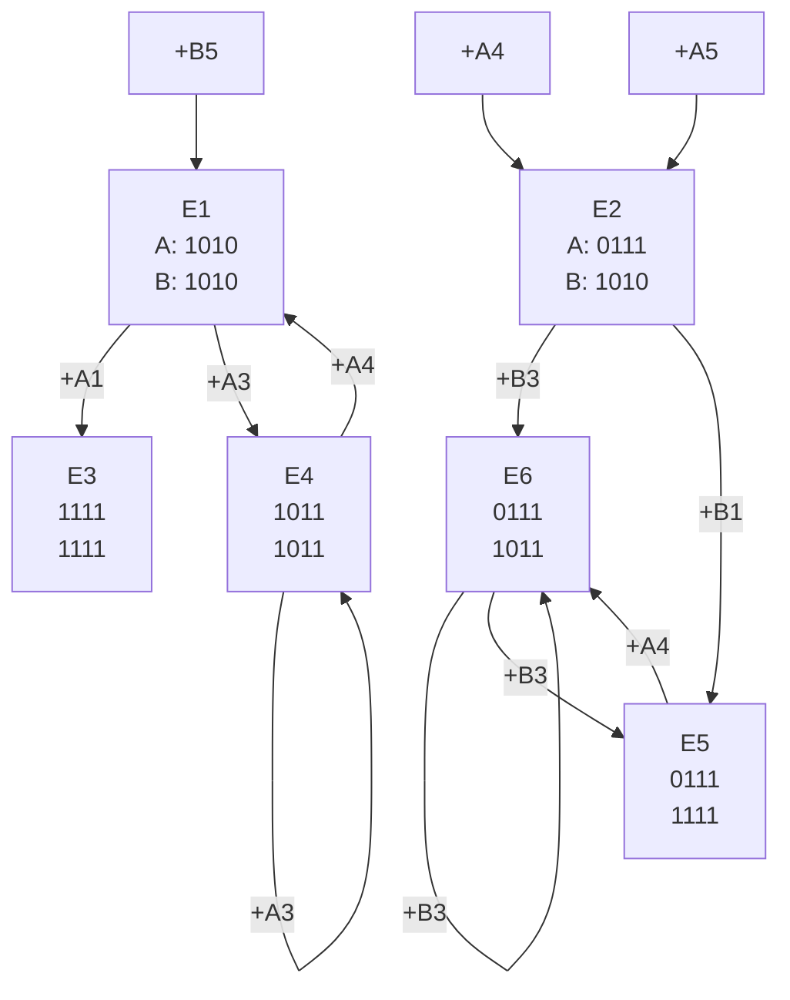

# Examen 2025 AC

1. Un algoritmo de procesamiento de imagenes **tarda 80 segundos en ejecutarse en un procesador.** Tras analizar el código se determina que:

+ El 70% del tiempo puede paralelizarse perfectamente

+ El 30% restante es secuencial y no puede paralelizarse

a) Si se usan **8 procesadores** para ejecutar la parte paralelizable ¿Cuál será el tiempo total de la ejecución del programa?

b) Calcule la ganancia (speedup) obtenida con 8 procesadores

c) Se está considerando aumentar a **32 procesadores** ¿Cuál sería la nueva ganancia? ¿Vale la pena cuadriplicar el número de procesadores?

d) ¿Cuál es la ganancia máximo teórico que se podría obtener con un número infinito de procesaodres? Explique que cómponente del código limita esta ganancia

----
> Resolución

* **Datos del problema**
* **Tiempo total de ejecución secuencial ($T_1$)**: $80\text{ segundos}$

* **Fracción paralelizable ($f$)**: $0.70$ (el $70\%$)

* **Fracción secuencial ($s$)**: $0.30$ (el $30\%$)

Calculamos primero unos cálculos auxiliares

Tiempo de la parte secuencial ($T_{\text{sec}}$) = $80 \times 0.30 = 24\text{ segundos}$
Tiempo de la parte paralelizable ($T_{\text{par}}$) = $80 \times 0.70 = 56\text{ segundos}$


a) Tiempo total de ejecución con 8 procesadores ($N = 8$)

> $$T_N = T_{\text{sec}} + \frac{T_{\text{par}}}{N}$$

$$T_8 = 24 + \frac{56}{8} = 24 + 7 = 31\text{ segundos}$$

b) Ganancia de velocidad (Speedup) con 8 procesadores

> $$S_N = \frac{T_1}{T_N}$$

$$S_8 = \frac{80}{31} \approx 2.58$$

La ganancia obtenida con $8$ procesadores es de $2.58\times$ (el programa se ejecuta $2.58$ veces más rápido)

c) Ganancia con 32 procesadores y evaluación del cambio

$$T_{32} = 24 + \frac{56}{32} = 24 + 1.75 = 25.75\text{ segundos}$$

$$S_{32} = \frac{80}{25.75} \approx 3.11$$

 La nueva ganancia con $32$ procesadores es de $3.11\times$. No vale la pena cuadriplicar los procesadores, ya que el rendimiento entra en un punto de retornos decrecientes pronunciados, desperdiciando hardware para lograr una mejora de tiempo insignificante


d) Ganancia máxima teórica con infinitos procesadores ($N \to \infty$)

> De acuerdo con la Ley de Amdahl, cuando el número de procesadores tiende a infinito, el tiempo de la parte paralelizable tiende a cero ($\frac{56}{\infty} \to 0$)

$$T_\infty = T_{\text{sec}} = 24\text{ segundos}$$

$$S_{\max} = \frac{T_1}{T_{\text{sec}}} = \frac{1}{s} = \frac{1}{0.30} = \frac{80}{24} \approx 3.33$$


----

2. Considere el siguiente código qeu se ejecuta en un procesador RISC-V con detección de riesgos de datos y adelantamientos. Las lecutras y escrituras en el banco de registros se realizan en mitades de ciclo diferentes

* **Unidades Funcionales**

    * ALU (resta, suma) : 1 ciclo de latencia

    * Multiplicación: 3 ciclos de latencia

    * Carga (Almacenamiento): 1 ciclo de latencia

a) Complete la tabla de ejecución para el siguiente código

```
(1) lw s0, 0(t0)
(2) lw s1, 4(t0)
(3) add a0, s0, s1
(4) mul a1, a0, s0
(5) addi t0, t0, 8
(6) lw s2, 0(t0)
(7) add a2, a1, s2
(8) sw a2, 0(t1)
```

b) Indique los adelantamientos por bypass que se producen

c) ¿hay algún registro que lea y escriba en el mismo ciclo?


> Resolución

| Instrucción | 1 | 2 | 3 | 4 | 5 | 6 | 7 | 8 | 9 | 10 | 11 | 12 | 13 | 14 |
|:---|:---:|:---:|:---:|:---:|:---:|:---:|:---:|:---:|:---:|:---:|:---:|:---:|:---:|:---:|
| (1) `lw s0, 0(t0)` | IF | ID | EX | MEM | WB | | | | | | | | | |
| (2) `lw s1, 4(t0)` | | IF | ID | EX | MEM | WB | | | | | | | | |
| (3) `add a0, s0, s1` | | | IF | ID | ST | EX* | MEM | WB | | | | | | |
| (4) `mul a1, a0, s0` | | | | IF | ST | ID | EX* | MEM | WB | | | | | |
| (5) `addi t0, t0, 8` | | | | | IF | ID | EX | MEM | WB | | | | | |
| (6) `lw s2, 0(t0)` | | | | | | IF | ID | EX* | MEM | WB | | | | |
| (7) `add a2, a1, s2` | | | | | | | IF | ST | EX* | MEM | WB | | | |
| (8) `sw a2, 0(t1)` | | | | | | | | ST | ID | EX* | MEM | WB | | |


**ST**: Ciclo de parada (Stall) provocado por riesgo de carga (Load-Use Hazard) en la etapa ID

**EX***: adelantamiento (forwarding) del dato


b) Indique los adelantamientos por bypass que se producen

1. **De (2) `lw` (MEM) a (3) `add` (EX):** Adelantamiento del dato `s1` tras el ciclo de parada (*stall*).

2. **De (3) `add` (EX) a (4) `mul` (EX):** Adelantamiento del resultado `a0` de la ALU.

3. **De (1) `lw` (WB) a (4) `mul` (EX):** Adelantamiento del dato `s0` desde la etapa WB (o lectura directa del banco de registros).

4. **De (5) `addi` (EX) a (6) `lw` (EX):** Adelantamiento de la nueva dirección `t0` calculada en la ALU.

5. **De (6) `lw` (MEM) a (7) `add` (EX):** Adelantamiento del dato `s2` cargado de memoria tras el ciclo de parada (*stall*).

6. **De (4) `mul` (WB) a (7) `add` (EX):** Adelantamiento del resultado `a1` hacia la ALU.

7. **De (7) `add` (EX/MEM) a (8) `sw` (MEM):** Adelantamiento del dato `a2` para escribirlo en memoria.

c) ¿hay algún registro que lea y escriba en el mismo ciclo?

En los cauces estándar (escritura en la primera mitad del ciclo y lectura en la segunda mitad):

1. **Registro `s0` en el ciclo 5:** Se escribe desde (1) `lw` (etapa WB) en la primera mitad del ciclo y se lee para (3) `add` / (4) `mul` (etapa ID) en la segunda mitad.

2. **Registro `a0` en el ciclo 8:** Se escribe desde (3) `add` (WB) y se lee en la decodificación de instrucciones posteriores.

3. **Registro `t0` en el ciclo 9:** Se escribe desde (5) `addi` (WB) en la primera mitad del ciclo.

----

3. Se tiene un procesador superescalar con emisión desordenada y retirada ordenada con las siguientes características:

- **Captación:** 2 instrucciones/ciclo.
- **Descodificación:** 2 instrucciones/ciclo.
- **Emisión:** 2 instrucciones/ciclo.
- **Escritura:** 2 resultados/ciclo en el ROB.
- **Retirada:** 2 instrucciones/ciclo.

## Unidades funcionales (CON LIMITACIONES)

- 1 UF de carga para entero (2 ciclos) — CAMBIO.
- 1 UF de carga para flotantes (2 ciclos) — CAMBIO.
- 1 UF de almacenamiento de flotantes (1 ciclo).
- 1 ALU entera (1 ciclo) — CAMBIO: solo 1.
- 1 Multiplicador para coma flotante (4 ciclos) — CAMBIO.

## Código

```asm
(1) lw  x1, 0(x10)
(2) lw  x2, 4(x10)
(3) flw f0, 0(x11)
(4) flw f1, 4(x11)
(5) add x3, x1, x2
(6) fmul f2, f0, f1
(7) addi x10, x10, 8
(8) fsd f2, 0(x12)
```

| Instrucción | IF | ID/IS | EX | ROB (WB) | RET (Commit) |
|:---|:---:|:---:|:---:|:---:|:---:|
| (1) `lw x1, 0(x10)` | 1 | 2 | 3–4 | 5 | 6 |
| (2) `lw x2, 4(x10)` | 1 | 2 | 5–6 | 6 | 7* |
| (3) `flw f0, 0(x11)` | 2 | 3 | 4–5 | 6 | 7 |
| (4) `flw f1, 4(x11)` | 2 | 3 | 6–7 | 7 | 8* |
| (5) `add x3, x1, x2` | 3 | 4 | 7 | 8 | 9 |
| (6) `fmul f2, f0, f1` | 3 | 4 | 8–11 | 12 | 12 |
| (7) `addi x10, x10, 8` | 4 | 5 | 6 | 7 | 12* |
| (8) `fsd f2, 0(x12)` | 4 | 5 | 12 | 13 | 13 |

> Nota: Las instrucciones marcadas se retiran en el mismo ciclo que su pareja debido al ancho de retirada de 2 inst/ciclo

---
4. Tenemos un cauce multifuncional que ejecuta dos operaciones que ocupan las etapas según las siguientes secuencias:

- **Operación A:** S₁, S₂, S₃, S₄.
- **Operación B:** S₁, S₃, S₂, S₄.

Se pide:

**a)** Construya las tablas de reserva para ambas operaciones.

**b)** Determine los conjuntos de latencias prohibidas:
- $F_{AA}$
- $F_{BB}$
- $F_{AB}$
- $F_{BA}$

Para las operaciones A y B, considerando tanto la repetición de una misma operación como la ejecución de una operación seguida de la otra.

**c)** Obtenga las matrices de colisiones cruzadas correspondientes.

**d)** Dibuje el diagrama de transiciones con las operaciones y las latencias.

**e)** Determine la mejor secuencia de ejecución:

`ABABABABABA`

> Resolución

| | 0 | 1 | 2 | 3 | 4 | 5 | 
|  -- | -- | -- | -- | -- | -- | -- | 
| **S1** | AB | | B  | | A
| **S2** | | | A | B
| **S3** | | A | | A | B  
| **S4** | | B | | | | AB

- $F_{AA}$ = {2,4}
- $F_{BB}$ = {2,4}
- $F_{AB}$ = {1 ,2 ,3}
- $F_{BA}$ = {2,4}



