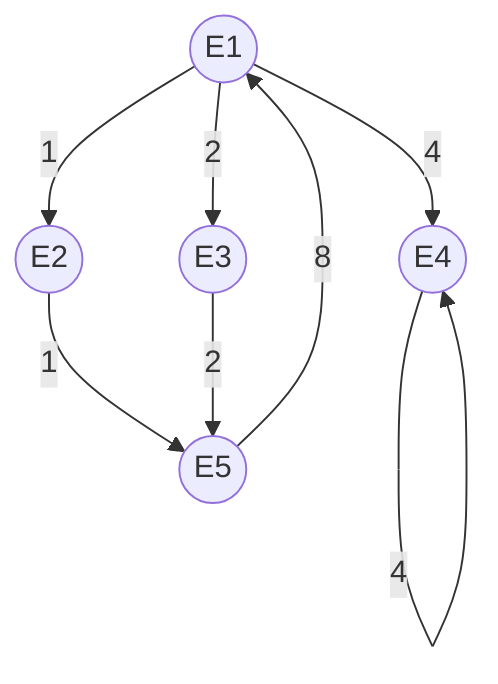

# Examen 2022 (Enero) AC

1. Dadas las etapas de una unidad funcional segmentada 

`S1,S2,S3,S4 y S5` , que se utilizan en el siguiente orden:

`S1,S3,S5,S1,S3,S4,S1,S3,S2,S5,S4,S2`

Se pide determinar el vector de colisión y los estados que se producen después de tener la unidad funcional vacía e insertar una operación en los ciclos indicados

> Resolución

| Etapa / Ciclo | 1 | 2 | 3 | 4 | 5 | 6 | 7 | 8 | 9 | 10 | 11 | 12 |
|:---:|:---:|:---:|:---:|:---:|:---:|:---:|:---:|:---:|:---:|:---:|:---:|:---:|
| S1 | X | | X | | X | | X | | | | | |
| S2 | | | | | | | | X | | X | | X |
| S3 | | X | | X | | X | | | X | | | |
| S4 | | | | | | | X | | | | X | |
| S5 | | | X | | | | | | | X | | |

El vector de colisión se obtiene a partir de las latencias prohibidas entre las utilizaciones de una misma etapa.

\[
F = \{3,5,6,7\}
\]

\[
P = \{1,2,4\}
\]

Por tanto, el vector de colisión es:

\[
\boxed{C=(1,1,1,0,1,0,0)}
\]

Donde:
- `1`: latencia prohibida.
- `0`: latencia permitida.

El estado inicial coincide con el vector de colisión:

\[
E_1=(1110100)
\]

Para calcular los estados siguientes se realiza la operación OR entre el vector de estado y el vector correspondiente a la latencia seleccionada.

**Estado inicial:**

\[
E_1=(1110100)
\]

**Desde E1:**

- Latencia 1:

\[
(0001010)\ OR\ (1110100)=(1111110)=E_2
\]

- Latencia 2:

\[
(0001101)\ OR\ (1110100)=(1111101)=E_3
\]

- Latencia 4:

\[
(0000111)\ OR\ (1110100)=(1110111)=E_4
\]

**Desde E2:**

\[
(0001010)\ OR\ (1111110)=(1111110)
\]

**Desde E3:**

\[
(0001111)\ OR\ (1111101)=(1111111)=E_5
\]

**Desde E4:**

\[
(0000111)\ OR\ (1110111)=(1110111)=E_4
\]

**Desde E5:**

\[
(1111111)
\]

**Latencia 8:**

\[
(1110100)\ OR\ (0000000)=(1110100)=E_1
\]

----

2. Considere el fragmento de código que aparece en la tabla, que se ejecuta en un procesador segmentado con las siguientes etapas:

- **IF (Instruction Fetch):** captación de instrucciones.
- **ID (Instruction Decode):** decodificación de instrucciones y captación de operandos.
- **EX (Execute):** ejecución de la instrucción.
- **MEM (Memory):** acceso a memoria.
- **WB (Write Back):** almacenamiento de resultados en el banco de registros.

En la etapa de ejecución (EX) se dispone de las siguientes unidades funcionales:

- Una unidad funcional para sumas, restas y operaciones lógicas de enteros, con una latencia de **1 ciclo**.
- Una unidad funcional para la suma en punto flotante, con una latencia de **3 ciclos**.
- Una unidad funcional para la multiplicación en punto flotante, con una latencia de **3 ciclos**.

Además, se cumplen las siguientes condiciones:

- Por razones de eficiencia, las lecturas de operandos en el banco de registros se realizan en mitades de ciclos diferentes.
- Se consideran caminos de bypass (forwarding), que permiten el paso directo de resultados.

## Código del programa

| N.º | Instrucción |
|:---:|:---|
| 1 | `lf f1, 0(r7)` |
| 2 | `lf f3, 4(r7)` |
| 3 | `addf f4, f1, f3` |
| 4 | `multf f7, f1, f3` |
| 5 | `addf r7, r7, #8` |
| 6 | `sf 0(r8), f4` |
| 7 | `sf 4(r8), f7` |
| 8 | `sub r8, r8, #8` |
| 9 | `bnez r8, ini` |

> Resolución

| Concepto | Resultado |
|:---|:---:|
| Ciclos en ejecutarse el programa | **48** |
| Número de adelantamientos | **4** |
| Número de riesgos estructurales | **7** |

| Instrucción | 1 | 2 | 3 | 4 | 5 | 6 | 7 | 8 | 9 | 10 | 11 | 12 | 13 | 14 | 15 | 16 | 17 | 18 | 19 | 20 | 21 | 22 |
|:---|:---:|:---:|:---:|:---:|:---:|:---:|:---:|:---:|:---:|:---:|:---:|:---:|:---:|:---:|:---:|:---:|:---:|:---:|:---:|:---:|:---:|:---:|
| (1) `lf f1, 0(r7)` | IF | ID | EX | MEM | WB | | | | | | | | | | | | | | | | | |
| (2) `lf f3, 4(r7)` | | IF | ID | EX | MEM | WB | | | | | | | | | | | | | | | | |
| (3) `addf f4, f1, f3` | | | IF | ID | | | EX | EX | EX | MEM | WB | | | | | | | | | | | |
| (4) `multf f7, f1, f3` | | | | IF | ID | | EX | EX | EX | MEM | WB | | | | | | | | | | | |
| (5) `addi r7, r7, #8` | | | | | IF | ID | EX | MEM | WB | | | | | | | | | | | | | |
| (6) `sf 0(r8), f4` | | | | | | IF | ID | | | | EX | MEM | | | | | | | | | | |
| (7) `sf 4(r8), f7` | | | | | | | IF | ID | | | | EX | MEM | | | | | | | | | |
| (8) `sub r8, r8, #8` | | | | | | | | IF | ID | EX | MEM | WB | | | | | | | | | | |
| (9) `bnez r8, ini` | | | | | | | | | IF | ID | EX | | | | | | | | | | | |

---
4. Considere que el fragmento de código de la tabla se ejecuta en un procesador superescalar que es capaz de:
* **Captar**: 5 instrucciones/ciclo.   
* **Decodificar:** 4 instrucciones/ciclo.   Emitir: 2 instrucciones/ciclo.   
* **Escribir:** hasta 3 resultados/ciclo en los registros correspondientes (registros de reorden, o registros de la arquitectura, según el caso).   
* **Completar (o retirar)**: hasta 2 instrucciones/ciclo.   

**Unidades Funcionales (Latencia en ciclos)**
* 2 Unidades de Carga para enteros: 2 ciclos.   
* 1 Unidad de Carga para flotantes: 2 ciclos.   
* 1 Unidad de Almacenamiento: 1 ciclo.   2 ALUs enteras: 1 ciclo.   
* 1 Sumador para coma flotante: 3 ciclos.   
* 1 Multiplicador para coma flotante: 4 ciclos.   
* 1 División en coma flotante: 6 ciclos.

(No hay limitaciones para el número de líneas de la cola de instrucciones, ventana de instrucciones, buffer de reorden, puertos de lectura/escritura, etc.)   

**Tabla auxiliar**

| Instrucción | IF | ID/ISS | EX | ROB | WB |
| :-- | :-: | :-: | :-: | :-: | :-: |
| **`lw r3, n`** | | | | | |
| **`sub r2, r3, #2`** | | | | | |
| **`lw r4, x(r2)`** | | | | | |
| **`lf f1, y(r2)`** | | | | | |
| **`divf f2, f0, f1`** | | | | | |
| **`sf (r2), f2`** | | | | | |
| **`multf f3, f2, f1`** | | | | | |
| **`sf (r2), f3`** | | | | | |
| **`addui r2, r2, #4`** | | | | | |
| **`sub r5, r4, r2`** | | | | | |
| **`bnez r2, init`** | | | | | |

> Resolución

| Instrucción | IF | ID/ISS | EX | ROB | WB |
| :-- | :-: | :-: | :-: | :-: | :-: |
| **`lw r3, n`** | 1 | 2 | 3-4 | 5 | 6 |
| **`sub r2, r3, #2`** | 1 | 2 | 5 | 6 | 7 |
| **`lw r4, x(r2)`** | 1 | 3 | 6-7 | 8 | 9 |
| **`lf f1, y(r2)`** | 1 | 3 | 6-7 | 8 | 9 |
| **`divf f2, f0, f1`** | 2 | 4 | 8-13 | 14 | 15 |
| **`sf (r2), f2`** | 2 | 4 | 14 | — | 15 |
| **`multf f3, f2, f1`** | 2 | 5 | 14-17 | 18 | 19 |
| **`sf (r2), f3`** | 2 | 5 | 18 | — | 19 |
| **`addui r2, r2, #4`** | 3 | 6 | 7 | 8 | 20 |
| **`sub r5, r4, r2`** | 3 | 6 | 9 | 10 | 20 |
| **`bnez r2, init`** | 3 | 7 | 10 | — | 21 |

----
5. Tenemos un procesador con un espacio de memoria de 32 bits y 16 KBytes de caché. El tamaño de los bloques de caché es de 32 bytes. Las palabras son de 32 bits. Responde a las siguientes cuestiones:   

    1. ¿Cuántos bloques de memoria pueden alojarse simultáneamente en la caché?   
    2. ¿Cuál sería la descomposición de las direcciones para acceder a memoria asumiendo que la caché es de correspondencia directa?   
    3. ¿Cuál sería la descomposición de las direcciones para acceder a memoria asumiendo que la caché es asociativa por conjuntos con cuatro planos? 

> Resolución

* Datos del problemaDirección de memoria: $32\text{ bits}$   
* Tamaño de la caché ($C$): $16\text{ KB} = 16 \times 2^{10}\text{ B} = 2^{14}\text{ Bytes}$   
* Tamaño de palabra ($TP$): $32\text{ bits} = 4\text{ Bytes}$   
* Tamaño de bloque ($TB$): $32\text{ Bytes} = 2^5\text{ Bytes}$  

**1. Número de bloques en caché ($NB$)**
$$NB = \frac{\text{Tamaño de Caché}}{\text{Tamaño de Bloque}} = \frac{2^{14}\text{ B}}{2^5\text{ B}} = 2^9 = 512\text{ bloques}$$

**2. Descomposición de la dirección para Caché de Correspondencia Directa**
Para una dirección de $32\text{ bits}$:

* **Bits de byte (desplazamiento en palabra):**
$$\text{Bytes por palabra} = \frac{32\text{ bits}}{8\text{ bits/byte}} = 4\text{ Bytes} = 2^2 \implies \mathbf{2\text{ bits}}$$

* **Bits de palabra (desplazamiento en bloque):**

$$\text{Palabras por bloque} = \frac{32\text{ Bytes}}{4\text{ Bytes/palabra}} = 8\text{ palabras} = 2^3 \implies \mathbf{3\text{ bits}}$$

* **Bits de bloque / línea (Índice):**
$$NB = 512 = 2^9 \implies \mathbf{9\text{ bits}}$$

* **Bits de etiqueta / marca ($Tag$):**
$$\text{Bits Totales} - (\text{Byte} + \text{Palabra} + \text{Conjunto}) = 32 - (2 + 3 + 7) = 32 - 12 = \mathbf{20\text{ bits}}$$

