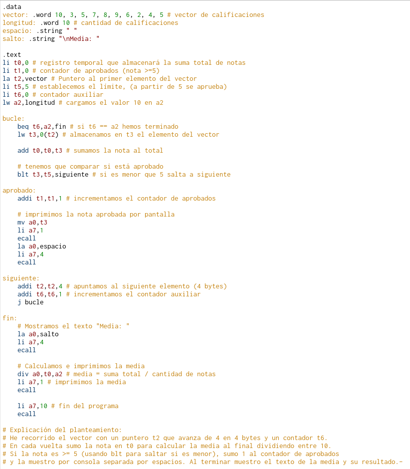
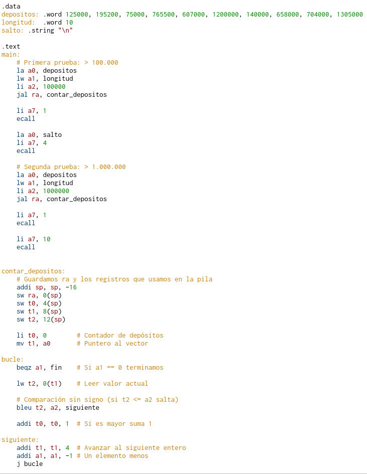
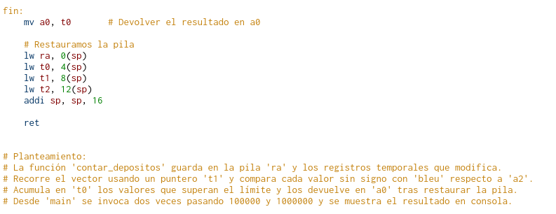

# Examen de la práctica 2 del año pasado y ejercicios similares

## Ejercicio 1 – 4/10 puntos - Eje1.s
Escribe un programa ajustado a las siguientes directivas:

* Se tiene **almacenado en memoria un vector** con el número de calificaciones *(entre $0$ y $10$)* que los estudiantes han obtenido en una asignatura. Los valores de dicho vector serán los siguientes: `10, 3, 5, 7, 8, 9, 6, 2, 4, 5`.

* El programa deberá calcular la **media de las calificaciones** en dicha asignatura, así como **cuántos de ellos superan dicha asignatura**, suponiendo que se aprueba con una calificación igual o mayor que $5$. **Las calificaciones aprobadas se mostrarán por consola.**

## Ejercicio 2 – 6/10 puntos - Eje2.s
Escribe un programa ajustado a las siguientes directivas:

* Se tiene **almacenado en memoria un vector** con la capacidad en litros que contienen varios depósitos, valores que nunca pueden ser negativos. Los valores en dicho vector serán los siguientes: 

`125000, 195200, 75000, 765500, 607000, 1200000, 140000, 658000, 704000, 1305000`.

* Escribe una función que tome como entrada los siguientes argumentos y que **devuelva en `a0`** el número de depósitos que pueden contener dicha capacidad:

* `a0` – La dirección donde comienzan el vector con las capacidades en litros.

* `a1` – El número de depósitos que tiene el vector de capacidades en litros.

* `a2` – La capacidad en litros a partir de la cual se quiere contar el número de depósitos.

* La función deberá **guardar en la pila la dirección de retorno** (registro `ra`) y **cualquier otro registro que modifique**, recuperándolos antes de volver. Al hacer comparaciones debe tenerse presente que **son palabras de 32 bits sin signo** .

* Desde el cuerpo principal del programa, llama a la anterior función dos veces para contar los satélites que distan más de $100\,000$ y $1\,000\,000$ de kilómetros, mostrando por la consola ambos resultados.


## Resolución del Examen

> Se admiten soluciones alternativas 
### Ejercicio 1



Resultado esperado: 

```
10 5 7 8 9 6 5 
Media: 5
```

### Ejercicio 2




``` Resultado esperado
9
2
```

## Ejercicios parecidos

## Ejercicio 1 – Estructura tipo Bucle / Filtrado Directo
Escribe un programa en ensamblador RISC-V ajustado a las siguientes directivas:
* Se tiene **almacenado en memoria** un vector con las temperaturas (en grados Celsius, valores enteros que pueden ser positivos o negativos) registradas en una estación meteorológica a lo largo de 10 días: `-3, 12, 8, 0, 15, -1, 22, 18, 5, 11`.

* El programa deberá **calcular la temperatura media del periodo, así como contar cuántos días se registraron temperaturas sobre cero ($> 0$)**. Las temperaturas positivas se **mostrarán por consola**.

* Agrega un comentario al inicio del programa con vuestros nombres y un comentario al final donde expliquéis brevemente el planteamiento o la estrategia general seguida.

```asm

.data
vector: .word -3,12,8,0,15,-1,22,18,5,11
espacio: .string " "
salto: .string "\n"

.text
la t0, vector  # cargamos la dirección del vector en t0
li t1, 10      # cargamos el tamaño en t1
li t2, 0       # queremos las temperaturas mayores que 0
li t4, 0       # contador de elementos con temperatura mayor que 0
li t5, 0       # acumulador para la suma total (media)

bucle:
    beqz t1, fin
    lw t3, 0(t0)        # leemos la temperatura actual
    add t5, t5, t3      # acumulamos para la media
    ble t3, t2, menor   # si la temperatura es <= 0 no es positiva

mayor:
    addi t4, t4, 1      # sumamos al contador de temperaturas > 0
    li a7, 1
    mv a0, t3           # mostramos la temperatura en pantalla
    ecall
    la a0, espacio
    li a7, 4
    ecall

menor:
    addi t0, t0, 4      # apuntamos a la siguiente dirección
    addi t1, t1, -1
    j bucle

fin:
    # Imprimir salto de línea
    la a0, salto
    li a7, 4
    ecall

    # Imprimir la media (suma total / 10)
    li a6, 10
    div a0, t5, a6
    li a7, 1
    ecall

    li a7, 10
    ecall

```
## Ejercicio 2 – Estructura tipo Función / Pila / Comparación Sin Signo

Escribe un programa en ensamblador RISC-V ajustado a las siguientes directivas:

* Se tiene **almacenado en memoria** un vector con el saldo en cuentas bancarias (valores de 32 bits sin signo en euros): 
`4500, 120000, 8500, 310000, 950, 670000, 50000, 1500000, 2300, 890000`.

* Escribe una función que tome como entrada los siguientes argumentos y que devuelva en a0 el número de cuentas que superan un cierto saldo:

* `a0` – La dirección de memoria donde comienza el vector de saldos.

* `a1` – El número de cuentas contenidas en el vector.

* `a2` – El umbral de saldo a partir del cual se quiere realizar el recuento.

La función deberá guardar en la pila la dirección de retorno (ra) y los registros que modifique, recuperándolos antes de volver (ret). Las comparaciones deben realizarse considerando que son palabras de 32 bits sin signo.

Desde el cuerpo principal del programa (main), llama a la función dos veces para contar las cuentas con más de 100.000 € y con más de 500.000 €, mostrando ambos resultados por consola.

Agrega los comentarios de inicio y explicación final correspondientes.

```asm
.data
saldo: .word 4500, 120000, 8500, 310000, 950, 670000, 50000, 1500000, 2300, 890000
salto: .string "\n"

.text
main:
la a0,saldo # cargamos la dirección de memoria donde comienza en a
li a1,10 # número de cuentas
li a2,100000 # humbral del recuento

jal ra, cuentas
li a7,1
ecall

la a0,salto
li a7,4
ecall

la a0,saldo
li a1,10
li a2,500000
jal ra, cuentas

li a7,1
ecall

li a7,10
ecall

cuentas:
    addi sp,sp,-16 # almacenamos 4 lugares en la pila
    sw ra,0(sp)
    sw t0,4(sp)
    sw t1,8(sp)
    sw t2,12(sp)
    
    li t0,0 # contador de veces que se supera dicho saldo
    mv t1,a0 # puntero 
    
bucle2:
    beqz a1,fin2
    lw t2,0(t1) # lee la primera posición del vector
    bleu t2,a2,siguiente
    addi t0,t0,1
    
siguiente:
    addi t1,t1,4
    addi a1,a1,-1
    j bucle2
fin2:
    mv a0,t0 # devuelve el resultado a a0
    
    lw ra,0(sp)
    lw t0,4(sp)
    lw t1,8(sp)
    lw t2,12(sp)
    addi sp,sp,16
    
    ret

```
## Ejercicio 3 – Mezcla Examen (Procesamiento de Stock)
Escribe un programa en ensamblador RISC-V ajustado a las siguientes directivas:

Se tiene almacenado en memoria un vector con las unidades de stock de varios productos de un almacén (palabras de 32 bits sin signo): 
`50, 1200, 0, 850, 3400, 12, 9500, 430, 2100, 6000`.

Escribe una función que reciba en `a0` la dirección del vector, en a1 la cantidad de productos y en `a2` el stock mínimo de seguridad. La función debe devolver en `a0` cuántos productos están en riesgo por tener un stock estrictamente menor que dicho valor mínimo.

La función debe ser segura con el uso de la pila (`sp, ra y registros modificados`) y usar comparaciones sin signo (`bltu/bleu`).

Desde `main`, invoca la función dos veces comprobando los límites de `100` unidades y `1.000` unidades, imprimiendo ambos conteos por pantalla.

Incluye los comentarios explicativos exigidos.


```asm
.data
vector2: .word 50,1200,0,850,3400,12,9500,430,2100,6000
salto: .string "\n"

.text
main:
    # Primera llamada (límite 100)
    la a0,vector2
    li a1,10
    li a2,100
    jal ra,vectorS
    
    li a7,1
    ecall

    la a0,salto
    li a7,4
    ecall

    # Segunda llamada (límite 1000)
    la a0,vector2
    li a1,10
    li a2,1000
    jal ra,vectorS

    li a7,1
    ecall

    li a7,10
    ecall

vectorS:
    addi sp,sp,-16
    sw ra,0(sp)
    sw t0,4(sp)
    sw t1,8(sp)
    sw t2,12(sp)
    
    li t0,0 # contador
    mv t1,a0 

bucle3:
    beqz a1,fin3
    lw t2,0(t1)              # leemos el stock actual del vector
    bgeu t2,a2,siguiente3    # si es >= límite, NO está en riesgo (saltamos)
    addi t0,t0,1             # si es estrictamente menor (<), sumamos 1
    
siguiente3:
    addi t1,t1,4
    addi a1,a1,-1
    j bucle3
    
fin3: 
    mv a0,t0
    
    lw ra,0(sp)
    lw t0,4(sp)
    lw t1,8(sp)
    lw t2,12(sp)
    addi sp,sp,16
    
    ret
```

## EJ 4:Procesamiento de Sensores e Sensores Máscara de Bits
Escribe un programa en ensamblador RISC-V ajustado a las siguientes directivas:

Se tiene almacenado en memoria un vector de 10 palabras de 32 bits (word) que representan lecturas brutas codificadas de unos sensores de calibración. Los valores del vector serán:

`0x12F0, 0x00A3, 0x5104, 0x001F, 0x03E8, 0x7FFF, 0x0005, 0x1000, 0x00FE, 0x2040`

El programa debe recorrer el vector y realizar el siguiente procesamiento:

* **Filtrado por paridad:** Identificar cuántos valores son pares y cuántos son impares (puedes comprobar el bit menos significativo con una operación lógica bit a bit and / andi).

* **Transformación:** Calcular un nuevo valor para cada elemento shifteándolo 2 posiciones a la derecha de forma lógica (srl / srli) y acumulando la suma total de estos nuevos valores transformados.

* **Impresión**: Mostrar por consola únicamente aquellos valores del vector original cuyo bit 0 sea 1 (es decir, los números impares).

```asm
# Ejercicio 4
.data
vector: .word 0x12F0, 0x00A3, 0x5104, 0x001F, 0x03E8, 0x7FFF, 0x0005, 0x1000, 0x00FE, 0x2040
tam: .word 10
espacio:.string " "

.text
main:
    la t0, vector       # t0 = dirección base del vector
    lw t1, tam          # t1 = tamaño del vector (10)
    
    li t2, 0            # t2 = índice 
    li s0, 0            # s0 = contador de pares
    li s1, 0            # s1 = contador de impares
    li s2, 0            # s2 = suma total de los valores transformados
bucle:
    beq t2, t1, fin
    lw t3, 0(t0) # cargamos el primer valor
    srli t4, t3, 2 # desplazamos a la derecha dos posiciones
    add s2,s2,t4
    
    andi t4,t3,1
    beq t4,zero,par
    
    addi s1,s1,1 
    mv a0,t3
    li a7,34
    ecall
    
    la a0,espacio
    li a7,4
    ecall
    
    j siguiente
    
par:
    addi s0,s0,1
    
siguiente:
    addi t0,t0,4
    addi t2,t2,1
    j bucle
    
fin: 
    li a7,10
    ecall
```

## Ej 5: Control de Inventario y Subrutinas
Se tiene almacenado en memoria un vector de 32 bits sin signo (word) con el precio en céntimos de varios artículos de una tienda. Los valores del vector serán:

4500, 12000, 350, 89000, 1500, 450000, 2300, 6700, 125000, 990

Escribe una función llamada contar_rango que reciba los siguientes argumentos de entrada:

a0: Dirección base del vector en memoria.
a1: Número total de elementos del vector.
a2: Precio mínimo del rango (min).
a3: Precio máximo del rango (max).
La función debe devolver en a0 la cantidad de artículos cuyos precios estén dentro del rango inclusivo [min, max], es decir:

min <= precio <= max

Requisitos de la función
Debe guardar en la pila el registro de retorno (ra) y todos los registros guardados o temporales que modifique, restaurándolos adecuadamente antes de retornar con ret.
Debe realizar las comparaciones considerando los datos como enteros de 32 bits sin signo, utilizando instrucciones como bltu, bgeu, etc.
Desde el programa principal (main), llama a la función contar_rango dos veces con los siguientes intervalos y muestra el resultado de cada llamada por consola:

Artículos con precio entre 1.000 y 10.000 céntimos.
Artículos con precio entre 50.000 y 500.000 céntimos.


```asm
# Ejercicio 5
.data
vector: .word 4500, 12000, 350, 89000, 1500, 450000, 2300, 6700, 125000, 990

.text
main:
    # Primera llamada
    la a0, vector
    li a1, 10
    li a2, 1000
    li a3, 10000 

    jal ra, contar_rango
    li a7, 1
    ecall
    
    # Segunda llamada
    la a0, vector
    li a1, 10
    li a2, 50000
    li a3, 500000 

    jal ra, contar_rango
    li a7, 1
    ecall

    li a7, 10
    ecall

contar_rango:
    addi sp, sp, -16
    sw ra, 0(sp)
    sw t0, 4(sp)
    sw t1, 8(sp)
    sw t2, 12(sp)
    
    li t0, 0 # contador de elementos
    mv t1, a0 
    
bucle:
    beqz a1, fin
    lw t2, 0(t1) # primer elemento del vector
    bgeu t2, a2, mayor # si t2 >= a2 (sin signo) salta a mayor
    j siguiente
    
mayor:
    bgtu t2, a3, siguiente # si t2 > a3 no vale, salta a siguiente
    addi t0, t0, 1 # incrementamos el contador de elementos
    j siguiente
    
siguiente:
    addi t1, t1, 4
    addi a1, a1, -1
    j bucle

fin:
    mv a0, t0 # pasamos el contador al registro de retorno a0
    lw ra, 0(sp)
    lw t0, 4(sp)
    lw t1, 8(sp)
    lw t2, 12(sp)
    addi sp, sp, 16
    ret
```

## Ej 6: Filtrado e Incremento en Subrutina 
Se tiene almacenado en memoria un vector de 32 bits sin signo (word) con el número de pulsaciones registradas por varios sensores industriales:

120, 45, 0, 890, 300, 15, 0, 420, 60, 0

Escribe una función llamada actualizar_y_contar que reciba los siguientes argumentos de entrada:

a0: Dirección base del vector en memoria.
a1: Número total de elementos del vector.
a2: Valor umbral mínimo (umbral).
La función debe recorrer el vector y realizar dos tareas:

Para cada elemento que sea estrictamente mayor que el umbral (> umbral), debe sumarle 10 directamente en la memoria.
Contar cuántos elementos del vector eran iguales a cero (= 0).
La función debe devolver en a0 el total de elementos que eran iguales a cero.

Requisitos de la función
Debe guardar en la pila el registro de retorno (ra) y todos los registros temporales o guardados que modifique dentro de la función, restaurándolos antes de salir con ret.
Las comparaciones deben hacerse considerando datos de 32 bits sin signo, utilizando instrucciones como bgeu, bltu, etc.
Desde la función principal (main), llama a actualizar_y_contar dos veces con los siguientes umbrales y muestra el resultado de cada llamada (cantidad de ceros) por consola:

Umbral = 50
Umbral = 200

```asm
.data
vector: .word 120, 45, 0, 890, 300, 15, 0, 420, 60, 0

.text
main:
    # Primera llamada (umbral 50)
    la a0, vector
    li a1, 10
    li a2, 50
    
    jal ra, actualizar_y_contar
    li a7, 1
    ecall
    
    # Segunda llamada (umbral 200)
    la a0, vector
    li a1, 10
    li a2, 200
    jal ra, actualizar_y_contar
    li a7, 1
    ecall
    
    li a7, 10
    ecall
    
actualizar_y_contar:
    addi sp, sp, -20
    sw ra, 0(sp)
    sw t0, 4(sp)
    sw t1, 8(sp)
    sw t2, 12(sp)
    sw t3, 16(sp)
    
    li t0, 0 # contador de elementos procesados
    li t2, 0 # contador de ceros
    mv t1, a0

bucle:
    beq t0, a1, fin # si t0 == a1, termina el bucle
    lw t3, 0(t1) # cargamos el elemento actual
    bgtu t3, a2, supera # estrictamente mayor (> umbral)
    beqz t3, cero
    j siguiente

supera:
    addi t3, t3, 10
    sw t3, 0(t1) # guardamos el valor modificado en memoria
    j siguiente

cero:
    addi t2, t2, 1
    j siguiente
    
siguiente:
    addi t1, t1, 4 # avanza puntero de memoria (4 bytes)
    addi t0, t0, 1 # incrementa contador de elementos (1 en 1)
    j bucle

fin: 
    mv a0, t2 # cargamos el total de ceros en a0 para devolverlo

    lw ra, 0(sp)
    lw t0, 4(sp)
    lw t1, 8(sp)
    lw t2, 12(sp)
    lw t3, 16(sp)
    addi sp, sp, 20
    ret
```

## Ej 7:
Se tiene almacenado en memoria un vector de 32 bits sin signo (word) que representa el stock de productos en varios estantes de un almacén. Los valores del vector serán:

`150, 0, 85, 200, 12, 0, 45, 300, 95, 10`

Escribe una función llamada procesar_stock que reciba los siguientes argumentos de entrada:

`a0`: Dirección base del vector en memoria.
`a1`: Número total de elementos del vector.
`a2`: Límite de reabastecimiento (reorder_point).
La función debe recorrer el vector y realizar dos operaciones:

* Contar cuántos estantes tienen un stock estrictamente menor que el límite de reabastecimiento (< reorder_point).
Si un estante tiene un stock igual a cero (= 0), debe reabastecerse automáticamente escribiendo el valor 50 directamente en esa posición de memoria del vector.
La función debe devolver en a0 el número total de estantes que necesitaban reabastecimiento (los que tenían un stock menor que reorder_point).

* **Requisitos de la función**
Debe guardar en la pila el registro de retorno (ra) y todos los registros que modifique (temporales o guardados), restaurándolos antes de retornar con ret.
Debe realizar las comparaciones considerando los datos como enteros de 32 bits sin signo, utilizando instrucciones como bltu, bgeu, etc.
Desde el programa principal (main), llama a la función procesar_stock dos veces con los siguientes puntos de reabastecimiento y muestra el resultado de cada llamada por consola:

* Punto de reabastecimiento = 50
* Punto de reabastecimiento = 100

```asm
.data
vector: .word 150, 0, 85, 200, 12, 0, 45, 300, 95, 10

.text
main:
    # Primera llamada (umbral 50)
    la a0, vector
    li a1, 10
    li a2, 50
    jal ra, procesar_stock
    li a7, 1
    ecall
    
    # Segunda llamada (umbral 100)
    la a0, vector
    li a1, 10
    li a2, 100
    jal ra, procesar_stock
    li a7, 1
    ecall
    
    li a7, 10
    ecall
    
procesar_stock:
    addi sp, sp, -24
    sw ra, 0(sp)
    sw t0, 4(sp)
    sw t1, 8(sp)
    sw t2, 12(sp)
    sw t3, 16(sp)
    sw t4, 20(sp)
    
    li t0, 0 # índice
    li t4, 0 # contador de elementos < umbral
    mv t2, a0 # t2 = puntero a la dirección del vector

bucle:
    beq t0, a1, fin # si t0 == a1 (llegó a 10), salimos a fin
    lw t3, 0(t2) # cargamos elemento en t3
    
    # Comprobar si es igual a cero para reabastecer
    beqz t3, es0
    j comprobar_menor

es0:
    li t1, 50 # cargamos el valor 50 en t1
    sw t1, 0(t2) # escribimos 50 en la memoria del vector

comprobar_menor:
    # Comprobar si el valor original era menor que el umbral (a2)
    bltu t3, a2, menor
    j siguiente

menor:
    addi t4, t4, 1 # incrementamos contador de elementos menores
    j siguiente

siguiente:
    addi t2, t2, 4 # avanzamos puntero en memoria (4 bytes)
    addi t0, t0, 1 # incrementamos índice (1 en 1)
    j bucle

fin:
    mv a0, t4 # cargamos la cantidad de menores en a0 para devolverlo

    lw ra, 0(sp)
    lw t0, 4(sp)
    lw t1, 8(sp)
    lw t2, 12(sp)
    lw t3, 16(sp)
    lw t4, 20(sp) # restaurar t4
    addi sp, sp, 24
    ret
```

## Ej 8: Control de Velocidad y Sanciones (Subrutina y Pila)
Se tiene almacenado en memoria un vector de 32 bits sin signo (word) con las velocidades en km/h registradas por un radar en un tramo de carretera:

`110, 85, 135, 120, 90, 145, 100, 125, 70, 150`

Escribe una función llamada detectar_infractores que reciba los siguientes argumentos de entrada:

`a0`: Dirección base del vector en memoria.
`a1`: Número total de elementos del vector.
`a2`: Límite de velocidad permitido (limite).
La función debe recorrer el vector y realizar dos operaciones:

* Contar cuántos vehículos han superado estrictamente el límite de velocidad (> limite).
Si un vehículo supera los 140 km/h (gran exceso de velocidad), se le aplica una sanción de prueba reduciendo su registro en memoria a 0 (simulando retirada de permiso).
La función debe devolver en a0 el número total de vehículos infractores (los que superaron el límite).

* Requisitos de la función
Debe guardar en la pila el registro de retorno (ra) y todos los registros temporales o guardados que modifique, restaurándolos adecuadamente antes de retornar con ret.
Debe realizar las comparaciones considerando los datos como enteros de 32 bits sin signo, utilizando instrucciones como bgtu, bgeu, etc.
Desde el programa principal (main), llama a la función detectar_infractores dos veces con los siguientes límites y muestra el resultado de cada llamada por consola:

Límite de velocidad = 100 km/h.
Límite de velocidad = 120 km/h.

```asm
.data
vector: .word 110, 85, 135, 120, 90, 145, 100, 125, 70, 150

.text
main: 
    # Primera llamada (límite 100)
    la a0, vector
    li a1, 10
    li a2, 100
    jal ra, detectar_infractores
    li a7, 1
    ecall
    
    # Segunda llamada (límite 120)
    la a0, vector
    li a1, 10
    li a2, 120
    jal ra, detectar_infractores
    li a7, 1
    ecall
    
    li a7, 10
    ecall

detectar_infractores:
    addi sp, sp, -20
    sw ra, 0(sp)
    sw t0, 4(sp)
    sw t1, 8(sp)
    sw t2, 12(sp)
    sw t3, 16(sp)

    li t0, 0 # índice 
    li t3, 0 # contador de infractores (> limite)
    mv t1, a0 # t1 = puntero a la dirección del vector

bucle:
    beq t0, a1, fin
    lw t2, 0(t1) # cargamos la velocidad actual
    
   # vemos si supera el límite
    li t4, 140
    bgtu t2, t4, sancion
    j comprobar_limite

sancion:
    sw zero, 0(t1) # ponemos a 0 la posición en memoria

comprobar_limite:
    # Comprobar si superaba el límite dado en a2 (> limite)
    bgtu t2, a2, es_infractor
    j siguiente

es_infractor:
    addi t3, t3, 1 # sumamos 1 al contador de infractores

siguiente:
    addi t1, t1, 4 # avanzamos en memoria
    addi t0, t0, 1 # incrementamos el índice
    j bucle
        
fin:
    mv a0, t3 # devolvemos el contador en a0

    lw ra, 0(sp)
    lw t0, 4(sp)
    lw t1, 8(sp)
    lw t2, 12(sp)
    lw t3, 16(sp) # restaurar t3 con lw
    addi sp, sp, 20
    ret
```