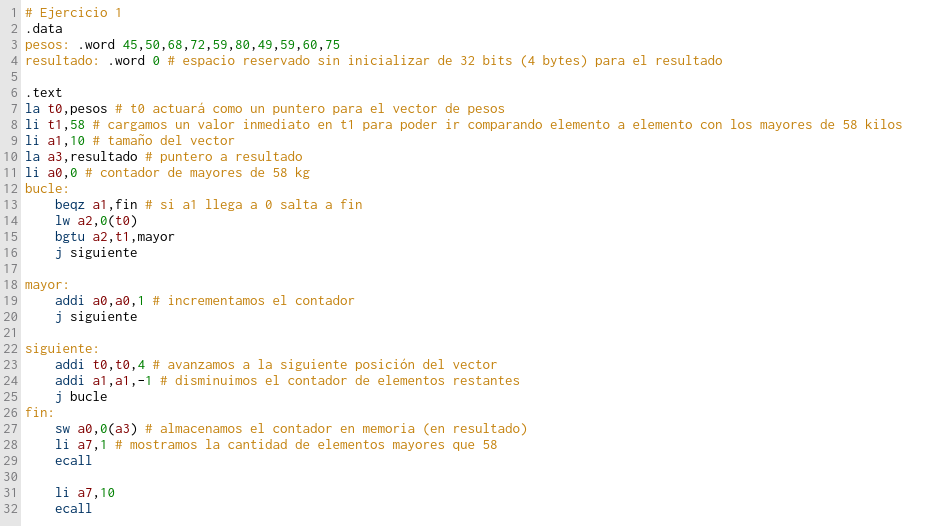
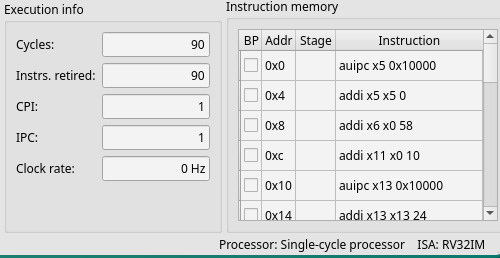
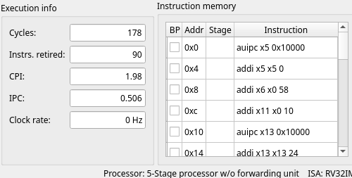
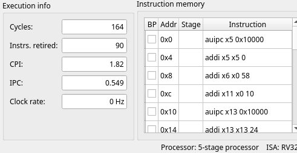
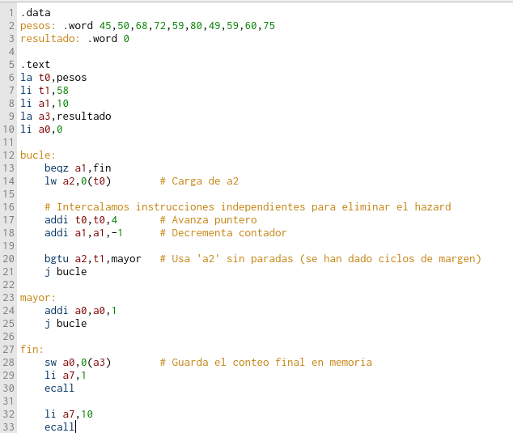
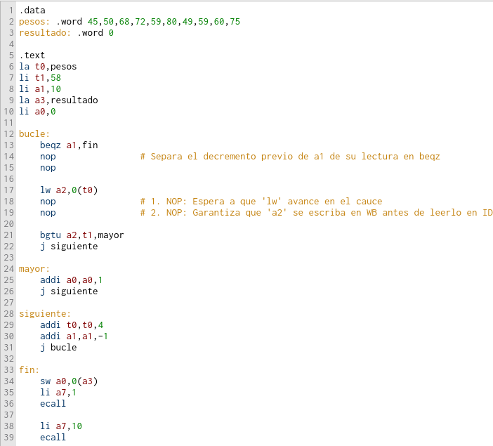

# Examen del Año pasado de la Práctica 3

## Ejercicio 1 – 2/10 puntos - Archivos Eje1.s y P3.pdf   

Escribe un programa ajustado a las siguientes directivas:   En el segmento de datos se tiene un conjunto de pesos de personas expresadas en kilos, almacenadas como números enteros de 32 bits:


El programa deberá contar **cuántos kilos son mayores que 58 kilos**, y el resultado **deberá almacenarse en memoria**, en un espacio reservado a tal efecto en el segmento de datos sin inicializar, como un número entero de 32 bits.   

Crea un documento y adjunta en él una captura de pantalla del panel Memory tras haber ejecutado el programa, en la que se vea el código en el editor y el conteo de espacios en la memoria.   



## Ejercicio 2 – 3/10 puntos - Archivo P3.pdf   

Ejecuta el programa del **ejercicio 1** en las **configuraciones de procesador Single-cycle processor (C1), 5-Stage processor w/o Forwarding unit (C2) y 5-stage processor (C3)** y anota en cada caso el **número de ciclos y CPI**.

Incluye en el documento creado antes una **tabla con los ciclos, CPI y mejora en rendimiento de cada una de las configuraciones**, calculando a partir de C1 una estimación de lo que se tardaría en un procesador sin cauce segmentado. 

Explica brevemente la fórmula que hayas empleado para hacer el cálculo de la mejora en rendimiento. Incluye una captura de pantalla de la ejecución en cada configuración en la que se aprecien los datos usados en la tabla.   

> Para cambiar la configuración del procesador tenemos que darle al icono que hay justo debajo de File 


> Resolución

**Si configuramos Single-cycle processor**



**Si configuramos 5-Stage processor w/o Forwarding unit**



**Si configuramos 5-Stage processor**




| Configuración de procesador | Ciclos | Instrucciones | CPI | Aceleración / Mejora respecto C1 | 
| -- | -- | -- | -- | -- |
| **C1: Single-cycle processor** | 90 | 90 | 1 | 1x | 
| **C2: 5-Stage processor w/o Forwarding** | 178 | 90 | 1,98 | 0,51x | 
| **C3: 5-Stage processor** (con Forwarding) | 164 | 90 | 1,82 | 0,55x | 

### Explicación y Formulas empleadas

1. Cálculo de la mejora en rendimiento (Speedup)La mejora en rendimiento o Speedup ($S$) de una configuración respecto a la base (C1 - Monociclo) se calcula dividiendo los ciclos del procesador base entre los ciclos del procesador evaluado (asumiendo que el periodo de reloj $T_{clk}$ se mantiene constante para la comparación teórica):

$$\text{Speedup} (S) = \frac{\text{Ciclos}_{C1}}{\text{Ciclos}_X}$$

Para C2 (5-Stage sin Forwarding):$$S_{C2} = \frac{90}{178} \approx 0,51\times$$

Para C3 (5-Stage con Forwarding):$$S_{C3} = \frac{90}{164} \approx 0,55\times$$

**2. Análisis de los resultados**

* **Monociclo (C1)**: Ejecuta exactamente 1 instrucción por ciclo ($\text{CPI} = 1,00$), requiriendo 90 ciclos para completar las 90 instrucciones.

---
* **Segmentado sin Forwarding (C2)**: Al no contar con unidad de reenvío de datos, el procesador debe introducir burbujas (stalls) cada vez que una instrucción necesita un dato producido por una instrucción anterior que aún no ha terminado. Además, los saltos introducen penalización por riesgo de control. Esto eleva el número total de ciclos a 178 ($\text{CPI} = 1,98$).

----
* **Segmentado con Forwarding (C3)**: La presencia de la unidad de reenvío (Forwarding unit) resuelve gran parte de las dependencias de datos directamente entre etapas del cauce sin tener que parar la ejecución. Esto reduce los ciclos totales a 164 ($\text{CPI} = 1,82$), logrando una ligera mejora respecto a C2.

## Ejercicio 3 – 3/10 puntos - Archivos Eje2.s y P3.pdf  

Inicia un nuevo programa en Ripes y copia en él el código del ejercicio 1. **Identifica las detenciones por riesgos de datos que detectes, usa las herramientas que necesites, y descríbelas de forma concisa en el documento**. 

A continuación, **reordena el código para evitar esos riesgos** y verifica que el resultado es correcto, examinando en el panel Memory el conteo de espacios. 

Incluye en el documento una captura de pantalla en la que se vean los ciclos y CPI de esta versión del programa con la configuración C2. Agrega una versión actualizada de la tabla creada en el ejercicio 2, en la que incluyas los datos de la versión reordenada y el cálculo de rendimiento.   

> Resolución

**Identificamos riesgos de datos en el código**

```asm
bucle:
    beqz a1,fin 
    lw a2,0(t0)        # 1. Carga a2 desde la memoria
    bgtu a2,t1,mayor   # 2. Usa a2 (Dependencia de datos RAW: Load-Use Hazard)
    j siguiente

mayor:
    addi a0,a0,1 
    j siguiente
    
siguiente:
    addi t0,t0,4       # 3. Modifica t0
    addi a1,a1,-1      # 4. Modifica a1
    j bucle            # 5. Salto al inicio (Riesgo de control)
```

* **Riesgo Load-Use:** Ocurre entre `lw a2,0(t0)` y `bgtu a2,t1,mayor`. En la configuración C2 (sin Forwarding), la instrucción bgtu intenta leer a2 antes de que lw escriba el dato en el banco de registros, insertando burbujas (stalls)

**Código reordenado**

Separamos la carga `lw` de la comparación `bgtu` intercalando el avance de puntero y el decremento del contador:



**Comparativa de rendimiento** 


| Configuración de procesador | Ciclos | Instrucciones | CPI | Aceleración / Mejora respecto C1 | 
| -- | -- | -- | -- | -- |
| **C1: Single-cycle processor** | 90 | 90 | 1 | 1x | 
| **C2: 5-Stage processor w/o Forwarding** | 178 | 90 | 1,98 | 0,51x | 
| **C3: 5-Stage processor** (con Forwarding) | 164 | 90 | 1,82 | 0,55x | 
| **C2: 5-Stage w/o Forwarding** (Reordenado) | 128 | 80 | 1,6 | 0,625x | 

## Ejercicio 4 – 2/10 puntos - Archivos Eje3.s y P3.pdf   

Parte del código de Eje2.s, **activa la configuración de CPU 5-stage processor w/o forwarding or hazard unit y ejecuta el programa**. Identifica en la vista del cauce segmentado de Ripes dónde hay riesgos de datos que produzcan un funcionamiento incorrecto del programa (si es que existen). En caso afirmativo introduce de forma manual, con la instrucción `nop`, las detenciones precisas para que el programa produzca un resultado correcto. Explica brevemente en el documento qué cambios has realizado y porqué.

 Si no has tenido que hacer cambio alguno, entrega como Eje3.s una copia del código que tenías en Eje2.s. 

 > Resolución

Al configurar la CPU en 5-stage processor w/o forwarding or hazard unit, el procesador no resuelve los riesgos de datos ni inserta burbujas (stalls) de forma automática. Si hay dependencias Read-After-Write (RAW), las instrucciones leen valores desactualizados del banco de registros, produciendo un funcionamiento incorrecto.


**Identificación de riesgos y solución con `nop`**

Tomando el código original del Ejercicio 1 (el de `Eje2.s`), un registro escrito en la etapa WB tarda 2 ciclos en estar disponible para ser leído en la etapa ID. Al no haber unidad de Hazards, debemos insertar instrucciones `nop` (No Operation) manualmente para separar los productores de los consumidores:



**Explicación**
**1. Riesgo Load-Use (lw $\rightarrow$ bgtu)**: La instrucción `lw a2, 0(t0)` escribe en a2 en la etapa WB. Sin unidad de reenvío ni de paradas, la instrucción bgtu leería un valor antiguo de a2. Se introducen 2 nop entre ambas para dar margen a que el dato se escriba en el banco de registros.

**2. Riesgo en el control del bucle (addi a1 $\rightarrow$ beqz a1)**: Al final de cada iteración se modifica a1. Para evitar que en la siguiente iteración beqz lea el valor desactualizado de a1, se añaden 2 `nop` tras la etiqueta `bucle:`


# Ejercicios Extras para prácticar

(Son del estilo que dijo Macarena que iba a caer en este examen)

## Ejercicio 1 (2/10 puntos) - Archivos Eje1.s y P3.pdf

Escribe un programa ajustado a las siguientes directivas:

En el segmento de datos se tiene un conjunto de calificaciones numéricas de alumnos (expresadas del 0 al 100), almacenadas como números enteros de 32 bits:notas: `.word 45, 82, 60, 30, 95, 55, 78, 40, 90, 68`

En la sección de datos sin inicializar (`.bss` o mediante `.space`), reserva espacio para almacenar un entero de 32 bits llamado **aprobados**.

El programa deberá recorrer la lista y contar cuántas notas están dentro del rango de aprobado inclusive (es decir, **mayores o iguales que 50 Y menores o iguales que 90**). El resultado final deberá guardarse en la etiqueta aprobados en memoria.

### Ejercicio 2 (3/10 puntos) - Archivo P3.pdf
Ejecuta el programa del Ejercicio 1 en las siguientes configuraciones de procesador en Ripes:

* Single-cycle processor (C1)

* 5-stage processor w/o forwarding unit (C2)

* 5-stage processor (C3)

Anota en cada caso el número total de ciclos consumidos y el CPI resultante.

Incluye en el documento una tabla comparativa con los ciclos, CPI y la mejora de rendimiento (Speedup) de C2 y C3 tomando como base C1. Explica brevemente la fórmula empleada para el cálculo de la mejora de rendimiento. Adjunta una captura de pantalla de la ejecución en cada configuración donde se aprecien los datos de la tabla.

### Ejercicio 3 (3/10 puntos) - Archivos Eje2.s y P3.pdf
Inicia un nuevo programa en Ripes y copia en él el código del Ejercicio 1 (Eje2.s).

Identifica y describe de forma concisa en el documento todas las detenciones por riesgos de datos (stalls) que se producen durante la ejecución en la configuración C2 (5-stage sin adelantamiento pero con unidad de detección).

Reordena las instrucciones de tu código (sin alterar el resultado final) para minimizar o eliminar por completo esas detenciones.

Ejecuta el código optimizado en la configuración C2, verifica en el panel Memory que el resultado sigue siendo correcto e incluye en el documento una captura con el número de ciclos y CPI.

Actualiza la tabla del Ejercicio 2 añadiendo los datos de esta versión reordenada y calcula su mejora de rendimiento respecto a la versión original.

### Ejercicio 4 (2/10 puntos) - Archivos Eje3.s y P3.pdf
Toma como base el código original de Eje2.s (sin reordenar).

Activa en Ripes la configuración de CPU 5-stage processor w/o forwarding or hazard unit (sin adelantamiento ni unidad de detección de riesgos).

Identifica en la vista del cauce segmentado qué riesgos de datos provocan que el programa falle o lea datos desactualizados.

Introduce manualmente, mediante la instrucción nop, el número de paradas estrictamente necesario para que el programa se ejecute de forma correcta en este procesador.

Explica en el documento qué nops has introducido, entre qué instrucciones y por qué aplicaste esa cantidad según la distancia entre la instrucción productora y la consumidora. Guarda el resultado final en Eje3.s.

**Resolución**: 
Lo primero de todo es hacerlo tranquilamente con la configuración de `Single-cycle processor` y cuando salga el resultado correcto ya podemos empezar con el resto de ejercicios

Una posible resolución de la primera parte sería la siguiente:

```asm
.data
calificaciones: .word 45,82,60,30,95,55,78,40,90,68

.bss
aprobados: .word 0   # Guardaremos aquí el resultado final (1 palabra = 4 bytes)

.text
la t0,calificaciones
li t1,50 # límite inferior
li t2,90 # límite superior
li a1,10 # tamaño del vector calificaciones
li a2,0 # tamaño del vector aprobados (núm de aprobados)
bucle:
    beqz a1,fin # si llega a 0 salta a fin
    lw t3,0(t0)
    bgeu t3,t1,mayor # si t3>=t1 salta a mayor
    j siguiente
mayor:
    bgtu t3,t2,siguiente
    addi a2,a2,1 # si no se da la condición de que t3>t2 es que está en el rango válido, por lo que sumamos
 
siguiente:
    addi t0,t0,4
    addi a1,a1,-1
    j bucle
    
fin:
    la a3,aprobados # cargamos la dirección de aprobados
    sw a2,0(a3) # guardamos la cantidad de elementos en memoria
    mv a0,a2
    li a7,1
    ecall # hacemos un cout de la cantidad de notas comprendidas en el rango
    
    li a7,10
    ecall # para finalizar el programa completamente 
```

## Parte 2
En mi caso ejecutando este código me salen los siguientes resultados ( que pueden variar dependiendo de la resolución )

| Procesador | Ciclos | Instrucciones | CPI | Tiempo Relativo | SpeedUp |  
| -- | -- | -- | -- |  -- | -- | 
| **Single-cycle processor** | 91 * 5 = 455 | 455 | 1 | 91*5 = 455 | 1.00x |
| **5 stages processor** | 153 | 91 | 1.68 | 153 | 2.97x |
|  **5-stage processor w/o forwarding** | 170 | 91 | 1.87 | 170 |  2.68x | 

Para comparar el rendimiento real entre una arquitectura monociclo ($C1$) y una arquitectura segmentada ($C_x$), debemos considerar la frecuencia/periodo de reloj de cada procesador:$$\text{Speedup} = \frac{\text{Tiempo de Ejecución}_{C1}}{\text{Tiempo de Ejecución}_{C_x}} = \frac{\text{Ciclos}_{C1} \times \text{Periodo}_{C1}}{\text{Ciclos}_{C_x} \times \text{Periodo}_{\text{segmentado}}}$$

Asumiendo la relación estándar de Ripes donde $T_{C1} = 5 \cdot T_{\text{segmentado}}$:Mejora C2 (sin adelantamiento) respecto a C1:$$\text{Speedup}_{C2} = \frac{91 \times 5}{170} = \frac{455}{170} \approx \mathbf{2.68}$$(La versión segmentada sin adelantamiento es 2.68 veces más rápida que el monociclo).Mejora C3 (con adelantamiento) respecto a C1:$$\text{Speedup}_{C3} = \frac{91 \times 5}{153} = \frac{455}{153} \approx \mathbf{2.97}$$(La versión segmentada con adelantamiento es 2.97 veces más rápida que el monociclo)

## Parte 3
Al ejecutar el código en la configuración C2 (5-stage w/o forwarding), la unidad de detección de riesgos detecta dependencias tipo RAW (Read-After-Write) e introduce burbujas/paradas automáticas en el cauce:

1. **Dependencia lw $\rightarrow$ bgeu (Riesgo Load-Use)**:
* La instrucción lw t3, 0(t0) escribe en t3 (etapa WB)
* La instrucción bgeu t3, t1, mayor lee t3 en la etapa ID
* **Detención**: El hardware introduce 2 ciclos de parada (stalls) en cada iteración del bucle

2. **Dependencia addi $\rightarrow$ beqz (Riesgo en el bucle)**:
* Al final del bucle, `addi a1, a1, -1` modifica a1.
* El salto `j bucle` vuelve al inicio donde `beqz a1, fin` lee a1
* **Detención:** Hay 1 ciclo de parada debido a que solo la instrucción j separa la escritura de la lectura

**2. Código Optimizado Reordenado (Eje2.s)**
Reordenamos las instrucciones independientes para rellenar los huecos del cauce sin usar nops manuales, aprovechando el espacio entre lecturas/escrituras:

```asm
.data
calificaciones: .word 45, 82, 60, 30, 95, 55, 78, 40, 90, 68
aprobados:      .word 0

.text
    la t0, calificaciones
    li a1, 10             # Tamaño del vector
    li t1, 50             # Límite inferior
    li t2, 90             # Límite superior
    li a2, 0             # Contador de aprobados

bucle:
    beqz a1, fin
    lw t3, 0(t0)
    addi t0, t0, 4        # Avanza puntero (Independiente de t3)
    addi a1, a1, -1       # Decrementa contador (Independiente de t3)
    
    bgeu t3, t1, mayor    # t3 ya está listo (Distancia = 2, 0 stalls)
    j bucle

mayor:
    bgtu t3, t2, bucle    # Salta directo a bucle si no está en rango
    addi a2, a2, 1        # Incrementa aprobados
    j bucle

fin:
    la a3, aprobados
    mv a0, a2             # Colocado entre la y sw para dar 1 ciclo de margen
    sw a2, 0(a3)
    
    li a7, 1
    ecall
    
    li a7, 10
    ecall
```

**3. Tabla Actualizada con la Versión Optimizada**
Al ejecutar esta versión reordenada en la configuración C2 (5-stage w/o forwarding), eliminamos las paradas del cauce:

| Configuración | Ciclos | Instrucciones | CPI | Tiempo relativo | Speed up |
| -- | -- | -- | -- | -- | -- |  
| **C1: Single-cycle processor** | 91 | 91 | 1.00 | 455 | 1.00x | 
| **C2: Original (con stalls)** | 170 | 91 | 1.87 | 170 | 2.68x | 
| **C2: Reordenado / Optimizado** | 135 | 91 | 1.48 | 135 | 3.37x | 
| **C3: 5-stage processor** | 153 | 91 | 1.68 | 153 | 2.97x | 


# Ejercicio 2

## Ejercicio 1 (2/10 puntos) - Archivos Eje1.s y P3.pdf
Escribe un programa ajustado a las siguientes directivas:En el segmento de datos se tiene una lista de temperaturas registradas en grados Celsius, almacenadas como números enteros de 32 bits:`temperaturas: .word 12, 28, 5, 35, 42, 18, 50, 8, 22, 31` 

* En el segmento de datos reserva espacio para almacenar el resultado final:`calurosos: .word 0`

* El programa deberá recorrer la lista y contar cuántas temperaturas son estrictamente mayores que 25 grados ($T > 25$). El conteo final debe guardarse en la variable calurosos en memoria.

## Ejercicio 2 (3/10 puntos) - Archivo P3.pdf
Ejecuta el programa en las tres configuraciones de Ripes:

1. **Single-cycle processor (C1)**
2. **5-stage processor w/o forwarding unit (C2)**
3. **5-stage processor (C3)**

Completa la tabla con Ciclos, Instrucciones, CPI y el Speedup calculado respecto a C1 (usando $T_{C1} = 5 \cdot T_{\text{segmentado}}$).

## Ejercicio 3 (3/10 puntos) - Archivos Eje2.s y P3.pdf
1. Copia el código en un nuevo archivo `Eje2.s` y ejecútalo en la configuración **C2 (sin adelantamiento)**

2. Identifica los riesgos tipo Load-Use y las paradas (stalls) del bucle

3. **Reordena las instrucciones** (cambia de sitio los incrementos del puntero/contador) para **eliminar las paradas sin añadir ningún** `nop`

4. Anota los nuevos ciclos/CPI en C2 tras la optimización

## Ejercicio 4 (2/10 puntos) - Archivos Eje3.s y P3.pdf
1. Toma el código original sin reordenar

2. Activa la configuración **5-stage processor w/o forwarding or hazard unit**.

3. Añade los `nops` **manuales necesarios** (en dependencias lw $\rightarrow$ lectura, tras el j bucle y antes de llamadas a sistema) para que se ejecute sin errores de memoria ni de ecall


### Resolución:

**Parte 1**
```asm
.data
temperaturas: .word 12, 28, 5, 35, 42, 18, 50, 8, 22, 31
calurosos: .word 0

.text
la t0,temperaturas
li a1,10
li t1,25
li a2,0 # contador

bucle:
    beqz a1,fin
    lw t2,0(t0)
    bgtu t2,t1,mayor
    j siguiente
mayor:
    addi a2,a2,1
    j siguiente
siguiente:
    addi t0,t0,4
    addi a1,a1,-1
    j bucle
fin:
    la a3,calurosos
    sw a2,0(a3)
    
    mv a0,a2
    li a7,1
    ecall
```

**Ejercicio 2**

| Configuración de CPU | Ciclos | Instrucciones | CPI | Tiempo Relativo (Ciclos Eq. C1) | Speedup (vs. C1) |
| :--- | :---: | :---: | :---: | :---: | :---: |
| **C1: Single-cycle processor** | 91 | 91 | 1.00 | $91 \times 5 = 455$ | **1.00x** (Base) |
| **C2: 5-stage w/o forwarding unit** | 170 | 91 | 1.87 | 170 | **2.68x** |
| **C3: 5-stage processor (Full)** | 153 | 91 | 1.68 | 153 | **2.97x** |

Justificación del cálculo de Speedup:$$\text{Speedup} = \frac{\text{Tiempo C1}}{\text{Tiempo C}_x} = \frac{\text{Ciclos}_{\text{C1}} \times 5}{\text{Ciclos}_{\text{C}_x}}$$

**Ejercicio 3: Tabla de Rendimiento tras Reordenar (Código Optimizado)**

```asm
.data
temperaturas: .word 12, 28, 5, 35, 42, 18, 50, 8, 22, 31
calurosos: .word 0

.text
la t0,temperaturas
li a1,10
li t1,25
li a2,0 # contador

bucle:
    beqz a1,fin
    lw t2,0(t0)
    addi t0,t0,4
    addi a1,a1,-1
    bgtu t2,t1,mayor
    j bucle
mayor:
    addi a2,a2,1
    j bucle

fin:
    la a3,calurosos
    mv a0,a2
    sw a2,0(a3)
    li a7,1
    ecall
```

| Configuración | Ciclos | Instrucciones | CPI | Speedup (vs. C1) | Mejora respecto a C2 Original |
| :--- | :---: | :---: | :---: | :---: | :---: |
| **C2: Original (con paradas/stalls)** | 170 | 91 | 1.87 | 2.68x | 1.00x (Base) |
| **C2: Reordenado (sin paradas)** | 77 | 77 | 1 |  5.91x | 2.21x |

Speedup respecto a C1 (Monociclo):$$\text{Speedup} = \frac{\text{Ciclos}_{\text{C1 (Equiv.)}}}{\text{Ciclos}_{\text{C2 Reordenado}}} = \frac{91 \times 5}{77} = \frac{455}{77} \approx \mathbf{5.91x}$$Mejora respecto a C2 Original:$$\text{Mejora} = \frac{\text{Ciclos}_{\text{C2 Original}}}{\text{Ciclos}_{\text{C2 Reordenado}}} = \frac{170}{77} \approx \mathbf{2.21x}$$

**Código del Ejercicio 4 Correcto (Sin adelantamiento y SIN Hazard Unit)**

```.data
temperaturas: .word 12, 28, 5, 35, 42, 18, 50, 8, 22, 31
calurosos: .word 0

.text
lui t0,%hi(temperaturas)
li a1,10
li t1,25
addi t0,t0,%lo(temperaturas)
li a2,0 # contador

bucle:
beqz a1,fin
lw t2,0(t0)
addi t0,t0,4
addi a1,a1,-1
bgtu t2,t1,mayor
j bucle
mayor:
addi a2,a2,1
j bucle

fin:
lui a3,%hi(calurosos)
mv a0,a2
li a7,1
addi a3,a3,%lo(calurosos)
nop
nop
sw a2,0(a3)
ecall
```

# Examen 3
## Ejercicio 1 – Archivos Eje1.s y P3.pdf

Escribe un programa en ensamblador RISC-V ajustado a los siguientes requerimientos:

* **Datos de entrada**: Un vector de 10 valores correspondientes al consumo eléctrico en kWh de distintos sensores:

`consumos: .word 15, 82, 45, 120, 60, 30, 95, 10, 75, 50`

* **Criterio de filtrado**:

1. Si el consumo está en el rango $[40, 80]$ (ambos inclusive, es decir $40 \le C \le 80$), se considera **Consumo Moderado**. Cada elemento en este rango suma 1 punto al resultado final.

2. Si el consumo es estrictamente mayor que 80 ($C > 80$), se considera **Consumo Alto**. Cada elemento en este rango suma 2 puntos al resultado final.

3. Los consumos menores de 40 ($C < 40$) se ignoran (suman 0)

* **Resultado**: Reserva memoria en `.data` para la variable `puntuacion: .word 0` y guarda ahí el total acumulado al terminar de recorrer el vector.

* **Consola:** Imprime el valor final por consola usando la llamada al sistema (ecall servicio 1)

## Ejercicio 2: Rendimiento Comparativo (P3.pdf)

Ejecuta tu código en las tres configuraciones básicas en Ripes y completa la tabla en

| Configuración de CPU | Ciclos | Instrucciones | CPI | Tiempo Relativo (Ciclos Eq. C1) | Speedup (vs. C1) |
| :--- | :---: | :---: | :---: | :---: | :---: |
| **C1: Single-cycle processor** | *Anota* | *Anota* | 1.00 | $\text{Ciclos} \times 5$ | **1.00x** (Base) |
| **C2: 5-stage w/o forwarding unit** | *Anota* | *Anota* | *Anota* | $\text{Ciclos}$ | *Calcula* |
| **C3: 5-stage processor (Full)** | *Anota* | *Anota* | *Anota* | $\text{Ciclos}$ | *Calcula* |

## Ejercicio 3: Optimización por Reordenamiento sin NOPs (Eje2.s y P3.pdf)

| Configuración C2 | Ciclos | Instrucciones | CPI | Speedup (vs. C1) | Mejora respecto a C2 Original |
| :--- | :---: | :---: | :---: | :---: | :---: |
| **C2: Original (con stalls)** | *Anota* | *Anota* | *Anota* | *Calcula* | 1.00x (Base) |
| **C2: Reordenado (sin stalls)** | *Anota* | *Anota* | *Anota* | *Calcula* | *Calcula* |

## Ejercicio 4: Inserción Manual de NOPs (Eje3.s y P3.pdf)

### Resolución

```asm
.data
consumos: .word 15, 82, 45, 120, 60, 30, 95, 10, 75, 50
puntuacion: .word 0

.text
la a1,consumos
li a2,10 # tamaño del vector
li t1,40 # límite inferior
li t2,80 # límite superior
li a0,0 # para contar los elementos y guardarlo en puntuación
bucle:
    beqz a2,fin
    lw t3,0(a1)
    bgeu t3,t1,mayor
    j siguiente
mayor:
    bgtu t3,t2,mayor2
    addi a0,a0,1
    j siguiente
mayor2:
    addi a0,a0,2
    j siguiente
siguiente:
    addi a1,a1,4
    addi a2,a2,-1
    j bucle
fin:
    la a3,puntuacion
    sw a0,0(a3)
    li a7,1
    ecall
```

### Parte 2
| Configuración de CPU | Ciclos | Instrucciones | CPI | Tiempo Relativo (Ciclos Eq. C1) | Speedup (vs. C1) |
| :--- | :---: | :---: | :---: | :---: | :---: |
| **C1: Single-cycle processor** | 96 | 96 | 1.00 | $96 \times 5$ = 480 | **1.00x** (Base) |
| **C2: 5-stage w/o forwarding unit** | 190 | 96 | 1.98 | 190 | 2.5263x |
| **C3: 5-stage processor (Full)** | 174 | 96 | 1.81 | 1.74 | 2.7586x |

### Parte 3
Una posible optimización es esta:

```asm
.data
consumos: .word 15, 82, 45, 120, 60, 30, 95, 10, 75, 50
puntuacion: .word 0

.text
la a1,consumos
li a2,10 # tamaño del vector
li t1,40 # límite inferior
li t2,80 # límite superior
li a0,0 # para contar los elementos y guardarlo en puntuación
bucle:
    beqz a2,fin
    lw t3,0(a1)
    addi a1,a1,4
    addi a2,a2,-1
    bltu t3,t1,bucle
    addi a0,a0,1
    bleu t3,t2,bucle
    addi a0,a0,1
    j bucle
fin:
    la a3,puntuacion
    sw a0,0(a3)
    li a7,1
    ecall
```

| Configuración C2 | Ciclos | Instrucciones | CPI | Speedup (vs. C1) | Mejora respecto a C2 Original |
| :--- | :---: | :---: | :---: | :---: | :---: |
| **C2: 5-stage w/o forwarding unit** | 190 | 96 | 1.98 | 190 | 2.5263x | 
| **C2: Reordenado (sin stalls)** | 119 | 82 | 1.45 | 3.455x | 1.6x |

### Parte 4:

Introduciendo los nops sobre el código original quedaría algo similar a esto:

```asm
.data
consumos: .word 15, 82, 45, 120, 60, 30, 95, 10, 75, 50
puntuacion: .word 0

.text
lui a1,%hi(consumos)
li a2,10 # tamaño del vector
li t1,40 # límite inferior
li t2,80 # límite superior
addi a1,a1,%lo(consumos)
li a0,0 # para contar los elementos y guardarlo en puntuación
bucle:
    nop
    beqz a2,fin
    lw t3,0(a1)
    nop
    nop
    bgeu t3,t1,mayor
    j siguiente
mayor:
    bgtu t3,t2,mayor2
    addi a0,a0,1
    j siguiente
mayor2:
    addi a0,a0,2
    j siguiente
siguiente:
    addi a1,a1,4
    addi a2,a2,-1
    j bucle
fin:
    lui a3,%hi(puntuacion)
    li a7,1
    addi a3,a3,%lo(puntuacion)
    nop
    sw a0,0(a3)
    ecall
```

## Examen 4:
### Ejercicio 1 – Archivos Eje1.s y P3.pdf

Escribe un programa en ensamblador RISC-V ajustado a las siguientes especificaciones:

* **Datos de entrada**: Un vector de 10 lecturas de sensor en la sección .data:
`sensores: .word -5, 12, -8, 25, 0, -15, 30, 4, -2, 18`

* **Especificación del Algoritmo:**
Recorre el vector e implementa las siguientes reglas:

**1. Valores Negativos ($< 0$)**: Se consideran ruido. Debes contar cuántos hay y guardar ese total en la variable `ruido: .word 0`.

**2. Valores Positivos Pares ($> 0$ y par)**: Se consideran lecturas estables. Debes sumar sus valores en un acumulador y guardar el resultado total en `suma_pares: .word 0`.
**3. Valores Impares o Cero:** Se ignoran para la suma, pero se procesan (no detienen el bucle).

* **Consola**: Al finalizar, imprime por consola la suma total de los pares usando la llamada al sistema (`ecall` servicio 1)

### Ejercicio 2: Análisis de Rendimiento Comparativo (P3.pdf)
Ejecuta tu código del Ejercicio 1 en las 3 configuraciones básicas en Ripes y completa la tabla comparativa:

| Configuración de CPU | Ciclos | Instrucciones | CPI | Tiempo Relativo (Ciclos Eq. C1) | Speedup (vs. C1) |
| :--- | :---: | :---: | :---: | :---: | :---: |
| **C1: Single-cycle processor** | *Anota* | *Anota* | 1.00 | $\text{Ciclos} \times 5$ | **1.00x** (Base) |
| **C2: 5-stage w/o forwarding unit** | *Anota* | *Anota* | *Anota* | $\text{Ciclos}$ | *Calcula* |
| **C3: 5-stage processor (Full)** | *Anota* | *Anota* | *Anota* | $\text{Ciclos}$ | *Calcula* |

### Ejercicio 3: Optimización por Reordenamiento sin Stalls (Eje2.s y P3.pdf)
En la configuración C2 (5-stage w/o forwarding unit), reordena las instrucciones de lectura para ocultar la latencia del lw t2, 0(a1).

Aprovecha los 2 ciclos de latencia de la memoria adelantando el incremento del puntero (`addi a1, a1, 4`) y el decremento del contador (`addi a2, a2, -1`) justo después de la carga para no sufrir ningún stall por riesgo de datos RAW.

Plantilla para la Tabla del Ejercicio 3:
| Configuración C2 | Ciclos | Instrucciones | CPI | Speedup (vs. C1) | Mejora respecto a C2 Original |
| :--- | :---: | :---: | :---: | :---: | :---: |
| **C2: Original (con paradas)** | *Anota* | *Anota* | *Anota* | *Calcula* | 1.00x (Base) |
| **C2: Reordenado (sin paradas)** | *Anota* | *Anota* | *Anota* | *Calcula* | *Calcula* |

### Ejercicio 4: Inserción Manual de NOPs (Eje3.s y P3.pdf)


### Resolución

```asm
.data
sensores:   .word -5, 12, -8, 25, 0, -15, 30, 4, -2, 18
ruido:      .word 0
suma_pares: .word 0

.text
la a1,sensores
li a0,0 # para los menores de 0
li t0,0 # para la suma de pares
li a2,10 # cantidad de elementos en el vector
li t1,0 # para delimitar los inferiores

bucle:
    beqz a2,fin
    lw t2,0(a1)
    blt t2,t1,menores
    bgt t2,t1,mayores
    j siguiente
menores:
    addi a0,a0,1
    j siguiente
mayores:
    andi t3,t2,1
    bnez t3,siguiente
    add t0,t0,t2
    j siguiente
    
siguiente:
    addi a1,a1,4
    addi a2,a2,-1
    j bucle
    
fin:
    la a3, ruido
    sw a0, 0(a3)        # Guarda el contador de ruido en memoria (4)
    
    la a4, suma_pares
    sw t0, 0(a4)        # Guarda la suma de pares en memoria (64)
    
    mv a0, t0           # Mueve el 64 a a0 para imprimir solo la suma
    li a7, 1
    ecall               # Imprime 64 en consola
```

### Parte 2
| Configuración de CPU | Ciclos | Instrucciones | CPI | Tiempo Relativo (Ciclos Eq. C1) | Speedup (vs. C1) |
|:---|---:|---:|---:|---:|---:|
| C1: Single-cycle processor | 105 | 105 | 1.00 | 525 | 1.00x (Base) |
| C2: 5-stage w/o forwarding unit | 206 | 105 | 1.96 | 2062 | 2.55x |
| C3: 5-stage processor (Full) | 183 | 105 | 1.74 | 1832 | 2.87x |
### Parte 3

```asm
.data
sensores: .word -5, 12, -8, 25, 0, -15, 30, 4, -2, 18
ruido: .word 0
suma_pares: .word 0

.text
la a1,sensores
li a0,0 # para los menores de 0
li t0,0 # para la suma de pares
li a2,10 # cantidad de elementos en el vector
li t1,0 # para delimitar los inferiores

bucle:
    beqz a2,fin
    lw t2,0(a1)
    addi a1,a1,4
    addi a2,a2,-1
    beqz t2,bucle
    bgt t2,t1,mayores
    addi a0,a0,1
    j bucle
mayores:
    andi t3,t2,1
    bnez t3,bucle
    add t0,t0,t2
    j bucle
    
fin:
    la a3, ruido
    sw a0, 0(a3)
    la a4, suma_pares
    sw t0, 0(a4)
    li a7,1
    ecall
    
    mv a0,t0
    li a7,1
    ecall
```

| Configuración C2 | Ciclos | Instrucciones | CPI | Speedup (vs. C1 Monociclo) | Mejora respecto a C2 Original |
|:---|---:|---:|---:|---:|---:|
| C2: Original (con paradas/stalls) | 206 | 105 | 1.96 | 2.55x | 1.00x (Base) |
| C2: Reordenado (sin paradas) | 123 | 105 | 1.17 | 4.27x | 1.67x |

### Parte 4
Introduciendo los nops sobre el código original nos quedaría algo así: 

```asm
.data
sensores:   .word -5, 12, -8, 25, 0, -15, 30, 4, -2, 18
ruido:      .word 0
suma_pares: .word 0

.text
lui a1,%hi(sensores)
li a0,0 # para los menores de 0
li t0,0 # para la suma de pares
li a2,10 # cantidad de elementos en el vector
addi a1,a1,%lo(sensores)
li t1,0 # para delimitar los inferiores

bucle:
    nop
    beqz a2,fin
    lw t2,0(a1)
    nop
    nop
    blt t2,t1,menores
    bgt t2,t1,mayores
    j siguiente
menores:
    addi a0,a0,1
    j siguiente
mayores:
    andi t3,t2,1
    nop
    nop
    bnez t3,siguiente
    add t0,t0,t2
    j siguiente
    
siguiente:
    addi a1,a1,4
    addi a2,a2,-1
    j bucle
    
fin:
    lui a3, %hi(ruido)
    li a7, 1
    lui a4,%hi(suma_pares)
    addi a3,a3,%lo(ruido)
    addi a4,a4,%lo(suma_pares)
    nop
    nop
    sw a0, 0(a3)        # Guarda el contador de ruido en memoria (4)
    mv a0, t0           # Mueve el 64 a a0 para imprimir solo la suma    
    nop
    nop
    sw t0, 0(a4)        # Guarda la suma de pares en memoria (64)
    
    ecall               # Imprime 64 en consola
```

| Configuración | Ciclos | Instrucciones | CPI | Speedup (vs. C1 Monociclo) | Explicación del Resultado |
|:---|---:|---:|---:|---:|:---|
| C2 Original (Stalls de HW) | 206 | 105 | 1.96 | 2.55x | El hardware detiene el cauce automáticamente ante riesgos RAW. |
| Eje 4 (NOPs manuales sin HW) | 218 | 154 | 1.42 | 2.41x | Relleno manual por software mediante instrucciones `nop`. |

