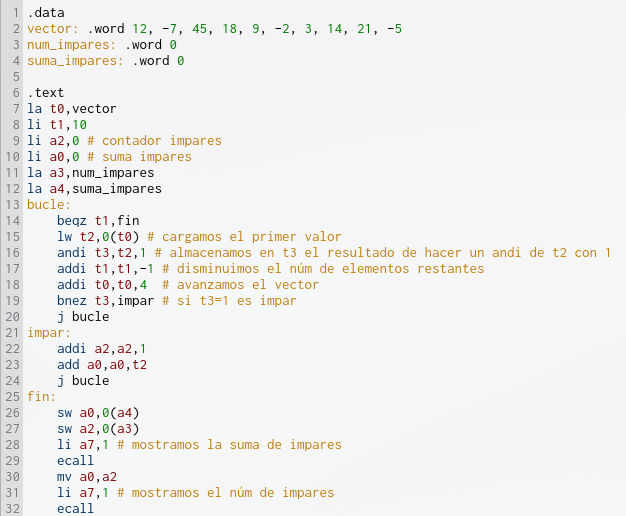
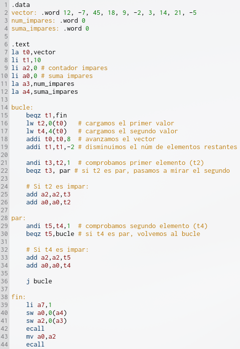
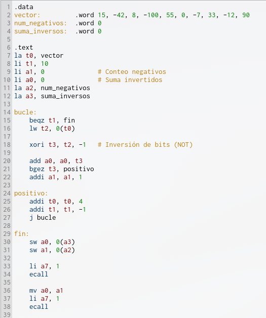
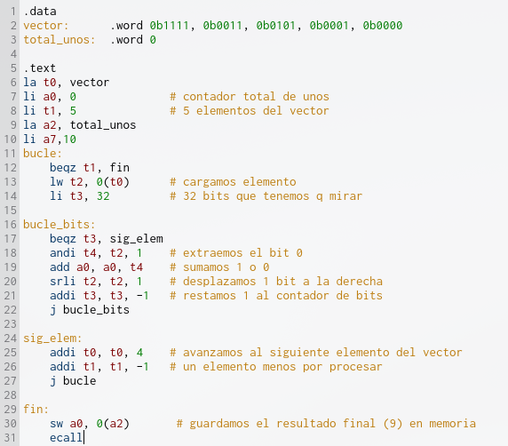
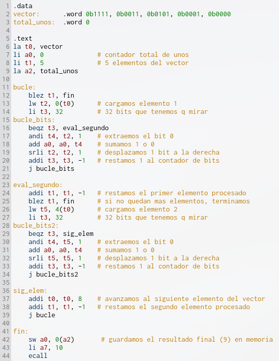

# Ejercicios similares a los que ha dicho Juan Francisco en clase 

> Es muy recomendable hacerlos ya que ha dicho que si o si caerá algún ejercicio similar

## Ejercicio 1 – 2/10 puntos - Archivos Eje1.s y P3.pdf
Escribe un programa en ensamblador RISC-V ajustado a las siguientes directivas:

En el segmento de datos se tiene un vector/conjunto de números enteros de 32 bits con signo. El programa deberá:

$$\text{vector} = [12, -7, 45, 18, 9, -2, 3, 14, 21, -5]$$

* Recorrer el vector e identificar los números impares.

* Contar cuántos números impares hay en total.

* Calcular la suma total de dichos números impares.

* Almacenar ambos resultados en memoria (el conteo y la suma) en espacios reservados a tal efecto en el segmento de datos no inicializado (sección .bss o etiqueta .space), representados como enteros de 32 bits.

Crea un documento y adjunta en él una captura de pantalla del panel Memory de Ripes tras haber ejecutado el programa completo, en la que se aprecie con claridad el código ensamblador en el editor y la zona de memoria donde se han guardado el conteo y la suma.

## Ejercicio 2 – 4/10 puntos - Archivo P3.pdf
Ejecuta el programa desarrollado en el Ejercicio 1 sobre las siguientes configuraciones de procesador en Ripes:

* **Configuración 1 (C1): Single-cycle processor**

* **Configuración 2 (C2): 5-Stage processor w/o Forwarding unit**

* **Configuración 3 (C3): 5-stage processor**

* **Configuración 4 (C4): 6-Stage Dual-Issue processor**

* **Realiza los siguientes apartados:**

1. Anota para cada una de las cuatro configuraciones el número total de ciclos de reloj y el CPI (Ciclos Por Instrucción) obtenido tras finalizar la ejecución del programa.

2. Incluye en el documento una tabla comparativa que muestre los ciclos, el CPI y la ganancia/mejora en rendimiento (Speedup) de las configuraciones C2, C3 y C4 tomando como base de comparación el procesador monociclo (C1).

3. Explica brevemente la fórmula que has empleado para calcular la mejora en rendimiento (Speedup).

4. Adjunta las capturas de pantalla del procesador Ripes para cada una de las 4 configuraciones donde se observen los datos recopilados en la tabla (ciclos y CPI).

## Ejercicio 3 – 4/10 puntos - Optimización por Desenrollamiento de Bucles
Tomando como base el bucle principal desarrollado en el Ejercicio 1:

1. Analiza los riesgos de datos (data hazards) y de control que generan paradas de reloj (stalls / burbujas) al ejecutar el bucle en la arquitectura 6-Stage Processor / 6-Stage Dual-Issue.

2. Aplica la técnica de desenrollamiento de bucle (loop unrolling) (procesando 2 elementos por iteración) y reordena las instrucciones (instruction scheduling) para minimizar las paradas en la tubería de 6 etapas aprovechando la emisión múltiple / superescalar.

3. Muestra el código ensamblador del bucle desenrollado y explica qué dependencias de datos se han intercalado/resuelto para optimizar la ejecución en las 6 etapas.

4. Vuelve a ejecutar el código optimizado en la configuración 6-Stage Dual-Issue processor y compara el nuevo número de ciclos y CPI con los obtenidos en el Ejercicio 2.

----

## Resolución
### EJ 1

## EJ 2
| Configuración de Procesador | Ciclos de Reloj (CCC) | Instrucciones (III) | CPI (C/IC) | Speedup vs. C1 |
|---|---:|---:|---:|---:|
| C1: Single-cycle processor | 99 | 99 | 1.00 | 1.00× (Base) |
| C2: 5-Stage w/o Forwarding | 167 | 99 | 1.69 | 0.59× ($\frac{99}{167}$) |
| C3: 5-Stage Processor (w/ Forwarding) | 151 | 99 | 1.53 | 0.66× ($\frac{99}{151}$) |
| C4: 6-Stage Dual-Issue Processor | 139 | 99 | 1.40 | 0.71× ($\frac{99}{139}$) |

**Explicación de las Fórmulas Aplicadas**
La mejora en rendimiento se calcula tomando como referencia el procesador monociclo ($C1$):
$$\text{Speedup}_{Cx} = \frac{\text{Tiempo de Ejecución}_{C1}}{\text{Tiempo de Ejecución}_{Cx}} = \frac{\text{Ciclos Total}_{C1}}{\text{Ciclos Total}_{Cx}}$$

* **C1 vs C1:** $\frac{99}{99} = 1.00$   
* **C2 vs C1:** $\frac{99}{167} \approx 0.59$   
* **C3 vs C1:** $\frac{99}{151} \approx 0.66$   
* **C4 vs C1:** $\frac{99}{139} \approx 0.71$   

## EJ 3

| Versión del Código (en 6-Stage Dual-Issue - C4) | Ciclos Totales | CPI | Mejora (Speedup vs. C4 Original) |
|---|---:|---:|---:|
| Código Ejercicio 1 (Sin desenrollar) | 139 ciclos | 1.40 | 1.00× (Base) |
| Código Ejercicio 3 (Desenrollado 2x) | 88 ciclos | 1.17 | 1.58× ($\frac{139}{88}$) |

**Mejoras Realizadas**

* **Desenrollamiento del bucle (Loop Unrolling 2x)**: Al procesar 2 elementos por iteración (`t2` y `t4`), la condición de final de bucle (`beqz t1, fin`), el salto de retorno (`j bucle`) y el avance de contadores (`addi t0, addi t1`) se ejecutan solo 5 veces en lugar de 10

* **Eliminación del riesgo Load**: Al poner juntos lso dos `lw` mientras el procesador completa la lectura de memoria se interalan los `andi`

* **Aprovechamiento de la doble emisión**: Al tener pares de instrucciones independientemente seguidas, la rquitectura de 6 etapas superescalar puede emitir dos instrucciones simultáneamente por ciclo de reloj

---
# Ejercicio 1 – 2/10 puntos - Archivos Eje1.s y P3.pdf
Escribe un programa en ensamblador RISC-V ajustado a las siguientes directivas:En el segmento de datos se define un vector de números enteros de 32 bits con signo:$$\text{vector} = [15, -42, 8, -100, 55, 0, -7, 33, -12, 90]$$

El programa deberá:

1. Recorrer el vector e invertir todos los bits de cada número (obtener el Complemento a Uno de cada elemento)

2. Contar cuántos números resultantes son negativos (tienen su bit de signo en 1)

3. Calcular la suma total de todos los números tras aplicar la inversión de bits

4. Almacenar ambos resultados en memoria (`num_negativos` y `suma_inversos`) en dos posiciones consecutivas del segmento de datos sin inicializar (`.bss` / `.space`), como enteros de 32 bits

# Ejercicio 2 – 4/10 puntos - Archivo P3.pdf
Ejecuta el programa desarrollado en el Ejercicio 1 sobre las siguientes configuraciones de procesador en Ripes:

* **Configuración 1 (C1)**: Single-cycle processor

* **Configuración 2 (C2)**: 5-Stage processor w/o Forwarding unit

* **Configuración 3 (C3)**: 5-Stage processor

* **Configuración 4 (C4)**: 6-Stage Dual-Issue processor

Realiza los siguientes apartados:

1. Anota para cada una de las cuatro configuraciones el número total de ciclos de reloj y el CPI (Ciclos Por Instrucción) obtenido tras finalizar la ejecución

2. Incluye en el documento una tabla comparativa que muestre los ciclos, el CPI y la ganancia en rendimiento (Speedup) de las configuraciones C2, C3 y C4 tomando como base el procesador monociclo (C1)

3. Explica brevemente la fórmula empleada para calcular la mejora en rendimiento (Speedup)

4. Adjunta las capturas de pantalla de Ripes para cada una de las 4 configuraciones

# Ejercicio 3 – 4/10 puntos - Optimización por Desenrollamiento de Bucles en Procesador de 6 Etapas (6-Stage Dual-Issue Processor)
Tomando como base el programa del Ejercicio 1:

1. Analiza las paradas por dependencias de datos de tipo Load-Use que ocurren entre la lectura del vector `lw` y la instrucción de inversión `xori`/`xor`, además de los saltos condicionales.

2. Aplica la técnica de desenrollamiento de bucle (loop unrolling) procesando 2 elementos por iteración, reordenando las instrucciones para maximizar el uso de los dos cauces (Dual-Issue)

3. Muestra el código ensamblador del bucle desenrollado y explica qué dependencias de datos se han intercalado/resuelto

4. Vuelve a ejecutar el código optimizado en la configuración 6-Stage Dual-Issue processor (C4) y compara el nuevo número de ciclos y CPI respecto al Ejercicio 2

# Resolución
## EJ 1

## EJ 2
| Configuración del Procesador | Ciclos Totales | CPI | Speedup vs. C1 |
|---|---:|---:|---:|
| C1: Single-cycle | 103 | 1.00 | 1.00× (Base) |
| C2: 5-Stage w/o Forwarding | 187 | 1.82 | 0.55× ($\frac{103}{187}$) |
| C3: 5-Stage w/ Forwarding | 151 | 1.47 | 0.68× ($\frac{103}{151}$) |
| C4: 6-Stage Dual-Issue | 150 | 1.46 | 0.69× ($\frac{103}{150}$) |

$$\text{Speedup}_{Cx} = \frac{\text{Ciclos}_{C1}}{\text{Ciclos}_{Cx}}$$

## EJ 3

$$\text{Speedup} = \frac{\text{Ciclos}_{\text{base}}}{\text{Ciclos}_{\text{desenrollado}}} = \frac{150}{105} = \mathbf{1.43\times}$$

| Versión en C4 (6-Stage Dual-Issue) | Ciclos Totales | CPI | Speedup vs. Base |
|---|---:|---:|---:|
| C4 Base (Sin desenrollar) | 150 | 1.46 | 1.00× |
| C4 Optimizado (Desenrollado 2x) | 105 | 1.27 | 1.43× (+43% más rápido) |

* **Reducción de instrucciones**: Al procesar 2 elementos por iteración, las instrucciones retiradas se reducen de 103 a 83, recortando la sobrecarga del bucle (overhead)

* **Eliminación de saltos condicionales**: Reemplazar las comprobaciones `bgez` por operaciones lógicas evita las paradas por predicción de saltos (Control Hazards)

* **Mayor paralelismo (IPC)**: El IPC sube a 0.79, permitiendo al cauce superescalar ejecutar 2 instrucciones simultáneamente de forma mucho más eficiente

---
# Ejercicio 1 – 2/10 puntos - Archivos Eje1.s y P3.pdf

Escribe un programa en ensamblador RISC-V ajustado a las siguientes directivas: En el segmento de datos se define un vector de números enteros de 32 bits en formato binario:$$\text{vector} = [0\text{b1111}, 0\text{b0011}, 0\text{b0101}, 0\text{b0001}, 0\text{b0000}]$$

El programa deberá:

1. Recorrer el vector analizando sus elementos bit a bit mediante desplazamientos lógicos a la derecha (`srli`) y la extracción del bit menos significativo mediante una máscara lógica (`andi`)

2. Para cada elemento, **contar cuántos bits están a '1' (Popcount)** sumando directamente el bit extraído al contador sin utilizar saltos condicionales (branchless)

3. Calcular el **recuento total de bits a '1'** de todo el vector

4. Almacenar el resultado en memoria en la variable `total_unos` en el segmento de datos sin inicializar (`.bss` / `.space`) como un entero de 32 bits

# Ejercicio 2 – 4/10 puntos - Archivo P3.pdf
Ejecuta el programa desarrollado en el Ejercicio 1 sobre las siguientes configuraciones de procesador en Ripes:

* **Configuración 1 (C1)**: Single-cycle processor

* **Configuración 2 (C2)**: 5-Stage processor w/o Forwarding unit

* **Configuración 3 (C3)**: 5-Stage processor

* **Configuración 4 (C4):** 6-Stage Dual-Issue processor

Realiza los siguientes apartados:

1. Anota para cada una de las cuatro configuraciones el número total de ciclos de reloj y el CPI (Ciclos Por Instrucción) obtenido tras finalizar la ejecución

2. Incluye en el documento una tabla comparativa que muestre los ciclos, el CPI y la ganancia en rendimiento (Speedup) de las configuraciones C2, C3 y C4 tomando como base el procesador monociclo (C1)

3. Explica brevemente la fórmula empleada para calcular la mejora en rendimiento (Speedup):

$$\text{Speedup}_{Cx} = \frac{\text{Ciclos}_{C1}}{\text{Ciclos}_{Cx}}$$

4. Adjunta las capturas de pantalla de Ripes para cada una de las 4 configuraciones.

# Resolución

## EJ 1

## EJ 2
$$\text{Speedup}_{Cx} = \frac{5025}{\text{Ciclos}_{Cx}}$$

C2: $\frac{5025}{1687} = \mathbf{2.98\times}$   

C3: $\frac{5025}{1353} = \mathbf{3.71\times}$   

C4: $\frac{5025}{1203} = \mathbf{4.18\times}$   

| Configuración | Ciclos Totales | CPI | Speedup (Ciclos Ripes) | Speedup (Normalizado ×5) |
|---|---:|---:|---:|---:|
| C1: Single-cycle | 1005 | 1.00 | 1.00× (Base) | 1.00× (Base) |
| C2: 5-Stage w/o Forwarding | 1687 | 1.68 | 0.60× | 2.98× |
| C3: 5-Stage w/ Forwarding | 1353 | 1.35 | 0.74× | 3.71× |
| C4: 6-Stage Dual-Issue | 1203 | 1.20 | 0.84× | 4.18× |

## EJ 3

| Configuración | Ciclos Totales | CPI | Speedup vs C1 (Directo Ripes) | Speedup Normalizado (Ciclos C1 × 5) |
|---|---:|---:|---:|---:|
| C1: Single-cycle | 1005 | 1.00 | 1.00× (Base) | 1.00× (Base) |
| C2: 5-Stage w/o Forwarding | 1687 | 1.68 | 0.60× | 2.98× |
| C3: 5-Stage w/ Forwarding | 1353 | 1.35 | 0.74× | 3.71× |
| C4: 6-Stage Dual-Issue (Base) | 1203 | 1.20 | 0.84× | 4.18× |
| C4: 6-Stage Dual-Issue (Desenrollado 2x) | 1187 | 1.19 | 0.85× | 4.23× |

$$\text{Speedup} = \frac{\text{Ciclos}_{\text{C4 Base}}}{\text{Ciclos}_{\text{C4 Desenrollado}}} = \frac{1203}{1187} = \mathbf{1.013\times}$$

