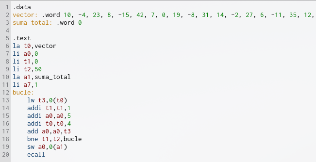
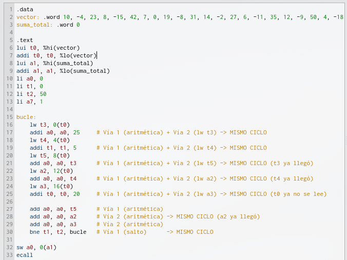
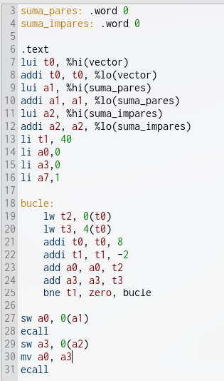
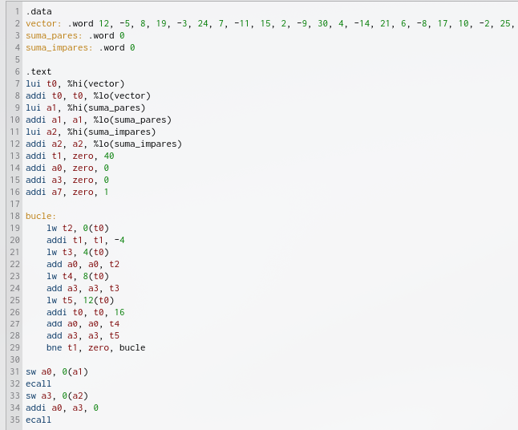

# Ejercicios tipo Examen según Macarena

# Ejercicio 1 – 2/10 puntos - Archivos Eje1.s y P4.pdf
Escribe un programa en ensamblador RISC-V ajustado a las siguientes directivas:

En el segmento de datos se tiene un vector de **50 números enteros de 32 bits con signo**:

`vector = [10, -4, 23, 8, -15, 42, 7, 0, 19, -8, 31, 14, -2, 27, 6, -11, 35, 12, -9, 50, 4, -18, 29, 3, -7, 16, 22, -13, 38, 1, -25, 44, 9, -6, 17, 33, -10, 21, 5, -3, 48, 11, -14, 26, 2, -19, 30, 15, -1, 40]`

El programa deberá:

- Recorrer los 50 elementos del vector de forma secuencial mediante un bucle estándar (1 elemento por iteración).
- Sumar el valor constante **5** a cada uno de los elementos leídos y calcular la **suma aritmética total** acumulada de todos los valores resultantes (es decir, `sumatoria(vector[i] + 5)`).
- Almacenar el resultado final de la suma aritmética en una variable (`suma_total`) reservada en el segmento de datos como un entero de 32 bits (sin modificar ni crear un nuevo vector en memoria).
- Mostrar por la consola de Ripes (mediante llamadas al sistema `ecall`) el valor de la suma aritmética total obtenida.

Crea un documento (`P4.pdf`) y adjunta una captura de pantalla del panel **Memory** y de la **Consola** de Ripes tras haber ejecutado el programa completo, en la que se aprecie el código ensamblador, la posición de memoria donde se ha guardado `suma_total` y el resultado impreso por pantalla.

---

# Ejercicio 2 – 4/10 puntos - Archivo P4.pdf
Ejecuta el programa del Ejercicio 1 sobre las siguientes configuraciones de procesador en Ripes:

- **Configuración 1 (C1):** Single-cycle processor
- **Configuración 2 (C2):** 5-Stage processor (con unidad de adelantamiento / forwarding)
- **Configuración 3 (C3):** 6-Stage dual-issue processor

Realiza los siguientes apartados:

1. Anota para cada configuración el número total de ciclos de reloj, las instrucciones ejecutadas (*Instructions Retired*) y el **CPI** (o **IPC**) obtenido tras finalizar la ejecución completa.
2. Incluye una tabla comparativa con los ciclos, el CPI y el **Speedup** de C2 y C3 tomando como base C1, además del Speedup de C3 frente a C2.
3. Explica brevemente la fórmula empleada para calcular el Speedup y justifica por qué, al trabajar con un vector largo (50 elementos), el impacto de las instrucciones de inicialización y de llamada al sistema (`ecall`) se diluye frente al peso del bucle principal.
4. Adjunta las capturas de pantalla de Ripes de cada configuración donde se aprecien claramente las métricas de rendimiento.

---

# Ejercicio 3 – 4/10 puntos - Riesgos y desenrollamiento de bucle (Factor 5) en 6 etapas
Tomando como base el programa del Ejercicio 1 ejecutado sobre la **Configuración 3 (6-Stage dual-issue processor)**:

1. Analiza los **riesgos estructurales** (conflictos de puertos en las dos vías de emisión *Way 0* y *Way 1*), **riesgos de datos** (*load-use*, dependencias RAW entre instrucciones consecutivas y el cuello de botella provocado por el registro acumulador único) y **riesgos de control** (saltos condicionales) que impiden emitir dos instrucciones por ciclo o provocan paradas (*stalls* / burbujas) en el cauce de 6 etapas.
2. Aplica un **desenrollamiento de bucle de factor 5** (*loop unrolling* procesando **5 elementos por cada iteración**, reduciendo las 50 iteraciones originales a solo **10 iteraciones**) y **reordena las instrucciones** dentro del cuerpo del bucle. El objetivo es cargar los 5 elementos en registros distintos (`t0`–`t4`), sumarles 5 y utilizar múltiples acumuladores parciales (para romper la dependencia en cadena sobre un único registro acumulador) antes de consolidar la suma final, eliminando las paradas *load-use* y maximizando la emisión doble por ciclo.
3. Muestra el código ensamblador optimizado (`Eje3.s`) y explica qué dependencias de datos y conflictos estructurales se han resuelto al intercalar las instrucciones, usar acumuladores independientes y actualizar el puntero de memoria con desplazamientos (*offsets* `0, 4, 8, 12, 16`) y saltos de `20` bytes por iteración.
4. Vuelve a ejecutar el código optimizado en **C3 (6-Stage processor)** y compara el nuevo número de ciclos, el CPI/IPC y el Speedup total alcanzado respecto a la versión sin desenrollar del Ejercicio 2.

> Resolución

### 1. Tabla comparativa de rendimiento

| Configuración | Ciclos Ripes | Ciclos equivalentes (Tiempo) | Instrucciones ejecutadas | CPI (Ripes) | IPC (Ripes) | Speedup real respecto a C1 | Speedup de C3 frente a C2 |
| :--- | :---: | :---: | :---: | :---: | :---: | :---: | :---: |
| **C1: Single-cycle** | 310 | **1550** (310 × 5) | 310 | 1.00 | 1.000 | **1.00x (Base)** | — |
| **C2: 5-Stage (c/ forwarding)** | 412 | **412** | 310 | 1.33 | 0.752 | **3.76x** | — |
| **C3: 6-Stage dual-issue** | 360 | **360** | 310 | 1.16 | 0.861 | **4.31x** | **1.14x** |

---

### 2. Cálculo del Speedup real y justificación

* **Fórmula empleada:**
  `Speedup = Tiempo_C1 / Tiempo_mejorado = (Ciclos_C1 × 5) / Ciclos_mejorado`
  *(Al tener el procesador monociclo un periodo de reloj 5 veces más largo que el de los procesadores segmentados para poder atravesar las 5 etapas en un solo ciclo, multiplicar C1 por 5 permite comparar directamente el tiempo total de ejecución).*

* **Resultados obtenidos:**
  * **Speedup real C2 frente a C1:** `1550 / 412 = 3.762` (**3.76x**). El procesador segmentado de 5 etapas es **3.76 veces más rápido** que el monociclo. Aunque el ideal teórico de un cauce de 5 etapas es 5x, se queda en 3.76x debido principalmente a los **2 ciclos de penalización (flush)** por cada salto condicional tomado (`49 saltos × 2 ciclos = 98 ciclos extra` más el llenado del cauce), ya que el adelantamiento (*forwarding*) sí logra evitar las paradas por riesgos *load-use* (`lw` está separado de `add` por otras instrucciones).
  * **Speedup real C3 frente a C1:** `1550 / 360 = 4.305` (**4.31x**). El procesador de 6 etapas *dual-issue* alcanza una aceleración de **4.31 veces** respecto al monociclo.
  * **Speedup C3 frente a C2:** `412 / 360 = 1.144` (**1.14x**). El procesador de 6 etapas reduce en **52 ciclos** la ejecución respecto al de 5 etapas (un **14.4% más rápido**) gracias a su emisión doble, aunque sin desenrollar el bucle sigue limitado por los saltos frecuentes (1 salto cada 6 instrucciones) y las dependencias RAW sobre el acumulador `a0`.

* **Impacto del tamaño del vector (50 elementos):**
  De las **310 instrucciones** ejecutadas, **300** pertenecen al bucle (`50 iteraciones × 6 instrucciones`) y solo **10** corresponden al código de inicialización y salida (`la`, `li`, `sw`, `ecall`), suponiendo apenas un **3.2%** del total. Esto diluye el coste fijo de arranque y hace que la comparativa refleje fielmente el comportamiento del cauce en carga sostenida.

## Ejercicio 3 – Riesgos y desenrollamiento de bucle (Factor 5) en 6 etapas

### 1. Análisis de riesgos en el programa original sobre 6 etapas (C3)

En la configuración **6-Stage dual-issue processor** de Ripes, el procesador intenta emitir dos instrucciones simultáneamente por ciclo repartidas en dos vías asimétricas:
* **Vía 1:** Instrucciones aritméticas, saltos (`bne`) y llamadas al sistema (`ecall`).
* **Vía 2:** Instrucciones aritméticas, cargas (`lw`) y almacenamientos (`sw`).

Al ejecutar el código base sin desenrollar (1 elemento por iteración, 50 iteraciones), el rendimiento se ve limitado por tres tipos de riesgos:

1. **Riesgos estructurales (asimetría de vías):** Si aparecen consecutivas dos instrucciones que solo pueden ir por la misma vía (por ejemplo, dos cargas seguidas `lw` que requieren la Vía 2, o un salto seguido de otra instrucción restringida a Vía 1), la segunda vía queda ociosa (*bubble* de emisión) al no poder emparejarse.
2. **Riesgos de datos (RAW y *load-use*):**
   * En el bucle original, `addi a0, a0, 5` y `add a0, a0, t3` comparten el registro destino `a0`, generando una dependencia verdadera (RAW) que impide emitirlas en paralelo dentro del mismo ciclo y obliga al uso continuo de la unidad de adelantamiento (*forwarding*).
   * Asimismo, si la suma `add a0, a0, t3` se sitúa inmediatamente después de `lw t3, 0(t0)`, se produce un riesgo *load-use* que detiene el cauce 1 ciclo hasta que el dato sale de la etapa de memoria (MEM).
3. **Riesgos de control (saltos frecuentes):** Al procesar solo 1 elemento por iteración, se ejecutan **50 saltos condicionales** (`bne`), de los cuales 49 son tomados. Cada salto tomado provoca el vaciado (*flush*) de las instrucciones captadas especulativamente en las primeras etapas del cauce (penalización de ciclos por salto), lo que supone una sobrecarga altísima frente a un cuerpo de bucle de apenas 6 instrucciones.

| Versión / Configuración | Ciclos Ripes | Ciclos equiv. (Tiempo) | Instrucciones ejecutadas | CPI | IPC | Speedup real vs C1 (×5) | Speedup vs C3 base |
| :--- | :---: | :---: | :---: | :---: | :---: | :---: | :---: |
| **C1: Single-cycle (base)** | 310 | **1550** | 310 | 1.000 | 1.000 | 1.00x | — |
| **C2: 5-Stage (base)** | 412 | **412** | 310 | 1.330 | 0.752 | 3.76x | — |
| **C3: 6-Stage (sin optimizar)** | 360 | **360** | 310 | 1.160 | 0.861 | 4.31x | 1.00x |
| **C3: 6-Stage (desenrollado sin intercalar)** | 140 | **140** | 150 | 0.933 | 1.070 | 11.07x | 2.57x |
| **C3: 6-Stage (desenrollado + reordenado)** | **131** | **131** | **150** | **0.873** | **1.150** | **11.83x** | **2.75x** |

---
# Ejercicio 1 – 2/10 puntos - Archivos Eje1.s y P4.pdf
Escribe un programa en ensamblador RISC-V ajustado a las siguientes directivas (utilizando instrucciones reales base de RISC-V, evitando pseudoinstrucciones como `la`):

En el segmento de datos se tiene un vector de **40 números enteros de 32 bits con signo**:

`vector = [12, -5, 8, 19, -3, 24, 7, -11, 15, 2, -9, 30, 4, -14, 21, 6, -8, 17, 10, -2, 25, 3, -12, 16, 9, -7, 28, 1, -15, 20, 11, -4, 18, 13, -6, 22, 5, -10, 14, 27]`

El programa deberá:

- Recorrer los 40 elementos del vector de forma secuencial mediante un bucle estándar (1 elemento por iteración, o 2 elementos alternando par/impar).
- Calcular por separado la **suma aritmética de los elementos situados en posiciones pares** (`índice 0, 2, 4, ..., 38`) y la **suma aritmética de los elementos situados en posiciones impares** (`índice 1, 3, 5, ..., 39`).
- Almacenar ambos resultados en dos variables independientes reservadas en el segmento de datos como enteros de 32 bits (`suma_pares` y `suma_impares`).
- Mostrar por la consola de Ripes (mediante llamadas al sistema `ecall`) ambos resultados obtenidos.

Crea un documento (`P4.pdf`) y adjunta una captura de pantalla del panel **Memory** y de la **Consola** de Ripes tras haber ejecutado el programa completo, en la que se aprecie el código ensamblador, las posiciones de memoria donde se han guardado `suma_pares` y `suma_impares` y la salida impresa por pantalla.

---

# Ejercicio 2 – 4/10 puntos - Archivo P4.pdf
Ejecuta el programa del Ejercicio 1 sobre las siguientes configuraciones de procesador en Ripes:

- **Configuración 1 (C1):** Single-cycle processor
- **Configuración 2 (C2):** 5-Stage processor (con unidad de adelantamiento / forwarding)
- **Configuración 3 (C3):** 6-Stage dual-issue processor

Realiza los siguientes apartados:

1. Anota para cada configuración el número total de ciclos de reloj, las instrucciones ejecutadas (*Instructions Retired*) y el **CPI** (o **IPC**) obtenido tras finalizar la ejecución completa.
2. Incluye una tabla comparativa con los ciclos reales de Ripes, los **ciclos equivalentes en tiempo** (multiplicando C1 × 5 para equiparar la duración del ciclo monociclo a las 5 etapas), el CPI y el **Speedup real** de C2 y C3 tomando como base C1, además del Speedup de C3 frente a C2.
3. Explica brevemente la fórmula empleada para calcular el Speedup y justifica las diferencias de rendimiento observadas entre las tres arquitecturas.
4. Adjunta las capturas de pantalla de Ripes de cada configuración donde se aprecien claramente las métricas de ejecución.

---

# Ejercicio 3 – 4/10 puntos - Riesgos y desenrollamiento de bucle (Factor 4) en 6 etapas
Tomando como base el programa del Ejercicio 1 ejecutado sobre la **Configuración 3 (6-Stage dual-issue processor)**, cuya emisión doble sigue la siguiente distribución de vías:
- **Vía 1:** Instrucciones aritméticas, saltos (`bne`, `blt`) y `ecall`.
- **Vía 2:** Instrucciones aritméticas, cargas (`lw`) y almacenamientos (`sw`).

Realiza los siguientes apartados:

1. Analiza los **riesgos estructurales** (conflictos por asimetría de vías al emitir cargas o saltos consecutivos), **riesgos de datos** (*load-use* y dependencias RAW) y **riesgos de control** (saltos condicionales) que limitan la emisión doble en el cauce de 6 etapas.
2. Aplica un **desenrollamiento de bucle de factor 4** (*loop unrolling* procesando **4 elementos por iteración**: dos de posición par con desplazamientos `0` y `8`, y dos de posición impar con desplazamientos `4` y `12`, reduciendo las iteraciones a **10**) y **reordena las instrucciones** para emparejar las cargas por **Vía 2** con las operaciones aritméticas independientes sobre `suma_pares`, `suma_impares` y los punteros/contadores por **Vía 1**.
3. Muestra el código ensamblador optimizado (`Eje3.s`) y explica qué dependencias y conflictos de vías se han resuelto en el cronograma.
4. Vuelve a ejecutar el código optimizado en **C3 (6-Stage processor)** y compara el nuevo número de ciclos, el CPI/IPC y el Speedup total alcanzado respecto a `C1 × 5` y respecto a la versión sin optimizar del Ejercicio 2.

## Ejercicio 2 – Comparativa de configuraciones (Posiciones pares e impares)

### 1. Tabla comparativa de rendimiento

| Configuración | Ciclos Ripes | Ciclos equivalentes (Tiempo) | Instrucciones ejecutadas | CPI (Ripes) | IPC (Ripes) | Speedup real respecto a C1 | Speedup de C3 frente a C2 |
| :--- | :---: | :---: | :---: | :---: | :---: | :---: | :---: |
| **C1: Single-cycle** | 155 | **775** (155 × 5) | 155 | 1.00 | 1.000 | **1.00x (Base)** | — |
| **C2: 5-Stage (c/ forwarding)** | 199 | **199** | 155 | 1.28 | 0.779 | **3.89x** | — |
| **C3: 6-Stage dual-issue** | 177 | **177** | 155 | 1.14 | 0.876 | **4.38x** | **1.12x** |

---

### 2. Cálculo del Speedup real y justificación

* **Fórmula empleada:**
  `Speedup = Tiempo_C1 / Tiempo_mejorado = (Ciclos_C1 × 5) / Ciclos_mejorado`
  *(Al tener el procesador monociclo un periodo de reloj 5 veces más largo que el de los procesadores segmentados para completar las 5 etapas en un único ciclo, multiplicar C1 por 5 permite comparar directamente el tiempo total de ejecución).*

* **Resultados obtenidos:**
  * **Speedup real C2 frente a C1:** `775 / 199 = 3.894` (**3.89x**). El procesador segmentado de 5 etapas es **3.89 veces más rápido** que el monociclo. Aunque el límite teórico de un cauce de 5 etapas es 5x, se sitúa en 3.89x debido a los **2 ciclos de penalización (flush)** por cada salto condicional tomado (`19 saltos × 2 ciclos = 38 ciclos extra` más el llenado del cauce), mientras que las paradas *load-use* se evitan gracias a la unidad de adelantamiento (*forwarding*) y a que `lw t2` y `lw t3` están separadas de sus `add` por dos instrucciones (`addi t0` y `addi t1`).
  * **Speedup real C3 frente a C1:** `775 / 177 = 4.378` (**4.38x**). El procesador de 6 etapas *dual-issue* alcanza una aceleración de **4.38 veces** respecto al monociclo.
  * **Speedup C3 frente a C2:** `199 / 177 = 1.124` (**1.12x**). El procesador de 6 etapas reduce en **22 ciclos** la ejecución respecto al de 5 etapas (un **12.4% más rápido**), aunque no logra bajar el CPI de 1 (`CPI = 1.14`) porque al inicio de cada iteración aparecen dos cargas consecutivas (`lw t2` y `lw t3`) que solo pueden emitirse por la **Vía 2**, dejando ociosa la **Vía 1** en esos ciclos.

## Ejercicio 3 – Riesgos y desenrollamiento de bucle (Factor 4) en 6 etapas

### 1. Riesgos en el código original (C3: 6-Stage dual-issue)
* **Estructurales (asimetría de vías):** La Vía 2 es la única que ejecuta cargas (`lw`), por lo que poner dos `lw` seguidas deja inactiva la Vía 1 en ese ciclo.
* **De datos (*load-use* y RAW):** Usar un dato justo tras cargarlo (`lw` -> `add`) detiene el cauce 1 ciclo, y las dependencias sobre los mismos acumuladores limitan el paralelismo.
* **De control:** Al iterar de 2 en 2 elementos (20 iteraciones), se ejecutan 19 saltos condicionales tomados que provocan *flushes* en el cauce.

| Versión / Configuración | Ciclos Ripes | Ciclos equiv. (Tiempo) | Instrucciones ejecutadas | CPI | IPC | Speedup real vs C1 (×5) | Speedup vs C3 base |
| :--- | :---: | :---: | :---: | :---: | :---: | :---: | :---: |
| **C1: Single-cycle (base)** | 155 | **775** (155 × 5) | 155 | 1.00 | 1.000 | 1.00x | — |
| **C2: 5-Stage (base)** | 199 | **199** | 155 | 1.28 | 0.779 | 3.89x | — |
| **C3: 6-Stage (sin optimizar)** | 177 | **177** | 155 | 1.14 | 0.876 | 4.38x | 1.00x |
| **C3: 6-Stage (desenrollado x4)** | **137** | **137** | **125** | **1.10** | **0.912** | **5.66x** | **1.29x** |