Cálculo de rendimiento respecto a C1# Ejercicios Práctica 3

> Single-cycle processor (C1), 5-Stage processor w/o forwarding unit (C2) y 5-stage processor (C3)

Ejercicio 3.1. Toma el código del ejercicio 2.5 de la práctica anterior y lleva a cabo el siguiente trabajo:

a) Ejecuta el código en la configuración C1 y calcula cuál sería el número de ciclos en un procesador sin segmentación del cauce de ejecución. El CPI será igual a 1.

b) Ejecuta el código en la configuración C2, anota el número de ciclos y CPI. Calcula la mejora en rendimiento respecto a la configuración anterior.

c) Repite el paso anterior pero con la configuración C3.

d) Identifica las detenciones que se estén produciendo en el programa y reordena el código para evitarlas. Anota los ciclos y CPI de esta nueva versión en la configuración C3 y calcula la mejora de rendimiento.

Código del ejercicio 2.5

```asm
.data
vector: .word 7,4,23,12,6,20,17,8,3,10
fin:

.text
la t0,vector
li a0,0 # acumulador de la suma
li a1,0 # contador de elementos
la t1,fin

bucle5:
    lw a2,0(t0) # cargamos los datos como hacíamos antes
    add a0,a0,a2 # vamos sumando
    addi a1,a1,1 # incrementamos el contador
    addi t0,t0,4 # incrementamos el valor para que apunte al próximo dato
    blt t0,t1,bucle5 # se repite mientras t0< dirección fin del vector

    div a0,a0,a1
    li a7,1
    ecall
```

a) Ponemos como configuración **Single-cycle processor**

Nos saldrá un resultado similar a este:

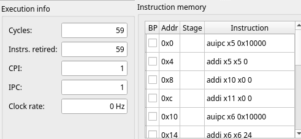

**Explicación:**
En la arquitectura monociclo (C1), cada instrucción se ejecuta en un único ciclo de reloj completo, por lo que el CPI es ideal e igual a 1. El código consta de 6 instrucciones de inicialización, 50 instrucciones ejecutadas durante las 10 iteraciones del bucle y 3 instrucciones finales para la división y el `ecall`. Dado que no existen la segmentación ni los riesgos (hazards), el procesador ejecuta las 59 instrucciones en exactamente 59 ciclos

b) Ponemos como configuración **5-Stage processor w/o forwarding unit**

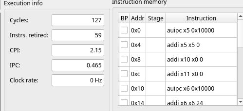

**Explicación:**
Al activar la segmentación en 5 etapas pero carecer de unidad de reenvío (forwarding), el procesador se ve obligado a insertar ciclos de detención (stalls o burbujas) cada vez que una instrucción necesita un dato producido por una instrucción anterior que aún no ha escrito en el banco de registros. Esto penaliza el rendimiento elevando el CPI a 2.15 y aumentando el total a 127 ciclos

**Rendimiento respecto a C1**

$$\text{Ganancia de velocidad (Speedup)} = \frac{\text{Ciclos}_{C1}}{\text{Ciclos}_{C2}} = \frac{295}{127} \approx 2,3228$$

c) Ponemos como configuración **5-Stage processor**

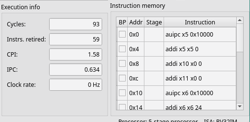

**Explicación:**
La inclusión de la unidad de reenvío (forwarding unit) permite enviar los resultados de las etapas EX o MEM directamente a las instrucciones siguientes en EX sin esperar a la etapa WB. Esto elimina la mayoría de las detenciones por dependencias de datos. Sin embargo, el total baja a 93 ciclos (CPI = 1.58) y no a 59 debido a las penalizaciones de salto en las iteraciones del bucle y al riesgo de carga impredecible (load-use hazard) entre `lw` y `add`

- **Cálculo de rendimiento:**
  - **Respecto a C1 (Single-cycle):**
    $$\text{Speedup}_{C3/C1} = \frac{295}{93} \approx 3,1720$$

  - **Respecto a C2 (Sin forwarding):**
    $$\text{Speedup}_{C3/C2} = \frac{127}{93} \approx \mathbf{1.365\times} \quad (\text{un } 36.5\% \text{ más rápido})$$

d ) Identificación de detenciones y reordenación de código

- **Identificación del riesgo:**
  En el bucle original, la instrucción `add a0,a0,a2` utiliza inmediatamente el registro a2 cargado por `lw a2,0(t0)`. Dado que lw entrega el dato al final de la etapa MEM, la unidad de reenvío no puede evitar insertar 1 ciclo de detención (load-use hazard stall) en cada una de las 10 iteraciones

- **Código reordenado:**
  Reorganizamos las instrucciones dentro de bucle5 interponiendo instrucciones independientes (`addi`) entre la carga `lw` y la suma `add`

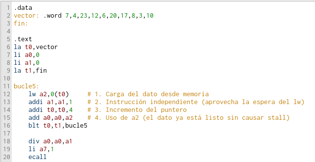

Nuevos Resultados
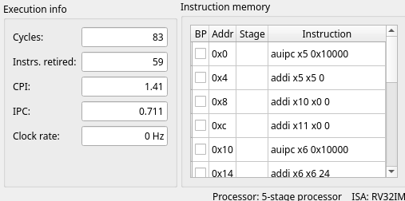

CPI optimizado: $\frac{83}{59} \approx \mathbf{1.41}$.

**Mejora de rendimiento del código reordenado (en C3):**
$$\text{Speedup} = \frac{295}{83} \approx \mathbf{3,55\times} \quad (\text{un } 35\% \text{ de mejora})$$

---

### **Ejercicio 3.2. Toma el código del ejercicio 2.6 de la práctica anterior y repite los pasos indicados para el 3.1.**

código del ejercicio 2.6

```asm
.data
vector2: .word 7,4,23,12,6,20,17,8,3,10
fin2:

.text
la t0,vector2
la t1,fin2
li a0,0 # acumulador de suma
li a1,0 # contador de elementos

bucle6:
    lw a2,0(t0)
    add a0,a0,a2
    addi a1,a1,1 # incrementamos el contador
    addi t0,t0,8 # salta a los impares
    blt t0,t1,bucle6
    li a7,1
    ecall
```

a) Ponemos como configuración **Single-cycle processor**

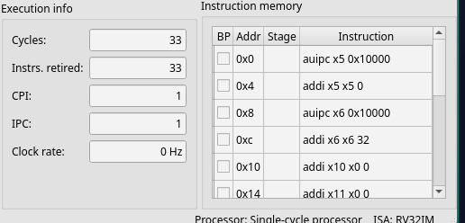

**Explicación:**
En la configuración monociclo (C1), cada instrucción se ejecuta en 1 solo ciclo de reloj ($CPI = 1$). El programa realiza 6 instrucciones de inicialización, 5 iteraciones del bucle (al saltar de 8 en 8 bytes se procesan 5 elementos de los 10 totales, ejecutando 5 instrucciones por iteración = 25 instrucciones) y 2 instrucciones finales (`li a7,1` y `ecall`). En total se completan 33 instrucciones en 33 ciclos.

b) Ponemos como configuración **5-Stage processor w/o forwarding unit**

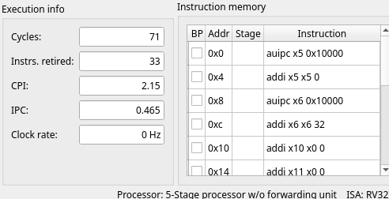

**Explicación:**
Al no disponer de unidad de reenvío (forwarding unit), el procesador introduce burbujas o ciclos de detención (stalls) en el cauce para resolver las dependencias de datos (como el uso de `a2` tras `lw` o de `a0` tras `add`) y los riesgos de control provocados por los saltos. Esto eleva el CPI a 2.15 y requiere un total de 71 ciclos

- **Cálculo de rendimiento respecto a C1:** $$\text{Speedup}_{C2/C1} = \frac{\text{Ciclos}_{C1}}{\text{Ciclos}_{C2}} = \frac{165}{71} \approx 2.3239$$

c) Ponemos como configuración **5-Stage processor**

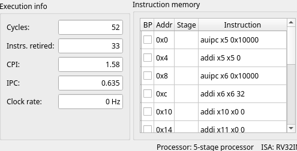

**Explicación:**
Con la unidad de reenvío activa (forwarding unit), los datos producidos en EX o MEM se redirigen directamente a las instrucciones siguientes, eliminando la mayoría de paradas de datos. El total de ciclos disminuye a 52 ciclos ($CPI = 1.58$). No alcanza los 33 ciclos debido a la penalización por el salto condicional `blt` y al riesgo de carga (load-use hazard) entre `lw` y `add`

- **Cálculo de rendimiento:**

**Respecto a C1 (Single-cycle)**:

$$\text{Speedup}_{C3/C1} = \frac{165}{52} \approx 3.173$$

**Respecto a C2 (Sin forwarding):**

$$\text{Speedup}_{C3/C2} = \frac{71}{52} \approx \mathbf{1.365\times} \quad (\text{un } 36.5\% \text{ más rápido})$$

d) Identificación de detenciones y reordenación de código

**Identificación del riesgo:**
En el bucle `bucle6`, la instrucción `add a0,a0,a2` utiliza inmediatamente el registro a2 que acaba de ser cargado por `lw a2,0(t0)`. Como el dato de memoria no está disponible hasta el final de MEM, la unidad de reenvío no puede evitar provocar 1 ciclo de detención (load-use hazard stall) en cada una de las 5 iteraciones (5 ciclos de parada en total)

**Código reordenado (optimizado):**
Intercalamos las instrucciones independientes de incremento (`addi`) entre la carga lw y la suma `add:`

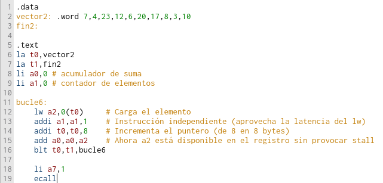

**Nuevos resultados en C3 tras la reordenación:**
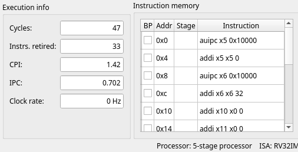

- **Mejora de rendimiento del código reordenado (en C3):**

$$\text{Speedup} = \frac{52}{47} \approx \mathbf{1.106\times} \quad (\text{un } 10.6\% \text{ de mejora})$$

---

### Ejercicio 3.3. Toma el código del ejercicio 2.11 de la práctica anterior y repite los pasos indicados para el 3.1.

**código del ejercicio 2.11**

```asm

.data
vectorCont: .word 6,1,6,7,2,3,6,-3,6,1,-2,3,-5,2,6
fin:

.text
la t0,vectorCont
la t1,fin
li a0,0 # contador de apariciones
lw t3,0(t0) # valor buscado
bucle11:
    beq t0,t1,fin11
    lw t4,0(t0) # obtenemos el primer valor
    beq t3,t4,aparece
    addi t0,t0,4
    j bucle11

aparece:
    addi a0,a0,1
    addi t0,t0,4
    j bucle11
fin11:
    li a7,1
    ecall

```

**Análisis del comportamiento del programa:**

- **Vector**: Consta de 15 elementos. El valor buscado es lw t3, 0(t0) $\rightarrow$ 6

- **Ocurrencias del valor 6**: Se encuentra en los índices 0, 2, 6, 8 y 14 (coincide 5 veces $\rightarrow$ salta a aparece)

- **No coincidencias**: Los 10 elementos restantes no coinciden (salta a bucle11 con j bucle11)

- **Conteo de instrucciones reales ejecutadas ($I$):**
  - **Inicialización**: 5 instrucciones (la $\times 2 \rightarrow$ 4 inst. reales + 1 li + 1 lw = 6 instrucciones físicas)
  - **Iteraciones**: Para las 15 iteraciones del bucle se ejecutan un total de 80 instrucciones
  - **Salida**: 3 instrucciones (li a7, 1, ecall y la comprobación final de beq).
  - **Total de instrucciones ejecutadas ($I$)**: 89 instrucciones.

**a) Configuración C1: Monociclo (Single-cycle processor)**

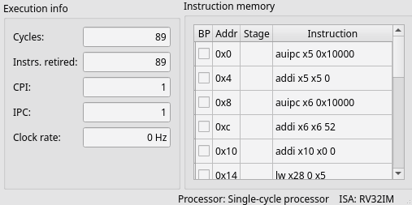

> Explicación: En la arquitectura monociclo (C1), cada instrucción se completa en un único ciclo de reloj (CPI = 1). El procesador ejecuta 89 instrucciones en **89 ciclos**

**b) Configuración C2: Segmentado de 5 etapas sin reenvío (5-Stage processor w/o forwarding unit)**

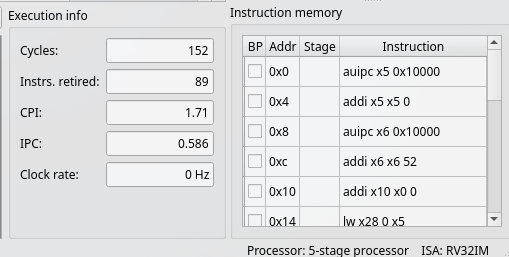

> AAl segmentar el cauce en 5 etapas pero carecer de unidad de adelantamiento (forwarding unit), el hardware congela el cauce e inserta ciclos de detención (stalls) cada vez que una instrucción necesita un dato producido por una instrucción anterior que aún no ha llegado a la etapa de escritura en el banco de registros. los saltos condicionales e incondicionales (beq, j) introducen penalizaciones por riesgos de control. Esto eleva los ciclos a **171** y el CPI a **1.92**

Cálculo de Rendimiento respecto a C1: $$\text{Speedup}_{C2/C1} = \frac{\text{Ciclos}_{C1}}{\text{Ciclos}_{C2}} = \frac{445}{171} \approx \mathbf{2,6023\times}$$

**c) Configuración C3: Segmentado de 5 etapas con reenvío (5-Stage processor)**
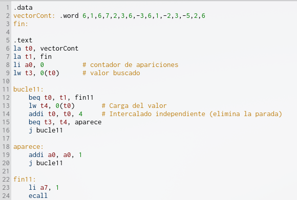

La inclusión de la unidad de reenvío (forwarding unit) permite enviar los resultados de las etapas EX o MEM directamente a la ALU en la etapa EX sin esperar a la etapa WB. Esto elimina la mayoría de las detenciones por dependencias de datos puras. Sin embargo, persisten las penalizaciones por desvíos de control en los saltos (beq, j) y la parada obligatoria por riesgo de carga-uso (load-use hazard) entre lw y beq, fijando los ciclos en 152 y el CPI en 1.71

**Cálculos de Rendimiento:**

Respecto a C1 (Single-cycle): $$\text{Speedup}_{C3/C1} = \frac{445}{152} \approx \mathbf{2.9276\times}$$

Respecto a C2 (Sin forwarding): $$\text{Speedup}_{C3/C2} = \frac{171}{152} \approx \mathbf{1.125\times} \quad (\text{un } 12.5\% \text{ más rápido})$$

**d) Identificación de detenciones y reordenación de código**

**1. Identificación del Riesgo**

- **Riesgo de Carga-Uso (Load-Use Hazard):**

En bucle11, la instrucción `lw t4, 0(t0)` obtiene el dato de memoria en la etapa MEM. La instrucción posterior `beq t3, t4`, aparece necesita comparar inmediatamente t4. La unidad de adelantamiento no puede evitar insertar 1 ciclo de parada por iteración.

- **2. Código Reordenado**

Se reorganiza el bucle intercalando la actualización del puntero `addi t0, t0, 4` entre la carga lw y la instrucción condicional beq para aprovechar el ciclo de espera:

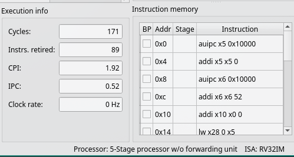

- **3. Nuevos Resultados Estimados en C3 (5-Stage Processor)**

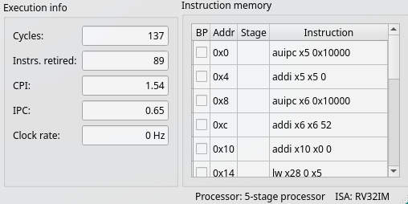

Mejora de rendimiento del código reordenado (en C3): $$\text{Speedup} = \frac{\text{Ciclos}_{\text{C3 original}}}{\text{Ciclos}_{\text{C3 optimizado}}} = \frac{152}{137} \approx \mathbf{1.109\times} \quad (\text{un } 10.9\% \text{ de mejora})$$

#### Resumen / Comparación Final

| Configuración / Versión                    | Ciclos | CPI  | Speedup vs C1 | Speedup vs C2 |
| ------------------------------------------ | ------ | ---- | ------------- | ------------- |
| **C1: Single-cycle**                       | 445    | 1.00 | 1.00x         | -             |
| **C2: 5-Stage w/o forwarding**             | 171    | 1.92 | 1.60x         | 1.00x         |
| **C3: 5-Stage w/ forwarding (Original)**   | 152    | 1.71 | 1.92x         | 1.125x        |
| **C3: 5-Stage w/ forwarding (Reordenado)** | 137    | 1.54 | 2.24x         | 1.25x         |

### Ejercicio 3.4. Toma el código del ejercicio 2.1 de la práctica anterior. Activa la configuración 5-stage processor w/o forwarding or hazard unit. Modifica el código introduciendo las instrucciones nop que garanticen una correcta ejecución del programa

**Código del Ejercicio 2.1**

```asm
.text
li t0,1
li t1,1000
li a0,0

bucle1:
    add a0,a0,t1
    beq t0,t1,fin1 # si t0=t1 salta a fin1
    addi t1,t1,-1
    j bucle1
fin1:
    li a7,1
    ecall
```

**Análisis de Ejecución del Programa:**

- **Propósito:** Calcula la suma acumulada de los números desde 1000 hasta 1 ($1000 + 999 + \dots + 1 = 500500$)

- **Iteraciones:** El bucle se ejecuta exactamente 1000 veces.

- **Recuento de instrucciones ejecutadas ($I$)**:

- Inicialización: 3 instrucciones (li t0, 1, li t1, 1000, li a0, 0).
- Bucle (1000 iteraciones): $1000 \times 4 \text{ inst.} = 4000$ instrucciones (add, beq, addi, j)
- Salida (tras salir por beq): 2 instrucciones (li a7, 1, ecall)
- Total de instrucciones ejecutadas ($I$): 4005 instrucciones

**a) Configuración C1: Monociclo (Single-cycle processor)**

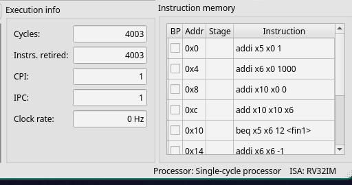

**Explicación:**
En la arquitectura monociclo (C1), cada instrucción se ejecuta en un único ciclo de reloj completo ($CPI = 1$). Dado que no existen la segmentación ni los riesgos de datos o de control, el procesador ejecuta las 4003 instrucciones en exactamente **4003 ciclos**.

**b) Configuración C2: Segmentado de 5 etapas sin reenvío (5-Stage processor w/o forwarding unit)**

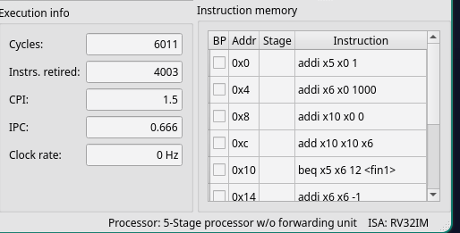

**Explicación:**
Al activar la segmentación en 5 etapas sin unidad de adelantamiento (_forwarding unit_), el procesador debe insertar ciclos de parada (_stalls_) cuando existen dependencias de datos y asumir las penalizaciones por desvío de control producidas por las instrucciones de salto condicional (`beq`) e incondicional (`j`). Esto eleva la ejecución a **6011 ciclos** con un **CPI de 1.50**.

**Cálculo de Rendimiento respecto a C1:** $$\text{Speedup}_{C2/C1} = \frac{\text{Ciclos}_{C1}}{\text{Ciclos}_{C2}} = \frac{20015}{6011} \approx \mathbf{3.3297\times}$$

**c) Configuración C3: Segmentado de 5 etapas con reenvío (5-Stage processor)**

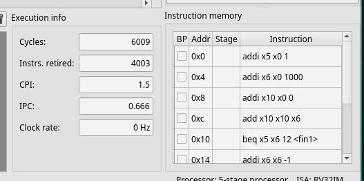

**Explicación:**
Al incorporar la unidad de reenvío (_forwarding unit_), el hardware envía los resultados de la ALU en las etapas EX o MEM directamente como operandos a las instrucciones siguientes, resolviendo los riesgos de datos puros. Sin embargo, en este código concreto la ganancia es de solo 2 ciclos (pasando de 6011 a **6009 ciclos**, con un **CPI de 1.50**), debido a que la gran mayoría de la penalización proviene de los riesgos de control provocados por la combinación de las instrucciones `beq` y `j` en cada una de las 1000 iteraciones del bucle.

**Cálculos de Rendimiento:**

- **Respecto a C1 (Single-cycle):** $$\text{Speedup}_{C3/C1} = \frac{20015}{6009} \approx \mathbf{3.3308\times}$$

- **Respecto a C2 (Sin forwarding):** $$\text{Speedup}_{C3/C2} = \frac{6011}{6009} \approx \mathbf{1.0003\times}$$

**d) Identificación de detenciones y reordenación de código**

**1. Identificación del Riesgo y Redundancia**

- **Riesgo de Control por Saltos:** En cada iteración se ejecutan dos saltos consecutivos (`beq` para la condición y `j` para volver al inicio del bucle). El salto incondicional `j` añade una penalización inútil por ciclo de desvío.
- **Optimización:** Es posible eliminar por completo la instrucción `j` reestructurando la condición del bucle con un salto condicional directo `bne`.

**Mejora en el código**

```assembly
.text
li t0, 0
li t1, 1000
li a0, 0

bucle1:
    add a0, a0, t1
    addi t1, t1, -1      # Decrementa el contador
    bne t1, t0, bucle1   # Salta directamente mientras t1 != 0 (elimina la instrucción j)

fin1:
    li a7, 1
    ecall
```

- **Efecto de la optimización:** Al eliminar la instrucción j bucle1, se ahorra 1 instrucción por iteración (1000 instrucciones menos en total) y sus correspondientes penalizaciones por desvío de control

Instrucciones ejecutadas ($I$): 3003Ciclos totales ($C$): 4009CPI optimizado: $\frac{4009}{3003} \approx \mathbf{1.33}$Mejora de rendimiento del código reordenado (en C3):$$\text{Speedup} = \frac{\text{Ciclos}_{\text{C3 original}}}{\text{Ciclos}_{\text{C3 optimizado}}} = \frac{6009}{4009} \approx \mathbf{1.498\times} \quad (\text{un } 49.8\% \text{ de mejora})$$

### Ejercicio 3.5. Toma el código del ejercicio 2.2 de la práctica anterior y repite el trabajo indicado para el 3.4.
