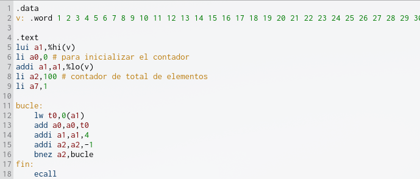
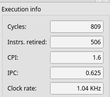
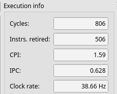
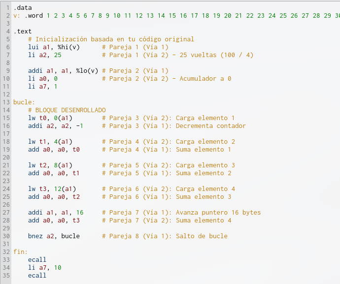
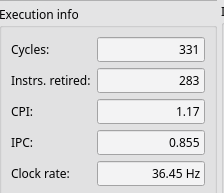
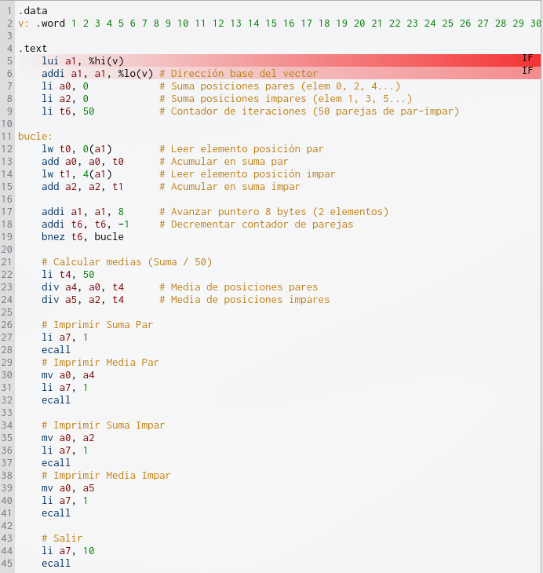
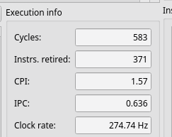
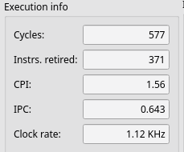
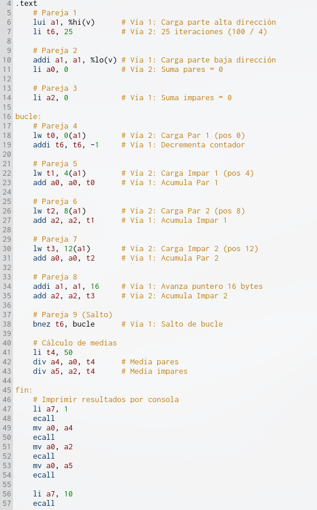
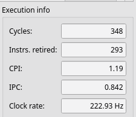

# Ejercicios del capítulo 4

## Ejercicio 5.1. 
Copia de `https://bit.ly/3pchzlQlalistade100númerosenterosaleatoriosque`
aparecen, pégalos en el editor de Ripes y **sepáralos con comas**, introduciéndolos
como un **vector en tu programa**. A continuación, escribe el código necesario para
obtener la suma y mostrarla en la consola. A partir de ese código lleva a cabo las
siguientes acciones:

> No va el link así que para hacer el ejercicio copiad directamente de aquí:

```asm
v: .word 1 2 3 4 5 6 7 8 9 10 11 12 13 14 15 16 17 18 19 20 21 22 23 24 25 26 27 28 29 30 31 32 33 34 35 36 37 38 39 40 41 42 43 44 45 46 47 48 49 50 51 52 53 54 55 56 57 58 59 60 61 62 63 64 65 66 67 68 69 70 71 72 73 74 75 76 77 78 79 80 81 82 83 84 85 86 87 88 89 90 91 92 93 94 95 96 97 98 99 100
```

**a) Ejecuta el programa con la confguración de cinco etapas no superescalar y anota el número de ciclos y CPI.**

**Nos saldrá un código similar a este:**



**Ciclos obtenidos:**




**b) Cambia a la confguración de seis etapas superescalar, ejecuta de nuevo el programa y anota el número de ciclos y CPI.**



**c) Aplica un desenrollado de factor cuatro a fn de incrementar el número de instrucciones disponibles en el programa**
Para procesar 4 elementos por iteración manteniendo la estructura de tu código:

* El contador inicial a2 pasa de 100 a 25 ($100 / 4 = 25$)

* En cada vuelta leemos 4 palabras consecutivas usando desplazamientos: `0(a1)`, `4(a1)`, `8(a1)` y `12(a1)`

* Avanzamos el puntero de memoria en 16 bytes (`addi a1, a1, 16`) en lugar de 4.

**Código**




**d) Empareja las instrucciones y marca aquellos pares en los que surjan riesgos estructurales. Reordena para evitarlos, de forma que no haya parejas de dos instrucciones de acceso a memoria o de salto.**

* **Riesgo Estructural de Memoria**: No podemos poner dos instrucciones lw seguidas porque solo hay una unidad de memoria en la Vía 2. Intercalamos lw con sumas y decrementos de contador

**e) Identifca otro tipo de riesgos, como los RAW y WAR/WAW, si es preciso ayudándote del cronograma y la vista del cauce mientras ejecutas paso a paso. Reordena donde sea posible para reducir esos riesgos.**

* **Riesgos RAW / Latencia de Carga:** Usamos cuatro registros temporales (t0, t1, t2, t3). Intercalamos la carga del siguiente elemento mientras la Vía 1 suma el elemento cargado anteriormente, eliminando así las paradas (stalls).

**f) Ejecuta la versión fnal del programa, anota número de ciclos y CPI.**



**g) Resume en una tabla los ciclos, CPI y ganancia de rendimiento de cada versión respecto a la anterior**

| Versión del programa / Configuración | Ciclos (Cycles) | CPI | Instrucciones (Instrs. retired) | Ganancia de rendimiento (respecto a la versión anterior) | Ganancia de rendimiento (respecto a la versión inicial) |
|---|---:|---:|---:|---:|---:|
| a) Código original (5-Stage / Escalar) | 809 | 1.6 | 506 | — (Referencia) | — (Referencia) |
| b) Código original (6-Stage Dual-Issue / Superescalar) | 806 | 1.59 | 506 | +0.37% | +0.37% |
| f) Código optimizado (Desenrollado x4 y Reordenado) | 331 | 1.17 | 283 | +143.50% | +144.41% |


**Explicación de los cálculos de ganancia:**

* De a) a b) (Cambio de procesador sin optimizar código):

$$\text{Ganancia} = \left(\frac{809 - 806}{806}\right) \times 100 = \mathbf{+0.37\%}$$

> La mejora es prácticamente nula ($0.37\%$) porque, aunque el hardware admite dos vías, las dependencias del código original obligan a emitir casi todas las instrucciones de una en una.

* De b) a f) (Optimización con desenrollado x4 y reordenación estática):$$\text{Ganancia} = \left(\frac{806 - 331}{331}\right) \times 100 = \mathbf{+143.50\%}$$

> Al eliminar los riesgos estructurales y de datos, la CPU aprovecha las 2 vías reduciendo los ciclos a menos de la mitad y haciendo bajar el CPI de $1.59$ a $1.17$.

Ganancia Total (f respecto a la versión inicial a):$$\text{Ganancia Total} = \left(\frac{809 - 331}{331}\right) \times 100 = \mathbf{+144.41\%}$$


## Ejercicio 5.2. 
Copia de https://bit.ly/3pchzlQ una nueva lista de 100 números enteros y prepáralos para usarlos desde un nuevo programa. Este deberá calcular por separado la media aritmética de los **valores que ocupan posición impar** y **la de los que ocupan posiciones pares**, mostrando por la consola ambas sumas y promedios. Completado el programa, repite los pasos indicados para el ejercicio 5.1.


**1. Código Base Original (Apartados a y b)**
En esta versión procesamos los números de uno en uno dentro de un bucle de 100 iteraciones. En cada vuelta comprobamos el contador para alternar entre sumar a la suma par (`a0`) o a la suma impar (`a2`)



**a) Ejecución en 5-Stage Processor (Escalar)**



**b) Ejecución en 6-Stage Dual-Issue (Superescalar sin optimizar):**



**2. Código Optimizado: Desenrollado (Factor 4) y Reordenación por Parejas (Apartados c, d, e y f)**

Aplicamos un **factor de desenrollado 4** (procesamos 4 elementos por iteración: 2 pares y 2 impares). Con 100 elementos, realizaremos 25 iteraciones ($100 / 4 = 25$)



**Resultados optimizados**


**Identificación y Solución de Riesgos (Apartados d y e)**

* **Riesgos Estructurales de Memoria (Etapa MEM):**

    * **Problema**: El cauce superescalar solo dispone de un bus de memoria (Vía 2). Intentar ejecutar dos instrucciones de carga (lw) consecutivas genera una detención (stall)

    * **Solución**: Intercalamos cada lectura de memoria (lw) con una operación aritmética (add o addi) que pueda emitirse concurrentemente por la Vía 1

* **Riesgos de Datos (RAW - Latencia de Carga):**

    * **Problema**: Si intentamos usar el valor de un registro inmediatamente en la instrucción siguiente a su carga (lw), el procesador se detiene a esperar a que complete la etapa de acceso a memoria

    * **Solución**: Usamos 4 registros temporales distintos (t0, t1, t2, t3). Mientras la Vía 2 carga el siguiente dato, la Vía 1 va procesando y sumando el dato cargado en la pareja anterior

* **Riesgos de Control (Saltos):**

    * **Problema**: Los saltos (bnez) en un cauce superescalar descargan las instrucciones de la segunda vía y penalizan el rendimiento

    * **Solución**: El desenrollado a factor 4 reduce las iteraciones de 50 a 25, eliminando la mitad de las operaciones de salto del programa original

| Versión del programa / Configuración | Ciclos (Cycles) | CPI | Instrucciones (Instrs. retired) | Ganancia (respecto a versión anterior) | Ganancia (respecto a versión inicial) |
|---|---:|---:|---:|---:|---:|
| a) Código Base (5-Stage / Escalar) | 583 | 1.57 | 371 | — (Referencia) | — (Referencia) |
| b) Código Base (6-Stage Dual-Issue sin optimizar) | 577 | 1.56 | 371 | +1.04% | +1.04% |
| f) Código Optimizado (Desenrollado x4 y Reordenado) | 348 | 1.19 | 293 | +65.80% | +67.53% |

## Ejercicio 5.3. 

Copia de https://bit.ly/3pchzlQ una nueva lista de 100 números enteros y prepáralos para usarlos desde un nuevo programa. Este deberá calcular por separado la media aritmética de aquellos valores que sean impares, por una parte, y la de los que sean pares, por otra, mostrando por la consola ambas sumas y promedios. Completado el programa, repite los pasos indicados para el ejercicio 5.1.
