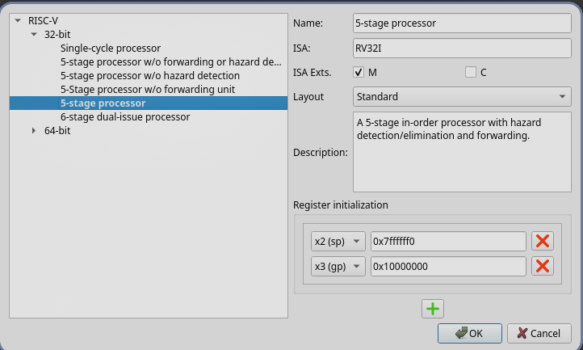
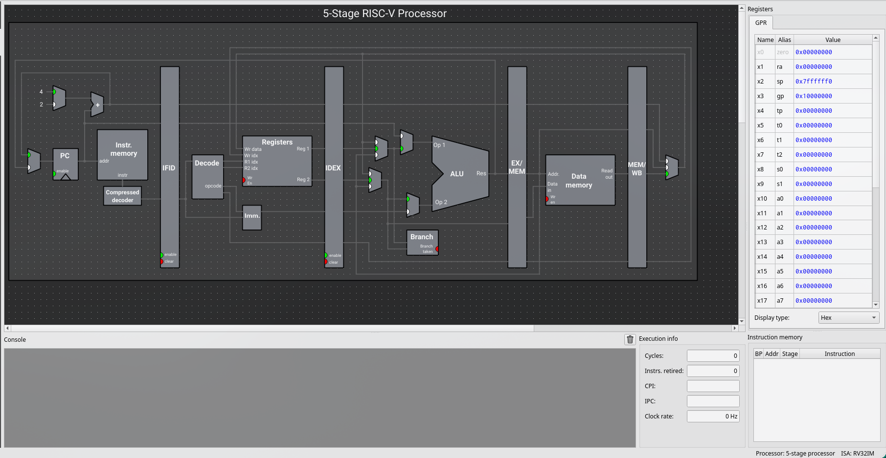
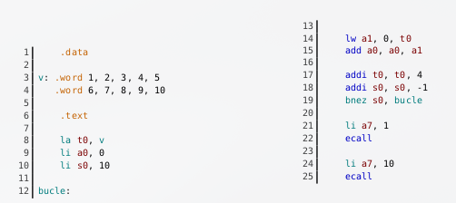
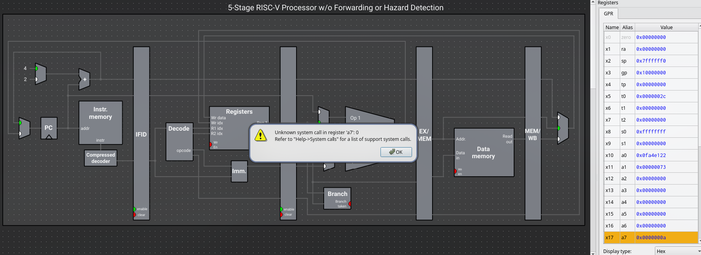
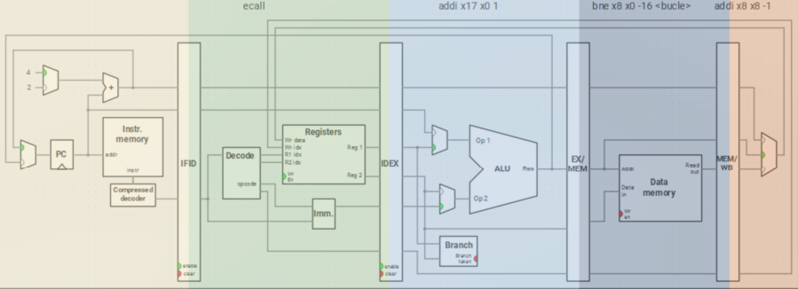
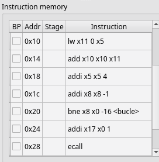
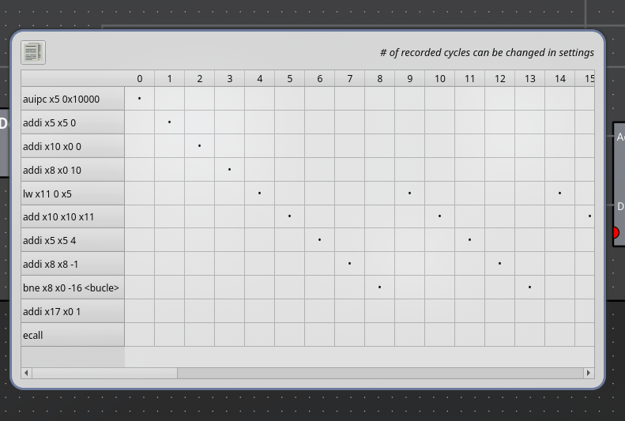
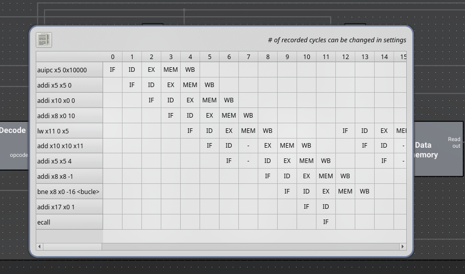
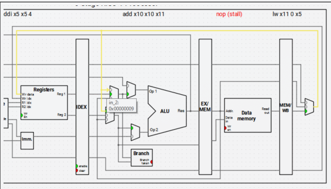

# Tema 3: Segmentación del cauce y riesgos de datos

## 3.1-Introducción

La **segmentación del cauce de ejecución** es una de las técnicas más habituales para mejorar el rendimiento de un procesador. A pesar de que diferentes procesadores expongan la misma `ISA` (Instruction Set Architecture), pueden implementarla de varias maneras

**Nota importante:** El número de etapas del cauce depende del diseño de cada CPU:
* **5 etapas** (clásicas): Ripes, muchos RISC-V
* **4 etapas**: ESP32-C3
* **9 etapas**: Spacemit X60

En esta práctica trabajaremos con las **cinco etapas clásicas** que también utiliza Ripes

---

### 3.2-Configuración del Procesador en Ripes

#### Selección de la Configuración

El botón de configuración situado la ventana de **Processor** y en el icono del **procesador**, si lo abrimos nos desplegará algo así: 




##### Single-cycle Processor (Referencia)
* **Cada instrucción se ejecuta en 1 ciclo de reloj**
* Punto de referencia para medir mejoras de rendimiento
* Teóricamente ideal (en procesadores reales no es posible)

> **Razón**: las instrucciones deben ser traídas desde memoria, descodificadas, esperar operandos y escribir resultados

##### 5-stage Processor (Defecto)
* Arquitectura con cauce segmentado de **cinco etapas**
* Etapas: IF (Instruction Fetch), ID (Instruction Decode), EX (Execute), MEM (Memory), WB (Write Back)
* Permite analizar riesgos de datos y mejoras reales

### 3.3-Vista del Cauce de Ejecución

El botón **Processor** en la barra lateral de Ripes abre una vista que permite:

- **Examinar el cauce de ejecución** en tiempo real
- **Visualizar el estado de los registros**
- **Ver la lista de instrucciones** en orden de ejecución
- **Obtener estadísticas de ejecución:**
  - Número de instrucciones completadas
  - Ciclos totales
  - Ciclos por instrucción (CPI)
  - Instrucciones por ciclo (IPC)




**Características:**
* Situar el puntero del ratón sobre cualquier entrada/salida muestra su contenido
* Un clic sobre cualquier línea de conexión la ilumina para mostrar las partes del procesador que comunica


### 3.4-Determinar Mejoras de Rendimiento

#### Unidad de Medida
**Se utiliza el número de ciclos** que tarda el programa en completarse, no el tiempo real. Se hace porque:

* Un programa ineficiente podría tardar menos en un procesador de mayor frecuencia
* El número de ciclos es una medida independiente de la frecuencia

#### Punto de Referencia
La **configuración Single-cycle processor** actúa como punto de referencia inicial para comparar resultados.

#### Procesador Sin Segmentar (Referencia Teórica)
* Cada instrucción tarda **5 ciclos** en ejecutarse (1 por fase)
* Fases: 
```
IF → ID → EX → MEM → WB
```
---
#### Ejemplo


#### Cálculo de Ciclos

**Registros utilizados:**

    t0: puntero que avanza por el vector
    a0: acumulador de la suma
    s0: contador del bucle

**Ejecución:**
    Single-cycle processor: 58 ciclos
    Procesador sin segmentación (×5): 290 ciclos aproximados


### 3.4.2-Ciclos en Otras Configuraciones

Una vez obtenida la medida de referencia (290 ciclos), se pueden analizar otras configuraciones aplicando fórmulas de ganancia y rendimiento.

#### Ganancia Teórica del Cauce Segmentado

En una arquitectura con cauce segmentado de 5 etapas, en el caso perfecto:

    Ganancia teórica: 400% (5 veces más rápido)
    Se empleería 1/5 de los ciclos

**Realidad:** La segmentación introduce problemas que reducen considerablemente esta ganancia teórica:

* **Riesgos de datos**
* **Riesgos de control**
* **Conflictos de recursos**
---
### 3.5-Riesgo de Datos
**Concepto**
Al ejecutar múltiples instrucciones en paralelo es posible que aparezcan **dependencias de datos** en instrucciones consecutivas

* **Ejemplo**
Con el código anterior cambiamos la configuración y ponemos esta: `5-stage processor w/o forwarding or hazard detection`



Cuando ejecutamos el programa anterior en esta configuración, genera un error aunque el código sea correcto

---
### 3.5.1 Problemas de la Segmentación
#### Dependencia de Datos (RAW - Read After Write)

Una instrucción intenta leer un registro **antes de que la instrucción anterior haya escrito en el**

* **Consecuencias**
    * La CPU procesa varias instrucciones en paralelo sin comprobación de dependencias
    
    * Las instrucciones utilizan valores obsoletos de los registros
    
    * El programa produce resultados incorrectos o errores inesperados

* **Ejemplo**:
```asm
li a7, 1          # Escribe en a7
ecall             # Lee a7 (problema: valor aún no escrito)
```
#### Herramientas de Visualización en Ripes


**1. Vista Editor**
* Las instrucciones en el cauce aparecen destacadas con tonalidades de rojo
* En el margen derecho se indica la etapa actual de cada instrucción

**2. Vista Processor - Panel Instruction Memory**
* Muestra la etapa de cada instrucción
* Se actualiza dinámicamente conforme avanza la ejecución


**3. Navegación Paso a Paso**
* `F5`: avanzar al siguiente ciclo
* `F4`: retroceder al ciclo anterior

**4. Ventana Pipeline Diagram**
* Se abre con el botón en la parte superior de la vista Processor (seleccionando el icono que parece una tabla)
* Proporciona un cronograma completo de toda la ejecución
* Permite ver qué etapa ocupaba cada instrucción en cada ciclo
* Incluso funciona después de que el programa ha terminado

> Si no funciona o lo pone en gris quita la instrucción de li a7,10 ecall 



Esto sería el ejemplo para visualizarlo con la configuración: `Single-cycle processor` si ponemos alguna similar a la de **5-stage processor** nos saldrá así y podremos analizarlo más claramente




**Configuración:**
> Por defecto muestra solo los primeros 100 ciclos
    Para cambiar: Edit > Preferences > Environment > Max. pipeline diagram cycles

### 3.5.2 Etapas de ejecución y cronograma
**Las 5 etapas del Cauce**

| Etapa | Sigla | Función | 
| -- | -- | -- | 
| **Instruction Fetch** | `IF` | Captación de la instrucción desde memoria | 
| **Instruction Decode** | `ID` | Decodificación y lectura de operandos | 
| **Execute** | `EX` | Ejecución en la ALU | 
| **Memory** | `MEM` | Acceso a memoria (si es necesario) | 
| **Write Back** | `WB` | Escritura de resultados en registros | 

### 3.5.3 Análisis de la ejecución en el cronograma
Se distribuyen de izquierda a derecha según el orden en el que se hayan ejecutado

**Latencia Inicial: Primeros 5 Ciclos**

* **Ciclo 0:**
    * Se capta la primera instrucción (etapa IF)
    *   Resto de etapas vacías

* **Ciclo 1:**
    * Primera instrucción → ID
    * Segunda instrucción capturada → IF

* **Ciclo 2:**
    * Primera instrucción → EX
    * Segunda instrucción → ID
    * Tercera instrucción capturada → IF

* **Ciclo 3:**
    * Primera instrucción → MEM
    * Segunda instrucción → EX
    * Tercera instrucción → ID
    * Cuarta instrucción capturada → IF

* **Ciclo 4:**
    * Primera instrucción → WB (finaliza)
    * Segunda instrucción → MEM
    * Tercera instrucción → EX
    * Cuarta instrucción → ID
    * Quinta instrucción capturada → IF

* **A partir del ciclo 4:**
    * Todas las 5 etapas están ocupadas
    * La CPU finaliza 1 instrucción por ciclo (en caso ideal)
    * Se aprovecha al máximo el paralelismo
----
### 3.5.4 Solución por Software: Introducción Manual de Paradas (`nop`)

Para resolver las dependencias sin modificar el hardware, se deben insertar **ciclos de parada (*stalls* o burbujas)** usando la pseudoinstrucción `nop` (`addi x0, x0, 0`).

**1. Funcionamiento**
* **`nop`**: No altera el estado de los registros (`x0` es inmutable), pero consume un ciclo en cada etapa del cauce.
* **Cálculo de `nop` necesarios**: Depende de la distancia entre la instrucción que genera el dato y la que lo consume.
  * *Ejemplo (`ecall`)*: Lee registros en la etapa **ID**. Si la instrucción previa escribe en **WB**, se requieren **3 `nop`** intermedios para dar tiempo a que complete las etapas EX, MEM y WB.

**2. Puntos Críticos y Soluciones en el Código**
* **Lectura tras carga (`lw` $\rightarrow$ consumo)**: `lw a1, 0(t0)` necesita llegar a MEM para leer el dato. La instrucción `add a0, a0, a1` lo requiere en EX/ID $\rightarrow$ Se insertan **2 `nop`**
* **Dependencia de control en bucles**: `addi s0, s0, -1` modifica el registro de control que evalúa `bnez s0, bucle` $\rightarrow$ Se insertan **2 `nop`**
* **Llamadas al sistema (`ecall`)**: Requieren que el valor de `a7` esté consolidado $\rightarrow$ Se insertan **3 `nop`**

**3. El Problema de las Pseudoinstrucciones (`la`)**
* La pseudoinstrucción `la t0, v` es descompuesta por el ensamblador en dos instrucciones físicas (`lui` + `addi`).
* **Riesgo**: No se pueden insertar `nop` *dentro* de una pseudoinstrucción.
* **Solución**: Desglosar manualmente la pseudoinstrucción e introducir las paradas correspondientes:
  
```assembly
  lui t0, %hi(v)
  nop
  nop
  addi t0, t0, %lo(v)
```

**Modificación del código anterior**
```asm
.data
v: .word 1, 2, 3, 4, 5, 6, 7, 8, 9, 10

.text
    # Carga de dirección desglosada
    lui t0, %hi(v)
    nop
    nop
    addi t0, t0, %lo(v)
    li a0, 0
    li s0, 10

bucle:
    lw a1, 0(t0)
    nop
    nop
    add a0, a0, a1

    addi t0, t0, 4
    addi s0, s0, -1
    nop
    nop
    bnez s0, bucle

    # Salida por pantalla
    li a7, 1
    nop
    nop
    nop
    ecall

    # Fin de programa
    li a7, 10
    nop
    nop
    nop
    ecall
```

### 3.5.5. Solución por Hardware: Detección Automática de Riesgos
> **Procesador**: 5-Stage processor w/o forwarding unit (sin unidad de adelantamiento)

**1. Detección de Riesgos por Hardware**
El hardware detecta la dependencia entre registros y congela el cauce (`hardware stall`) insertando burbujas automáticas sin necesidad de modificar el código ensamblador

**2. Comparativa Rendimiento: Manual (nop) vs Hardware automático**

| Métrica | Detención Manual (`nop`) | Detección Automática por Hardware | 
| -- | -- | -- | 
| **Métrica** | 106 (incluye los `nop` como instrucciones) | 58 (solo instrucciones reales) | 
| **Ciclos totales** | 128 | 126 | 
| **CPI (Ciclos por Instrucción)** | 1.21 | 2.17 |

**3. Explicación de la diferencia en CPI**
* **¿Por qué sube el CPI a 2.17 con hardware?**
El CPI se calcula como 

> $\text{Ciclos} / \text{Instrucciones}$

En la versión manual, cada nop cuenta como una instrucción ejecutada con éxito, lo que distorsiona la métrica a la baja ($128 / 106 = 1.21$).En la versión por hardware, los parones no son instrucciones reales ($126 / 58 = 2.17$). El número de ciclos totales es casi idéntico, pero refleja con mayor precisión la ineficiencia provocada por las esperas sin "engañar" al contador de instrucciones

----
### 3.5.6. Solución por Hardware: Adelantamiento de Datos (*Forwarding* / *Bypass*)

**1. Principio de Funcionamiento**
* El resultado de una operación aritmética/lógica está disponible al final de la etapa **EX** (almacenado en el registro intermedio EX/MEM).
* Mediante **caminos de bypass** (rutas de conexión directa y multiplexores), la salida de la ALU se reconduce a la entrada de la propia ALU como operando para la siguiente instrucción
* **Ventaja**: Elimina la necesidad de insertar paradas o `nop` para la mayoría de los riesgos de datos entre instrucciones aritmético-lógicas

**2. Configuración en Ripes**
* Procesador: **`5-stage processor`** (cuenta con unidad de adelantamiento activada)
* **Rendimiento obtenido**:
  * **Ciclos totales**: Baja a **94 ciclos** (frente a 126 sin adelantamiento)
  * **CPI**: Baja a **1.62**

---
### 3.5.7. Limitaciones del Adelantamiento y Reordenación de Código
**1. El Riesgo de Carga (*Load-Use Data Hazard*)**

El adelantamiento **no puede eliminar todas las detenciones**. 
* En una instrucción de carga (`lw`), el dato no se genera en la ALU (etapa EX), sino que **se lee de la memoria en la etapa MEM**.

* Si la instrucción inmediatamente posterior (`add`) necesita ese dato en su etapa EX, se produce una colisión temporal: el dato no está listo a tiempo.

* **Resultado**: El procesador debe insertar obligatoriamente **1 ciclo de parada (stall)**. Una vez leído el dato en MEM, se usa un camino de *bypass* directo hacia EX para continuar sin más retrasos.

**2. Solución por Software: Reordenación de Código (*Code Reordering*)**

Para eliminar el ciclo de parada que provoca la instrucción `lw`, el compilador (o programador) puede **reordenar las instrucciones**, intercalando instrucciones independientes entre la carga y su uso

#### Algoritmo de Reordenación (Proceso Iterativo)
1. **Identificar** el par de instrucciones $d_1$ y $d_2$ con dependencia (ej. `lw` y `add`).
2. **Buscar** una instrucción independiente $I$ (anterior o posterior) que pueda situarse entre ambas sin alterar la lógica.
3. **Intercalar** la instrucción $I$, ejecutar y verificar la corrección del programa.
4. **Repetir** si aún persisten riesgos de datos.



#### Transformaciones Aplicadas en el Código
* **Intercalar `addi` tras `lw`**: Se mueve `addi t0, t0, 4` entre `lw` y `add` para rellenar el hueco del *load-use hazard*.

* **Anticipar el decremento de `s0`**: Se adelanta `addi s0, s0, -1` antes del `add` para alejarlo de la condición de salto `bnez`.

* **Intercambiar inicializaciones**: Se invierte el orden de `li a0, 0` y `li s0, 10` para evitar el riesgo derivado de mover la modificación de `s0`.

#### Optimización del código anterior
```asm
.data
v: .word 1, 2, 3, 4, 5, 6, 7, 8, 9, 10

.text
    la t0, v
    li s0, 10         # Reordenado (antes en línea 9)
    li a0, 0          # Reordenado (antes en línea 8)

bucle:
    lw a1, 0(t0)
    addi s0, s0, -1   # Intercalado entre lw y add (antes en línea 16)
    addi t0, t0, 4    # Intercalado
    add a0, a0, a1    # Movido a la posición 16
    bnez s0, bucle

    # Salida por pantalla
    li a7, 1
    ecall

    # Fin de programa
    li a7, 10
    ecall
```

### 3.6. Comparativa de Rendimiento

A modo de síntesis, las distintas combinaciones de optimización de código y soporte hardware aplicadas a un programa segmentado ofrecen los siguientes resultados:

| Versión del Código / Configuración | Ciclos | CPI | Mejora respecto a la Orig. (%) |
| :--- | :---: | :---: | :---: |
| **Original con detección de riesgos (Hardware Stall)** | 126 | 2.17 | — |
| **Con caminos de adelantamiento (*Forwarding*)** | 94 | 1.62 | **34 %** |
| **Reordenado sin caminos de adelantamiento** | 87 | 1.50 | **45 %** |
| **Reordenado con caminos de adelantamiento** | **84** | **1.45** | **50 %** |

> **Nota**: El objetivo de la optimización mediante software (reordenación) y hardware (adelantamiento) es **eliminar por completo las detenciones por riesgos de datos**, reduciendo los ciclos totales e introduciendo la menor cantidad de burbujas posibles en el cauce

### 3.7. Aspectos Avanzados: Evaluación de Rendimiento en Hardware Real

En hardware real no se dispone del cronograma gráfico de un simulador (como Ripes). Para medir el rendimiento en una CPU física se recurre a contadores dedicados en el silicio

#### 1. Hardware Performance Counters (HPC)
* Registros hardware encargados de medir métricas del sistema en tiempo real:
  * Número de ciclos de reloj transcurridos
  * Número de instrucciones ejecutadas
  * Fallos en la memoria caché o de predicción de saltos
* **Privilegios**: Generalmente protegidos por el sistema operativo. Su acceso requiere herramientas del kernel como **`perf`** en GNU/Linux

#### 2.Registros de Control y Estado (CSR) y Extensión `Zicsr`
* La arquitectura RISC-V implementa hasta **4 096 registros CSR** (*Control and Status Register*) mediante la extensión `Zicsr`

* Se operan con instrucciones especiales cuyo campo de opcodes selecciona la función y utiliza los 12 bits superiores ($2^{12} = 4096$) para direccionar el registro

#### 3. Lectura de Contadores de Rendimiento (`Zicntr`)
La extensión **`Zicntr`** de RISC-V proporciona tres contadores básicos de 64 bits a los que se puede acceder mediante las siguientes pseudoinstrucciones:

| Pseudoinstrucción | Registro CSR | Descripción |
| :--- | :--- | :--- |
| **`rdcycle rd`** | `RDCYCLE` | Guarda en el registro `rd` el número total de **ciclos de reloj** ejecutados por el núcleo. |
| **`rdtime rd`** | `RDTIME` | Guarda en `rd` el número de *ticks* o **tiempo real transcurrido**. |
| **`rdinstret rd`** | `RDINSTRET` | Guarda en `rd` el número de **instrucciones retiradas** (*finalizadas con éxito*). |

#### Cálculo del CPI mediante Contadores
Con las lecturas obtenidas directo del hardware, el **CPI** se calcula mediante la fórmula:

$$\text{CPI} = \frac{\text{RDCYCLE}}{\text{RDINSTRET}}$$