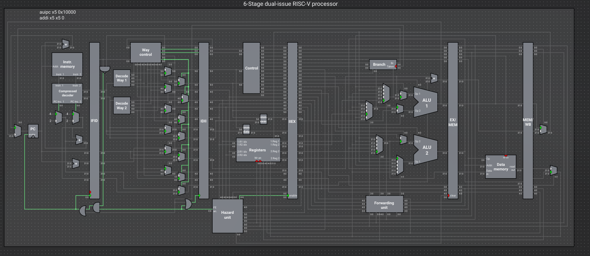
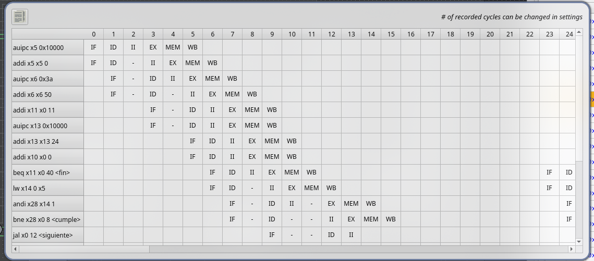
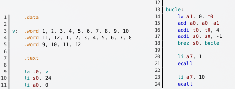
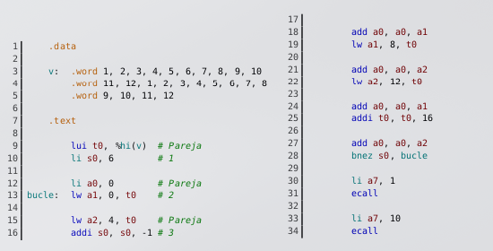
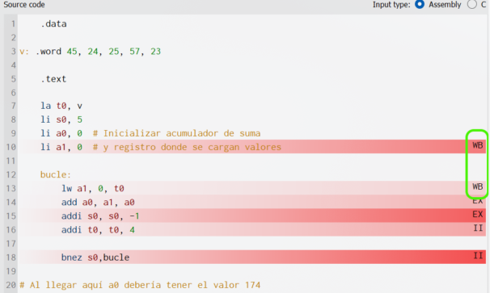

# Tema 5: Arquitectura Superescalar

## 1. Introducción y Conceptos Fundamentales

### ¿Qué es una Arquitectura Escalar vs. Superescalar?

* **Procesador Escalar (Segmentado clásico):**

    * Posee un cauce segmentado (pipelined) convencional

    * Llega **una sola instrucción por ciclo** a la etapa de Ejecución (`EX`)

    * Dispone de **una sola ALU** o unidad funcional principal.

    * **Rendimiento máximo teórico**: $\text{IPC} = 1$ (1 instrucción por ciclo) o $\text{CPI} = 1$

* **Procesador Superescalar:**

    * Incorpora **múltiples unidades funcionales** en la etapa de Ejecución (`EX`)

    * Puede procesar **más de una instrucción simultáneamente** en cada una de las etapas del cauce (no solo a lo largo del procesador)

    * **Capacidad:** Debe ser capaz de captar (`IF`), descodificar (`ID`), emitir (`II`), ejecutar (`EX`), acceder a memoria (`MEM`) y escribir resultados (`WB`) para $n$ instrucciones a la vez en el mismo ciclo de reloj.

## 2. Técnicas para Implementar la Superescalaridad
Para procesar $n$ instrucciones en paralelo en una misma etapa, los procesadores emplean dos soluciones de hardware:

```text
                  ┌──────────────────────────────────────────────┐
                  │    Técnicas de Hardware Superescalar         │
                  └──────────────────────┬───────────────────────┘
                                         │
                 ┌───────────────────────┴───────────────────────┐
                 ▼                                               ▼
┌─────────────────────────────────┐             ┌─────────────────────────────────┐
│     Incremento de Capacidad     │             │    Replicación de Unidades      │
├─────────────────────────────────┤             ├─────────────────────────────────┤
│ Rediseño de unidades para       │             │ Duplicación física de unidades  │
│ manejar más datos en 1 ciclo.   │             │ funcionales complejas.          │
│ Ejemplo: Captador (IF) lee 2    │             │ Ejemplo: Poner 2 ALUs para      │
│ inst. (8 bytes) y PC += 8.      │             │ ejecutar 2 sumas simultáneas.   │
└─────────────────────────────────┘             └─────────────────────────────────┘
```

1. **Incremento de capacidad de la unidad**: Rediseño de una unidad para gestionar más datos por ciclo

> Ejemplo (Etapa IF): En vez de leer 4 bytes (1 instrucción) e incrementar $\text{PC} \leftarrow \text{PC} + 4$, el captador se rediseña para leer 8 bytes (2 instrucciones) simultáneamente en paralelo e hacer $\text{PC} \leftarrow \text{PC} + 8$

2. **Replicación de unidades: Duplicación física de componentes de hardware.**

> Ejemplo (Etapa EX): Como una ALU estándar opera sobre un único par de operandos por ciclo, para ejecutar 2 instrucciones aritméticas simultáneas se colocan 2 ALUs en paralelo

### Requisitos adicionales de hardware
* **Estructuras de almacenamiento temporal**: Registros de segmentación más anchos para guardar la información de $n$ instrucciones simultáneas

* **Líneas/Buses duplicados**: Múltiples buses de datos e instrucciones en paralelo

* **Lógica de sincronización y control compleja:** Verificación de riesgos ampliada para gestionar múltiples instrucciones cruzadas en el mismo ciclo

## 3. Configuración Superescalar en Ripes (`6-stage dual-issue`)

En el simulador Ripes, la opción `6-stage dual-issue processor` simula un procesador RISC-V superescalar con las siguientes especificaciones clave:

* **Grado de emisión: 2 vías (Dual-Issue)** $\rightarrow$ Procesa hasta 2 instrucciones en paralelo por ciclo

* **Tipo de Planificación: Estática** $\rightarrow$ Las instrucciones se ejecutan obligatoriamente en el estricto orden original en el que aparecen en el código fuente (In-Order)

* **Número de etapas: 6 etapas (frente a las 5 del cauce clásico).**

```text
CAUCE DE 6 ETAPAS EN RIPES (DUAL-ISSUE)
                      
   ┌───────┐     ┌───────┐     ┌───────┐     ┌───────┐     ┌───────┐     ┌───────┐
   │  IF   │ ──► │  ID   │ ──► │  II   │ ──► │  EX   │ ──► │  MEM  │ ──► │  WB   │
   └───────┘     └───────┘     └───────┘     └───────┘     └───────┘     └───────┘
  Fetch 2 inst.  Decode 2    Issue/Riesgos    2 ALUs       1 Memoria      2 Writes
```




### Especialización de las Vías (Ways) de Ejecución
Las 2 vías de este procesador no son idénticas; ejecutan tipos específicos de instrucciones:

| Vía (Way) | Tipos de Instrucciones Permitidas | 
| -- | -- | 
| **Vía 1** | Aritméticas, Saltos (`bnez`, `beq`, `j`, etc.), Instrucciones de sistema (`ecall`)
| **Vía 2** | Aritméticas, Carga de memoria (`lw`), Almacenamiento en memoria (`sw`)

> Observación: Las instrucciones aritméticas (como `add`, `addi`, `sub`) pueden ir por cualquiera de las dos vías, pero el resto de instrucciones están restringidas a una vía específica

## 4. Análisis Etapa por Etapa del Cauce de 6 Etapas

```text
┌──────────────────────────────────────────────────────────────────────────────────────────┐
│ ETAPA 1: IF (Instruction Fetch / Captación)                                              │
├──────────────────────────────────────────────────────────────────────────────────────────┤
│ • Dos buses de 32 bits leen 2 instrucciones en paralelo desde la Memoria/Caché.         │
│ • El PC se actualiza sumándole +8 (o +4 si solo se puede captar o saltar).                │
└──────────────────────────────────────────────────────────────────────────────────────────┘
                                           │
                                           ▼
┌──────────────────────────────────────────────────────────────────────────────────────────┐
│ ETAPA 2: ID (Instruction Decode / Descodificación)                                       │
├──────────────────────────────────────────────────────────────────────────────────────────┤
│ • Contiene 2 unidades 'Decode' en paralelo.                                              │
│ • La unidad 'Way Control' analiza las instrucciones e intenta asignar la primera         │
│   a la Vía 1 y la segunda a la Vía 2. Redirige según el tipo de instrucción.             │
└──────────────────────────────────────────────────────────────────────────────────────────┘
                                           │
                                           ▼
┌──────────────────────────────────────────────────────────────────────────────────────────┐
│ ETAPA 3: II (Instruction Issue / Emisión) ───► ¡NUEVA ETAPA EN ESTA ARQUITECTURA!        │
├──────────────────────────────────────────────────────────────────────────────────────────┤
│ • Unidad de Control de Emisión + Circuitería Ampliada de Detección de Riesgos.           │
│ • Si NO hay riesgos: Emite AMBAS instrucciones simultáneamente a la etapa EX.             │
│ • Si HAY riesgos: Emite únicamente la 1ª instrucción y retiene (stall) la 2ª.           │
└──────────────────────────────────────────────────────────────────────────────────────────┘
                                           │
                                           ▼
┌──────────────────────────────────────────────────────────────────────────────────────────┐
│ ETAPA 4: EX (Execution / Ejecución)                                                      │
├──────────────────────────────────────────────────────────────────────────────────────────┤
│ • Cuenta con 2 ALUs (permite 2 operaciones aritméticas al mismo tiempo).                 │
│ • Cuenta con SOLO 1 unidad 'Branch' para saltos (solo 1 salto por ciclo).                │
└──────────────────────────────────────────────────────────────────────────────────────────┘
                                           │
                                           ▼
┌──────────────────────────────────────────────────────────────────────────────────────────┐
│ ETAPA 5: MEM (Memory Access / Acceso a Memoria)                                          │
├──────────────────────────────────────────────────────────────────────────────────────────┤
│ • Dispone de SOLO 1 módulo de acceso a memoria con un único bus de datos de 32 bits.    │
│ • No se pueden realizar 2 lecturas/escrituras en memoria a la vez.                       │
└──────────────────────────────────────────────────────────────────────────────────────────┘
                                           │
                                           ▼
┌──────────────────────────────────────────────────────────────────────────────────────────┐
│ ETAPA 6: WB (Write Back / Escritura)                                                     │
├──────────────────────────────────────────────────────────────────────────────────────────┤
│ • Conexiones ampliadas con el Banco de Registros para escribir hasta 2 resultados        │
│   diferentes en el mismo ciclo sin conflictos.                                           │
└──────────────────────────────────────────────────────────────────────────────────────────┘
```

## 5. Riesgos en el Cauce Superescalar
En un procesador superescalar con planificación estática surgen riesgos que provocan detenciones (`stalls`), representadas en el cronograma con el símbolo `-`

```text
Tipos de Riesgos
                                      │
         ┌────────────────────────────┼────────────────────────────┐
         ▼                            ▼                            ▼
┌─────────────────┐          ┌─────────────────┐          ┌─────────────────┐
│   Estructural   │          │ Control (Salto) │          │ Data (RAW/WAR)  │
└─────────────────┘          └─────────────────┘          └─────────────────┘
```

### 1. Riesgos Estructurales
Ocurren cuando dos instrucciones captadas en el mismo ciclo compiten por una unidad funcional limitada del hardware

* **Caso 1: Dos accesos a memoria juntos (`lw`/`sw` + `lw`/`sw`)**

    * Causa: Solo existe 1 bus de datos en la etapa `MEM`

    * Solución: Se emite la primera instrucción por la Vía 2 y la segunda se detiene para el siguiente ciclo

* **Caso 2: Dos instrucciones de salto juntas**

    * Causa: Solo hay 1 componente `Branch` en la etapa `EX`

    * Solución: Se ejecutan secuencialmente en ciclos consecutivos.

* **Caso 3: Dos llamadas al sistema (`ecall` + `ecall`)**
    * Causa: Solo la Vía 1 puede procesar `ecall`


### 2. Riesgo de Control (Saltos)

* Ocurre al procesar una instrucción de salto (ej. `bnez`) captada junto a otra instrucción por la Vía 1

* **Comportamiento**: Como no se dispone de un predictor de saltos complejo, se emite únicamente la instrucción de salto. La instrucción captada en la segunda vía se **detiene/cancela** inmediatamente para evitar ejecutar erróneamente instrucciones de un flujo que no corresponde

### 3. Riesgos de Datos (RAW y WAR)
Ocurren al procesar dos instrucciones aritméticas en paralelo cuando hay dependencia de registros

* **Riesgo RAW (Read After Write - Lectura tras Escritura)**: La segunda instrucción intenta leer un registro que la primera instrucción está calculando/escribiendo

* **Riesgo WAR (Write After Read - Escritura tras Lectura) / Escritura Coincidente:**

    * Ocurre si ambas instrucciones escriben sobre el **mismo registro de destino** en la etapa `WB` (por ejemplo, dos instrucciones seguidas que modifican `x5`)

    * Solución del hardware: Para evitar escrituras simultáneas e inconsistencias en el banco de registros, la unidad de emisión emite la primera instrucción en el ciclo actual y frena la segunda hasta el ciclo siguiente


## 6. Interpretación del Cronograma (Pipeline Diagram)
En un cauce escalar tradicional (5 etapas), el cronograma avanza con **1 instrucción nueva por fila/ciclo** formando una escalera perfecta

En el cauce superescalar (6 etapas, 2 vías):

* Se observan **2 instrucciones dentro de la misma etapa en un mismo ciclo**



* **Capacidad máxima teórica**: Hasta $6 \times 2 = 12$ instrucciones activas simultáneamente en el procesador

## 7. Preparación del código

### 1. El problema
Al cambiar la configuración del procesador de un cauce estándar (5 etapas) al superescalar de 6 etapas (dual-issue), la expectativa intuitiva es que el programa se ejecute al doble de velocidad. Sin embargo, al ejecutar un código convencional no planificado, se observa que **el rendimiento penas varía o incluso empeora**




| Métrica | Cauce Estándar (5 etapas) | Superescalar (6 etapas) Sin Planificar | 
| -- | -- | -- | 
| **Ciclos totales** | 206 ciclos | 205 ciclos | 
| **CPI (Cycles Per Instruction)** | 1.61 | 1.61 | 

### 1.2 ¿Por qué el rendimiento no mejora automáticamente?

**1. Dependencias y Riesgos continuos:** Si las instrucciones adyacentes en el código tienen dependencias entre sí (p. ej., una calcula un valor que la siguiente necesita leer, o ambas son de memoria), la unidad de emisión (`II`) solo puede emitir una instrucción por ciclo

**2. Penalización por la 6.ª etapa**: El cauce superescalar tiene 6 etapas en lugar de 5. Si la emisión es individual (las instrucciones van de una en una por haber riesgos), el programa tardará más tiempo en ejecutarse en la CPU superescalar (hasta un **20% de penalización adicional** por instrucción debido a la etapa extra `II`)

### 2. Metodología de Optimización: Desenrollado y Planificación Estática
Para optimizar un programa para un cauce superescalar con **planificación estática**, se aplican dos fases:

```text
┌───────────────────────────┐     ┌───────────────────────────┐     ┌───────────────────────────┐
│     1. Código Inicial     │ ──► │  2. Desenrollar Bucles    │ ──► │  3. Reordenar Parejas     │
│  Bucle pequeño, depend.   │     │  Crear ventana amplia de  │     │  Eliminar riesgos RAW/WAR │
│  frecuentes y saltos.     │     │  instrucciones libres.    │     │  y estructurales.         │
└───────────────────────────┘     └───────────────────────────┘     └───────────────────────────┘
```

#### Paso 1: Desenrollado de Bucles (Loop Unrolling)
En el ejemplo del texto, se aplica un **factor de desenrollado de 4** a un vector de 24 elementos:

* **Menos iteraciones**: Se pasa de 24 iteraciones a solo 6

* **Reducción de riesgos de control:** Cada salto no tomado o tomado penaliza con hasta 2 instrucciones por etapa. Al reducir las iteraciones a la cuarta parte, se eliminan drásticamente las paradas por control

* **Mayor ventana de instrucciones**: En lugar de tener 4 o 5 instrucciones en el bucle, tenemos un bloque grande de instrucciones que nos permite buscar operaciones independientes entre sí

#### Paso 2: Procedimiento para Identificar Riesgos
Para planificar el código estáticamente debemos:

1. **Agrupar en parejas**: Separar el código fuente dejando una línea en blanco cada dos instrucciones. De este modo, se visualizan exactamente qué parejas intentará captar el hardware (`IF`) en el mismo ciclo

2. **Sustituir seudoinstrucciones:** Pseudoinstrucciones como `la t0, v` se traducen en 2 instrucciones reales (`auipc` y `addi`) que generan un riesgo RAW entre sí. Conviene sustituirlas manualmente por instrucciones reales (como `lui t0, %hi(v)`) para tratarlas y moverlas de forma independiente

3.**Analizar la compatibilidad de vías:**

* **Incompatible (Riesgo Estructural)**: Parejas de 2 accesos a memoria (lw + lw), 2 saltos (bnez + bnez) o 2 llamadas (ecall + ecall).

* **Incompatible (Riesgo RAW / WAR / Escritura)**: Parejas aritméticas donde la segunda lee lo que escribe la primera, o donde ambas escriben en el mismo registro

* **Compatible (Sin riesgo)**: Instrucción de Vía 1 + Instrucción de Vía 2 sin dependencias (ej. $Aritmética + Memoria$, $Aritmética + Salto$), o $2\text{ Aritméticas}$ sobre registros completamente distintos

#### Paso 3: Reordenamiento del Código (Código Optimizado)
En el **Listado 5.2**, el código se reordena de forma que en cada pareja la Vía 1 (Aritmética/Salto) y la Vía 2 (Aritmética/Memoria) operen juntas sin chocar:



##### Resultados del Código Optimizado:
| Métrica | Original (Escalar) | Superescalar Sin Optimizar | Superescalar Optimizado | 
| -- | -- | -- | -- | 
| **Ciclos** | 206 | 205 | ~80 ciclos | 
| **CPI** | 1.61 | 1.61  | 1.12 | 
| **Ganancia** | Referencia | ~0% | > 150% de mejora | 

> (Nota: Con optimizaciones adicionales introduciendo instrucciones nop estratégicas, se pueden alcanzar los ~60 ciclos con un $\text{CPI} \approx 0.8$, logrando más de un 200% de ganancia)

### 3. Precauciones y Bugs de Hardware (Sección 5.6.5)
El aumento de complejidad en el hardware superescalar incrementa el riesgo de fallos en el diseño de la CPU o en los simuladores

```text
FALLO DE HARDWARE (BUG EN RIPES)
                      
     Instrucción A (Vía 1):  lw  a1, 0(t0)  ──┐  Ambas escriben en a1
                                              ├──► Llegan juntas a WB
     Instrucción B (Vía 2):  li  a1, 0      ──┘  El valor de memoria SE PIERDE
```



Si antes del bucle inicializamos `li a1, 0`, ocurre un **conflicto de escritura en la etapa WB (Riesgo WAW no detectado)**:

1. Las dos instrucciones que modifican el registro `a1` son emitidas y avanzan en paralelo

2. En la etapa `WB`, **ambas intentan escribir a la vez en el registro** `a1`.

3. **Consecuencia**: El valor leído de memoria (`lw`) es sobrescrito y borrado por la inicialización, dando un resultado **final incorrecto en `a0`.**

4. **Lección**: El hecho de que un programa no tenga errores de sintaxis o lógica en ensamblador no garantiza que sea correcto si la CPU (o el simulador) presenta fallos de hardware en el control de dependencias cruzadas

## 8. Aspectos Avanzados de la Arquitectura Superescalar

En los apartados anteriores se estudió el procesador superescalar de Ripes, el cual utiliza **planificación estática** (ejecución estricta en el orden original del programa)

Sin embargo, los microprocesadores comerciales avanzados utilizan **planificación dinámica y ejecución fuera de orden** (out-of-order execution)

### 1. Planificación Dinámica y Ejecución Fuera de Orden
En una arquitectura con planificación dinámica, el hardware recae en el propio cauce para aprovechar las unidades funcionales extendidas

Las instrucciones **se ejecutan en cuanto sus operandos y la unidad funcional requerida están disponibles**, sin importar si respetan el orden original del código fuente

```text
                             MEMORIA / CACHÉ
                                     │
                                     ▼
                          ┌─────────────────────┐
                          │ Cola de Instrucciones│ (Instrucciones captadas)
                          └──────────┬──────────┘
                                     │
                                     ▼
                          ┌─────────────────────┐
                          │ Ventana de Inst.    │ (A la espera de operandos/ALU)
                          └──────────┬──────────┘
                                     │
                                     ▼
                          ┌─────────────────────┐
                          │  Ejecución (EX)     │ (Fuera de orden / In-Order / Parallel)
                          └──────────┬──────────┘
                                     │
                                     ▼
                          ┌─────────────────────┐
                          │  Búfer de Reorden   │ (Garantiza consistencia final)
                          └─────────────────────┘
```

Para implementar esto, la CPU necesita una circuitería mucho más compleja y las siguientes **estructuras de datos clave:**

1. **Cola de instrucciones**: Estructura de datos donde el captador (`IF`) almacena temporalmente las instrucciones que trae desde la memoria

2. **Ventana de instrucciones (o estaciones de reserva)**: Estructura(s) de datos donde las instrucciones aguardan a que sus operandos estén listos y la unidad funcional (ALU, MEM, etc.) esté libre para ser ejecutadas

3. **Búfer de reorden (Reorder Buffer - ROB)**: Estructura que retiene los resultados calculados fuera de orden antes de llevarlos definitivamente al banco de registros o a la memoria, **garantizando que la escritura final de resultados sea consistente y en orden**

4. **Predictor de saltos:** Elemento indispensable en planificación dinámica. En arquitecturas superescalares, el coste de los riesgos de control es muy alto (hay muchas más instrucciones en marcha dentro del cauce); el predictor evita detener el captador especulando sobre el resultado del salto

### 2. Simulador de Arquitecturas Avanzadas: Gem5
Dado que el simulador Ripes no cuenta con una configuración de CPU superescalar dinámica ni fuera de orden, se recurre a herramientas de investigación avanzadas como **Gem5**:

* **¿Qué es Gem5?** Es un simulador de arquitecturas de referencia para investigación (creado con enfoque educativo)

* **Soporte**: Simula múltiples ISAs (Instruction Set Architectures), entre ellas **RISC-V**, x86/x64 y ARM

* **Características principales:**
    * Simula procesamiento superescalar con planificación dinámica, ejecución fuera de orden y predicción de saltos

    * Se ejecuta desde la línea de comandos (carece de interfaz gráfica visual como la de Ripes)

    * Funciona mediante scripts escritos en Python y ejecuta binarios ya compilados (código máquina)

* **Salida de datos (Estadísticas)**: Al finalizar la ejecución, genera un informe extenso con métricas clave como:

    * Número de ciclos y CPI final

    * Instrucciones emitidas, ejecutadas y finalizadas por ciclo

    * Ocupación de las unidades funcionales

    * Accesos y tasa de aciertos/fallos en la Caché y memoria

    * Fallos en la predicción de saltos (*branch mispredictions*)

    