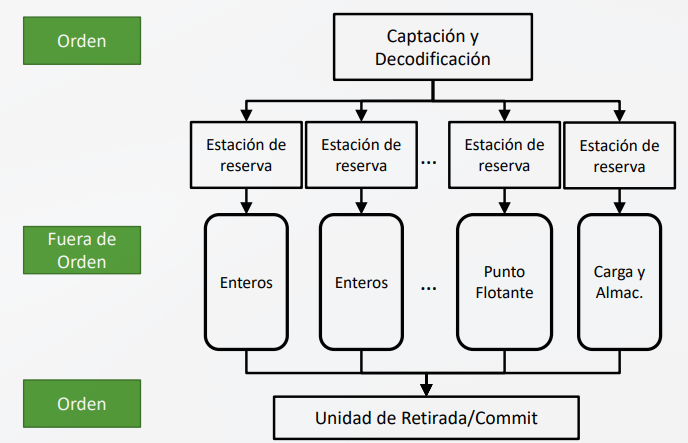

# Procesadores Superescalares: emisión fuera de orden y control de dependencias

Los procesadores superescalares pueden ejecutar múltiples instrucciones por ciclo de reloj. Sin embargo, no todas las instrucciones pueden **ejecutarse simultáneamente**

Para que dos o más instrucciones se ejecuten en paralelo, deben ser independientes

### 1. Principales Limitaciones para el Paralelismo

Existen 4 causas principales que impiden la ejecución en paralelo:

1. Dependencias verdaderas de datos (RAW)

2. Riesgos de control (Saltos condicionales)

3. Conflictos de recursos (Riesgos estructurales)

4. Dependencias falsas de datos (WAR y WAW)

### 2. Dependencias de Datos
### A. Dependencia Verdadera (RAW — Read After Write)

Ocurre cuando una instrucción posterior necesita leer un dato producido por una instrucción anterior

* **Ejemplo**
```text
I1: ADD X3, X1, X2   ; Escribe en X3
I2: SUB X4, X3, X5   ; Lee X3
```

* **Flujo**: $I_1 \rightarrow X_3 \rightarrow I_2$

* **Consecuencia**: $I_2$ debe esperar obligatoriamente a que $I_1$ calcule y escriba el valor de $X_3$

* **Característica clave**: Es una dependencia **real/inherente del programa. NO se puede eliminar** añadiendo más recursos hardware ni mediante renombrado de registros

### B. Dependencias Falsas (WAR y WAW)

No representan un flujo de datos real entre instrucciones, sino un conflicto causado por **reutilizar los mismos nombres de registros**

| Tipo de Dependencia | Nombre | Descripción | Ejemplo | 
| -- | -- | -- | -- | 
| **WAR (Write After Read)** | Escritura tras Lectura | Una instrucción intenta escribir en un registro antes de que una anterior lo lea | $I1$ lee $X3$  $I2$ escribe en $X3$ | 
| **WAW (Write After Write)** | Escritura tras Escritura | Dos instrucciones escriben en el registro. Debe respetarse el orden para mantener el valor final correcto | $I1$ escribe en $X3$ , $I2$ escribe en $X3$ | 

**Nota**: Estas dependencias se denominan "falsas" porque peuden eliminarse en hardware mediante la ténica de **Renombrado de Registros** (Register Renaming)

### 3. Riesgos de Control: Saltos Condicionales
Un salto condicional cambia el flujo de ejecución (decide si continuar en $PC + 4$ o ir a la dirección de destino)

* **El Problema**: Hasta que se resuelve la condición del salto, no se sabe qué instrucciones se deben ejecutar a continuación

* **Impacto Superescalar**: Debido a que el procesador procesa múltiples instrucciones por ciclo, una mala decisión es **muy costosa** (implica descartar muchas instrucciones en progreso)

**Solución: Predicción de Saltos + Ejecución Especulativa**

El procesador "adivina" el camino y ejecuta las instrucciones de forma especulativa:

**Predicción Correcta:** La ejecución continúa sin interrupción.

**Predicción Incorrecta:** Se anulan todas las instrucciones especulativas captadas por el camino equivocado (**Flush**) y se redirige la captación al camino correcto

### 4. Conflictos de Recursos (Riesgos Estructurales)

Ocurre cuando dos o más instrucciones **independientes** necesitan el mismo componente hardware al mismo tiempo

* **Recursos propensos a conflicto:**

* Unidades funcionales (ALUs, multiplicadores, etc.).

* Puertos de lectura/escritura del banco de registros.

* Unidades de Carga/Almacenamiento (Load/Store Units).

* Memorias caché.

Ejemplo:
Si el sistema cuenta con una **sola unidad de multiplicación**:

```text
I1: MUL X3, X1, X2
I2: MUL X6, X4, X5
```

Aunque $I_1$ e $I_2$ son totalmente independientes, no pueden ejecutarse simultáneamente por falta de hardware

**Diferencia clave con RAW**: Los conflictos de recursos sí se pueden solucionar añadiendo más hardware (p. ej., agregando una segunda unidad multiplicadora). Las dependencias RAW no

### 5. Paralelismo del Programa vs. Paralelismo de la Máquina

El rendimiento real depende de la interacción entre el software y el hardware:

```
+-----------------------------------+       +------------------------------------+
|  Paralelismo de Programa (ILP)    |  vs.  |      Paralelismo de Máquina        |
|  (¿Cuánto paralelismo TIENE?)     |       |   (¿Cuánto paralelismo SOPORTA?)   |
+-----------------------------------+       +------------------------------------+
```


1. **Paralelismo a Nivel de Instrucción (ILP - Instruction Level Parallelism):**

* Es inherente al código/programa

* Limitado por dependencias RAW, saltos y el grado de independencia de las instrucciones

2 **Paralelismo de la Máquina:**

* Es la capacidad física del procesador

* Determinado por el ancho de captación/decodificación, el número de unidades funcionales y estructuras internas

**Regla de oro**
> $$\text{Paralelismo Efectivo} \le \min(\text{ILP del Programa}, \text{Paralelismo de la Máquina})$$

* **Conclusión**: Un programa con bajo ILP (muchas dependencias entre instrucciones) dejará infrautilizada una máquina superescalar muy potente. El procesador no puede aprovechar más paralelismo del que el propio programa posee

## Políticas de instrucciones en orden
En un procesador superescalar, el objetivo es **permitir cierta ejecución fuera de orden** para mantener ocupadas las unidades funcionales, pero **sin alterar el resultado** observable del programa

### 1. Los Tres Órdenes en la Ejecución
Para gestionar el flujo de trabajo, debemos distinguir tres momentos y sus respectivos órdenes:

1. **Orden de Emisión (Issue):**

¿Qué es? El momento en el que la instrucción se envía a una unidad funcional para comenzar su ejecución.

> Pregunta clave: ¿En qué orden comienzan a ejecutarse las instrucciones?

2. **Orden de Finalización (Completion / Ejecución):**

¿Qué es? El momento en el que la unidad funcional termina de calcular el resultado

> Pregunta clave: ¿En qué orden terminan de computar las unidades funcionales?

3. **Orden de Retirada (Commit / Write Back):**

¿Qué es? El momento en el que el resultado de la instrucción se confirma y pasa a formar parte del estado arquitectónico del procesador

> Pregunta clave: ¿En qué orden se hacen definitivos los resultados?

### 2. Configuración Estándar del Procesador
En el diseño habitual estudiado:

| Fase del Procesador | Tipo de Ordenación | 
| -- | -- | 
| Captación y Decodificación (IF / ID) |  En orden (In-order) | 
| Ejecución / Emisión (EX) | Puede ser Fuera de orden (Out-of-order) | 
| Retirada / Commit (WB) |  En orden (In-order) | 

### 3. Políticas de Emisión

### A. Emisión en Orden y Retirada en Orden (In-Order / In-Order)

* **Funcionamiento**: Las instrucciones se emiten respetando estrictamente el orden original del programa

* **Problema Principal:** Si una instrucción se bloquea (por esperar un operando o porque la unidad funcional está ocupada), las instrucciones posteriores quedan bloqueadas, incluso aunque sean independientes

* **Ventaja:** Hardware relativamente sencillo

* **Limitación**: Menor capacidad para explotar el paralelismo disponible (ILP)

### B. Emisión en Orden y Retirada Fuera de Orden (In-Order / Out-of-Order)

* **Funcionamiento**: Las instrucciones se emiten en orden, pero pueden terminar y escribir sus resultados fuera de orden si duran menos ciclos

* **Inconveniente:** Introduce riesgos y dependencias falsas (WAW y WAR)

### 4. Análisis Práctico de Dependencias y Riesgos
Tomando como referencia la siguiente secuencia de instrucciones:

$$\begin{aligned} I_1: & \quad X_3 \leftarrow X_2 + X_5 \\ I_2: & \quad X_4 \leftarrow X_3 + 1 \\ I_3: & \quad X_3 \leftarrow X_5 + 1 \\ I_4: & \quad X_6 \leftarrow X_3 + 1 \end{aligned}$$

**Riesgos Identificados:**

* **Dependencia Real (RAW) en $I_1 \rightarrow I_2$**:
    * $I_2$ necesita el valor de $X_3$ calculado por $I_1$
    * **Consecuencia**: $I_2$ no puede ejecutarse hasta que $I_1$ haya finalizado y $X_3$ esté disponible

* **Riesgo WAW (Write After Write) en $I_1 \rightarrow I_3$**:
    * Tanto $I_1$ como $I_3$ escriben en el registro $X_3$
    * **Consecuencia**: Si $I_3$ se completa antes que $I_1$, el valor final de $X_3$ quedará sobrescrito de forma incorrecta por el resultado antiguo de $I_1$

* **Riesgo WAR (Write After Read) en $I_2 \rightarrow I_3$ (Efecto en $I_4$)**:

    * $I_2$ lee $X_3$ (producido por $I_1$), mientras que $I_3$ sobddrescribe $X_3$.

    * **Consecuencia**: Si $I_3$ completa antes que $I_1$, $I_4$ tomará un valor erróneo de $X_3$, produciendo resultados inesperados y errores en la ejecución del programa.

### 5. Introducción a emisión fuera de orden y renombrado de registros

#### 1. Concepto y Mecanismo Base
La Emisión Fuera de Orden (Out-of-Order Issue) desacopla la fase de decodificación de la fase de ejecución para evitar paradas innecesarias en el pipeline

```text
[ Decodificación ] ──► [ Ventana de Instrucciones / Estación de Reserva ] ──► [ Ejecución ]
                                   ▲
                Esperan operandos y disponibilidad de la UF
```

* **Funcionamiento:** Tras decodificarse, las instrucciones van a una estructura intermedia (**Ventana de Instrucciones o Estaciones de Reserva**)

* **Condición de emisión**: Una instrucción se emite a la unidad funcional (UF) únicamente si:

    1. Sus operandos están disponibles.

    2. La Unidad Funcional necesaria está libre

* **Ventaja clave**: Una instrucción bloqueada no detiene a las instrucciones posteriores que sean independientes

#### 2. Limitaciones de la Emisión en Orden vs. Solución

| Política | Problema / Limitación | Solución | 
| -- | -- | -- | 
| **Emisión en Orden** | Si $I_1$ se bloquea, $I_2$ (dependiente de $I_1$) espera y $I_3$ (independiente) también se detiene detrás, desaprovechando el paralelismo | **Emisión Fuera de Orden**: Permite buscar más adelante en el flujo de programa para emitir $I_3$ mientras $I_1$ resuelve sus operandos | 

**Criterios de espera (¿Cuándo no se puede emitir una instrucción?)**

* **Dependencia RAW**: Faltan operandos por calcular

* **Conflicto de recursos**: La Unidad Funcional requerida está ocupada

* **Riesgo de control**: Incertidumbre por un salto condicional mal predicho

* **Límites de hardware**: Ventana de instrucciones o estaciones de reserva llenas, o se alcanzó el límite de emisión por ciclo

> **Regla de Prioridad**: Si varias instrucciones están preparadas al mismo tiempo para la misma UF, el hardware suele dar prioridad a la instrucción preparada más antigua

#### 3. Dependencias Falsas y Renombrado de Registros
Al ejecutar fuera de orden, las **dependencias falsas (WAR y WAW)** se vuelven mucho más críticas debido a la reutilización de nombres de registros lógicos

**Tipos de Dependencias**

* **RAW (Read-After-Write)**: Dependencia real. No se puede eliminar; representa el flujo verdadero de datos

* **WAR (Write-After-Read)**: Antidependencia. Una instrucción posterior intenta escribir en un registro antes de que la anterior lo lea

* **WAW (Write-After-Write)**: Una instrucción posterior intenta escribir en un registro antes de que la anterior escriba su resultado

**Solución: Renombrado de Registros (Register Renaming)**
Consiste en **asignar registros físicos distintos a las diferentes versiones de un mismo registro lógico**

**Ejemplo Práctico:**

**Código Original (Con dependencias falsas):**

```text
I1: X3 <- X3 + X5
I2: X4 <- X3 + 1
I3: X3 <- X5 + 1    ; WAR con I2 (escribe X3) y WAW con I1
I4: X7 <- X3 + X4
```

> Riesgo en código original: $I_2$ necesita leer la versión de $X_3$ producida por $I_1$. Si $I_3$ ejecuta y escribe en $X_3$ demasiado pronto, $I_2$ leerá un valor erróneo

**Tras el Renombrado de Registros (Nombres físicos $X_{3a}$, $X_{3b}$):**

```text
I1: X3a <- X3 + X5
I2: X4  <- X3a + 1   ; Lee explícitamente X3a
I3: X3b <- X5 + 1    ; Escribe en una nueva ubicación física X3b
I4: X7  <- X3b + X4  ; Lee X3b
```

* **Resultado**: $I_3$ ya no tiene que esperar a que $I_2$ lea $X_{3a}$. Se eliminan las dependencias WAR y WAW

#### 4. Políticas de Emisión y Retirada (Commit)
La combinación estándar en procesadores superescalares modernos es: **Ejecución Fuera de Orden + Retirada (Commit) en Orden**

```text
[ Captación / Decodificación ]  ──►  En Orden
[ Ejecución ]                    ──►  Fuera de Orden
[ Retirada / Commit ]            ──►  En Orden
```

* **Commit en Orden**: Los resultados se hacen definitivos en la arquitectura respetando el orden secuencial original del programa

* **Ventajas del Commit en Orden:**

    * Mantiene un estado arquitectónico preciso

    * Facilita la recuperación ante excepciones o interrupciones

    * Permite descartar resultados especulativos si un salto condicional fue predicho de forma errónea

#### 5. Orden Interno y Modelos de Consistencia

| Modelo de Consistencia | Aplicación en el Procesador | Comportamiento | 
| -- | -- | -- |
| **Consistencia de Procesador Fuerte** | Banco de Registros / Estado | Garantiza que las instrucciones completen su estado definitivo en el orden secuencial de captación. Evita conflictos de dependencias en registros | 
| **Consistencia de Memoria Débil** | Accesos a RAM / Caché | Permite reordenar lecturas y escrituras en memoria para mayor eficiencia. Típicamente las escrituras se mantienen en orden y **las lecturas pueden adelantarse** si no hay conflicto de datos | 

**Ejemplos Prácticos de Procesadores Superescalares y Renombrado Dinámico**

**1. Visión Global de la Ejecución Fuera de Orden**
Los procesadores superescalares actuales combinan tres etapas de ejecución con diferentes políticas de orden:


* **Captación / Decodificación (En Orden)**: Las instrucciones entran al pipeline respetando el flujo del programa

* **Estaciones de Reserva / Ventana**: Almacenan instrucciones decodificadas divididas por tipo (Enteros, Punto Flotante, Carga/Almacenamiento)

* **Emisión y Ejecución (Fuera de Orden)**: Si sub no depende de un lw bloqueado (por ejemplo, por un cache miss), la CPU puede emitir y ejecutar sub de forma anticipada

* **Retirada / Commit (En Orden)**: Mantiene la consistencia fuerte del procesador. El banco de registros lógicos se actualiza únicamente en el orden original del código


## 6. Renombrado de Registros (Gestión de WAR y WAW)

### **Registros Lógicos vs. Registros Físicos**

| Concepto | Definición | Ejemplo | 
| -- | -- | -- | 
| **Registro Lógico (Arquitectónico)** | Nombre visible para el programador/compilador en el juego de instrucciones (ISA) | `x1`,`x2`,`x3`,`t0` ... | 
| **Registro Físico** | Almacenamiento real interno del hardware gestionado dinámicamente | `P1`,`P7`,`P12`,`P18` ... | 

> **Principio de Funcionamiento**: Cada nueva escritura en un registro lógico se mapea internamente a un registro físico distinto. El programa "ve" x3, pero la CPU asigna dinámicamente $x_3 \rightarrow P_7$, $x_3 \rightarrow P_{12}$, etc

### Mapeo Práctico de Dependencias Falsas
#### 1. Eliminación de Riesgos WAW (Write-After-Write)
Dos instrucciones independientes intentan escribir en el mismo registro de destino

```text
SIN RENOMBRADO (Riesgo WAW)          CON RENOMBRADO (Sin Riesgo)
I1: ADD X1, X2, X3                  I1: ADD X1a, X2, X3
I2: SUB X1, X4, X5                  I2: SUB X1b, X4, X5
```

* **Consecuencia del riesgo**: Si $I_1$ tarda más ciclos (p. ej., termina en ciclo 8) que $I_2$ (termina en ciclo 6), $I_1$ sobrescribiría $X_1$ al final, dejando un valor incorrecto en la arquitectura

* **Solución**: Al renombrar a $X_{1a}$ y $X_{1b}$, ambas se ejecutan en paralelo sin interferir

#### 2. Eliminación de Riesgos WAR (Write-After-Read / Antidependencia)
Una instrucción posterior sobreescribe el registro que lee una instrucción anterior.

```text
SIN RENOMBRADO (Riesgo WAR)          CON RENOMBRADO (Sin Riesgo)
I1: MUL X1, X2, X3                  I1: MUL X1a, X2, X3
I2: SUB X4, X1, X5  (Lee X1)        I2: SUB X4, X1a, X5
I3: ADD X1, X6, X7  (Escribe X1)     I3: ADD X1b, X6, X7
```

* **Solución: $I_2$** lee explícitamente $X_{1a}$ (producido por $I_1$). $I_3$ escribe en $X_{1b}$. $I_3$ ya no tiene que esperar a que $I_2$ termine de leer para ejecutar

#### 3. Ejemplo Completo de Transformación de Código
#### Análisis de Dependencias (Código Original vs. Renombrado)

**Código Original:**

```text
I1: X3 = X3 * X5
I2: X4 = X3 + 1     # RAW con I1 (usa X3)
I3: X3 = X5 + X6     # WAR con I2 (escribe X3) / WAW con I1 (escribe X3)
I4: X7 = X3 * X4     # RAW con I3 (usa X3) y RAW con I2 (usa X4)
```

**Tras Aplicar Renombrado Dinámico:**
```text
I1: X3b = X3a * X5
I2: X4a = X3b + 1    # Mantiene RAW real (espera a X3b de I1)
I3: X3c = X5  + X6    # Nueva versión física X3c -> WAR y WAW eliminadas
I4: X7a = X3c * X4a  # Mantiene RAW real (espera X3c de I3 y X4a de I2)
```
#### 4. Implementación del Renombrado Dinámico
El renombrado puede realizarse a nivel de software o de hardware:

* **Renombrado Estático**: Lo realiza el compilador mediante una selección de registros lógicos en la fase de generación de código

* **Renombrado Dinámico**: Lo realiza el hardware en tiempo de ejecución. Utiliza:

    * Registros físicos adicionales (Physical Register File)

    * Tablas de mapeo (RAT - Register Alias Table)

    * **Reorder Buffer (ROB)**: Guarda información sobre qué registro lógico representa cada entrada, el estado de disponibilidad del resultado y la versión más reciente del registro

## 7. Lectura de Operandos con Banco de Registros y ROB

El **Reorder Buffer (ROB)** o Buffer de Renombrado es una estructura de datos dinámica que permite almacenar temporalmente los resultados de las instrucciones ejecutadas fuera de orden sin actualizar el banco de registros de forma desordenada

### 1. Campos Estructura del ROB
Para gestionar el estado de cada entrada, el ROB utiliza los siguientes campos clave:

| Campo | Significado | Valores y Descripción | 
| -- | -- | -- | 
| `#` | Número de Línea | Índice o posición física dentro del buffer | 
| `Ev.` | Entrada Válida (Ocupada) |  `1`: Entrada activa y utilizada  `0`: Entrada libre/anulada (ignorada por completo) | 
| `Dest.` | Registro Destino | Número del registro lógico renombrado (p. ej., `4` para $X_4$) | 
| `Valor` | Estado del Dato | `1`: El resultado ya está calculado y disponible `0`: La instrucción está calculando/esperando el dato | 
| `Último` | Versión Más Reciente | `1`: Es la última versión producida del registro destino `0`: Existe un renombrado posterior para este mismo registro | 

### 2. Reglas de Lectura de Registros
Para leer el valor de un registro $X_n$, el procesador evalúa el estado del ROB y del Banco de Registros según la siguiente jerarquía de decisión:

```text
¿Existe entrada en ROB con Ev = 1 y Dest = Xn?
                                /                \
                              NO                  SÍ
                             /                      \
      [Leer del Banco de Registros]        ¿Tiene Último = 1?
                                               /         \
                                             NO           SÍ
                                            /               \
                            (Ignorar esta entrada)   ¿Tiene Válido = 1?
                                                     /                \
                                                   SÍ                  NO
                                                  /                      \
                                    [Leer dato del ROB]       [ESPERAR al ROB]
                                                            (Dato en cálculo)
```

### 3. Emisión de Instrucciones: Lectura y Escritura Simultánea
Al emitir una instrucción que lee y escribe sobre el mismo registro (p. ej., `ADD X3, X2, X1` o `ADD X3, X3, X5`), el orden temporal interno es crítico:

```text
1. LEER OPERANDOS FUENTE  ──► Buscar la versión actual activa (Último = 1) en ROB o Banco.
2. CREAR NUEVO RENOMBRADO ──► Cambiar "Último = 0" a la versión previa y asignar "Último = 1" a la nueva entrada.
```

* **Ejemplo de Emisión**: `ADD X3, X2, X1`

* **Estado Inicial (Antes de Emitir):**
    * `X3` tenía su versión activa en la línea #1 (Último = 1)

**Proceso de Emisión**:

**1. Lectura**: Se identifican las fuentes actuales ($X_1 = 55$ desde línea #0, $X_3 = 33$ desde línea #1)

**2. Actualización del ROB**:
* La versión anterior de $X_3$ (línea #1) pasa a Último = 0
* Se asigna una nueva entrada libre en el ROB (línea #2):
    * `Ev. = 1`, `Dest. = X3`, `Válido = 0`, `Último = 1`

**Transición del ROB:**

| `#` | `Ev.` | `Dest.` | `Valor` | `Válido` | `Último` | 
| -- | -- | -- | -- | -- | -- |
| 0 | 1 | X1 | 55 | 1 | 1 | 
| 1 | 1 | x3 | 33 | 1 | 1 | 
| 2 | 1 | x3 | - | 0 | 0 | 

