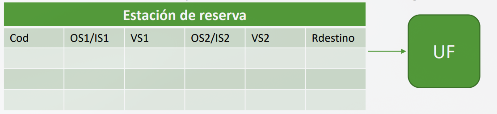
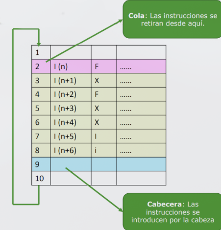
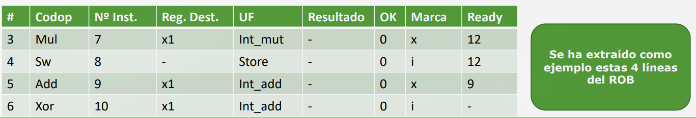
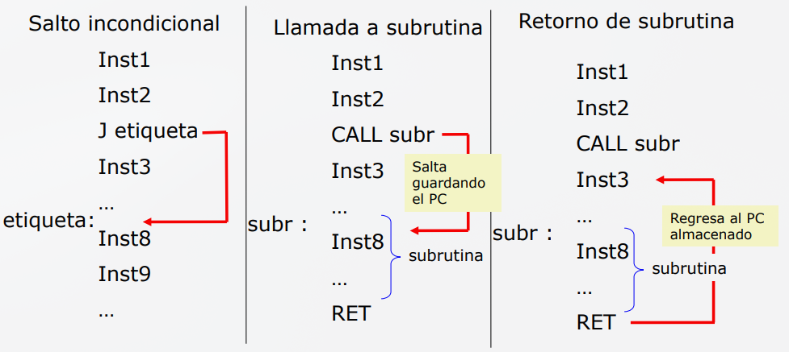
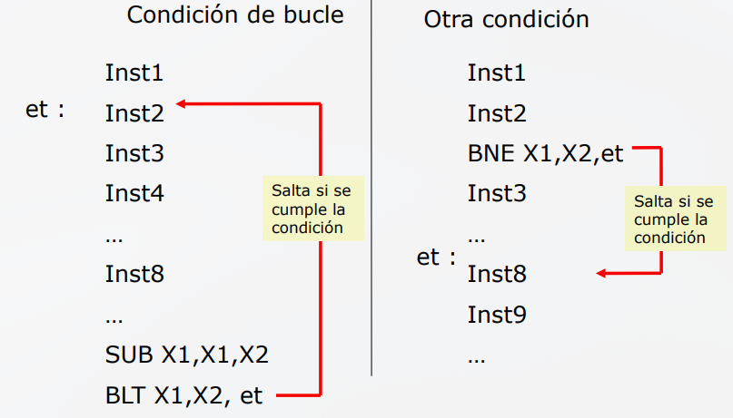

# Tema 4.3. Procesadores Superescalares: Retirada, predicción de saltos y tendencias

## 1. Introducción y Conceptos Clave

Un procesador superescalar busca ejecutar múltiples instrucciones por ciclo de reloj (CPI< 1 o IPC>1) replicando etapas y unidades funcionales (UF)

Para maximizar el rendimiento, aplica **ejecución dinámia fuera de orden (Out-of-Order o OoO)**: las instrucciones se emiten y se ejecutan en cuatno sus operandos y las UFS están libres, sin importar el orden original del programa

### Regla de Hardware

* **Ejecutar fuera de orden**: Para ganar rendimiento

* **Retirar en orden (In-Order Commit)**: Para mantener el orden del programa y asegurar consistencia fuerte (estado preciso ante excepciones o fallos)

## 2. Estaciones de Reserva (RS) y Renombrado de Registros
### 2.1. ¿Qué es una Estación de Reserva (RS)?
Es una estructura buffer hardware que almacena instrucciones ya descodificadas que están esperando a que sus operandos estén disponibles para poder enviarse a una Unidad Funcional

#### Campos de una entrada en la RS:

* `Cod`: Código de la operación
* `OS1 / IS1`: Valor del primer operando (`OS1`) si está disponible; o la línea del ROB (`IS1`) donde debe leerse si aún se está calculando
* `VS1`: Bit de validez del operando 1 (`1` = dato listo/disponible en registro/RS; `0` = renombrado, pendiente de cálculo)
* `OS2 / IS2, VS2`: Equivalente para el segundo operando
* `Rdestino`: Línea del buffer de renombrado (ROB) asignada para guardar el resultado de la instrucción



### 2.2. Renombrado de Registros
El renombrado elimina las dependencias falsas de datos (**WAR** - Write After Read y **WAW** - Write After Write), permitiendo mantener múltiples versiones temporales de un registro arquitectónico

* **RAW (Read After Write)**: Dependencia real; la instrucción consumidora debe esperar

* **WAR y WAW**: Se solucionan asignando el resultado provisional a una nueva entrada en el **ROB** (Reorder Buffer) en lugar de sobreescribir el registro físico inmediatamente

## 3. El Buffer de Reorden (ROB) y la Retirada (Commit)
### 3.1. Estructura y Funcionamiento del ROB
El **ROB** gestiona las instrucciones en una cola FIFO dinámica controlada por dos punteros:

1. **Cabecera (Head)**: Apunta a la posición por donde entran las nuevas instrucciones en orden de programa estricto

2. **Cola (Tail)**: Apunta a la instrucción más antigua que está pendiente de retirarse



**Campos principales del ROB:**
* `#`: Identificador/línea dentro del ROB
* `Codop` / `Nº Inst.`: Tipo e identificador de la instrucción
* `Reg. Dest.`: Registro arquitectónico de destino (ej. `x1`, `x2`)
* `Resultado` & `OK`: Valor calculado y bit de validez del resultado
* `Marca (Estado)`
    * **i (Issued / Enviada)**: En espera o descodificada
    * **x (Execute / En ejecución)**: Calculándose en la UF
    * **f (Finalized / Finalizada)**: Cálculo terminado, resultado guardado en ROB
* `Último`: Bit que indica si esa entrada contiene la versión más reciente del registro destino



### 3.2. Retirada de Instrucciones (Commit / Retirement)

* Finalización vs. Retirada:

    * Finalización: La UF termina el cálculo y pone el bit `OK=1` y la marca a `f` en el ROB. **No modifica el estado de la máquina**

    * Retirada (Commit): El resultado de la instrucción se vuelca al **Banco de Registros principal** o a la **Memoria**, y la instrucción sale del ROB

* Condiciones para Retirar:

1. La instrucción ha finalizado correctamente (`Marca = f`)

2. **Todas las instrucciones anteriores en el ROB ya se han retirado** (está en la cola del ROB)

* **Retirada Múltiple**: Procesadores de "ancho de retirada $N$" pueden retirar hasta $N$ instrucciones por ciclo, pero siempre en estricto orden de programa (comenzando por la más antigua)

## 4. Ejemplos Prácticos de Traza (Paso a Paso)
### 4.1. Ejemplo de Renombrado y Ejecución Fuera de Orden

Considérese el código:

```asm
Mul x2, x0, x1
Add x3, x1, x2
Sub x2, x0, x1
```

* **Ciclo $i+1$**: `Mul` se envía a la RS de multiplicación. Asigna la línea 1 del ROB para `x2`

* **Ciclo $i+2$**: `Add` entra a la RS de sumar. Apunta su segundo operando a la línea 1 del ROB (esperando el x2 de Mul). `Sub` asigna la línea 3 del ROB para su propio `x2`

* **Ejecución fuera de orden**: Aunque `Sub` va después de `Add`, sus operandos están listos en el ciclo $i+2$. Por tanto, Sub pasa a ejecutarse en el ciclo $i+3$ antes que `Add`

* **Escritura en Registro (Retirada)**: Solo se transfieren al Banco de Registros los valores válidos cuyo bit `Último` sea `1`. El `x2` calculado por `Mul` (línea 1) tiene `Último = 0` (porque `Sub` lo sobrescribió conceptualmente), así que su valor intermedio se descarta y jamás contamina el banco de registros

### 4.2. Ejemplo de Retirada Ordenada
Dado el conjunto de instrucciones:

`(I1) mul x1, x2, x3` | `(I2) sw x1, 0(t1)` | `(I3) add x1, x4, x3` | `(I4) xor x1, x1, x3`

* **Ciclo 9**: `Add` (I3) finaliza (`Marca = f`). NO puede retirarse porque Mul (I1) y Sw (I2) aún no terminan

* **Ciclo 10**: `Xor` (I4) finaliza (`Marca = f`). Tampoco puede retirarse

* **Ciclo 12**: `Mul` (I1) y `Sw` (I2) finalizan

* **Ciclo 13**: Asumiendo un ancho de retirada de 2, se retiran **(I1)** e **(I2)**

* **Ciclo 14**: Se retiran **(I3)** e **(I4)**


## 5. Predicción de Saltos y Ejecución Especulativa

### 5.1. El Problema de los Saltos
En pipelines profundos y superescalares, parar la captación (stall) hasta resolver una condición de salto destruye el IPC

* **Tipos de saltos:**

    * **Incondicionales**: `JAL`, `CALL`, `RET` (se toman siempre)

        


    * **Condicionales**: `BEQ`, `BNE`, `BLT`, etc. (dependen del resultado de una comparación)

        

### 5.2. Técnicas de Predicción

### A. Predicción Estática (Sin hardware dedicado)
No guarda historial. Reglas fijas:

* Siempre tomado / Nunca tomado

* BTFN (Backward Taken, Forward Not Taken): Saltos hacia atrás (bucles) se predicen como Tomados; saltos hacia adelante (condicionales `if`), como No Tomados

* Precise: **60-70%** (insuficiente para superescalares)

### B. Predicción Dinámica (Basada en Historial Hardware)

1 **BHT (Branch History Table):**

* 1 bit de historial: Almacena el último resultado (`1`=Tomado, `0`=No tomado). Falla 2 veces en cada bucle (al salir y al volver a entrar). Tasa: **80-85%**

* Contador saturado de 2 bits: Evita oscilaciones con 4 estados 

| Estado | Significado | Acción si acierta | Acción si falla |
| --- | --- | --- | --- |
| `00` | Fuertemente no tomado | Sin cambio | → `01` |
| `01` | Débilmente no tomado | → `00` | → `10` |
| `10` | Débilmente tomado | → `11` | → `01` |
| `11` | Fuertemente tomado | Sin cambio | → `10` |


2. **BTB (Branch Target Buffer):**
* Memoria asociativa que guarda la **dirección destino** calculada de saltos recientes. Permite a la etapa de captación (Fetch) conocer el nuevo PC de forma inmediata sin esperar a la descodificación

3. **GHR (Global History Register):**
* Registra el comportamiento reciente de múltiples saltos globales para detectar patrones interconectados

4. **Historial Local / Predictores Híbridos y Correlacionados:**
* Usan tanto patrones individuales como globales mediante un meta-predictor para elegir el sistema de mayor fiabilidad en cada instante

### 5.3. Ejecución Especulativa y Recuperación de Errores

```
        ┌─────────────────────────────────────────────────────────────┐
        │ Predicción de Salto ───► Captar / Ejecutar Especulativamente│
        └──────────────────────────────┬──────────────────────────────┘
                                       │
                         ¿La predicción fue correcta?
                                       │
                       ┌───────────────┴───────────────┐
                       ▼                               ▼
                     [SÍ]                            [NO]
                       │                               │
            Continuar normalmente.          Flush del Pipeline:
            Hacer Commit en ROB             - Cancelar inst. especulativas
            cuando corresponda.             - Limpiar RS y marcas ROB
                                            - Restaurar tabla renombrado
                                            - Corregir PC (PC+4 o Target)
```

* **Flush del Pipeline**: Si el salto fue mal predicho, se invalidan y limpian del pipeline, de las RS y del ROB todas las instrucciones tomadas por la vía incorrecta antes de hacer commit

## 6. Rendimiento y Tendencias Actuales

### 6.1. Concepto de Procesador Superescalar y Emisión Múltiple
Un procesador superescalar busca ejecutar múltiples instrucciones por ciclo de reloj mediante la técnica de **emisión múltiple (Multiple-Issue)**

#### Características Principales:

* **Replicación de cauces**: Se duplican o multiplican los estados del pipeline hardware para iniciar varias instrucciones en un solo ciclo de reloj

* **Pipelines dedicados**: Cada unidad de ejecución (ALU, multiplicación, memoria) cuenta con su propio pipeline

* **Métricas clave:**

    * $CPI < 1$: Se completan más de 1 instrucción por ciclo en condiciones ideales
    * $IPC$ (Instrucciones Por Ciclo): Es la métrica inversa ($IPC = 1 / CPI$). Se utiliza preferentemente cuando $CPI < 1$


### 6.2. Cálculo del CPI Real y Benchmarks
El rendimiento teórico (ancho del procesador) no determina por sí solo el rendimiento real en programas de uso diario


**Fórmula del Tiempo de CPU y Medición del CPI**
$$\text{Tiempo CPU} = NI \times CPI \times Tc$$

* En procesadores superescalares se busca $CPI < 1$, expresándose habitualmente como **$IPC$ (Instrucciones por Ciclo)**

* **Rendimiento Real (Benchmarks SPEC)**: Los atascos de memoria (memory stalls) y los fallos de especulación (misspeculation stalls) impiden alcanzar el IPC ideal en la práctica

### 6.2. Diseños Reales de Procesadores Comerciales

| Procesador | Ancho / Ventana ROB | Características destacadas |
| --- | --- | --- |
| ARM Cortex-A53 | In-order / Doble emisión (2-wide) | Eficiencia energética y bajo consumo. |
| Intel Nehalem (Core i7) | 4-wide / ROB de 128 entradas | 6 UFs, 36 entradas en RS y pipeline de 20-24 etapas. |
| AMD Zen 4 | 6-wide Dispatch / ROB de 256 entradas | Decodificador de 4 vías y decodificación previa con Micro-Op Cache. |
| Apple A14 Firestorm | 8-wide Decode / ROB de \~630 entradas | Ventana de ejecución masiva y PRF de \~354 entradas. |