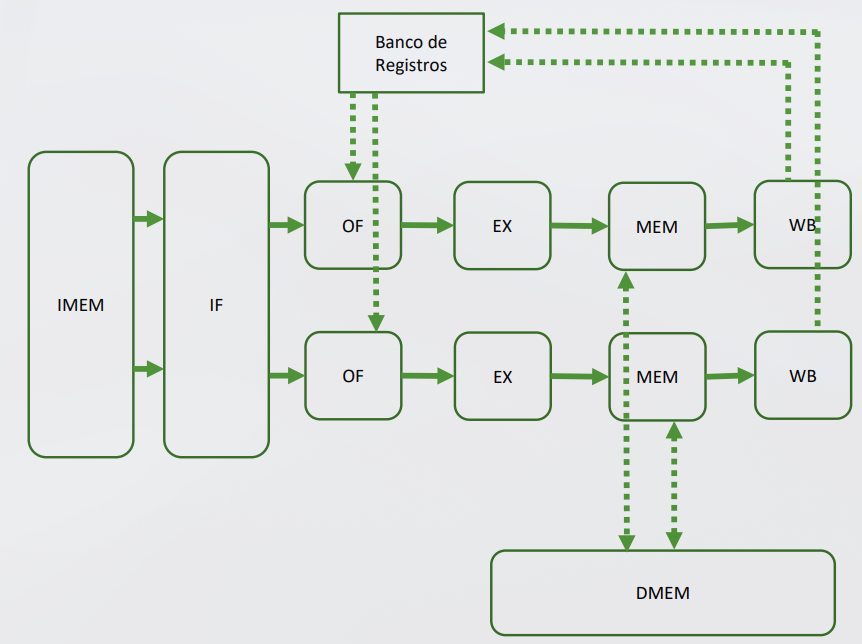
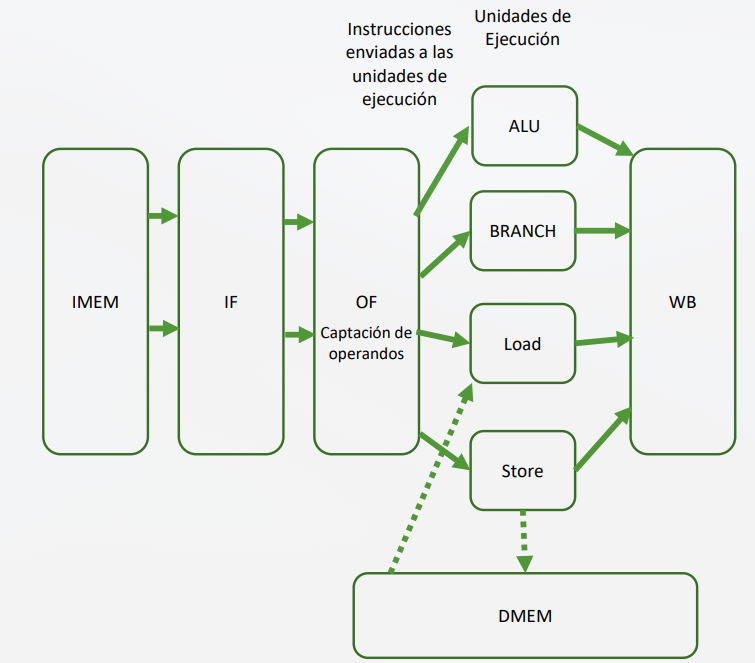
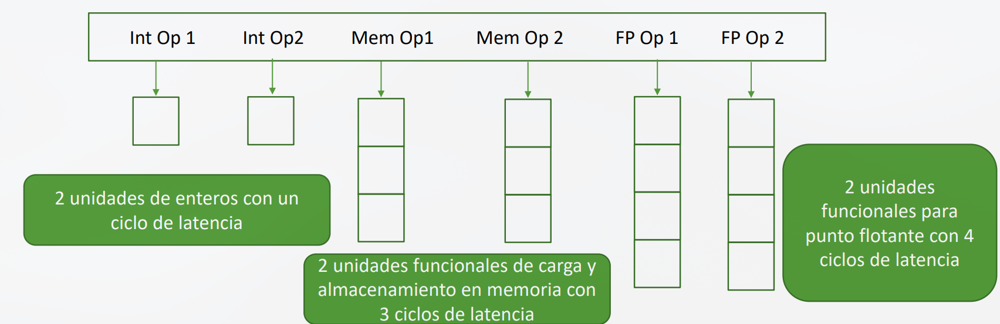

# Tema 4: Fundamentos de Procesadores Superescalares

## Evolución en las arquitecturas
### Los procesadores secuenciales
* Procesan una instrucción cada vez
* Una instrucción debe finalizar antes de comenzar la siguiente

### Procesadores segmentados
* Divide la ejecución de cada instrucción en diferentes etapas:

```text
IF -> ID -> EX -> MEM -> WB 
```

* Permite solapar la ejecución de varias instrucciones
* En condiciones ideales se puede inciar una nueva instrucción en cada ciclo

> Limitaciones: Los riesgos estructurales, de datos y de control pueden introducir detenciones (stalls) y reducir el rendimiento

## ¿ Cómo aumentar aún más el rendimiento del procesador?

### 1. Aumentar la velocidad de reloj

* Limitaciones: tecnología de fabricación, consumo energético y disipación térmica

### 2. Aumentar la profundidad del pipeline

* Dividir el trabajo en un mayor número de etapas puede reducir el trabajo realizado en cada etapa y permitir una frecuencia de reloj mayor

* Limitaciones:
    * Aumenta el coste de los registros de pipeline
    * Aumenta la penalización de algunos riesgos. Especialmente de saltos y dependencia de datos

### 3. Procesar varias instrucciones por ciclo
* En lugar de intentar únicamente que cada instrucción avance más rápido , **podemos procesar varias instrucciones simulaneamente** -> **procesador superescalar**

## Ciclos por Instrucción

* La **emisión** es el proceso mediante el cual una instrucción pasa de ID a EX

* **Ciclos por emisión (CPE)**: número de ciclos que transucrren entre dos emisiones consecutivas
* **Instrucciones por emisión (IPE)**: número de instrucciones que pueden emitirse simultáneamente

```text

Tcpu = NI * CPE/IPE * Tciclo

CPI = CPE / IPE

```
## Procesadores superescalares
Un **procesador superescalar** es capaz de **emitir y ejecutar varias instrucciones por ciclo de reloj**, (siempre que puedan ejecutarse en paralelo)

Para conseguirlo:
* Capacidad para procesar varias instrucciones simultáneamente
* Múltiples **unidades funcionales**
* Hardware capaz de detectar qué instrucciones pueden ejecutarse en paralelo

Podemos disponer de:
* Varias ALU
* Unidades de carga/almacenamiento
* Unidades de salto
* Unidades de punto flotante

Aprovechar el **Paralelismo a nivel de instrucción (ILP) - Instruction-Level Parallelism tiene un coste**
Cuanto mayor es el número de instrucciones:
* Mayor es la complejidad hardware
* Mayor es la necesidad de coordinación
* Mayor consumo de recursos

## Modelos de Procesadores Superescalares

* Permite el procesamiento de **varias instrucciones simultáneamente**

* Dos organizaciones:
    * **Varios caminos de ejecución en paralelo**: Existen varios caminos capaces de procesar instrucciones simultánemanete
    * **Pipeline de mayor anchura**: Las etapas del pipeline pueden manejar **varias instrucciones en cada ciclo** y distribuirlas entre diferentes unidades funcionales

* **En ambos casos**, el objetivo es **ejecutar instrucciones independientes en paralelo**

* Los procesos actuales siguen dichos modelos aunque son más complejos

## Dos cauces totalmente independientes:

* En este modelo el procesador tiene **dos cauces (pipelines)** independientes
* Cada uno de estos está diseñado para **manejar un tipo específico de instrucción**
* Permite manejar instrucciones de **manera eficiente**
* **El código debe estar muy bien organizado en pares de instrucciones** para que puean ser ejecutados en paralelo por los dos cauces


## Un cauce donde cada etapa procesa varias instrucciones

* El procesador tiene un solo cauce pero cada **etapa** es capaz de procesar **varias instrucciones simultáneamente**

* Se requieren **estructuras de almacenamiento** entre las distintas etapas para gestionar múltiples instrucciones en diferentes estados de ejecución

* **Aumenta la eficiencia** de la ejecución y mejora el **rendimiento**

> Este es el modello más común de los procesadores superescalares

## Orden de Ejecución de un Procesador superescalar
* Las instrucciones se encuentran en el programa en un determinado orden que es el **orden del programa**

* Normlamente la **captación y decodificación** mantienen ese orden
* Existen dos posibilidades durante la ejecución:
    * **Ejecución en orden**: Las instrucciones comienzan a ejecutarse respetando el orden del programa
    * **Ejecución fuera de orden**: Una instrucción posterior puede ejecutarse antes que otra si:
        * Sus operandos están disponibles
        * Existe una unidad funcional disponible
        * No se viola ninguna dependencia
    
* Aunque una instrucción pueda **ejecutarse fuera de orden**, el procesador debe garantizar que el resultado final sea equivalente al de una ejecución correcta en dicho orden

* **Fuera de orden no significa incorrecto -> cambia el orden interno de ejecución, no el resultado del programa**

## Planificación de la emisión de múltiples instrucciones

### ¿Quién decide qué instrucciones se ejecutan juntas?
Existen 2 estrategias:

* **Planificación estática**: El protagonista es el **compilador**. Las decisiones se realizan principalmente **antes de la ejecución**

### Planificación estática
* Antes de ejecutar el programa , el compilador
    * Analiza las dependencias
    * Reordena las instrucciones
    * Intenta colocar juntas instrucciones independientes
    * Tiene en cuenta las unidades funcionales disponibles

* El compilador conoce:
    * las unidades funcionales disponibles
    * Sus latencias 
    * Las dependencias entre instrucciones
    * Las posibles restricciones de emisión


> Intenta colocar las intrucciones en un orden que permita ejecutar el mayor número posibles en paralelo

* **La CPU ejecuta principalmente las instrucciones según el ordenador preparado** por el compilador

* El objetivo es **colocar cerca instrucciones independientes** que puedan utilizar unidades funcionales diferentes 

* El trabajo es encontrar **paralelismo**

> La planificación esatica reduce la complejidad del hardware a cambio de exigir más trabajo al compilador


### VLIW (Very Long Instruction Word)
* En una arquitectura VLIW, una única palabra de instrucción contiene varias operaciones que pueden ejecutarse simultáneamente

* Cada posición de la palabra puede corresponder a una unidad funcional diferente

* El compilador decide previamente qué operaciones pueden colocarse juntas

* **En VLIW, el paralelismo queda explícitamente codificado por el software**



### VLIW: Ventajas y Desventajas
* **Ventajas**: 
    * Parte la complejidad de planificación se translada al compilador
    * El hardware encargado de decidir qué instrucciones ejecutar puede ser más sencillo
    * CUando existe suficiente paralelismo, peude aprovechar varias unidades funcionales simultáneamente

* **Limitaciones**:
    * **Gran dependencia del compilador**. El rendimiento depende de su capacidad para encontrar instrucciones independientes

    * **Código de mayor tamaño**. Si no existen suficientes operaciones paralelas pueden aparecer slots vacíos o `nop`.
    
    * **Menor capacidad de adaptación en tiempo de ejecución**. El compilador no conoce siempre eventos dinámicos como fallos de caché, latencias variables y comportamiento real de los saltos
    
    * **Dependencia de la arquitectura**. El código puede estar muy ligado al número y tipo de unidades funcionales de la máquina

> VLIW simplifica parte del hardware trasladando más responsabilidad al compilador

### Planificación Dinámica

El protagonista es el **hardware**. Las decisiones se toman en **tiempo de ejecución**.

* Durante la ejecución, la CPU:
    * Analiza qué instrucciones están preparadas
    * Comprueba si sus operandos están disponibles
    * Comprueba qué unidades funcionales están libres
    * Decide qué instrucciones emitir en cada ciclo

### Estructuras Adicionales Necesarias
* **Cola de Instrucciones**
Almacena instrucciones que han sido captadas y esperan continuar su procesamiento
---
* **Ventana de Instrucciones / Estaciones de Reserva**
    * Mantienen instrucciones que esperan:
        * Sus operandos
        * Una unidad funcional disponible
    * Permiten localizar instrucciones listas para ejecutarse

----

* **Buffer de Reordenamiento**
    * Mantiene información sobre las instrucciones que se encuentran en ejecución
    * Permite que las instrucciones puedan ejecutarse fuera de orden pero que sus resultados se confirmen en el orden correcto
---
* **Predictor de Saltos + BTB**
    * Permiten anticipar si un salto se tomará y cuál será su dirección destino
    * Especialmente importante en procesadores superescalares porque una predicción incorrecta puede obligar a descartar muchas instrucciones en paralelo
---
* **Renombrado de Registros**
 Permite eliminar determinadas dependencias falsas entre instrucciones

### Emisión Fuera de Orden

Una instrucción puede emitirse cuando:
1. **Sus operandos están disponibles**
2. **La unidad funcional que necesita está libre**

Esto permite que una instrucción posterior se ejecute antes que una anterior que se encuentre bloqueada.

### Características Clave

- La CPU decide en cada ciclo qué instrucciones están preparadas para ejecutarse
- El número de instrucciones emitidas puede variar de un ciclo a otro
- Si una instrucción está bloqueada, el procesador puede buscar otras instrucciones independientes
- Una instrucción bloqueada no tiene por qué detener a todas las instrucciones posteriores

### Beneficios

**1. Aprovecha mejor el paralelismo**
El procesador puede localizar instrucciones independientes y ejecutarlas aunque otras instrucciones anteriores estén bloqueadas.

**2. Tolera latencias variables**
Por ejemplo, si una instrucción espera un acceso a memoria, otras instrucciones independientes pueden continuar ejecutándose. Así se intenta ocultar parte de la latencia.

**3. Se adapta a lo que ocurre realmente durante la ejecución**
El hardware conoce en cada momento:
* Qué operandos están disponibles
* Qué unidades funcionales están ocupadas
* Qué instrucciones están esperando
* Puede tomar decisiones utilizando información que el compilador no conocía

**4. Facilita la ejecución especulativa**
Mediante la predicción de saltos, el procesador puede comenzar a ejecutar instrucciones antes de saber con certeza si pertenecen al camino correcto.
- Si la predicción falla: sus resultados se descartan

**5. Reduce el impacto de**
- Dependencias de datos
- Latencias variables
- Conflictos en las unidades funcionales

### Consideraciones Importantes

- Las verdaderas dependencias de datos no pueden eliminarse, pero puede aprovecharse otro trabajo mientras se espera
- El procesador debe garantizar que el resultado final respete la semántica del programa (el orden del programa)
- La planificación dinámica intenta mantener ocupadas las unidades funcionales incluso cuando algunas instrucciones están esperando

### Costes

La planificación dinámica requiere:
- Más hardware
- Más espacio
- Mayor consumo energético
- Mayor complejidad de diseño

**Conclusión:** Planificación dinámica = más capacidad de adaptación a cambio de mayor complejidad hardware