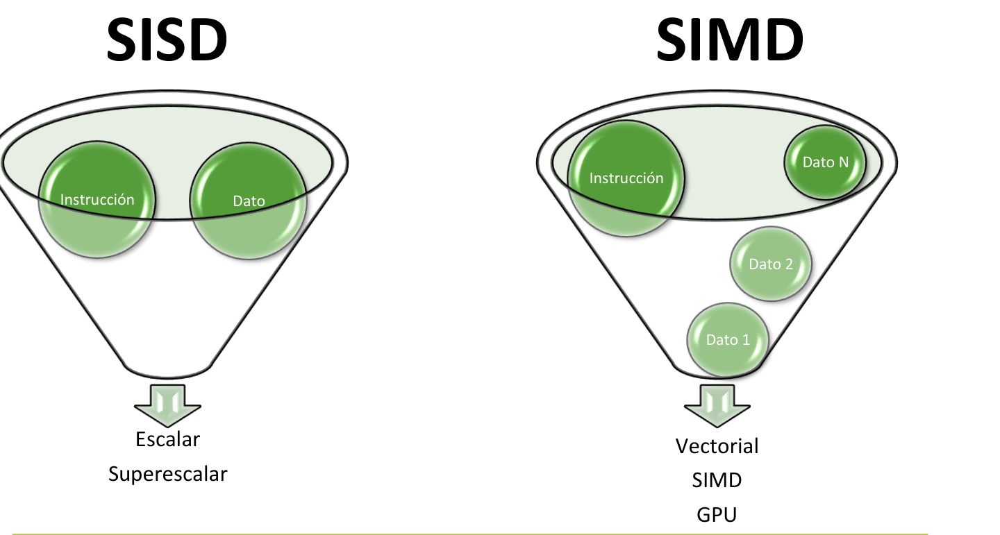
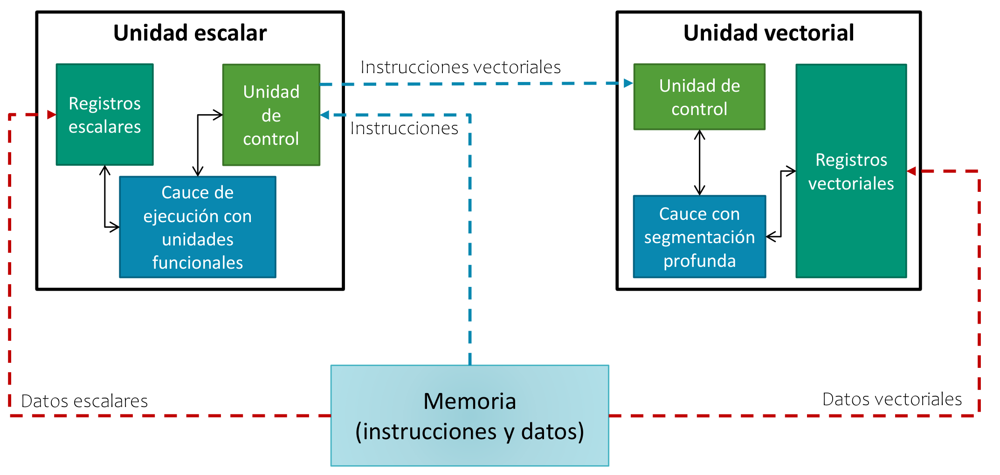
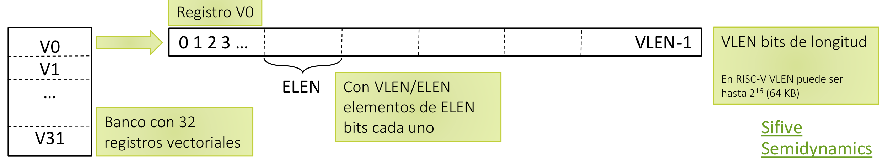
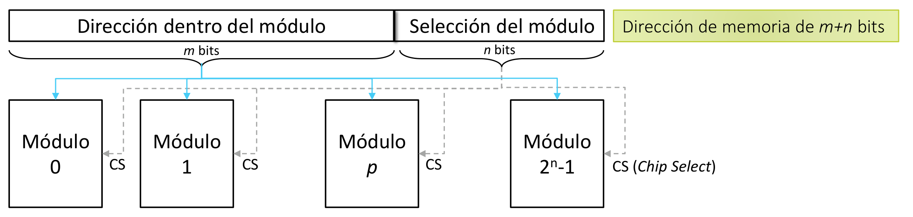
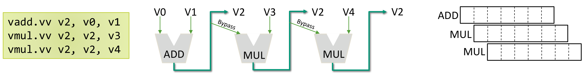
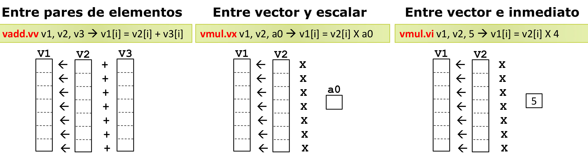
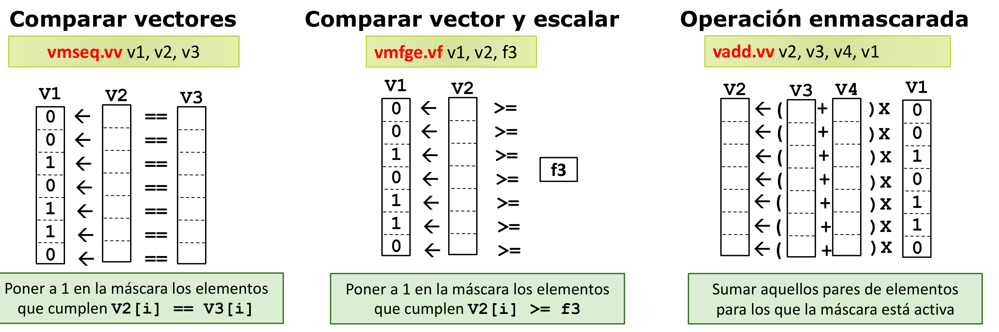
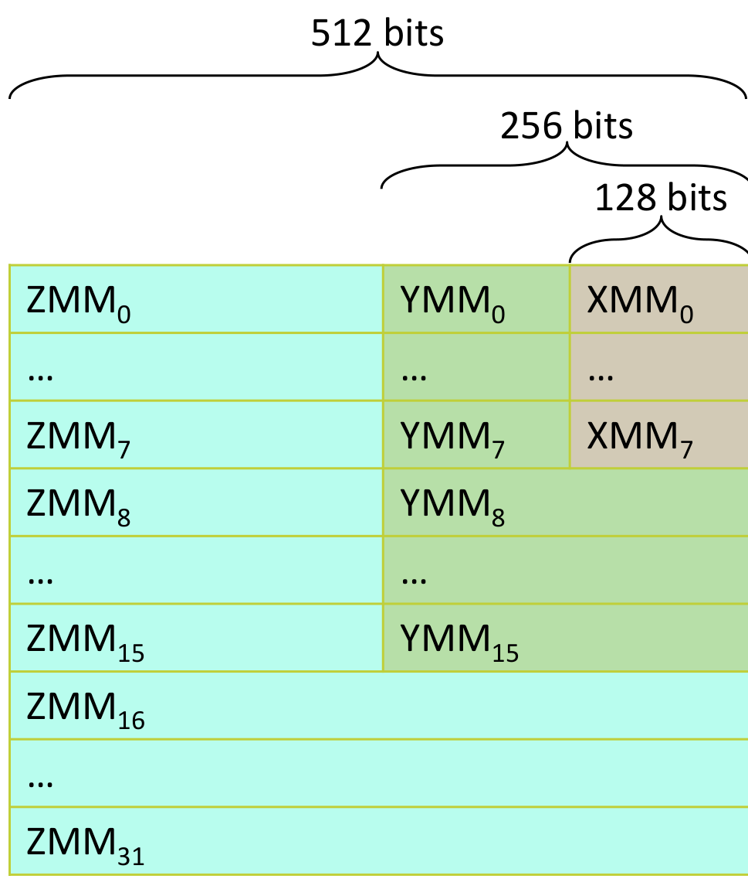
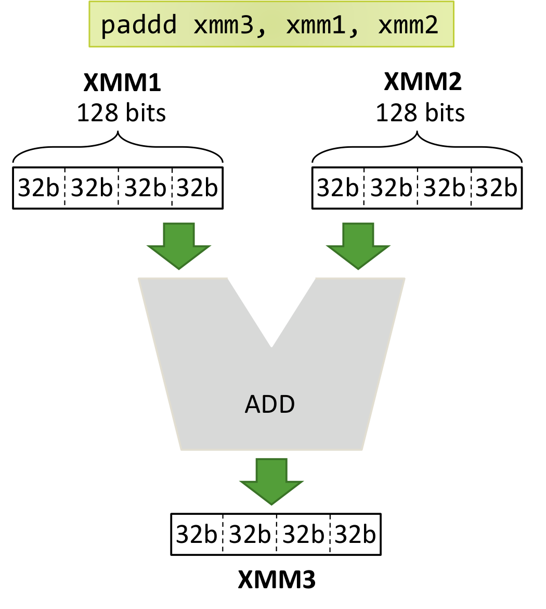
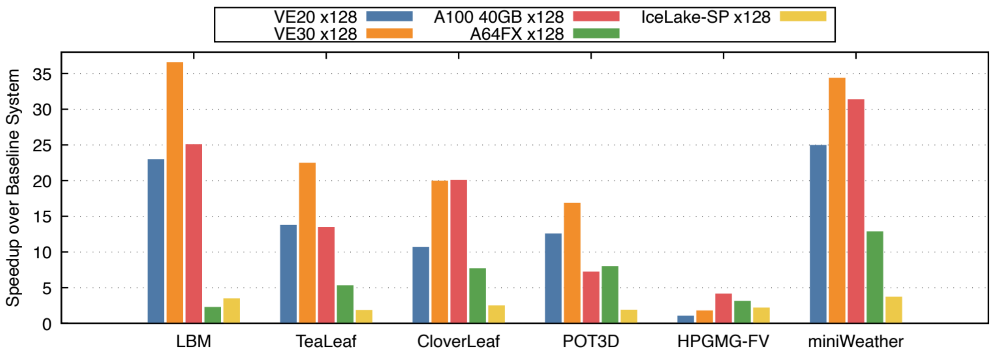

# Tema 5: Paralelismo de datos

## 1. Introducción y objetivos

Hasta ahora hemos visto **paralelismo de instrucciones**: superescalares, segmentación, ejecución fuera de orden... Todo ello busca que se ejecuten *más instrucciones* por ciclo, pero **cada instrucción sigue trabajando sobre un solo dato**.

En este tema atacamos el problema desde el otro lado: **paralelismo de datos**, es decir, ejecutar la **misma operación sobre muchos datos a la vez**.

> **Objetivo general**: conocer las arquitecturas de procesador para el tratamiento de datos en paralelo, sus diferencias, ventajas e inconvenientes.

**Objetivos específicos:**

* Saber en qué consiste el paralelismo de datos
* Conocer los orígenes del paralelismo de datos
* Identificar las soluciones existentes para procesar datos en paralelo
* Diferenciar entre las categorías de paralelismo de datos actuales
* Analizar las ventajas e inconvenientes entre las arquitecturas paralelas

## 2. Taxonomía de Flynn

Michael J. Flynn propuso clasificar las arquitecturas de procesador según **el número de flujos de instrucciones y el número de flujos de datos** que manejan.

| | **Datos: uno** | **Datos: varios** |
| --- | --- | --- |
| **Instrucciones: una** | SISD | SIMD |
| **Instrucciones: varias** | MISD | MIMD |

* **SISD**: *Single Instruction Single Data*
* **MISD**: *Multiple Instructions Single Data*
* **SIMD**: *Single Instruction Multiple Data*
* **MIMD**: *Multiple Instructions Multiple Data*

Dentro de cada categoría se distinguen subcategorías:

| Categoría | Subcategorías |
| --- | --- |
| **SISD** | Escalar (con cauce segmentado) y **Superescalar** |
| **SIMD** | **Vectorial** (registros de longitud arbitraria), **packed SIMD** (extensiones de las CPU) y **GPU** (SIMT) |
| **MIMD** | Multiprocesadores, clústeres, etc. (fuera del alcance de este tema) |

Lo que cambia de una categoría a otra es **qué se mete en la "embudo"** de la ejecución: en SISD entra *una instrucción y un dato*; en SIMD entra *una instrucción y muchos datos*.



*La mayoría de cálculos científicos, físicos y matemáticos operan sobre matrices y vectores de datos de idéntico tamaño, por lo que las arquitecturas SIMD resultan de especial interés para dichas tareas.*

### 2.1. Procesadores SISD

Son los procesadores que se ajustan a la **arquitectura Von Neumann** y que procesan instrucciones asociadas a **un solo dato de tipo escalar**.

**Implementaciones:**

* Los procesadores **escalares**, con cauce segmentado o no, entran en esta categoría: se captura una sola instrucción que actúa sobre un dato (carga, almacenamiento, aritmética...)
* También los procesadores **superescalares** son SISD:
    * Se captan múltiples instrucciones en un ciclo de reloj
    * El cauce superescalar es capaz de ejecutar varias instrucciones **en paralelo**
    * Pero **cada instrucción tiene operandos escalares** de entrada y de salida

> En general, para procesar múltiples datos con un procesador SISD **precisa escribir un bucle que los recorra**. Ese bucle es exactamente lo que el paralelismo de datos quiere eliminar.

### 2.2. Procesadores SIMD

Son procesadores con capacidad para ejecutar **una misma operación sobre múltiples datos de manera simultánea, sin necesidad de bucles**.

**Implementaciones:**

* **Procesadores vectoriales**: cuentan con instrucciones y registros específicos para el trabajo con vectores de datos de **longitud arbitraria**
* **Procesadores con extensiones SIMD**: disponen de instrucciones y unidades funcionales que facilitan operaciones sobre vectores de **longitud fija** (se conoce como **packed SIMD** para diferenciarlo de la denominación general SIMD)
* **Procesadores con paralelismo masivo de datos (GPU)**: miles de unidades funcionales sencillas, capaces de ejecutar cada una de ellas un hilo sobre un dato de longitud fija (**modelo SIMT**: *Single Instruction Multiple Thread*)

> Estas tres implementaciones son exactamente los tres bloques del tema: **vectoriales** (§5), **packed SIMD** (§6) y **GPU** (§7).

## 3. Fundamentos del paralelismo de datos

**Fundamentación**: una gran parte de los programas de ordenador operan sobre **colecciones de datos dispuestos secuencialmente en memoria (vectores)**, por lo que una mejora para ese tipo de operaciones redundaría en un mejor rendimiento general.

### Conceptos clave

* **Paralelismo**: la mayoría de operaciones entre vectores **no tienen dependencias de datos entre elementos**, por lo que pueden ejecutarse en paralelo, ya sea con múltiples unidades funcionales (SIMD) o en un cauce segmentado (vectorial)

* **Cuello de botella de Flynn**: al operar sobre múltiples datos con una sola instrucción, **sin requerir bucles**, se evitan los riesgos de control, origen del conocido como *cuello de botella de Flynn*

* **Anchura de banda**: se **reduce en el bus de instrucciones** pero se **incrementa en el bus de datos**. Las instrucciones vectoriales presentan patrones de acceso muy predecibles (posiciones secuenciales), por lo que resulta fácil optimizarlas. La latencia inicial se ve compensada por la transferencia del vector completo, en contraposición a los accesos a datos individuales

* **SIMD**: replica las unidades de cálculo (ALU), **sin necesidad de replicar las unidades de control**, de forma que una sola instrucción se aplica sobre múltiples datos en paralelo

* **Vectorial**: cauce segmentado profundo que hace posible operar sobre múltiples datos en paralelo con **una sola unidad de cálculo** (o un número limitado de ellas), siempre y cuando no haya dependencias entre datos

> **Diferencia esencial**: en SIMD el paralelismo está en el **espacio** (muchas ALU replicadas), en el vectorial está en el **tiempo** (una ALU muy segmentada procesando un elemento por ciclo).

## 4. Cronología del paralelismo de datos

| Año | Máquina / Hito | Descripción |
| --- | --- | --- |
| 1972 | **ILIAC IV** | 256 unidades de coma flotante de 64 bits (precursor de SIMD) |
| 1974 | **CDC STAR-100** | Vectorial memoria-memoria con vectores de hasta 65536 elementos |
| 1975 | **CRAY I** | Vectorial con 8 registros de 64 elementos y 64 bits/elemento |
| 1982 | **CRAY X** | El supercomputador más rápido durante años, con arquitectura vectorial |
| 1992 | **NEC SX** | Supercomputador vectorial, el primero en alcanzar 1 GFlop |
| 1997 | **SIMD x86** | Extensiones MMX, 3DNow!, SSE y AVX: registros para vectores de tamaño fijo |
| 2003 | **GPU** | Procesador tipo SIMT con paralelismo masivo de datos, más complejo que el packed-SIMD de las CPU |
| 2013 | **AVX-512** | Múltiples extensiones al modelo SIMD de Intel con predicados de control |
| 2018 | **NEC TSUBASA** | Sucesor de NEC SX pero en formato PCI-E, con procesadores vectoriales para servidores |
| 2022 | **RISC-V RVV** | Extensión para RISC-V con instrucciones vectoriales, similares a CRAY I/X y NEC SX |

Se distinguen claramente **dos ramas** en la cronología: la rama **vectorial** (1972-1992 y su resurgir con NEC TSUBASA y RISC-V RVV) y la rama **packed SIMD / GPU** (1997 en adelante).

## 5. Procesadores vectoriales

### 5.1. Introducción

Procesadores con **registros y unidades funcionales específicas** para operar sobre vectores de elementos de forma paralela, denominados durante años **supercomputadores**.

**Funcionamiento:**

* **Precursores**: el CDC STAR-100, TI-ASC y Cray-1
* **Memoria**: el CDC operaba directamente sobre vectores en memoria; diseño **no escalable** por el cuello de botella que representaba el acceso a la misma
* **Registros**: la incorporación de **registros vectoriales** en el Cray-1 representó una mejora fundamental al evitar múltiples accesos a memoria para operar sobre los mismos datos
* **Arquitectura**: cuentan con un conjunto de registros de configuración de los vectores sobre los que operan, así como con **unidades funcionales segmentadas profundas** (*deep pipelining*)

### 5.2. Almacenamiento de los datos

Los procesadores vectoriales operan en conjuntos de datos (vectores) con un **número variable de elementos** y de **tamaño por elemento** (tipo). Hay dos categorías:

| | **Memoria-Memoria** | **Registros vectoriales** |
| --- | --- | --- |
| **Máquinas** | CDC STAR-100, TI-ASC | Cray-1, Fujitsu VP-200, vectoriales modernos |
| **Dónde viven los operandos** | En la memoria principal, cargándose/almacenándose a medida que se ejecuta la operación | En un banco de registros vectoriales (análogo al banco de registros escalares) |
| **Tamaño máximo del vector** | Solo lo impone la memoria disponible | Tamaño fijado por el diseño del procesador |
| **Rendimiento** | Relativamente bajo por los accesos continuos a memoria | Mucho más elevado |
| **Coste hardware** | Simple | Más complejo y caro |

### 5.3. Arquitectura de bloques de un procesador vectorial

Un procesador vectorial se organiza en **dos grandes bloques**:

* **Unidad escalar**: es la que ya conocemos, con cauce segmentado simple o superescalar. Se caracteriza por un conjunto de registros, cada uno de los cuales almacena **un solo valor** (entero o punto flotante)
* **Unidad vectorial**: es la que nos interesa estudiar; contiene el **banco de registros vectoriales**, su propia **unidad de control** y un **cauce con segmentación profunda**



Fíjate en el diagrama, que resume la estructura:

* **Flechas azules (instrucciones)**: la memoria manda instrucciones a la UC escalar; esta deriva las **instrucciones vectoriales** a la **UC vectorial**, que es quien las ejecuta realmente
* **Flechas rojas (datos)**: los **datos escalares** van de la memoria a los registros escalares, y los **datos vectoriales** de la memoria al banco de **registros vectoriales**
* El cauce de la unidad vectorial está **segmentado en profundidad** y se conecta con el banco de registros vectoriales para leer/escribir elementos

### 5.4. Registros vectoriales (RISC-V)

**Número:**

* Contamos con un banco de registros vectoriales, similar al de los registros escalares, con un número variable según el procesador
* El Cray-1 contaba con **64 registros vectoriales**
* Los procesadores modernos suelen tener **32 o más**

**Tamaño** — hay que diferenciar entre el tamaño **total** del registro y el tamaño de **elemento**:

* El tamaño en bits de un registro vectorial viene dado por la implementación concreta. A este factor se le llama **VLEN**, y lo habitual es que sea de **64, 128, 256 o 512 bits** (en RISC-V puede llegar hasta $2^{16}$ = 64 KB)
* Dentro de un registro vectorial se almacenan múltiples datos de tamaño **ELEN**, parámetro configurable entre **8, 16, 32 y 64 bits**
* El cociente **VLEN / ELEN** indica el **número de elementos** que es posible almacenar en un registro vectorial

$$\text{Nº elementos} = \frac{VLEN}{ELEN}$$



Ejemplo: con **VLEN = 256 bits** y **ELEN = 32 bits** → $256/32 = 8$ elementos de 32 bits por registro.

### 5.5. Tamaño de los registros vectoriales: LMUL

**Agrupamiento:**

* **LMUL**: parámetro que determina el **número de registros que se agrupan** para formar uno de mayor tamaño. Puede tomar los valores **1, 2, 4 y 8**
* **Registros disponibles**: al agrupar, se cuenta con un **menor número de registros** disponibles (con LMUL = 8 solo quedan 4 registros utilizables de los 32)

**Ventajas:**

* Los registros alcanzan hasta **8 veces el VLEN original**, lo que permite operar sobre vectores **mucho mayores**, algo que no es posible con otras arquitecturas como las extensiones SIMD
* Se reduce el número de iteraciones para realizar el mismo trabajo, por lo que hay un **menor número de riesgos de control** en el programa

$$\text{Tamaño agrupado} = LMUL \times VLEN$$

> Ejemplo: con VLEN = 128 bits y LMUL = 8, un registro agrupado abarca $8 \times 128 = 1024$ bits → 32 elementos de 32 bits, usando 8 registros del banco (quedan 4 grupos disponibles de los 32).

### 5.6. Unidad de control vectorial

**Paralelismo** — la unidad de control (UC) tiene un diseño específico:

* La **UC escalar** gestiona el **paralelismo de instrucción** con múltiples instrucciones en un cauce
* La **UC vectorial** gestiona el **paralelismo de datos** con una sola instrucción operando sobre un conjunto de datos

**Registros de control** — además de los registros de datos, la UC cuenta con registros internos para controlar la operación de las unidades vectoriales:

* Un registro establece el **tamaño de cada elemento** (ELEN) y otro la **longitud de los vectores** con los que se trabajará (puede ser mayor o menor que el tamaño de los registros vectoriales)
* Un registro determina si se formarán **grupos de registros** (LMUL) para operar con vectores mayores que los considerados por el hardware
* Los **registros de enmascaramiento** determinan a qué elementos afectará la operación y qué ocurrirá con aquellos no afectados

**Detección de riesgos** — la UC ha de verificar que la operación es posible:

* Los datos han de estar **correctamente alineados** en memoria
* **No han de existir dependencias** entre elementos del vector para poder ejecutar la operación en paralelo

### 5.7. Cargas y almacenamientos: memoria entrelazada

**Disposición lógica**: las instrucciones de carga y almacenamiento de registros vectoriales son análogas a las escalares, con aspectos específicos.

**Memoria entrelazada** — se usa para acelerar la transferencia de múltiples elementos:

* El **entrelazamiento de orden bajo** usa los **bits de menor peso** de la dirección para seleccionar el **módulo de memoria** desde el que se hace la transferencia, lo cual permite su paralelización
* Se opera con direcciones consecutivas, pero también contempla la **carga con *stride*** para elementos no consecutivos pero con un **espaciado uniforme**
* El almacenamiento de resultados puede **enmascararse**, de forma que solo ciertos elementos del registro vectorial sean efectivamente escritos en memoria

**División de la dirección de memoria (m+n bits):**

| Campo | Bits | Significado |
| --- | --- | --- |
| **Dirección dentro del módulo** | los **m** más significativos | Posición dentro del módulo elegido |
| **Selección del módulo** | los **n** menos significativos | Elige el módulo 0, 1, ..., p, ..., $2^n-1$ mediante la señal **CS** (*Chip Select*) |



> Como los **n bits de menor peso** eligen módulo, dos direcciones consecutivas caen en **módulos distintos** y pueden transferirse **en paralelo**: eso es lo que acelera la carga de un vector completo.

### 5.8. Unidades funcionales vectoriales

**Unidades específicas**: hay **una unidad para cada tipo de operación** (suma, multiplicación, división...), en lugar de una sola ALU de propósito general. Pueden replicarse formando **lanes** para mayor capacidad.

**Segmentación**: las unidades funcionales están **muy segmentadas**, lo que les permite operar en paralelo sobre múltiples elementos de un vector:

* Sumas, restas y multiplicaciones en **5-8 etapas**
* Divisiones con segmentación de hasta **20 etapas**

**Encadenamiento** (*chaining*) — efectuar múltiples operaciones consecutivas sobre los registros:

* Una vez cargados los datos en los registros vectoriales, es posible efectuar múltiples operaciones **sin esperar a que se complete una operación previa**
* Es el equivalente vectorial al *forwarding*: el resultado parcial de un elemento se pasa directamente a la siguiente unidad funcional
* El encadenamiento reduce el número de esperas y, por tanto, **mejora el rendimiento**

```asm
vadd.vv v2, v0, v1   # v2 = v0 + v1
vmul.vv v2, v2, v3   # v2 = v2 * v3   (en cuanto sale el primer elemento de la suma)
vmul.vv v2, v2, v4   # v2 = v2 * v4
```



En el diagrama se ven las dos ideas:

* **Bypass** (*chaining*): el resultado de la `ADD` se inyecta directamente en la primera `MUL` antes de que termine el vector completo
* A la derecha, cómo se **solapan en el tiempo** las tres operaciones en el cauce: cada una ocupa el cauce desplazada unos ciclos con respecto a la anterior

### 5.9. Operaciones vectoriales (RISC-V)

#### A. Entre pares de elementos / con escalar / con inmediato

```asm
vadd.vv v1, v2, v3   # v1[i] = v2[i] + v3[i]        vector-vector
vmul.vx v1, v2, a0   # v1[i] = v2[i] * a0           vector-escalar
vmul.vi v1, v2, 5    # v1[i] = v2[i] * 5            vector-inmediato
```

* **Tipos de operandos**: el segundo operando puede ser un vector, un registro escalar o un valor inmediato, y se genera como resultado **un vector**
* **Tipos de operaciones**: adición, sustracción, producto, división, mínimo, máximo (enteros y punto flotante), desplazamiento de bits y operaciones lógicas a nivel de bit para enteros



> El sufijo de la instrucción indica el **modo de operando**: `.vv` = vector-vector, `.vx` = vector-escalar (registro `x`), `.vi` = vector-inmediato, `.vf` = vector-flotante.

#### B. Reducción

```asm
vredsum.vs v1, v2, v1   # v1[0] = v1[0] + sum(v2[i])
```

* Los tres operandos son **registros vectoriales**: en el **primer elemento del destino** se acumula el resultado de la operación aplicada a todos los elementos del segundo, más el primer elemento del tercero
* **Operaciones**: suma, máximo, mínimo y operaciones lógicas entre bits

**Ejemplo: perceptrón (producto escalar)**

```asm
vle32.v v1, t0           # Cargar entradas
vle32.v v2, t1           # Cargar pesos
vmul.vv v3, v1, v2       # Entradas × Pesos (en paralelo)
vredsum.vs v1, v3, v0    # Suma total de los elementos
```

$$V1[0] = \sum_{k=0}^{n} v3[k]$$

> Fíjate en que el producto escalar completo son **2 operaciones vectoriales**: un `vmul` elemento a elemento y un `vredsum` que lo colapsa a un único valor.

#### C. Comparación y enmascaramiento

```asm
vmseq.vv v1, v2, v3        # v1[i] = (v2[i] == v3[i])  → máscara 0/1
vmfge.vf v1, v2, f3        # v1[i] = (v2[i] >= f3)      → máscara 0/1
vadd.vv v2, v3, v4, v1     # suma solo los elementos con máscara activa
```

* **Enmascaramiento**: una operación **no actúa sobre todos los elementos** del vector, solo sobre aquellos indicados por una **máscara**
* **Creación de la máscara**: mediante operaciones **relacionales** entre elementos y operaciones **lógicas** entre los bits de máscaras
* Ejemplo con `vadd.vv v2, v3, v4, v1`: se suman únicamente aquellos pares de elementos para los que la máscara de `v1` está activa (el resto de posiciones de `v2` no se modifican)



> Flujo típico: **comparar → obtener máscara → operar enmascarado**. La máscara es un registro vectorial con un bit por elemento.

## 6. Extensiones SIMD (packed SIMD)

### 6.1. Introducción

Procesadores con **registros de mayor tamaño** que permiten almacenar **paquetes de datos** y operar sobre ellos de manera conjunta.

**Principio de funcionamiento:**

* **Registros**: cuentan con un cierto número de registros **extendidos de mayor tamaño**, entre 64 bits y 512 bits según la implementación
* **Arquitectura**: el paralelismo viene dado por la operación de las unidades funcionales sobre **todos los datos almacenados en los registros** (*packed SIMD*), **en lugar de** por la segmentación profunda de dichas unidades
* **Tamaño de vector**: el tamaño de los vectores sobre los que pueden operar es **fijo**, al no existir registros de control para establecer su longitud
* **Complejidad**: el tamaño de los datos empaquetados viene **codificado en las instrucciones**, por lo que se agrega un gran número de ellas

### 6.2. El origen de las extensiones SIMD

**Nacimiento**: estas extensiones surgen en **1996** con la denominación **Intel MMX** para acelerar operaciones sobre operandos de tamaño reducido.

**Principio de funcionamiento:**

* **Registros FPU**: los procesadores de la época contaban con una FPU que disponía de varios registros de 64 bits para operaciones en coma flotante
* **Operaciones multimedia**: muchas operaciones con datos gráficos y de audio se hacían con enteros de 8 o 16 bits, para lo que se recurría a los GPR
* **Extensiones MMX**: Intel introduce un conjunto de instrucciones que, apoyándose en los **registros FPU de 64 bits**, permiten operar de forma simultánea sobre **ocho datos de 8 bits** o **cuatro datos de 16 bits**
* **Limitaciones**: no es posible realizar cálculos de coma flotante mientras se ejecutan instrucciones MMX, ya que **usan el mismo conjunto de registros**

### 6.3. Implementaciones SIMD

Las extensiones SIMD surgieron para la arquitectura **x86** y es donde han evolucionado, aunque hoy hay implementaciones también para **ARM** o **RISC-V**.

#### SIMD en la arquitectura x86

| Extensión | Año | Registros | Operandos |
| --- | --- | --- | --- |
| **MMX** | 1996 | Usa los registros **FPU de 64 bits** | 8 o 16 bits |
| **SSE** | 1999 | 8 registros independientes de **128 bits** | 8, 16 y 32 bits |
| **SSE2/3/4** | 2001-2007 | 8 registros de 128 bits | Se agregan operaciones de **punto flotante**: 4 simples o 2 dobles precisión |
| **AVX / AVX2** | 2010-2013 | **16 registros de 256 bits** | 8 enteros de 32 bits o 4 flotantes de 64 bits |
| **AVX-512** | 2013 | **32 registros de 512 bits** | Duplica registros y tamaño respecto a AVX, con predicados de control |

### 6.4. Registros SIMD

**Número:**

* El banco de registros SIMD tiene un tamaño variable según la versión de las extensiones
* **8 registros en SSE, 16 en AVX, 32 en AVX-512**
* La denominación cambia: **XMMn** en SSE, **YMMn** en AVX, **ZMMn** en AVX-512

**Tamaño:**

* **128 bits** en SSE, **256 bits** en AVX y **512 bits** en AVX-512
* No todos los procesadores modernos soportan todas las extensiones

**Estructura:**

* Los tipos de datos que pueden contener varían según la versión
* Habitualmente se soportan **enteros y coma flotante de entre 8 y 64 bits**



> **Relación de anidamiento**: `XMM0` es la **mitad baja** de `YMM0`, y `YMM0` es la **mitad baja** de `ZMM0`. Por eso las instrucciones SSE siguen funcionando sobre AVX/AVX-512 (se amplía el registro, no se crea otro distinto).

### 6.5. Unidades funcionales SIMD: ejemplo `PADDD`

* La extensión SSE incorpora registros **XMM de 128 bits**, así como una **ALU capaz de operar sobre operandos de ese tamaño**
* En un registro XMM se introducen **cuatro enteros de 32 bits** con el objetivo de operar sobre ellos de forma simultánea
* La ALU de SSE realiza una suma con dos operandos de 128 bits, **pero desactivando el acarreo en el límite de cada bloque de 32 bits**



```asm
paddd xmm3, xmm1, xmm2   # suma de 4 enteros de 32 bits en paralelo
```

`PADDD` = **P**acket **ADD** **D**ouble-Word

$$XMM3 = \{\,Sa+Sp,\ Sb+Sq,\ Sc+Sr,\ Sd+Ss\,\}$$

> El detalle del **acarreo desactivado** es lo que permite tratar los 4 bloques de 32 bits como 4 sumas independientes; sin él, el acarreo "se saldría" de un bloque e invadiría al siguiente.

### 6.6. Vectorial vs SIMD

| Aspecto | **Vectorial** | **SIMD (packed)** |
| --- | --- | --- |
| **Tamaño del vector** | Arbitrario (registro de control con la longitud) | Fijo por el tamaño de los registros y sus divisiones |
| **Cargas / almacenamientos** | Pueden cargarse **paso a paso**, un elemento por ciclo, gracias a la segmentación profunda | Han de realizarse **por completo** antes de poder operar |
| **Disposición en memoria** | Contempla mecanismos más sofisticados (vectores dispersos, *stride*) | Los vectores han de estar en **posiciones consecutivas** |
| **Codificación del tipo** | En **registros de control** | En la **propia instrucción** |
| **Nº de instrucciones** | Conjunto reducido y regular | Muy numeroso: AVX10 (julio 2023) cuenta con cientos de instrucciones SIMD y su especificación ocupa **más de 1300 páginas** |
| **Flexibilidad** | Más flexible | Más rígido, pero muy eficiente para el caso común |

## 7. GPU y el modelo SIMT

### 7.1. Introducción

Procesadores con un **alto grado de paralelismo** para ejecutar operaciones simples a fin de acelerar el cauce de procesamiento de gráficos.

* Su origen está en los **aceleradores de gráficos 3D**, que debían operar en paralelo sobre gran cantidad de **vértices y píxeles**, por lo que las GPU no comparten muchas de las características de las CPU
* Cuentan con decenas de **CU** (*Computing Units*), cada una con un gran número de **núcleos** (*cores*) que operan en paralelo y de forma sincronizada
* Cada CU **capta una instrucción y la emite a todos sus núcleos**, que la ejecutan cada uno de ellos **sobre un dato distinto** según un modelo **SIMT** (*Single Instruction Multiple Thread*)

### 7.2. Arquitectura GPU (NVidia)

**Terminología:**

* Cada CU se denomina **SM** (*Symmetric Multiprocessor*) y consta de distintos elementos:
    * Un gran **banco de registros** y memoria **caché L1**
    * Su propio **contador de programa** y una unidad de **emisión de instrucciones**
    * Unidades de **carga y almacenamiento** de datos desde memoria
    * **Núcleos de cómputo** (*CUDA cores* en la denominación de NVidia) que contienen las ALU

* El número de hilos gestionados por un SM es habitualmente **mucho mayor que el de núcleos disponibles**:
    * En las últimas generaciones (RTX 4090) cada SM cuenta con **128 núcleos** de procesamiento
    * Sin embargo es posible tener hasta **2048 *threads* por SM**
    * Para una GPU con 142 SM (RTX 4090Ti) habría un total de **18176 núcleos** y **290816 hilos** de ejecución

* El **multiprocesamiento masivo compensa la latencia del acceso a memoria**:
    * Contar con un gran número de hilos activos y un banco de registros enorme facilita el **cambio de contexto** (*context switching*) sin pérdida de rendimiento
    * Los hilos se agrupan en **warps** que se activan de forma simultánea según la disponibilidad de sus datos

> **Idea clave**: mientras un grupo de hilos espera a la memoria, la SM conmuta a otro *warp* listo. La latencia se **enmascara con hilos**, no se reduce.

### 7.3. Ejemplo real: NVidia GA100

| Parámetro | Valor |
| --- | --- |
| SM | 128 |
| *Cores* por SM | 64 |
| *Cores* totales | 8192 |
| *Threads* por SM | 2048, agrupados en **64 warps de 32 threads** |
| *Threads* totales | 262144 |

**Regla de cálculo de warps:**

$$\frac{2048\ \text{threads}}{32\ \text{threads/warp}} = 64\ \text{warps por SM}$$

$$128\ \text{SM} \times 64\ \text{cores} = 8192\ \text{cores} \qquad 128 \times 2048 = 262144\ \text{threads}$$

## 8. Comparativa de arquitecturas

### 8.1. Tratamiento de los datos en cada arquitectura

| Arquitectura | Instrucción | Qué hace exactamente |
| --- | --- | --- |
| **Escalar** | `add x3, x1, x2` | Suma **dos valores escalares**: $X1 + X2 \to X3$ |
| **Vectorial** | `vadd.vv v2, v0, v1` | Suma dos vectores de **longitud variable** con **segmentación profunda**: $V0[i] + V1[i] \to V2[i]$ |
| **SIMD** | `paddd xmm3, xmm1, xmm2` | Suma dos vectores de **longitud fija** de forma **empaquetada**: $XMM1[i] + XMM2[i] \to XMM3[i]$ |
| **GPU** | `c[tid] = a[tid] + b[tid]` | Trata **cada elemento en un *thread* independiente**, de forma que la suma de todos los elementos se ejecuta en paralelo (si hay núcleos suficientes) |

```c
// GPU (CUDA)
void add( int *a, int *b, int *c ) {
    int tid = blockDim.x * blockIdx.x + threadIdx.x;
    c[tid] = a[tid] + b[tid];
}
```

Mismo cálculo, cuatro filosofías distintas de **dónde está el paralelismo**:

| | **Escalar** | **Vectorial** | **SIMD** | **GPU** |
| --- | --- | --- | --- | --- |
| Dónde está el paralelismo | En las instrucciones (superescalar) | En el **tiempo** (cauce profundo) | En el **espacio** (ALU replicadas) | En el **espacio** (miles de *cores*) |
| Datos por instrucción | 1 | N (**variable**) | N (**fijo**) | 1 por *thread* |

### 8.2. Comparativa de rendimiento

Comparativa de *speedup* frente a un sistema base para cinco arquitecturas distintas, en seis aplicaciones de referencia:

* **VE20/VE30** — procesador vectorial NEC SX-Aurora TSUBASA
* **A100 40GB** — GPU NVIDIA A100 (Ampere)
* **A64FX** — procesador vectorial Fujitsu
* **IceLake** — Intel Xeon Platinum 8368 con extensiones AVX (SIMD)



**Lectura de la gráfica:**

* Los **procesadores vectoriales** (VE20/VE30 y A64FX) y la **GPU A100** obtienen los mayores *speedups* en la mayoría de aplicaciones (LBM, TeaLeaf, CloverLeaf, miniWeather llegan a 20-37×)
* El **SIMD de la CPU** (IceLake con AVX) queda sistemáticamente por debajo: su ventana de datos es mucho más corta
* En **HPGMG-FV** todas las arquitecturas mejoran poco: la aplicación no es tan paralelizable a nivel de datos

> *Referencia*: TAKAHASHI, Keichi, et al. *Performance Evaluation of a Next-Generation SX-Aurora TSUBASA Vector Supercomputer*. ICS/HPC, Springer Nature, 2023, p. 359-378.

## 9. Otras arquitecturas de paralelismo de datos

### 9.1. Aceleradores *hardware* para IA (procesamiento de matrices)

| Diseñador | Acelerador | Características |
| --- | --- | --- |
| **IBM** | Matrix Engine (Power 10) | 4 MMA (*Matrix Math Accelerator*), hasta 2 PB RAM, 18 000 millones de transistores, 2.48 TFLOPs |
| **Google** | TPU v5 | 4 MXU (*Matrix-Multiply Units*), 16 GB HBM3, 393 TFLOPs |
| **NVidia** | Tensor core (B200, Blackwell) | 16 896 núcleos, 192 GB HBM3, 208 000 millones de transistores, 10 PFLOPs |
| **AMD** | Matrix core (Instinct MI300) | 19 456 núcleos, 192 GB HBM3, 153 000 millones de transistores, 3 967 TFLOPs |
| **Huawei** | NPU (Ascend 310) | 4 AI CPU, 18 GB de memoria, 8 TFLOPs |
| **Cerebras** | WSE-3 (*Wafer Scale Engine*) | 900 000 núcleos IA, 44 GB SRAM (hasta 1.2 PB DRAM), 4 billones de transistores, 125 PFLOPs |

> **Nota**: el superordenador más rápido del mundo en el año 2000, el **ASCI Red**, alcanzaba un rendimiento de **1 TFLOP** usando una arquitectura distribuida con múltiples computadores.

### 9.2. Supercomputadores: 2012 vs 2025

| | **2012 (Cray XC30)** | **2025 (Top500)** |
| --- | --- | --- |
| Rendimiento | 100 Pflops (× 100 000 Cray 1) | **1.742 Exaflops** |
| CPU | — | 43 808 AMD EPYC 24C = 1 051 392 núcleos CPU |
| GPU | — | 43 808 AMD MI300A = 9 988 224 núcleos GPU |
| Consumo | — | 29 581 KW |
| Coste | — | 600 000 000 $ |

$$1{,}742\ \text{EFlops} = 1\,742\,000\ \text{PFlops} \approx 1.742 \times 10^{6} \times \text{el Cray XC30 de 2012}$$

Fuente: <https://www.top500.org/lists/top500/2025/06>

### 9.3. Otras arquitecturas avanzadas

#### Computación en memoria (*In-Memory computing*)

* El actual **cuello de botella** en el procesamiento masivo de datos es la **transferencia** de datos desde la memoria RAM (externa al procesador) a las unidades funcionales (internas) y de vuelta a la memoria
* Al **integrar las unidades funcionales en los propios circuitos de memoria** se evita la transferencia, y se opera sobre los datos almacenados en memorias diseñadas para este fin: **MRAM, PCM, ReRAM**, etc.

#### Computación analógica (*Analog computing*)

* Procesar grandes matrices de datos con circuitos digitales implica un **alto consumo de recursos, especialmente energía**
* Los diseños de procesadores analógicos permiten realizar esas operaciones, con una **precisión aproximada**, empleando **muchísima menos energía y tiempo**. Lo habitual es combinar elementos digitales y analógicos
* Es una tecnología propuesta para el desarrollo de **procesadores neuromórficos** y que también se aplica en las memorias con capacidad de computación en memoria

#### Circuitos ópticos (*Photonic computing*)

* Los procesadores actuales operan con **transistores electrónicos**: se emplean corrientes de electrones para representar los estados digitales. Estos circuitos **consumen mucha energía y disipan una cantidad considerable de calor**
* Los circuitos ópticos basan su funcionamiento en el uso de **fotones en lugar de electrones**, por lo que precisan **menos energía** y producen **mucho menos calor**. Empleados ampliamente en equipos de comunicaciones (fibra óptica), se están aplicando también en la fabricación de procesadores

## 10. Cuestiones clave del tema

* ¿En qué consiste el **paralelismo de datos**?
* ¿Cuál es la diferencia entre **paralelismo de datos y de instrucciones**?
* ¿Cómo trabaja un **procesador vectorial** con segmentación profunda?
* ¿En qué se basan las extensiones **packed SIMD** de los procesadores modernos?
* ¿Cuáles son las **ideas básicas sobre el funcionamiento de las GPU**?
* ¿Cómo se tratan los datos en **cada una de las arquitecturas descritas**?

## 11. Resumen en una tabla

| | **Escalar (SISD)** | **Vectorial (SIMD)** | **packed SIMD** | **GPU (SIMT)** |
| --- | --- | --- | --- | --- |
| **Paralelismo** | Instrucción (superescalar) | Tiempo (cauce muy segmentado) | Espacio (ALU replicadas dentro de la UF) | Espacio (miles de *cores*) |
| **Instrucciones** | 1 instrucción / 1 dato | 1 instrucción / N datos | 1 instrucción / N datos | 1 instrucción / N hilos |
| **Longitud del vector** | No aplica | **Arbitraria** (registro de control) | **Fija** (tamaño del registro) | Un dato por *thread* |
| **Registros** | Escalares | Registros vectoriales (VLEN, ELEN, LMUL) | XMM / YMM / ZMM | Banco de registros enorme por SM |
| **Unidad de cálculo** | ALU | UF específicas muy segmentadas + encadenamiento | ALU ancha con acarreo desactivado entre bloques | CUDA cores |
| **Punto fuerte** | Programas secuenciales | Vectores largos, pocos riesgos de control | Multipunto flotante, integración en CPU | Masividad y enmascaramiento de latencias |
| **Punto débil** | Bucle obligatorio | Hardware complejo y caro | Muchísimas instrucciones, tamaño fijo | Programación específica, consumo |
