# Tema 6: Memoria caché

## 1. CPU y memoria RAM

**Funcionamiento**
La CPU precisa traer a su cauce de ejecución las instrucciones del programa además de leer y escribir desde la memoria RAM los datos sobre los que va a operar

### Iteracción CPU <-> RAM

* **Instrucciones**: La CPU necesita captar instrucciones del programa que ejecuta de forma continua

* **Datos**: En el mismo ciclo de reloj se pueden realizar mútliples accesos de lectura y/o escritura en memoria

* **Segmentación**: Los procesadores segmentados incrementan la demanda de accos a memoria al haber varios en cada ciclo de reloj

* **Superescalares**: Necesita captar varias instrucciones por ciclo y ejecutar múltiples accesos a datos

### Velocidad de Funcionamiento
La CPU opera a una velocidad mayor que la memoria DRAM, lo que genera un cuello de botella

**Consecuencias y soluciones**

* **Latencia**: La lectura / escritura en el banco de registros es inmediata ( < 1 ciclo ) y a memoria ( > 100 ciclos )

* **Detenciones**: Un acceso a memoria provocaría que la CPU detuviese el cauce de ejecución durante un tiempo muy significativo perjudicando las mejoras en segmentación y arquitectura superescalar

* **Memoria caché**: La solución es situar cerca de la CPU una memoria más rápida que la RAM para reducir la latencia y evitar las detenciones

## 2. Situación de la caché en la arquitectura
En la arquitectura de un computador existen diferentes niveles de memoria según su situación respecto al procesador

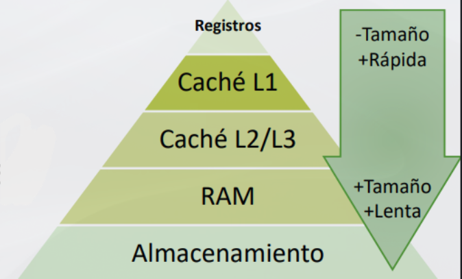

### Caracerísticas de cada tipo

* **Registros**: Internos al procesador, poca capacidad y alta velocidad
* **Caché L1**: Cercana al procesador, más capacidad que los registros, casi igual de rápida
* **Caché L2/L3**: Menos cercana a la CPU pero de mayor tamaño que L1
* **RAM**: Externa al procesador, mayor capacidad pero menor velocidad. Comunicación por un bus rápido dedicado
* **Almacenamiento**: Discos de estados sólido o mecánico. Gran tamaño ero mucho más lentos. Comunicación por un bus lento genérico

### Registros internos
* **Naturaleza**: Pequeñas porciones de memoria ( habitualmente de 32 o 64 bits por registro )
* **Tamaño**: Los procesadores cuentan con un banco de registros más o menos grande y acceden de forma individual por un bus de direcciones reducido
* **Velocidad**: La lectura y escritura realizada durante el procesamiento de las instrucciones, emplea una fracción de ciclo del procesador
* **Tecnología**: Los registros se crean con la misma tecnología de fabricación de la CPU (CMOS) y operan a la misma velocidad
* **Comunicación**: El contenido de los registros se lee o escribe a través de lineas internas que conectan el banco de registros con la ALU y elementos de la CPU

### Nivel 1 de memoria caché
* **Naturaleza**: Se divide en dos porciones, una para instrucciones y otra para datos y forma parte del circuito integrado junto a la CPU
* **Tamaño**: Poca capacidad ( 8 - 64 KB )
* **Velocidad**: En un ciclo de procesador si la info está en caché
* **Tecnología**: Se crea con tecnología SRAM por lo que no precisa refresco pero resulta muy cara , la escala de integración es la misma que la de la CPU
* **Comunicación**: La CPU emplea técnicas de comunicación específicas para acceder a la caché L1

### Nivel 2/3 de memoria caché
* **Naturaleza**: Uno o dos niveles adicionales de caché ( aunque pueden estar en el mismo circuito que la CPU **no forman parte de esta**). Almacenan código y datos
* **Tamaño**: Son memorias con una capacidad mucho mayor que la caché L1 
* **Velocidad**: No tan rápido como la L1 , requiere varios ciclos de procesador . La L2 es más cercana y rápida que la L3
* **Comunicación**: La caché L2/L3 es compartida por todas las CPU y tienen un bus de comunicación más complejo.

### Memoria RAM
* **Naturaleza**: Es una memoria externa al circuito integrado donde se aloja la CPU, aloja tanto código como datos 
* **Tamaño**: Se mide en GB
* **Velocidad**: Las operaciones de lectura/escritura en RAM pueden llegar a ser dos órdenes de magnitud más lentas que la caché L1
* **Tecnología**: No suele ser tan cara como los microprocesadores
* **Comunicación**: Los buses de direcciones y datos de la CPU se conectan a esta memoria para seleccionar una celdilla y leer o escribir en ella, pero son buses compartidos entre todos los núcleos y otros dispositivos de acceso a memoria

### Ubicación de la caché
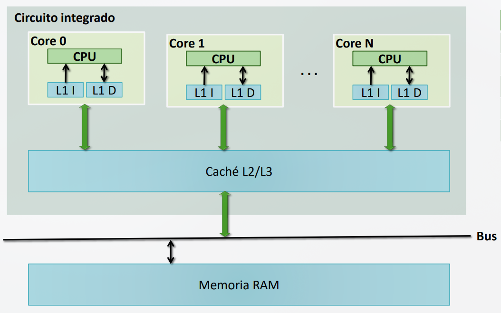

## 3. Cachés de instrucciones y de datos
La separacción hace posible el acceso a ambas cachés de forma que permita la captación de instrucciones y lectura/escritura en un mismo ciclo

**Descripción**
* **Niveles inferiores de memoria**: La RAM y cachés L2 y L3 se ajustan a la arquitectura **Von Neumann**, con una estructura unificada que almacena tanto el programa como los datos sobre los que opera

* **Separación**: Cuando el contenido de la RAM se lleva a la caché L1 se separan instrucciones y datos, dando lugar a una arquitectura **Hardvard**

* **L1I**: La caché L1 de instrucciones es de solo lectura y los patrones de acceso son predecibles

* **L1D**: La caché L1 de datos es de lectura y escritura , con patronces de acceso menos predecibles 

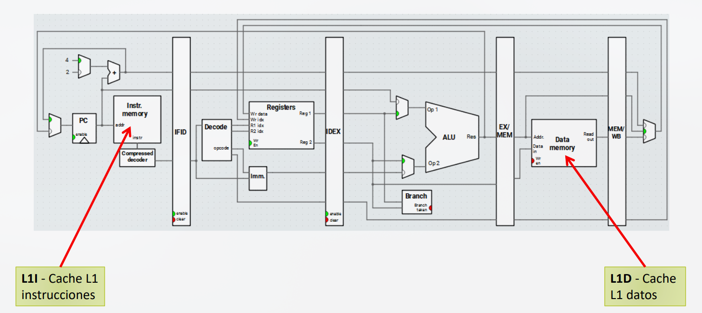

### Estructura de las cachés L1I y L1D
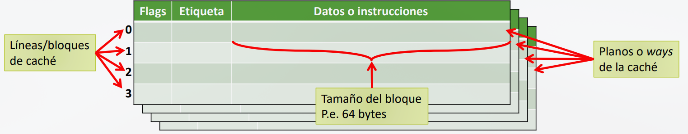

* **Bloque**: es la unidad mínima que se transfiere desde memoria RAM a caché y viceversa. Un bloque de 64 bytes contendrá 16 palabras de 32 bits

* **Plano**: cada bloque puede tener uno o más planos según la configuración de la caché. El número de planos determina el nivel de asociatividad de la caché

* **Tamaño**: los bloques tienen un tamaño homogéneo

* **Flags**: distintos indicadores que denotan el estado de cada bloque, según su tipo

* **Etiqueta**: identificador único de cada bloque que facilita el enlace entre memoria RAM y caché

### Cachés L1 en procesadores actuales

* **Tamaño de bloque (TB):** En la mayoría de procesadores es de 64 bytes
* **Número de bloques (NB):** lo usual es tener entre 64 y 192 bloques
* **Número de planos (NP)**: indicado habitualmente como *associativity* en las hojas de especificaciones, suele ser de 4 u 8 para la L1 y algo superior para las L2/L3
* **Tamaño de plano (TP):** un plano engloba todos los bloques que están en un plano, por lo que su tamaño es `TB X NB`
* **Tamaño total:** Los más habituales son 32KB, 48KB o 64KB

#### Relación entre memoria RAM y caché

* La cache se estructura en **n bloques y p planos**
* La memoria RAM se divide en *m* bloques, con **m>>n X p**

## 4. Tipos de caché y su funcionamiento

La memoria caché puede almacenar una fracción del contenido de la memoria principal. Precisa una estrategia que maximice el rendimiento y evite todos los accesos posibles a RAM

### Terminología
* **Acierto:** Cuando la CPU procisa un dato y este esté en caché acierta (hit) , ya que no requiere de acceso a RAM
* **Fallo:** El dato no está en caché y debe acceder a RAM para sustituir el bloque que contenga ese dato
* **Estrategia de sustitución:** Procedimiento por el que se decide qué bloque de la caché es sustituido por un bloque procedente de memoria principal
* **Estrategia de escritura:** Determina cómo se harán las escrituras en memoriA

### Tipos y características
* **Correspondencia directa**: Se asigna a cada bloque de la RAM una correspondencia directa con uno de los bloques de caché. **Menor latencia pero es poco flexible**

* **Completamente asociativa**: Consiste en tener tantos planos como bloques permita el tamaño de la caché y realizar una búsqueda basándose en las etiquetas de los bloques . **Mayor flexibilidad pero mayor latencia**

* **Asociativa por conjuntos**: Combina características de ambos tipos para tener un equilibrio entre latencia y flexibilidad

### Caché de correspondencia directa
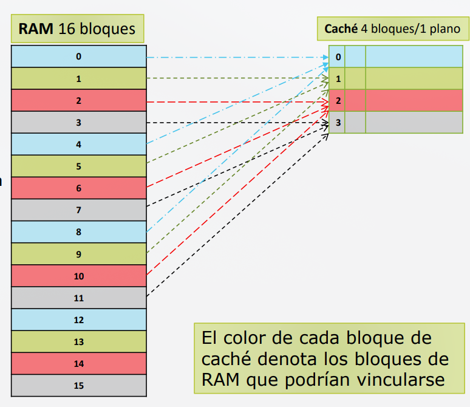

#### Funcionamiento
* La cache se estructura en **n bloques** y hay un único plano
* Cada bloque de RAM se asocia de forma directa con uno de caché según la fórmula `s = m % n`, siendo `%` el módulo de división entera
* Encontrar el bloque de caché que corresponde a una cierta dirección de memoria es inmediato -> la **latencia es mínima** (positivo)
* Si se accede a posiicones de memoria alojadas en boques múltiplos de $n$ , **habrá sustituciones contiguas de entradas** (negativo)
* Mecanismo de caché **Sencillo de implementar** en hardware pero muy **sensible a los patrones de acceso a memoria** por parte de programas

### Caché completamente asociativa
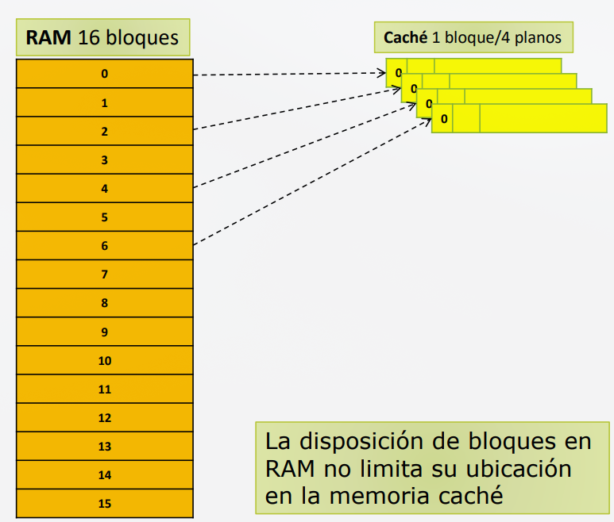
* La cache se estructura en $n$ planos y hay un único bloque por plano
* **Cualquier bloque** de RAM s epuede llevar a cualquiera de los planos de bloque de caché
* Determinar el plano donde está el bloque quecorresponde a una dirección requiere múltiples comparaciones, **la latencia es mayor** (negativo)
* **No habrá sustituciones continuas de entradas** si se accede a varios bloques de RAM de forma repetitiva, sin que importe su disposición (positivo)
*  Se requiere una **heurística de reemplazo** para determinar, cuando todos los planos de la caché están ocupados y hay que traer un nuevo bloque desde RAM, qué bloque es el que se descarta

### Caché asociativa por conjuntos

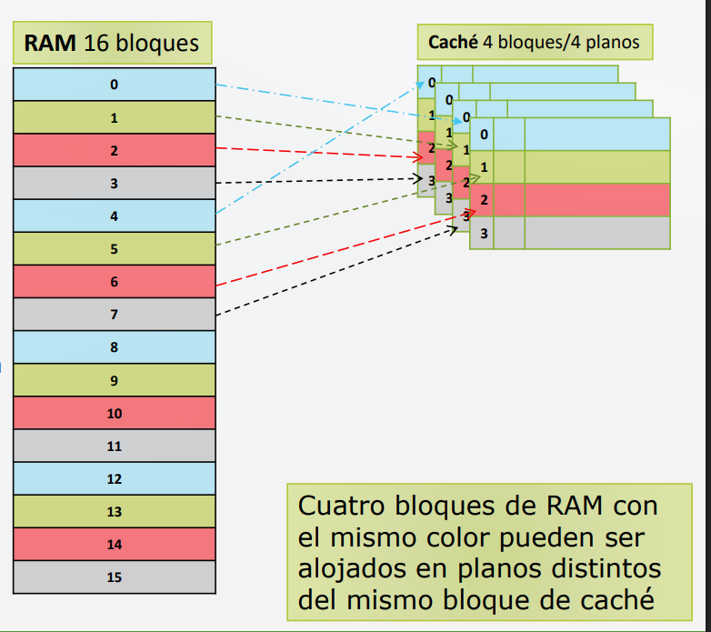

* La cache se estructura en **n bloques y p planos**
* Cada bloque de RAM puede llevarse a **cualquiera de los planos** del bloque que le corresponda
* Encontrar el blqoue de caché que corresponda a una dirección conlleva: 
    *  Determinar el bloque con la misma aritmética usada para la correspondencia directa
    * Buscar en los planos de ese bloque la marca 

* La **latencia es mayor** que en la caché de correspondencia directa, pero no tan alta como en la completamente asociativa
* Un cierto número de bloques de RAM a los que correspondería el mismo bloque pueden coexistir en la caché, lo que es **más flexible** que en la correspondencia directa
* **Aúna lo mejor** de los dos tipos de caché previos

### Procedimiento para acceder a memoria
El acceso de la CPU a la memoria ya no es directo. Requiere unos pasos previos para determinar si el dato solicitado está disponible en caché o no

### Algoritmo
**1. Descomposición de la dirección**: La dirección a la que se va a acceder se divide en: **marca**, **bloque**, **palabra** dentro del bloque y el **byte** dentro de la palabra

**2. Comprobación de la marca**: Con el número de bloque se busca la marca entre los distintos planos del mismo. Si no se encuenta -> **fallo** y hay que traer el bloque desde RAM

**3. Verificación de si la entrada es válida**: Si se encuentra la marca, hay que determinar si el bloque contiene información válida mediante la verificación de sus indicadores. Si lo es -> **acierto** y si no -> **fallo**

### Descomposición de la dirección
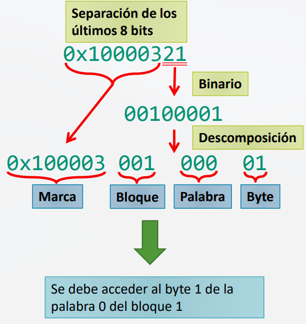

* **Direcciones de memoria**
Trabajamos con direcciones de memoria de 32 bits
y palabras de 32 bits

* **Configuración de caché**
Caché con 2 planos de 8 bloques cada uno y un tamaño de bloque de 32 bytes (8 palabras de 32 bits). Por tanto se precisan:
* **3 bits** para indicar el **bloque**
* **3 bits** para denotar la **palabra** dentro del bloque
* **2 bits** para seleccionar un **byte** de la palabra

Los restantes **24 bits** serán la **marca** que identificará cada bloque único de la RAM

* **Operación a ejecutar**
La CPU quiere leer el contenido de la dirección de memoria 0x10000321

### Comprobación de la marca
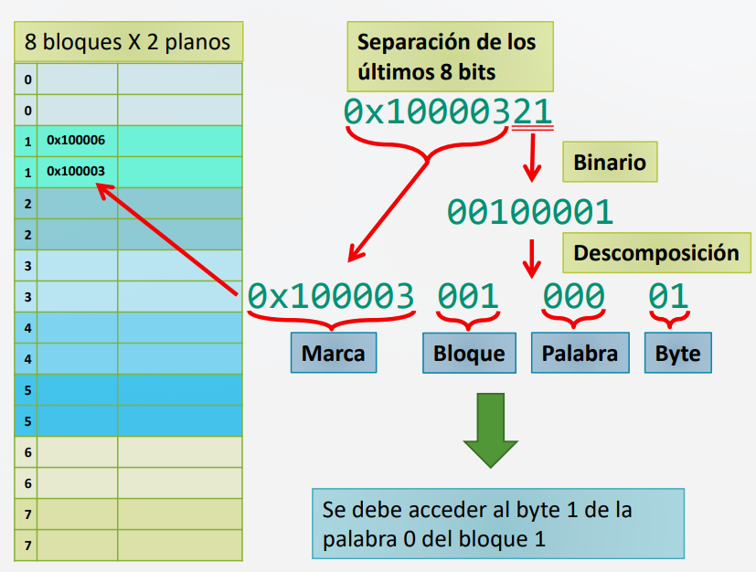

* **Planos del bloque 1**
Se recorren los planos del bloque que corresponda, comparando su marca con la de la dirección

* **Acierto (provisional)**
Si se encuentra la marca tenemos un acierto, pero aun hay que verificar la validez del bloque

* **Fallo**
Si ninguno de los planos del bloque contiene la marca se produce un fallo

* **Sustitución**
Hay que traer desde RAM el bloque que corresponde a la dirección 0x10000321

### Verificación de si la entrada es válida
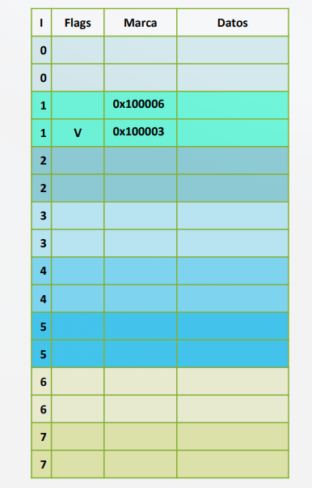

* **Indicadores**: Cada bloque de la caché tiene un campo de flags o indicadores que denotan su estado

* **Bit V**: Uno de los indicadores señalará si el contenido del bloque en caché contiene datos válidos o no. Si no está activo el bit se tendrá un fallo, en otro caso será acierto

* **Validez**: Un bloque de caché no contendrá datos válidos si nunca se ha copiado en él un bloque desde RAM (ocurre al inicio de la ejecución de un programa)

* **Coherencia**: En sistemas con múltiples CPU , una entrada de caché en un núcleo puede ser invalidada si tiene un bloque compartido con otro núcleo desde el que se ha modificado su contenido

### Estrategia de reemplazo

* **Directa**: En una caché de correspondencia directa siempre se sustituye el bloque que corresponda con el nuevo contenido traído desde RAM

* **Aleatoria**: Si se tienen varios planos en el bloque, se toma uno de ellos de forma aleatoria para copiar en él el nuevo bloque leído desde memoria RAM

* **LRU (Least Recently Used)**: Cada bloque/plano tiene asociado un índice que denota cuándo fue accedida por última vez la entrada en caché, de forma que se sustituya aquella que hace más tiempo que no se ha usado

* **Otras**: FIFO (First In First Out) y LFU (Least Frequently Used)

### Estrategia de escritura
Al traer un dato en memoria es preciso determinar como se preservará la coherencia entre los diferentes niveles de caché y RAM

* **Inmediata (write through)**: cualquier escritura se hace en caché y en RAM

* **Demorada (write back)**: Las escrituras se hacen en caché, marcando el bloque con el indicador Dirty. Este denota que si el bloque se sustituye por otro, antes hay que llevar los cambios a RAM

* **Sustitución en escritura (write allocate)**. Si la escritura afecta a una dirección que no está en caché, el bloque puede ser traído desde RAM a caché antes (write allocate) o escribir directamente en RAM sin esa sustitución (no write allocate)

## 5. Análisis del impacto de la caché en el rendimiento
Al acceder a un dato desde la CPU la dirección puede corresponder a un bloque válido que esté en caché o uno que haya que traer desde RAM

### Formulación

* **Tiempo de acceso a caché (Ta)**: Tiempo que se tarda en obtener una palabra desde caché

* **Tiempo de acceso a RAM (Tf)**: Tiempo empleado en traer un bloque desde RAM a la ubicación correspondiente de la caché y obtener la palabra desde caché

* **Tiempo total**: `𝑇𝑡 = 𝑁𝑎 × 𝑇𝑎 + 𝑁𝑓 × 𝑇f`

* **Tiempo de acceso medio** : `𝑇𝑚 = 𝑇𝑡 / 𝑁𝑡 = 𝑅𝑎 × 𝑇𝑎 + 𝑅𝑓 × 𝑇f`

* **Objetivo**: si se reduce 𝑇𝑚 se mejorará el rendimiento al ejecutar un programa, con
independencia de cuántos accesos se efectúen en total a memoria

### Cómo maximizar la ratio de aciertos
Mejorar la tasa de aciertos implica reducir el tiempo de acceso a memoria y mejorar el rendimiento

#### Factores a considerar
* **Tamaño de la caché:** La ratio de aciertos se verá incrementada a medida que lo haga la cantidad de caché disponible

* **Configuración de la caché**: El tamaño de bloque , número de bloques , nivel de asociatividad , estrategia de reemplazo y de escritura tienen también una influencia significativa en el ratio de aciertos

* **Patrones de acceso a memoria:** Los patrones que sigan los programas al hacer referencia a posiciones de memoria determinar en buena medida que haya más aciertos o fallos con independencia de los dos factores previos

### Tamaño de la caché
* **Espacio físico**:  La tecnología SRAM con la que se fabrica la memoria caché ocupa mucho más espacio que la DRAM , lo que implica sacrificar un área para esta tarea

* **Coste económico**: La fabricación de SRAM resulta mucho más cara que la DRAM

* **Tecnología actual**: Las limitaciones de espacio y coste se deben a la tecnología con la que actualmente se produce la caché 

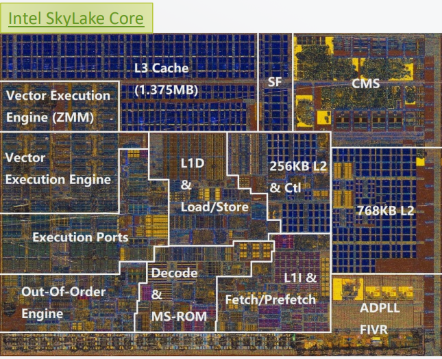

### Configuración de la caché
* **Tamaño de bloque**: Cuanto mayor es un bloque de caché menor es el número de fallos en el acceso a direcciones consecutivas de memoria. Pero se incrementa el tiempo preciso para traer un bloque desde RAM

* **Nivel de asociatividad**: Una memoria asociativa por conjuntos puede llegar a ser tan efectiva como una completamente asociativa , pero con una menor latencia de búsqueda

* **Estrategia de reemplazo**: La técnicas de remplazo como LRU ofrecen una mejor ratio de aciertos que otras más básicas como la aleatoria

* **Estrategia de escritura**: La escritura demorada, con sustitución de bloques que no estén ya en caché, suele tener un mejor rendimiento que otras opciones

* **Dependencias**: En último extremo muchos de estos aspectos dependerán del patrón de accesos a memoria que presente el programa a ejecutar

### Patrones de acceso a memoria
#### Principio de localidad espacial
La mayoría de programas acceden a datos que se alojan en posiciones consecutivas de memoria. Una vez que un bloque está en caché el número de aciertos será mayor

#### Principio de localidad temporal
Es normal que en unidades de timepo consecutivas se use un mismo dato, también contribuye a mejorar la ratio de aciertos

#### Análisis de los patrones de acceso
Analizar la ejecución del código para identificar los patrones de acceso y verificar que se respeten los dos principios anteriores es preciso para garantizar un buen uso de la memoria caché

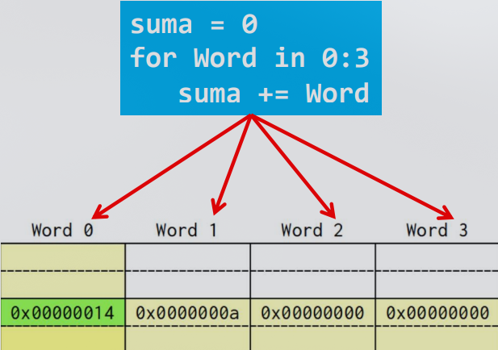