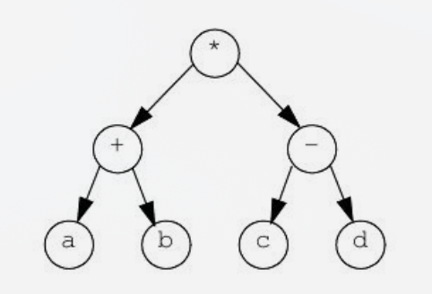

# Lección 10: Árboles

> Las resoluciones de cada ejercicio se encuentran debajo del documento

**Contestar V/F las siguientes cuestiones.**

**1 [ ] Conocer al altura de un ABB da información sobre el número de datos que contiene**

**2 [ ] Dos árboles ABB equivalentes pueden tener diferente altura, raíz y hojas.**

**3 [ ] Un árbol binario que representa expresiones matemáticas se resuelve mediante un recorrido en postorden.**

**4 [ ] Para obtener los datos ordenados de un ABB se hace un recorrido en preorden**

**5 [ ] Todo proceso recursivo que opere sobre un ABB se puede resolver de forma iterativa mediante una pila de punteros a nodos de tipo ABB**

**6 [ ] Al insertar la siguiente secuencia en un ABB: {4, 3, 7, 12, 2, 6, 5, 13}, el borrado del 12 implica una llamada a la función borraMin()**

**7 [ ] Para recorrer un árbol binario por niveles se necesita una cola. Este recorrido pasaría primero por la raíz, luego por raíz-> izq, luego por raiz->der, raiz->izq->izq, raíz->izq->der, etc...**

**8 [ ] Los recorridos recursivos Preorden, Inorden y Postorden permiten iterar sobre los árboles hacia delante y detrás.**


## Ejercicios
**1. Listar los datos por niveles de un árbol binario tal y como se explica arriba en el test y devolverlos en un vector:** 
```cpp
vector<T> recorreNiveles ();
```

**2. Implementar una función que devuelva la altura de un ABB:**
```cpp
int ABB::altura ();
```
**3. Implementar la versión iterativa de la búsqueda de un dato en un árbol ABB**
```cpp
bool Abb<T>::buscarNR (T &ele){
```

## Resolución

**1)**
Verdadero

La altura de un ABB proporciona límites sobre la cantidad de nodos $N$ que puede llegar a tener: la cantidad mínima de elementos es $h+1$ (en un árbol totalmente desequilibrado) y la cantidad máxima es $2^{h+1} - 1$ en un árbol completo

---
**2)**
Verdadero

Dos ABB son **equivalentes** si tienen el mismo conjunto de datos . Pero dependiendo de la secuencia y el orden en que se hayan insertado los datos la estructura del árbol puede ser distinta, cambiando su raíz, hojas e incluso altura

---
**3)**
Verdadero

Los operandos están en los nodos hoja y los operadores en los nodos internos. Un recorrido **postorden** (Izquierda->Derecha->Raíz) evalúa primero los subárboles con los operandos antes de aplicar el operador del padre



---
**4)**
Falso

Para recorrer los datos ordenador de menor a mayor se debe realizar un recorrido **inorden** (Izquierda->Raíz->Derecha) ya que el preorden procesaprimero la raíz y no los devuelve en orden

---
**5)**
Verdadero

Cualquier algoritmo recursivo sobre árboles utiliza implicitamente la pila de llamadas del sistema. Por ello siempre hay una versión iterativa utilizando una estructura de datos de tipo **pila** (`stack`) 

---
**6)**
Verdadero

```text
          4
        /   \
       3     7
      /     / \
     2     6   12
          /      \
         5        13
```

El nodo 12 tiene como hijo al 13. Para borrar un nodo con dos hijos la función busca el **mínimo del subárbol derecho** llamando a `borraMin()`

Resultado: 
```text
          4
        /   \
       3     7
      /     / \
     2     6   13
          /
         5
```
---
**7)**
Verdadero

El recorrido por niveles requiere una **cola** (**queue**) para ir procesando los nodos nivel a nivel. El orden exacto que sigue partiendo de la raíz es recorrer primero los hijos directos (`izq`,`der`) y luego los nietos (`izq`->`izq`, `izq`->`der`, etc.)

---
**8)**
Falso

Los recorridos recursivos estándar son unidireccionales, solo avanzan en sentido descendente (es decir de padres a hijos). Para poder ir hacia atrás se necesitaría un **iterador bidireccional** (*usado en Arboles Rojo-Negro*)

## Ejercicios

**1)**
```cpp
template <class T>
T* Abb<T>::recorreNiveles(int &numElementos) {
    numElementos = 0;
    if (!raiz) return nullptr;

    // 1. Contar el número total de nodos para reservar el tamaño exacto del array
    numElementos = numNodos(raiz); // Función auxiliar interna

    // 2. Crear el array de salida para los datos
    T* resultado = new T[numElementos];

    // 3. Crear una cola auxiliar dinámica de punteros a Nodo
    Nodo<T>** cola = new Nodo<T>*[numElementos];
    int frente = 0;
    int fin = 0;

    // Encolar la raíz
    cola[fin++] = raiz;

    int posResult = 0;
    while (frente < fin) {
        // Desencolar
        Nodo<T>* actual = cola[frente++];

        // Guardar el dato en el array
        resultado[posResult++] = actual->dato;

        // Encolar hijos
        if (actual->izq) {
            cola[fin++] = actual->izq;
        }
        if (actual->der) {
            cola[fin++] = actual->der;
        }
    }

    // Liberar la memoria de la cola auxiliar
    delete[] cola;

    return resultado;
}
```

**Función auxiliar privada para contar nodos:**
```cpp
template <class T>
int Abb<T>::numNodos(Nodo<T>* p) {
    if (!p) return 0;
    return 1 + numNodos(p->izq) + numNodos(p->der);
}
```
----
**2)**
```cpp
// Método privado auxiliar
template <class T>
int Abb<T>::calculaAltura(Nodo<T>* p) {
    if (!p) {
        return -1; // Árbol vacío
    }

    // Si es un nodo hoja (altura 0)[cite: 111, 112]
    if (!p->izq && !p->der) {
        return 0;
    }

    int altIzq = calculaAltura(p->izq);
    int altDer = calculaAltura(p->der);

    // Calcular el máximo manualmente
    if (altIzq > altDer) {
        return 1 + altIzq;
    } else {
        return 1 + altDer;
    }
}

// Método público
template <class T>
int Abb<T>::altura() {
    return calculaAltura(raiz);
}
```
----
**3)**
```cpp
template <class T>
bool Abb<T>::buscarNR(T &ele) {
    Nodo<T>* p = raiz;

    while (p != nullptr) {
        if (ele == p->dato) {
            ele = p->dato; // Confirmar / actualizar la referencia recibida
            return true;   // Encontrado
        }
        if (ele < p->dato) {
            p = p->izq;    // Bajar por el subárbol izquierdo[cite: 124]
        } else {
            p = p->der;    // Bajar por el subárbol derecho[cite: 124]
        }
    }

    return false; // No encontrado
}
```
