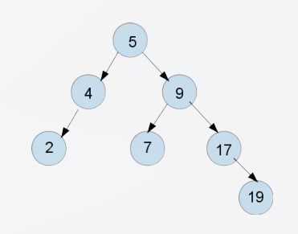

## Lección 11: Árboles AVL

Test de comprensión Contestar V/F las siguientes cuestiones.

**1 [ ] Dado el siguiente árbol AVL, la inserción de 10 requiere una rotación doble a derecha.**
```text
    11
    / \
    5 15
    / \ / \
    1 8 12 20
       \
       9
```
**2 [ ] Si se introducen datos ordenados de forma ascendente en un AVL, el tipo de rotación que se realizaría siempre sería el caso 4.**

**3 [ ] En un árbol AVL tras una inserción el proceso de ajuste requiere a lo sumo una única rotación simple o doble.**

**4 [ ] En un árbol AVL, tanto el borrado como la inserción requieren la localización de algún nodo hoja durante el proceso.**

**5 [ ] Se pueden listar los datos de un árbol AVL o ABB en orden inverso a su definición sin necesidad de añadir un puntero al padre.**

**6 [ ] No es posible que un árbol AVL tenga un nodo hoja a una profundidad 4 y otra a profundidad 8.**

**7 [ ] En los árboles AVL las rotaciones garantizan que el número de descendientes por la izquierda y derecha de un nodo difiere a lo sumo en 1.**

**8 [ ] Es posible que exista una secuencia de datos que al ser insertarda en un árbol AVL no provoque rotaciones**

## Ejercicios
**Ejercicios 1. Dado el siguiente árbol AVL, dibujad las modificaciones de dicho árbol tras realizar las siguientes inserciones (I) y borrados (B):**
```
I(6), I(13), I(10), B(19), I(1)
```


**2. En el control de acceso a una tienda Web se desea mantener una estructura de datos con la lista de de usuarios que han entrado en el sistema. Dicha lista se almacena en un vector dinámico pero para acelerar las búsquedas se usan dos árboles AVL auxiliares, ordenados por nombre de usuario y por fecha/hora de último acceso (en un long con formato AAAAMMDDHHMMSS). Las clases almacenadas en el vector y en los dos árboles AVL son las siguientes:**

```cpp
/* EEDD Vector */
class Usuario {
public:
    string nombre;
    long ultimoAcceso;
    string e-mail;
};
```

```cpp
/* EEDD AVL usuario por nombre */
class UsuarioPorNombre {
public:
    string nombre;
    Usuario *usuario;
    bool operator<(const UsuarioPorNombre& u) { return nombre < u.nombre; }
};
/* EEDD AVL usuario por fecha último acceso */
class UsuarioPorAcceso {
public:
    long ultimoAcceso;
    Usuario *usuario;
    bool operator<(const UsuarioPorAcceso& u) { return ultimoAcceso < u.ultimoAcceso;}
};
```

**Mostrar las estructuras de datos descritas durante las siguientes inserciones (agrupar pasos siempre que no se dificulte la lectura del ejercicio): I(Usuario(“pruiz”, 20161205101402, “pruiz@gmail.com”)), I(Usuario(“alopez”, 20170103122000, alopez@gmail.com)), I(Usuario(“igomez”, 20161110091523, “igomez@hotmail.com”)), I(Usuario(“mhernandez”, 20161122173045, “mhernandez@yahoo.es”)), I(Usuario(“yperez”, 20170120193215, “yperez@hotmail.com”))**

## Resolución

**1)**
Falso

Al insertar el 10, este se queda como hijo derecho del 9

El camino desde la raíz hasta el nodo insertado pasa por los nodos con desequilibrio: el nodo 8 (factor de equilibrio +2 , cargado a la derecha con 9 -> 10) y el nodo 5 (factor de equilibrio +2 subárbol derecho más alto)

En el primer nodo desequilibrado desde abajo (8), la rama cae a la derecha (9) y luego a la derecha (10), lo que forma un caso **Derecha-Derecha (DD)**. Se resuelve con una **rotación simple a la izquierda** sobre el nodo 8

---
**2)**
Falso

SI se insertan datos de forma estrictamente ascendente , en cada paso que desequilibre el árbol los datos caen siempre en la rama de **Derecha Derecha (DD)**

Esto da lugar a una **rotación simple a la izquierda** (caso 2 o caso DD)

---
**3)**
Verdadero

En la **inserción** dentro de un árbol de AVL, una vez detectado el primer nodo desequilibrado y realizada su correspondiente rotación, la altura del subárbol se restaura a su valor previo, reequilibrando automáticamente todo el árbol hacia arriba

Entonces, una insercción como mucho requiere una **única rotación** (Simple o doble)

---
**4)**
* **Inserción**: Todo nuevo nodo en un árbol binario de búsqueda / AVL se inserta siempre como una hoja en el árbol

* **Borrado:** Si el nodo a borrar no es una hoja (tiene 1 o 2 hijos), el proceso reemplaza su valor por el mínimo del subárbol derecho (o el máximo del izquierdo), lo cual requiere descender hasta localizar un nodo hoja o semihoja para realizar el borrado físico y ajustar desde ahí el equilibrio

---
**5)**
Verdadero 

Para listar los datos en orden inverso (de mayor a menor), basta con realizar un **recorrido Inorden inverso** (Derecha $\to$ Raíz $\to$ Izquierda).

Al ser un recorrido recursivo (o iterativo con pila explícita), no se requiere ningún puntero al padre en la estructura de los nodos

---
**6)**
Verdadero

La propiedad fundamental de un AVL es que para **todo** nodo, la diferencia entre las alturas de sus subárboles izquierdo y derecho es como mucho 1

Si existiera una hoja con profundidad 4 y otra con profundidad 8 (diferencia de 4 niveles) en algún ancestro común la diferencia de alturas superaría de sobra el límite

---
**7)**
Falso

Las rotaciones garantizan que la altura de los subárboles izquierdo y derecho de un nodo difiera a lo sumo en 1, no el número de descendientes (cantidad de nodos)

Un subárbol puede tener muchos más nodos pero si la diferencia es 1 estaría correcto

---
**8)**
Verdadero

Si los datos se insertan en un orden que mantenga el árbol naturalmente equilibrado en cada paso (por ejemplo, insertar la secuencia de un árbol binario perfecto nivel por nivel: $\{4, 2, 6, 1, 3, 5, 7\}$), la diferencia de alturas en todo nodo nunca superará $1$ y no se ejecutará ninguna rotación

## Ejercicios

**1)**

Árbol Inicial

```text
          5
        /   \
       4     9
      /     / \
     2     7   17
                 \
                  19
```

1. I(6) — Insertar 6
Inserción: Pasa a ser hijo izquierdo del 7.   
Equilibrio: Todo sigue en equilibrio ($\vert{}bal\vert{} \le 1$)


```text
          5
        /   \
       4     9
      /     / \
     2     7   17
          /      \
         6        19
```

2. I(13) — Insertar 13
Inserción: Pasa a ser hijo izquierdo del 17
Equilibrio: Todo sigue en equilibrio ($\vert{}bal\vert{} \le 1$)

```text
          5
        /   \
       4     9
      /     / \
     2     7   17
          /   /  \
         6   13   19
```

3. I(10) — Insertar 10
Inserción: Pasa a ser hijo izquierdo del 13
Desequilibrio: En la raíz 5 ($bal = -2$) por la rama Derecha-Derecha (DD)  
Solución: Rotación simple a la izquierda en el nodo 5. El 9 pasa a ser la nueva raíz

```text
               9
           /       \
          5         17
        /   \      /  \
       4     7    13   19
      /     /    /
     2     6    10
```

4. B(19) — Borrar 19
Borrado: Se elimina la hoja 19 directamente 
Desequilibrio: En el nodo 17 ($bal = +2$)  
Solución: Rotación simple a la derecha en el nodo 17. El 13 sube a su posición

```text
               9
           /       \
          5         13
        /   \      /  \
       4     7    10   17
      /     /
     2     6
```

5. I(1) — Insertar 1
Inserción: Pasa a ser hijo izquierdo del 2
Desequilibrio: En el nodo 4 ($bal = +2$) por la rama Izquierda-Izquierda (II)
Solución: Rotación simple a la derecha en el nodo 4. El 2 sube a su posición


```text
               9
           /       \
          5         13
        /   \      /  \
       2     7    10   17
      / \   /
     1   4 6
```

---
**2)**

Se realizan 5 inserciones en tres estructuras: un vector dinámico de usuarios, un AVL ordenado por nombre y otro AVL ordenado por fecha/hora de último acceso

### 1. Inserciones
Inserción 1: `I(pruiz, 20161205101402, pruiz@gmail.com)`
Se inserta el primer usuario en vec[0], que pasa a ser la raíz de ambos AVL

AVL por nombre:       AVL por acceso:

    pruiz                20161205101402

Inserción 2: `I(alopez, 20170103122000, alopez@gmail.com)`
`alopez` es menor alfabéticamente que `pruiz`, por lo que se inserta a la izquierda. Su fecha de acceso es mayor, así que se inserta a la derecha en el otro AVL

```text
AVL por nombre:       AVL por acceso:

    pruiz                20161205101402
    /                              \
 alopez                         20170103122000
 ```

Inserción 3: `I(igomez, 20161110091523, igomez@hotmail.com)`
En el AVL por nombre, `igomez` queda a la derecha de `alopez`, provocando un desequilibrio Izquierda-Derecha (ID). Se aplica una rotación doble izquierda-derecha

```text
       igomez
       /    \
   alopez   pruiz
```

Inserción 4: `I(mhernandez, 20161122173045, mhernandez@yahoo.es)`

`mhernandez` se inserta a la izquierda de `pruiz` en el AVL por nombre y a la derecha de 20161110091523 en el AVL por acceso

```text
AVL por nombre:       AVL por acceso:

      igomez             20161205101402
      /    \             /            \
  alopez   pruiz    20161110091523  20170103122000
           /                \
     mhernandez          20161122173045
```

Inserción 5: `I(yperez, 20170120193215, yperez@hotmail.com)`

En el AVL por nombre se produce un caso **Derecha-Derecha (DD)** en `pruiz`, que se corrige mediante una rotación simple a la izquierda.

En el AVL por acceso también aparece un caso DD en la raíz, corregido con una rotación simple a la izquierda

## 2. Estado final
### Vector dinámico de usuarios

```text
[0] -> ("pruiz",       20161205101402, "pruiz@gmail.com")
[1] -> ("alopez",      20170103122000, "alopez@gmail.com")
[2] -> ("igomez",      20161110091523, "igomez@hotmail.com")
[3] -> ("mhernandez",  20161122173045, "mhernandez@yahoo.es")
[4] -> ("yperez",      20170120193215, "yperez@hotmail.com")
```

### AVL ordenado por nombre
Cada nodo contiene el nombre y un puntero a su posición en el vector

```text
                 igomez (&vec[2])
                 /              \
     alopez (&vec[1])       pruiz (&vec[0])
                            /             \
              mhernandez (&vec[3])    yperez (&vec[4])
```

### AVL ordenado por último acceso
Cada nodo contiene la fecha de acceso y un puntero al usuario correspondiente

```text
                  20170103122000 (&vec[1])
                  /                       \
     20161205101402 (&vec[0])      20170120193215 (&vec[4])
     /
20161110091523 (&vec[2])
     \
     20161122173045 (&vec[3])
```

## 3. Resumen de las rotaciones

| Inserción | AVL | Caso | Rotación | 
| -- | -- | -- | -- |
| 3 | Por nombre | ID | Doble izquierda-derecha |
| 5 | Por nombre | DD | Simple a la izquierda | 
| 5 | Por acceso | DD | Simple a la izquierda | 
