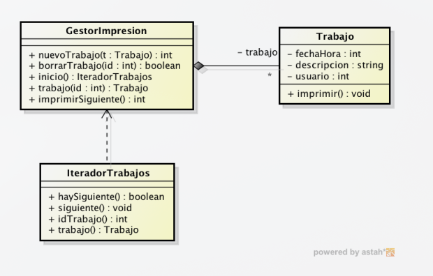
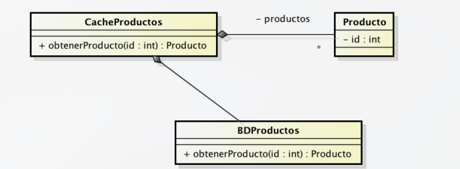

# Relación de ejercicios 2: implementación en C++ de diagramas de clases seleccionando las estructuras de datos adecuadas

1. Las siguientes clases forman parte de un sistema de impresión de un sistema operativo. La clase Trabajo representa los trabajos de impresión
enviados por los usuarios y el gestor de impresión el organizador de la cola
de impresión de trabajos. Las operaciones de la clase impresión son:

* `nuevoTrabajo()`: inserta un trabajo en la cola y devuelve un identificador único para cada trabajo.

* `borraTrabajo()`: elimina un trabajo de la cola indicando su identificador.

* `trabajo()`: Devuelve el trabajo asociado a un identificador.

* `inicio()`: Devuelve un iterador apuntando al primer trabajo. 

* `imprimir()`: imprime el siguiente trabajo de la cola y lo elimina. La política del gestor de impresión es el de una cola con prioridad. Si existe algún trabajo en la cola enviado por el root (id de usuario 0), este tendrá preferencia sobre todos los demas. El resto sigue un criterio FIFO.


Implementar las clases del diagrama. No pueden usarse las clases STL
queue o priorityqueue. Aunque no aparecen en el diagrama, deben implementarse también sus constructores.



```cpp
#include <iostream>
#include <string>
#include <list>

class Trabajo {
private:
    int id;
    int fechaHora;
    std::string descripcion;
    int usuario;

public:
    Trabajo(int fH = 0, std::string desc = "", int usr = 0) 
        : id(0), fechaHora(fH), descripcion(desc), usuario(usr) {}

    int getId() { return id; }
    void setId(int nuevoId) { id = nuevoId; }
    int getFechaHora() { return fechaHora; }
    std::string getDescripcion() { return descripcion; }
    int getUsuario() { return usuario; }

    void imprimir() {
        std::cout << "Imprimiendo trabajo " << id << " del usuario " << usuario << std::endl;
    }
};

class IteradorTrabajos {
private:
    std::list<Trabajo>::iterator actual;
    std::list<Trabajo>::iterator fin;

    friend class GestorImpresion; // sin la friend class no va


    IteradorTrabajos(std::list<Trabajo>::iterator inicio, std::list<Trabajo>::iterator final) 
        : actual(inicio), fin(final) {}

public:
    bool haySiguiente() {
        return actual != fin;
    }

    void siguiente() {
        if (haySiguiente()) {
            actual++;
        }
    }

    int idTrabajo() {
        return actual->getId();
    }

    Trabajo trabajo() {
        return *actual;
    }
};
class GestorImpresion {
private:
    std::list<Trabajo> cola;
    int contadorId;

public:
    GestorImpresion() : contadorId(1) {}

    int nuevoTrabajo(Trabajo t) {
        int idAsignado = contadorId++;
        t.setId(idAsignado);

        if (t.getUsuario() == 0) {
            std::list<Trabajo>::iterator it = cola.begin();
            while (it != cola.end() && it->getUsuario() == 0) {
                it++;
            }
            cola.insert(it, t);
        } else {
            cola.push_back(t);
        }

        return idAsignado;
    }
    bool borrarTrabajo(int id) {
        for (std::list<Trabajo>::iterator it = cola.begin(); it != cola.end(); it++) {
            if (it->getId() == id) {
                cola.erase(it);
                return true;
            }
        }
        return false;
    }
    Trabajo trabajo(int id) {
        for (std::list<Trabajo>::iterator it = cola.begin(); it != cola.end(); it++) {
            if (it->getId() == id) {
                return *it;
            }
        }
        return Trabajo();
    }
    IteradorTrabajos inicio() {
        return IteradorTrabajos(cola.begin(), cola.end());
    }

    int imprimirSiguiente() {
        if (cola.empty()) {
            return -1;
        }

        Trabajo t = cola.front();
        int idImpreso = t.getId();

        t.imprimir();
        cola.pop_front();

        return idImpreso;
    }
};
```

----
2. Disponemos de una base de datos de productos con un número muy grande de entradas que debe ser consultada con una frecuencia muy alta para localizar productos a partir de su identificador. Para acelerar este acceso
disponemos de una caché que guarda los últimos 1000 productos solicitados. El funcionamiento es el siguiente:

* El producto es solicitado a través de la operación obtenerProducto de CacheProductos

* Si existe en la caché, se devuelve inmediatamente.

* Si no existe en la caché, se solicita a la base de datos y se guarda en la caché por si vuelve a ser solicitado. Si la caché tiene 1000 elementos, se elimina el último que fue solicitado y se sustituye por éste. Finalmente se devuelve el producto.

Implementar la clase CacheProductos. La relación “productos no tiene
por qué traducirse en una única estructura de datos, y pueden incluirse
los atributos adicionales que se consideren necesarios.



```cpp
class Producto{
    private:
        int id;
    public:
    Producto(int id = 0) : id(id) {}

    int getId() { return id; }
};

class BDProductos {
    public:
        Producto obtenerProducto(int id) {
            return Producto(id);
    }
};

class CacheProductos {
private:
    std::list<Producto> listaProductos;
    std::map<int, std::list<Producto>::iterator> mapaCache;
    BDProductos bd;
    int capacidad;

public:
    CacheProductos(int cap = 1000) : capacidad(cap) {}

    Producto obtenerProducto(int id) {
        std::map<int, std::list<Producto>::iterator>::iterator itMap = mapaCache.find(id);
        if (itMap != mapaCache.end()) {
            std::list<Producto>::iterator itLista = itMap->second;
            Producto p = *itLista;
            listaProductos.erase(itLista);
            listaProductos.push_front(p);
            mapaCache[id] = listaProductos.begin();

            return p;
        }
        Producto p = bd.obtenerProducto(id);

        if (listaProductos.size() == capacidad) {
            int idEliminar = listaProductos.back().getId();
            mapaCache.erase(idEliminar);
            listaProductos.pop_back();
        }
        listaProductos.push_front(p);
        mapaCache[id] = listaProductos.begin();

        return p;
    }
};
```