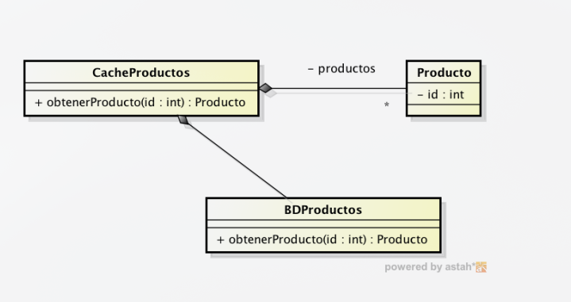

## Lección 8:  Clase vector, deque y list

## Tipo Test
Contestar V/F las siguientes cuestiones.

**1 [ ] El contenedor list<T> de STL implementa el operador [] para acceder directamente al dato almacenado en una posición arbitraria.**

> **Falso**
**std::list** está implementada como una lista doblemente enlazada, por lo que **no** permite el acceso aleatorio, para acceder a una posición específica se hace mediante un **iterador**

**2 [ ] Se ha pensado en implementar una matriz para almacenar todos los jugadores convocados en todos los partidos de todas las jornadas de la liga de fútbol. Esta sería una posible estructura de datos para crear dicha tabla: vector<vector<vector<Jugador> > > jugadores.**

> **Verdadero**
Un **std::vector** de tres dimensiones ($vector<vector<vector<T>>>$) representa una estructura matricial 3D . La primera dimensión podría servir para indexar una jornada, la segunda un partido y la tercera el jugador


**3 [ ] Para simular una lista circular (p.e. procesos de un S.O) en el que los datos entran siempre por el mismo lugar pero salen en cualquier momento es igualmente eficiente utilizar una lista (list) que un vector de STL.**

> **Falso**
La eliminación en un **vector** de un elemento en una posición intermedia requiere tiempo $O(n)$, porque hay que desplazar todos los elementos posteriores una posición. En una **lista** se puede realizar en tiempo $O(1)$ si se dispone del iterador al nodo, ya que basta con reajustar dos punteros

**4 [ ] Se ha utilizado la siguiente estructura de datos para implementar un editor de texto interactivo: list<vector<char> > texto. La implementación de la operación pulsarTecla(char c) sería la siguiente: i->insert(i->begin() + pos, c), siendo i un iterador de la lista que apunta a la línea donde se encuentra el cursor y pos un entero positivo que indica la posición del cursor en dicha línea.**

> **Falso**
Los iteradores de **std::list** son iteradores bidireccionales, no de acceso aleatorio. Por lo tanto la expresión **i->begin() + pos** es incorrecta porque el operador **+** de avance directo no sirve en estas estructuras

**5 [ ] Sean dos conjuntos a y b de palabras, implementados usando dos vectores de STL instanciados al tipo string. Entonces obtener el vector c = a ∩ b (palabras que están en ambos conjuntos) requiere un tiempo cuadrático.**

> **Falso**
Si los vectores se ordenan previamente ($O(n \log n)$), la intersección se puede realizar en tiempo lineal $O(n)$ usando **std::set_intersection**. También se puede lograr en complejidad $O(n)$ usando un conjunto de dispersión **std::unordered_set**

**6 [ ] La inserción de un dato d al principio de un vector v de STL mediante v.insert(v.begin(), d) requiere tiempo O(1).**

> **Falso**
Insertar en **std::vector** tiene complejidad $O(n)$, ya que exige desplazar todos los elementos existentes una posición a la derecha en memoria (y además el nuevo elemento se copia)

**7 [ ] Un std::deque admite inserciones y borrados eficientes tanto por el principio como por el final, mientras que en un std::vector insertar al principio es lineal.**

> **Verdadero**
La **deque** guarda los datos repartidos en **bloques** (chunks) de memoria conectados entre sí por una tabla de punteros. Insertar o borrar en un extremo solo obliga a tocar el bloque correspondiente y, si éste está lleno, a pedir uno nuevo; el resto de los bloques no se mueven. Por eso `push_front`, `pop_front`, `push_back` y `pop_back` son $O(1)$ amortizado. En un **vector** la memoria es **contigua**, de modo que `push_front(x)` exige desplazar los $n$ elementos existentes una posición: $O(n)$

**8 [ ] Cuando un push_back de std::vector provoca una reasignación de memoria, todos los iteradores y punteros al contenedor quedan invalidados.**

> **Verdadero**
El vector solo reasigna cuando `size() == capacity()`. En ese momento reserva un bloque nuevo (normalmente el doble de grande), **copia** todos los elementos y **libera** el bloque antiguo. Cualquier iterador que apuntara al bloque antiguo pasa a señalar memoria ya devuelta al sistema, por lo que su uso es comportamiento indefinido. Por eso no conviene guardar iteradores entre operaciones que pueden cambiar la capacidad: `push_back`, `insert`, `reserve`, `resize`

**9 [ ] La operación insert(pos, dato) de std::list devuelve un iterador que apunta al elemento recién insertado.**

> **Verdadero**
`list::insert` devuelve siempre un iterador al nodo nuevo, lo que permite encadenar inserciones y seguir recorriendo desde ese punto sin tener que recalcular nada. Matiz importante: en `vector::insert` esa devolución del iterador solo existe desde **C++11**; en C++98 devolvía `void`

**10 [ ] Para ordenar los elementos de una std::list se debe usar std::sort(l.begin(), l.end()), que es el mismo algoritmo que se usa con un vector.**

> **Falso**
`std::sort` exige iteradores de **acceso aleatorio** (necesita calcular posiciones intermedias y hacer intercambios por índice), y la lista no los tiene, por lo que ese código **no compila**. La lista ofrece su propio miembro **`l.sort()`**, que ordena los nodos **re-enlazándolos** (sin copiar datos), con complejidad $O(n \log n)$ y además es un algoritmo **estable**

**11 [ ] Si el contenedor está vacío, front() y back() devuelven un valor por defecto (0, cadena vacía, etc).**

> **Falso**
`front()` y `back()` devuelven una **referencia** al primer o al último elemento. Si el contenedor está vacío esa referencia no apunta a nada y el comportamiento es **indefinido**: el programa no lanza ninguna excepción, puede que "funcione" en pruebas y falle después. Hay que comprobar siempre `empty()` antes de usarlas. (`at()` y `operator[]` de `vector` y `deque` sí lanzan `std::out_of_range` si el índice es inválido, pero no existe un "valor por defecto")

**12 [ ] En un std::list el método size() tiene complejidad lineal porque hay que recorrer la lista contando nodos.**

> **Falso**
Desde **C++11**, `std::list::size()` es $O(1)$: la lista mantiene un contador de nodos que se actualiza en cada inserción y borrado. Antes de C++11 el estándar permitía $O(n)$ y algunas implementaciones antiguas lo hacían así, de ahí que la duda sea razonable

**13 [ ] Borrar con erase(it) en un std::vector invalida únicamente el iterador que apuntaba al elemento borrado.**

> **Falso**
En un **vector** los elementos están contiguos: al borrar, todos los posteriores se desplazan una posición, por eso quedan invalidados **todos los iteradores desde la posición borrada hasta el final** (los anteriores siguen siendo válidos). En una **list** los nodos son independientes y no se mueven: `erase` solo invalida el iterador del elemento borrado, el resto siguen apuntando a su nodo

**14 [ ] reserve(n) de std::vector aumenta el tamaño del vector hasta n elementos.**

> **Falso**
`reserve(n)` trabaja sobre la **capacidad** (`capacity()`), no sobre el tamaño: reserva espacio físico para $n$ elementos pero **`size()` no cambia**, el vector sigue teniendo exactamente los mismos elementos lógicos. Si `n > capacity()` se reasigna memoria y **se invalidan todos los iteradores**. Para aumentar el número de elementos hay que usar `resize(n)`, `push_back` o `insert`

**15 [ ] std::deque admite el operador operator[], por lo que ofrece acceso aleatorio en O(1), igual que un vector.**

> **Verdadero**
Para acceder a la posición $i$, la deque calcula en qué bloque está y en qué offset dentro de ese bloque mediante su tabla de índices: dos operaciones aritméticas, es decir $O(1)$. Las diferencias con el vector aparecen en otros sitios: la memoria **no es contigua** (peor localidad de caché y no existe `data()`), y las inserciones o borrados en posiciones intermedias siguen siendo caros

**16 [ ] pop_back() de std::vector libera memoria, de forma que capacity() disminuye al bajar size().**

> **Falso**
`pop_back()` solo **destruye** el elemento y decrementa `size()`: la **capacidad no cambia**, el bloque de memoria sigue siendo el mismo, y por eso el siguiente `push_back` es $O(1)$ y no hay que volver a reservar. Si se quiere devolver la memoria sobrante hay que pedirlo explícitamente con `shrink_to_fit()` (C++11, es una **solicitud** que el compilador puede ignorar) o con el truco de `vector<T>().swap(v)`

**17 [ ] std::list::splice mueve elementos de una lista a otra sin copiarlos, solo reajustando punteros.**

> **Verdadero**
`splice` extrae los nodos de la lista origen y los enlaza en la lista destino: **no se llama al constructor copia ni al destructor** de ningún dato, y los iteradores que apuntaban a esos nodos siguen siendo válidos (ahora apuntan dentro de la lista destino). El coste es de punteros, no de datos, por eso es la operación idónea para partir, unir o reordenar listas grandes sin gastar memoria adicional

## Ejercicios
1. Implementar una operación vector<int> primosMenores(int n) que devuelva la lista de los números primos
menores que n usando la criba de Euler. Su funcionamiento es el siguiente:
    1. Generar una lista con los números desde 2 a n
    2. El primer número de la lista es primo (añadir al resultado)
    3. Multiplicar el primer número por todos los elementos de la lista y marcar los elementos resultantes
    4. Eliminar el primer elemento y todos los elementos marcados
    5. Volver al paso (b) si la lista no está vacía

```cpp
#include <iostream>
#include <vector>

std::vector<int> primosMenores(int n) {
    std::vector<int> primos;
    if (n <= 2) return primos;

    // 1. Generar una lista con los números desde 2 a n-1
    std::vector<int> lista;
    for (int i = 2; i < n; i++) {
        lista.push_back(i);
    }

    // 5. Volver al paso (b) si la lista no está vacía
    while (!lista.empty()) {
        // 2. El primer número de la lista es primo (añadir al resultado)
        int p = lista[0];
        primos.push_back(p);

        // 3. Multiplicar el primer número por todos los elementos y marcar los resultantes
        // Usamos un vector de booleanos para marcar los números que debemos borrar
        std::vector<bool> marcar(lista.size(), false);

        for (size_t i = 0; i < lista.size(); i++) {
            long long producto = (long long)p * lista[i];
            
            // Buscar si el producto existe dentro de la lista para marcarlo
            if (producto < n) {
                for (size_t j = 0; j < lista.size(); j++) {
                    if (lista[j] == producto) {
                        marcar[j] = true;
                    }
                }
            }
        }

        // 4. Eliminar el primer elemento y todos los elementos marcados
        std::vector<int> nuevaLista;
        for (size_t i = 1; i < lista.size(); i++) {
            if (!marcar[i]) {
                nuevaLista.push_back(lista[i]);
            }
        }
        
        // Actualizar la lista con los elementos que no fueron marcados
        lista = nuevaLista;
    }

    return primos;
}
```

2. Disponemos de una base de datos de productos con un número muy grande de entradas que debe ser consultada con
una frecuencia muy alta para localizar productos a partir de su identificador. Para acelerar este acceso disponemos
de una caché que guarda los últimos 1000 productos solicitados. El funcionamiento es el siguiente:
* El producto es solicitado a través de la operación obtenerProducto() de CacheProductos.

* Si existe en la caché, se devuelve inmediatamente.

* Si no existe en la caché, se solicita a la base de datos y se guarda en la caché por si vuelve a ser solicitado.
Si la caché tiene 1000 elementos, se elimina el último que fue solicitado y se sustituye por éste. Finalmente se devuelve el producto.

Implementar la clase CacheProductos. La relación “productos no tiene por qué traducirse en una única estructura
de datos, y pueden incluirse los atributos adicionales que se consideren necesarios.



```cpp
#include <iostream>
#include <list>
#include <unordered_map>

// Definición de la clase Producto según el diagrama UML
class Producto {
private:
    int id;

public:
    Producto(int id = 0) : id(id) {}
    
    int getId() const { 
        return id; 
    }
};

// Clase simulada de la Base de Datos
class BDProductos {
public:
    Producto obtenerProducto(int id) {
        // Devuelve el producto desde la base de datos
        return Producto(id);
    }
};

// Clase Caché de Productos
class CacheProductos {
private:
    BDProductos bd; // Instancia de la base de datos
    
    // Lista para guardar el orden de uso (el más reciente delante, el menos reciente detrás)
    std::list<Producto> listaProductos; 
    
    // Mapa para buscar rápidamente un producto en la lista por su ID
    std::unordered_map<int, std::list<Producto>::iterator> mapaCache;

public:
    CacheProductos() {}

    Producto obtenerProducto(int id) {
        // 1. Buscamos si el producto ya está en la caché
        auto it = mapaCache.find(id);

        // SI ESTÁ EN LA CACHÉ:
        if (it != mapaCache.end()) {
            // Lo movemos al principio de la lista porque se acaba de usar
            listaProductos.splice(listaProductos.begin(), listaProductos, it->second);
            
            // Devolvemos el producto encontrado
            return *(it->second);
        }

        // NO ESTÁ EN LA CACHÉ:
        // Lo pedimos a la base de datos
        Producto prod = bd.obtenerProducto(id);

        // Si la caché está llena (ya tiene 1000 elementos), borramos el último
        if (listaProductos.size() == 1000) {
            int idUltimo = listaProductos.back().getId();
            mapaCache.erase(idUltimo);       // Lo quitamos del mapa
            listaProductos.pop_back();       // Lo quitamos del final de la lista
        }

        // Insertamos el nuevo producto al principio de la lista
        listaProductos.push_front(prod);
        
        // Guardamos su posición en el mapa para búsquedas futuras
        mapaCache[id] = listaProductos.begin();

        return prod;
    }
};
```

3. Implementar la clase `HistorialNavegacion` que simula los botones **Atrás** y **Adelante** de un navegador. La clase debe permitir: visitar una página nueva, retroceder, avanzar, conocer la página actual y saber cuántas páginas hay a cada lado. Cuando se visita una página nueva, el historial de "adelante" se pierde, igual que en un navegador real.

**Análisis previo: por qué `deque`**

* Solo se trabaja en los **extremos**: añadir la página actual al historial (final) y sacar la última para retroceder (final). Nunca hay que insertar en el medio.
* Se necesita saber **cuántas** páginas hay y **cuál** es la última: `size()` y `back()` son directos.
* `std::vector` también funcionaría (las operaciones son al final), pero la `deque` refleja mejor el modelo de "cola por ambos extremos" y no pide reasignaciones de un único bloque contiguo.

```cpp
#include <iostream>
#include <deque>
#include <string>
#include <stdexcept>

class HistorialNavegacion {
private:
    // Páginas visitadas ANTERIORES a la actual (el final es la más reciente)
    std::deque<std::string> anteriores;
    // Página que se muestra en este momento
    std::string actual;
    // Páginas a las que se puede volver con "Adelante"
    std::deque<std::string> posteriores;
    bool hayActual = false;   // para no confundir "primera página" con "sin página"

public:
    // Carga una nueva página: la actual pasa al historial y se pierde el "adelante"
    void visitar(const std::string& url) {
        if (hayActual) {
            anteriores.push_back(actual);  // O(1) amortizado
        }
        actual = url;
        hayActual = true;
        posteriores.clear();               // al navegar a otro sitio ya no se puede volver
    }

    bool puedeAtras()    const { return !anteriores.empty(); }
    bool puedeAdelante() const { return !posteriores.empty(); }

    // Retrocede una posición: la actual queda guardada para poder volver a ella
    std::string atras() {
        if (!puedeAtras()) {
            throw std::runtime_error("No hay pagina anterior");
        }
        posteriores.push_back(actual);     // la página actual se guarda para "adelante"
        actual = anteriores.back();        // leemos la última sin copiar toda la lista
        anteriores.pop_back();             // la quitamos del historial: O(1)
        return actual;
    }

    // Avanza una posición: es el proceso anterior en sentido contrario
    std::string adelante() {
        if (!puedeAdelante()) {
            throw std::runtime_error("No hay pagina siguiente");
        }
        anteriores.push_back(actual);
        actual = posteriores.back();
        posteriores.pop_back();
        return actual;
    }

    std::string paginaActual() const { return actual; }
    size_t numAtras()    const { return anteriores.size(); }
    size_t numAdelante() const { return posteriores.size(); }
};
```

| Operación | Qué hace internamente | Complejidad |
|:---|:---|:---|
| `visitar` | `push_back` + `clear` del historial adelante | $O(1)$ amortizado |
| `atras` / `adelante` | `push_back` + `back` + `pop_back` | $O(1)$ |
| `puedeAtras` / `numAtras` | `empty` / `size` | $O(1)$ |

---

4. Implementar una función que fusione dos listas de enteros **ya ordenadas** en una sola lista ordenada, manteniendo el orden de los elementos iguales (estabilidad) y sin usar contenedores auxiliares. Comparar al menos dos formas de resolverlo y explicar cuál conviene.

**Método 1 (el recomendado): `std::list::merge`**

`merge` es un miembro propio de la lista: extrae los nodos de la lista que le pasamos y los enlaza en la que lo llama, sin copiar ni un solo entero.

```cpp
#include <list>

// fusiona b dentro de a; al terminar, b queda vacía
void fusionarMerge(std::list<int>& a, std::list<int>& b) {
    // merge exige que AMBAS listas estén ordenadas. Si se está seguro de que
    // lo están, estos dos sort sobran; si no lo están, merge da un resultado incorrecto
    a.sort();   // O(n log n)
    b.sort();

    a.merge(b); // O(n + m): re-enlaza nodos, no copia datos, es estable
}
```

**Método 2: recorrido manual con iteradores e `insert`**

```cpp
#include <list>

void fusionarManual(std::list<int>& a, std::list<int>& b) {
    auto itA = a.begin();
    auto itB = b.begin();

    while (itB != b.end()) {
        // Avanzamos en a mientras sus elementos sean menores o iguales que *itB
        // (el "<=" hace que ante un empate se quede antes el elemento de a: estabilidad)
        while (itA != a.end() && *itA <= *itB) {
            ++itA;
        }

        // insertamos el elemento de b justo antes de itA
        itA = a.insert(itA, *itB);  // devuelve el iterador al nodo nuevo (no se invalida nada)
        ++itA;                      // seguimos a partir de ahí, sin reexaminar lo ya colocado
        ++itB;
    }

    b.clear();  // sus datos ya están en a (aquí sí hubo copia)
}
```

**Método 3 (no recomendado): pasarlo todo por un vector**

```cpp
#include <list>
#include <vector>
#include <algorithm>

void fusionarPorVector(std::list<int>& a, std::list<int>& b) {
    std::vector<int> v(a.begin(), a.end());   // copia de a
    v.insert(v.end(), b.begin(), b.end());    // copia de b

    std::sort(v.begin(), v.end());            // O((n+m) log(n+m))

    a.assign(v.begin(), v.end());             // vuelve a copiar todo dentro de a
    b.clear();
}
```

| Método | Complejidad | Memoria extra | Copias de datos | Estable |
|:---|:---|:---|:---|:---|
| 1. `merge` | $O(n + m)$ | Ninguna | Cero (solo punteros) | Sí |
| 2. Iteradores + `insert` | $O(n + m)$ | Ninguna | $n + m$ copias | Sí (con `<=`) |
| 3. `vector` + `sort` | $O((n+m)\log(n+m))$ | $O(n+m)$ | Varias pasadas | No (`sort`) |

Conclusión: si las listas ya están ordenadas, `merge` es la opción correcta: coste lineal y cero copias. Si no lo estuvieran, la secuencia `a.splice(a.end(), b); a.sort();` copia también cero datos (une las dos listas y ordena re-enlazando), aunque el coste pasa a ser $O((n+m)\log(n+m))$

---

5. Implementar una función que reciba un `vector<int>` y devuelva otro **sin elementos duplicados, conservando el orden de la primera aparición**. Plantear al menos tres soluciones y justificar cuándo conviene cada una.

**Método 1: `unordered_set` como memoria de "lo que ya vi" (recomendado)**

```cpp
#include <vector>
#include <unordered_set>

std::vector<int> sinDuplicadosOrden(const std::vector<int>& v) {
    std::vector<int> res;
    res.reserve(v.size());                 // evita reasignaciones: menos copias
    std::unordered_set<int> vistos;        // búsqueda media O(1)

    for (int x : v) {
        // insert devuelve pair<iterador, bool>: bool == true si REALMENTE se insertó
        if (vistos.insert(x).second) {
            res.push_back(x);              // solo entra la PRIMERA aparición
        }
    }
    return res;
}   // O(n) promedio, mantiene el orden original
```

**Método 2: `sort` + `unique` (solo si el orden no importa)**

```cpp
#include <vector>
#include <algorithm>

std::vector<int> sinDuplicadosSinOrden(std::vector<int> v) {   // por copia
    std::sort(v.begin(), v.end());              // O(n log n)
    auto it = std::unique(v.begin(), v.end());  // compacta los distintos al principio
    v.erase(it, v.end());                       // recorta la "cola" de duplicados
    return v;
}   // O(n log n), MUY rápido en la práctica, pero desordena los datos
```
> `std::unique` **no busca duplicados en un vector desordenado**: necesita los iguales juntos (por eso primero se ordena). Además no borra, devuelve el iterador donde acabaría la parte sin duplicados, y el borrado real lo hace `erase`.

**Método 3: sin ningún contenedor auxiliar (in situ)**

```cpp
#include <vector>

void sinDuplicadosInSitu(std::vector<int>& v) {
    size_t n = 0;   // marca hasta dónde está ya el resultado limpio

    for (size_t i = 0; i < v.size(); ++i) {
        bool duplicado = false;
        for (size_t j = 0; j < n && !duplicado; ++j) {   // solo miramos lo ya válido
            if (v[j] == v[i]) duplicado = true;
        }
        if (!duplicado) {
            v[n++] = v[i];   // sobrescribimos la posición siguiente
        }
    }
    v.resize(n);   // recortamos los restos
}   // O(n²) tiempo, O(1) memoria, mantiene el orden
```

| Método | Tiempo | Memoria | Conserva el orden | Cuándo usarlo |
|:---|:---|:---|:---|:---|
| 1. `unordered_set` | $O(n)$ promedio | $O(n)$ | Sí | Vector grande y sin orden impuesto |
| 2. `sort` + `unique` | $O(n \log n)$ | $O(1)$ | **No** | Da igual el orden y se quiere máxima velocidad |
| 3. Doble bucle in situ | $O(n^2)$ | $O(1)$ | Sí | Vectores pequeños o cuando está prohibida la STL auxiliar |

---

6. Dado un `vector<int>`, obtener la suma, el máximo, el número de elementos pares y el número de elementos negativos. Resolverlo de tres formas distintas y comentar las diferencias.

**Método 1: un único recorrido con bucle `for` sobre rango**

```cpp
#include <vector>
#include <limits>

void estadisticasBucle(const std::vector<int>& v, int& suma, int& maximo,
                       int& pares, int& negativos) {
    if (v.empty()) {
        suma = maximo = pares = negativos = 0;
        return;
    }

    suma = 0;
    maximo = std::numeric_limits<int>::min();   // el menor valor posible
    pares = 0;
    negativos = 0;

    for (int x : v) {          // recorrido único: O(n)
        suma += x;
        if (x > maximo) maximo = x;
        if (x % 2 == 0) ++pares;
        if (x < 0)      ++negativos;
    }
}
```

**Método 2: `std::for_each` con una lambda que captura por referencia**

```cpp
#include <vector>
#include <algorithm>
#include <limits>

void estadisticasForEach(const std::vector<int>& v, int& suma, int& maximo,
                         int& pares, int& negativos) {
    if (v.empty()) return;

    suma = 0; maximo = std::numeric_limits<int>::min();
    pares = 0; negativos = 0;

    // [&] significa "capturar TODO por referencia": la lambda modifica las variables
    std::for_each(v.begin(), v.end(), [&](int x) {
        suma += x;
        maximo = std::max(maximo, x);
        if (x % 2 == 0) ++pares;
        if (x < 0)      ++negativos;
    });
}   // mismo coste que el método 1, estilo declarativo
```

**Método 3: un algoritmo STL para cada dato (más legible, varios recorridos)**

```cpp
#include <vector>
#include <algorithm>   // count_if, max_element
#include <numeric>     // accumulate
#include <iostream>    // cout

void estadisticasSTL(const std::vector<int>& v) {
    if (v.empty()) return;

    int suma    = std::accumulate(v.begin(), v.end(), 0);            // O(n)
    int maximo  = *std::max_element(v.begin(), v.end());            // O(n)
    int pares   = std::count_if(v.begin(), v.end(),
                                [](int x) { return x % 2 == 0; });  // O(n)
    int negs    = std::count_if(v.begin(), v.end(),
                                [](int x) { return x < 0; });       // O(n)

    std::cout << "Suma: " << suma << ", Max: " << maximo
              << ", Pares: " << pares << ", Negativos: " << negs << std::endl;
}
```

| Método | Recorridos | Coste | Lectura del código |
|:---|:---|:---|:---|
| 1. Bucle `for` | 1 | $O(n)$ | Imperativa, la más rápida en la práctica |
| 2. `for_each` + lambda | 1 | $O(n)$ | Funcional, todo el cálculo junto |
| 3. Algoritmos STL | 4 | $4 \cdot O(n)$ | La más clara; con $n$ grande conviene el 1 o el 2 |

Nota: con 4 algoritmos el coste sigue siendo lineal ($4n$), pero se recorre la memoria cuatro veces, lo que peor aprovecha la caché.

---

7. Implementar dos funciones sobre `std::list` que muevan elementos **sin copiarlos**, aprovechando `splice`:

```cpp
// a) Mueve los k primeros elementos de la lista al final
void moverPrincipioAlFinal(std::list<int>& l, int k);

// b) Parte la lista en dos: los menores que umbral y el resto (la lista origen queda vacía)
void partirEnDos(std::list<int>& l, int umbral,
                 std::list<int>& menores, std::list<int>& mayores);
```

```cpp
#include <list>
#include <iterator>   // std::next

// a) Los k primeros pasan al final sin desplazar ni un dato
void moverPrincipioAlFinal(std::list<int>& l, int k) {
    if (k <= 0 || k >= static_cast<int>(l.size())) {
        return;                        // nada que mover
    }

    auto primero = l.begin();
    auto limite  = std::next(primero, k);   // avanzamos k nodos: O(k)

    // splice mueve el rango [primero, limite) justo antes de l.end()
    // Solo se reajustan punteros: cero copias, cero destructores
    l.splice(l.end(), l, primero, limite);
}

// b) Separa con splice: cada nodo se "desengancha" de l y se engancha en su lista
void partirEnDos(std::list<int>& l, int umbral,
                 std::list<int>& menores, std::list<int>& mayores) {
    auto it = l.begin();

    while (it != l.end()) {
        auto actual = it;   // guardamos el nodo que vamos a mover
        ++it;               // AVANZAMOS ANTES de mover: así 'it' no se pierde

        if (*actual < umbral) {
            menores.splice(menores.end(), l, actual);   // un solo nodo: O(1)
        } else {
            mayores.splice(mayores.end(), l, actual);
        }
    }
    // 'l' queda vacía: todos sus nodos ahora cuelgan de menores o mayores
}
```

Puntos clave que hay que entender de este ejercicio:

1. **`splice` nunca copia**: mueve el nodo reajustando los punteros `siguiente`/`anterior`. Los datos se quedan en la misma dirección de memoria.
2. **Los iteradores siguen siendo válidos**: tras `splice`, el iterador al nodo movido apunta a la misma lista destino; solo "cambia de lista", no de nodo.
3. **El orden de avance importa**: en (b) se hace `++it` *antes* de mover `actual`. Si se moviera primero, `it` apuntaría a un nodo que ya está en otra lista y el recorrido se rompería.
4. En (a), `std::next(primero, k)` cuesta $O(k)$ porque hay que seguir punteros nodo a nodo (no hay acceso aleatorio); el propio `splice` no recorre nada.

---

## Anexo 1: Repaso de métodos de los tres contenedores

### A. Métodos comunes a `vector`, `deque` y `list`

| Método | Qué hace | Comentario |
|:---|:---|:---|
| `T()` | Crea el contenedor vacío | `size() == 0`, `empty() == true` |
| `T(n, valor)` | Crea con $n$ copias de `valor` | Constructor rango de valores |
| `T(i, j)` | Copia el rango `[i, j)` de otro contenedor | Sirve para convertir entre contenedores |
| `T(const T&)` y `operator=` | Constructor copia y asignación | Copian **todos** los elementos |
| `swap(c)` y `swap` global | Intercambia el contenido con otro contenedor | $O(1)$: solo intercambia punteros internos |
| `size()` | Número de elementos | $O(1)$ en los tres (C++11) |
| `empty()` | ¿Está vacío? | Preferible a `size() == 0` |
| `clear()` | Borra todos los elementos | $O(n)$; la **capacidad no** se reduce |
| `begin()`, `end()` | Iterador al primero / al pasado del último | `end()` **no** es un elemento válido |
| `cbegin()`, `cend()` | Igual pero de solo lectura (`const`) | Evita modificaciones accidentales |
| `rbegin()`, `rend()` | Recorrido inverso | Iteradores `reverse_iterator` |
| `front()`, `back()` | Primer / último elemento por referencia | Comprobar antes `empty()` |
| `insert(pos, dato)` | Inserta antes de `pos` | Devuelve iterador al nuevo (C++11) |
| `insert(pos, n, dato)` | Inserta $n$ copias | En el medio hay que desplazar $n$ elementos: $O(n)$ |
| `insert(pos, i, j)` | Inserta el rango `[i, j)` | Cuidado si los rangos se solapan |
| `erase(pos)` | Borra el elemento de `pos` | Devuelve el iterador al siguiente |
| `erase(i, j)` | Borra el rango `[i, j)` | Devuelve iterador al primero tras el rango |
| `operator==`, `operator<` | Comparaciones lexicográficas | Recorren los dos contenedores |

### B. Métodos exclusivos de `std::vector`

| Método | Qué hace | Coste |
|:---|:---|:---|
| `push_back(x)` | Añade al final | $O(1)$ amortizado (dobla capacidad al reasignar) |
| `pop_back()` | Quita el último | $O(1)$, **no** reduce `capacity()` |
| `operator[i]` / `at(i)` | Acceso por índice | $O(1)$; `at` lanza `std::out_of_range` |
| `capacity()` | Espacio físico reservado | $O(1)$ |
| `reserve(n)` | Reserva sitio para $n$ elementos | Si `n > capacity()` **invalida todos los iteradores** |
| `resize(n)` / `resize(n, valor)` | Cambia el número de elementos | Puede reasignar: invalida iteradores |
| `shrink_to_fit()` | Devuelve la memoria sobrante | Solicitud **no vinculante**, $O(n)$ |
| `data()` | Puntero al bloque contiguo | Permite usar la memoria como array C |
| `assign(i, j)` | Reemplaza todo el contenido | Copia el rango indicado |

### C. Métodos exclusivos de `std::deque`

| Método | Qué hace | Coste |
|:---|:---|:---|
| `push_front(x)` / `pop_front()` | Añade / quita por el **principio** | $O(1)$ amortizado |
| `push_back(x)` / `pop_back()` | Añade / quita por el final | $O(1)$ amortizado |
| `operator[i]` / `at(i)` | Acceso por índice | $O(1)$ (vía tabla de bloques) |

La deque **no** tiene `capacity()` ni `reserve()`: su crecimiento se gestiona bloque a bloque. Tampoco tiene `data()`, porque la memoria no es contigua.

### D. Métodos exclusivos de `std::list`

| Método | Qué hace | Coste |
|:---|:---|:---|
| `push_front` / `pop_front` / `push_back` / `pop_back` | Extremos | $O(1)$ |
| `insert(pos, dato)` | Inserta un nodo en cualquier sitio | $O(1)$ si ya tenemos `pos` (no hay que buscar) |
| `splice(pos, otra, it)` | Mueve un nodo de otra lista a esta | $O(1)$, sin copias |
| `splice(pos, otra, i, j)` | Mueve un rango de otra lista | Sin copias de datos |
| `merge(otra)` | Fusiona dos listas **ordenadas** | $O(n + m)$, estable, sin copias |
| `sort()` | Ordena re-enlazando nodos | $O(n \log n)$, estable |
| `reverse()` | Invierte el orden | $O(n)$ |
| `unique()` | Elimina iguales **consecutivos** | $O(n)$; suele ir tras `sort()` |
| `remove(x)` / `remove_if(f)` | Borra todos los que cumplan | $O(n)$; **invalida solo esos iteradores** |

La lista **no** tiene `operator[]`, no tiene `capacity()` y no admite iteradores de acceso aleatorio (`it + n` no compila).

### E. Algoritmos de `<algorithm>` que suelen usarse con estos contenedores

| Algoritmo | Ejemplo | Contenedor requerido | Coste |
|:---|:---|:---|:---|
| `find` / `find_if` | `find(v.begin(), v.end(), x)` | Cualquiera | $O(n)$ |
| `count` / `count_if` | `count_if(v.begin(), v.end(), f)` | Cualquiera | $O(n)$ |
| `for_each` | `for_each(v.begin(), v.end(), f)` | Cualquiera | $O(n)$ |
| `accumulate` (`<numeric>`) | `accumulate(v.begin(), v.end(), 0)` | Cualquiera | $O(n)$ |
| `max_element` / `min_element` | `max_element(v.begin(), v.end())` | Cualquiera | $O(n)$ |
| `any_of` / `all_of` / `none_of` | `all_of(v.begin(), v.end(), f)` | Cualquiera | $O(n)$ (corta al primer caso) |
| `sort` / `stable_sort` | `sort(v.begin(), v.end())` | **Acceso aleatorio** (`vector`, `deque`) | $O(n \log n)$ |
| `reverse` / `rotate` | `reverse(v.begin(), v.end())` | `reverse`: bidireccionales. `rotate`: hacia delante. Los dos también valen en `list` | $O(n)$ |
| `unique` | tras `sort` | Hacia delante; necesita los iguales juntos | $O(n)$ |
| `lower_bound` / `upper_bound` / `equal_range` | sobre vector **ordenado** | Hacia delante; eficiente en acceso aleatorio | $O(\log n)$ en `vector` |
| `binary_search` | `binary_search(v.begin(), v.end(), x)` | Vector ordenado | $O(\log n)$ |
| `remove` / `remove_if` | ver abajo | Hacia delante; en `list` conviene el miembro `remove_if` | $O(n)$ |

**El "idioma erase-remove"** es el error más frecuente con estos algoritmos: `remove` **no borra**, solo desplaza hacia delante los que no interesan y devuelve el nuevo "final":

```cpp
// INCORRECTO: remove no cambia el tamaño del vector
std::remove_if(v.begin(), v.end(), [](int x) { return x < 0; });

// CORRECTO: se recorta a partir del iterador devuelto
v.erase(std::remove_if(v.begin(), v.end(), [](int x) { return x < 0; }), v.end());
```

En una `std::list` este truco **no hace falta**: su miembro `remove_if` sí borra de verdad los nodos y en un solo paso:

```cpp
l.remove_if([](int x) { return x < 0; });   // O(n), sin copias y sin invalidar el resto
```

---

## Anexo 2: Errores típicos con vector, deque y list

1. **Usar `l[i]` o `it + n` sobre una `list`**: no compila. Solo hay acceso mediante iterador, nodo a nodo.
2. **Guardar un iterador de `vector` y hacer un `push_back` que reasigna**: el iterador apunta a memoria liberada. Solución: volver a pedir `begin()` después de la operación, o usar índices.
3. **Hacer `it = v.erase(it)` mal planteado**: `erase` ya devuelve el iterador al siguiente. Lo correcto es:
   ```cpp
   auto it = v.begin();
   while (it != v.end()) {
       if (condicion(*it)) it = v.erase(it);   // no incrementar después
       else ++it;                              // solo avanzamos si no borramos
   }
   ```
4. **Llamar a `std::sort` con una `list`**: no compila; hay que usar `l.sort()`.
5. **Usar `front()`, `back()` o `*begin()` sin comprobar `empty()`**: comportamiento indefinido.
6. **Esperar que `pop_back()` o `clear()` liberen memoria**: `capacity()` no baja. Hay que usar `shrink_to_fit()` o `vector<T>().swap(v)`.
7. **Confundir `size()` con `capacity()`** en `vector`: `reserve()` no añade elementos, solo sitio.
8. **Olvidar que `merge` de `list` exige ambas listas ordenadas**: si no lo están, el resultado es incorrecto.
9. **Usar `remove` / `remove_if` de `<algorithm>` esperando que borren**: hay que combinarlos con `erase`.
10. **Devolver por referencia un contenedor local**: el objeto muere al salir de la función. Se devuelve **por valor** (`std::vector<int> f()`), que en C++11 o superior no copia de más gracias a la elisión de copias.

---

## Anexo 3: Criterio para elegir el contenedor

| Necesidad | Contenedor | Motivo |
|:---|:---|:---|
| Recorrer mucho y acceder por posición con `v[i]` | `std::vector` | Acceso $O(1)$ y memoria contigua (buena caché) |
| Añadir/quitar con frecuencia por los dos extremos y poder indexar | `std::deque` | Los cuatro extremos son $O(1)$ y sigue teniendo `operator[]` |
| Insertar o borrar en el **medio** con iterador, y que los iteradores sigan válidos | `std::list` | $O(1)$ con iterador y los nodos no se mueven |
| Unir, partir o reordenar colecciones grandes sin copiar datos | `std::list` con `splice` / `merge` | Solo reenlace de punteros |
| Mantener los datos siempre ordenados de forma automática | `std::list` + `sort()` o `vector` + ordenar bajo demanda | Depende de si hay que insertar mucho |
| Buscar por clave repetidamente | `unordered_map` / `map` | $O(1)$ / $O(\log n)$ en vez de $O(n)$ |
| Último en entrar, primero en salir (LIFO) | `stack` (adaptador sobre `deque`) | `push` / `top` / `pop` en $O(1)$ |
| Primero en entrar, primero en salir (FIFO) | `queue` (adaptador sobre `deque`) | `push` / `front` / `pop` en $O(1)$ |
| Tener siempre a mano el mayor o el menor | `priority_queue` | Raíz en $O(1)$, inserción en $O(\log n)$ |

Regla práctica de examen: si el enunciado pide **acceso por índice** se piensa en `vector` o `deque`; si pide **insertar o borrar en cualquier sitio con iteradores y estabilidad**, `list`; si además se pide **no copiar datos**, `splice`.