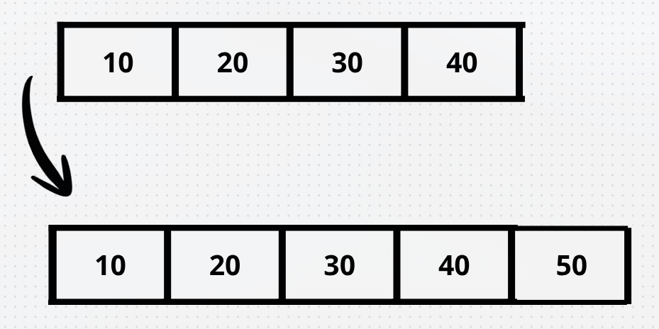

## Lección 4 : Vectores

> Las resoluciones de cada ejercicio se encuentran debajo del documento

**Contestar V/F las siguientes cuestiones.**
**1 [ ] Un vector dinámico es una estructura de datos básica que puede ser utilizada en la implementación de asociaciones y composiciones múltiples cuando no hay restricciones o necesidades especiales en las mismas.**

**2 [ ] Un dato almacenado en un vector dinámico que permanece en dicha estructura de datos a lo largo de todo su ciclo de vida nunca cambia su posición de memoria.**

**3 [ ] La siguiente definición de vector estático necesita de constructor copia y operador de asignación:**

```cpp
template<typename T> class MiVect{
int tama;
T *v;
public:
MiVect(int n){ v=new T[tama=n]; }
...
};
```

**4 [ ] La misma clase anterior debe definir así el operador corchete “[ ]” para que funcione correctamente (se obvian las comprobaciones de rango):**

```cpp
T operator[](unsigned i) { return v[i]; }
```

**5 [ ] Si se ha instanciado en la clase Biblioteca a Mivect para implementar una relación de asociación con la clase**
**Libro como:**
```cpp
MiVect<Libro*> estante;
```
**Entonces el destructor de Biblioteca debe entonces eliminar estante ejecutando:**
```cpp
delete[] estante;
```

**6 [ ] Es posible eliminar una posición de un vector dinámico en tiempo O(1) si no es necesario preservar el orden de los datos.**

**7 [ ] La implementación normal de un vector dinámico implementa una reducción del tamaño físico tamf a la mitad cuando el tamaño lógico taml cae por debajo de tamf/2.**

### Ejercicios

1. Partiendo de la implementación del vector estático VEstaticoInt que hay en las transparencias de teoría, añadir una operación void redimensionar(int nuevoTam) que permita modificar el tamaño del vector sin perder los datos guardados.
---
2. Partiendo de la implementación del vector dinámico VDinamicoInt que hay en las transparencias de teoría, añadir una operación void aumenta(VDinamicoInt& v, int primero = -1, int ultimo = -1) que añada los datos del vector indicado v al final. Pueden indicarse el primer y último elemento de v a copiar. El valor -1 indica desde el principio (para primero) y hasta el final (para ultimo).
---
3. Construir una clase VDinamicoIntAjustado que herede de la clase VDinamicoInt estudiada en la teoría e incluya una operación ajustar() que sustituya el array utilizado internamente como soporte por un array con el tamaño justo para contener los elementos almacenados en el vector.


## Soluciones

**1)**
Verdadero, un vector dinámico es la opción **por defecto** para guardar colecciones de objetos de elementos. Si en una relación entre clases solo necesitas guardar muchos objetos sin reglas (como estar ordenados, sin tener que buscar por clave o permitir elementos duplicados) esta es la estructura **más sencilla y eficiente**

---
**2)**
Falso, la memoria de un vector dinámico es **contigua**. Cuando un vector se llena y añadimos un nuevo elemento:

1. Reservamos memoria para un bloque de memoria **más grande**
2. **Mueve todos los elementos**
3. Borra la memoria contigua


Por lo tanto cambian de posición en memoria incluso si no tocamos dicho dato

---
**3)**

Verdadero, si no creamos el constructor copia ni el operador de asignación C++ nos dará uno por defecto , sin embargo al trabajar con memoria y punteros el uso de estos dará fallo ya que están destinados para copias superficiales

**4)** 
Falso, devuelve objeto por **copia** (`T`) en vez de devolverlo por **referencia** (`&T`). Esto implica que no podremos realizar asignaciones como `vector[0]=nuevoValor`

Además devolver por copia es bastante ineficiente, ya que si contamos con un vector muy grande estaremos desaprovechando mucha memoria.

---
**5)**
Falso
`estante` no es un puntero creado con `new` , es un objeto de tipo `MiVect<Libro*>`. Por tanto **NO** podemos hacer `delete[]`

También al ser un vector de punteros `Libro*`, si la relación fuera una composición o se necesitase liberar la memoria de libros habría que recorrer el vector con un bucle y hacer delete **individualmente** (`delete estante[i]`)

---
**6)**

Verdadero, si no importa el orden podemos realizar lo siguiente:

1. Copiamos el **último elemento** del vector a la posición que queremos borrar
2. Reducimos el tamaño del vector en 1 (elimina el último)

Como es solo realizar una copia y una resta de tamaño se realiza en $O(1)$

---
**7)**

Falso, si lo reducimos cuando llega a `tamf/2` sería ineficiente ya que tendriamos que estar constantemente aumentando el tamaño y disminuyendolo con unas pocas insercciones , en las prácticas lo que hacíamos era disminuirlo a la mitad una vez el tamaño lógico fuese $1/3$ del tamaño físico

### Ejercicios
**1)**

```cpp
void VEstaticoInt::redimensionar(int nuevoTam) {
    if (nuevoTam < 0) {
        throw std::invalid_argument("El nuevo tamaño no puede ser negativo");
    }

    // 1. Si el nuevo tamaño es igual al actual, no se realiza ningún cambio
    if (nuevoTam == tama) {
        return;
    }

    // 2. Si el nuevo tamaño es 0, liberamos el vector
    if (nuevoTam == 0) {
        delete[] v;
        v = nullptr;
        tama = 0;
        return;
    }

    // 3. Crear el nuevo array con el nuevo tamaño especificado
    int* vaux = new int[nuevoTam];

    // 4. Copiar los elementos existentes hasta el mínimo entre 'tama' y 'nuevoTam'
    int minTam;
    if (tama < nuevoTam) {
        minTam = tama;
    } else {
        minTam = nuevoTam;
    }
    
    // 5. Liberar la memoria antigua y actualizar los atributos
    delete[] v;
    v = vaux;
    tama = nuevoTam;
}
```

**2)**
```cpp
void VDinamicoInt::aumenta(const VDinamicoInt& v, int primero, int ultimo) {
    // 1. Resolver los valores por defecto (-1)
    if (primero == -1) {
        primero = 0;
    }
    if (ultimo == -1) {
        ultimo = v.tamal - 1; // Último elemento válido del vector v
    }

    // 2. Manejo de caso trivial (vector vacío o rango nulo)
    if (v.tamal == 0 || primero > ultimo) {
        return;
    }

    // 3. Validar los límites del rango especificado
    if (primero < 0 || ultimo >= v.tamal) {
        throw std::out_of_range("Índices 'primero' o 'ultimo' fuera de rango");
    }

    // 4. Insertar elemento por elemento en el rango [primero, ultimo]
    // Se utiliza la función 'aumenta(int dato)' ya existente en la clase (transparencia 16),
    // la cual se encarga automáticamente de redimensionar 'tamaf' al doble si tamal == tamaf.
    for (int i = primero; i <= ultimo; ++i) {
        this->aumenta(v.v[i]); 
    }
}
```
**3)**
```cpp
#include "VDinamicoInt.h" // Se asume la cabecera del vector dinámico de teoría

class VDinamicoIntAjustado : public VDinamicoInt {
public:
    // Reutilizar los constructores de la clase base VDinamicoInt
    using VDinamicoInt::VDinamicoInt;

    /**
     * Reemplaza el array interno por uno que tenga el tamaño exacto
     * necesario para albergar 'tamal' elementos.
     */
    void ajustar() {
        // Si el tamaño físico ya está ajustado al lógico, no se hace nada
        if (tamaf == tamal) {
            return;
        }

        // Caso 1: El vector no contiene ningún elemento
        if (tamal == 0) {
            delete[] v;
            v = nullptr;
            tamaf = 0;
            return;
        }

        // Caso 2: Crear un nuevo bloque con tamaño 'tamal' exacto
        int* vaux = new int[tamal];

        // Copiar todos los elementos válidos
        for (int i = 0; i < tamal; ++i) {
            vaux[i] = v[i];
        }

        // Liberar el bloque de memoria antiguo sobrante
        delete[] v;

        // Reasignar el puntero y ajustar la capacidad física al tamaño lógico
        v = vaux;
        tamaf = tamal;
    }
};
```