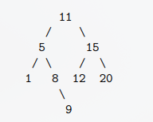

# Lección 11
### EJ 1
**Dado el siguiente árbol AVL, la inserción de 10 requiere una rotación doble a derecha**



Verdadero, ya que si lo insertamos este debe ser siguiendo el camino de: `11`,`5`,`8`,`9` y lo colocamos a la derecha, por lo tanto , aumentará la altura por la rama izquierda descompensando la parte derecha

### EJ 2
**2 [ ] Si se introducen datos ordenados de forma ascendente en un AVL, el tipo de rotación que se realizaría siempre sería el caso 4.**

Falso 

Caso 4 = Derecha-Derecha (DD) → rotación simple a la izquierda

```text
1                 2
 \    -->(rot)   / \
  2             1   3
   \
    3
```

Queda en desequilibrio en el lado derecho

### EJ 3
**3 [ ] En un árbol AVL tras una inserción el proceso de ajuste requiere a lo sumo una única rotación simple o doble.**

Verdadero , es el proceso de borrado el que puede requerir varias rotaciones , ya sean simples o dobles

## EJ 4
**4 [ ] En un árbol AVL, tanto el borrado como la inserción requieren la localización de algún nodo hoja durante el proceso.**

Verdadero ya que siempre se recorre desde la raíz a una posición nula 

## EJ 5
**5 [ ] Se pueden listar los datos de un árbol AVL o ABB en orden inverso a su definición sin necesidad de añadir un puntero al padre**

## EJ 6

**6 [ ] No es posible que un árbol AVL tenga un nodo hoja a una profundidad 4 y otra a profundidad 8.**


## EJ 7
**7 [ ] En los árboles AVL las rotaciones garantizan que el número de descendientes por la izquierda y derecha de un nodo difiere a lo sumo en 1.**

Falso, el AVL garantiza que el factor de equilibrio no difiera a lo sumo de 1, es decir {-1,0,1}, no dice nada del número de descendientes del nodo

## EJ 8
**8 [ ] Es posible que exista una secuencia de datos que al ser insertarda en un árbol AVL no provoque rotaciones**

