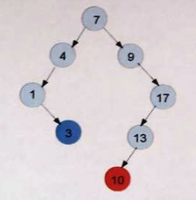

# Primitivas de enero 2017

2. En el control de acceso a una tienda Web se desea mantener una estructura de datos con la lista de usuarios que han entrado en el sistema. Dicha lista se almacena en un vector dinámico pero para acelerar las búsquedas se usan dos árboles AVL auxiliares, ordenados por nombre de usuario y por fecha/hora de último acceso (en un long con formato AAAA-MM-DD-HH-MM-SS). Las clases almacenadas en el vector y en los dos árboles AVL son las siguientes:

```cpp
/* EEDD Vector */
class Usuario {
public:
    string nombre;
    long ultimoAcceso;
    string e-mail;
};

/* EEDD AVL usuario por nombre */
class UsuarioPorNombre {
public:
    string nombre;
    Usuario *usuario;

    bool operator<(const UsuarioPorNombre& u) {
        return nombre < u.nombre;
    }
};

/* EEDD AVL usuario por fecha ultimo acceso */
class UsuarioPorAcceso {
public:
    long ultimoAcceso;
    Usuario *usuario;

    bool operator<(const UsuarioPorAcceso& u) {
        return ultimoAcceso < u.ultimoAcceso;
    }
};
```

Mostrar las estructuras de datos descritas durante las siguientes inserciones (agrupar pasos siempre que no se dificulte la lectura del ejercicio):$I(Usuario("pruiz", 20161205101402, "pruiz@gmail.com")), I(Usuario("alopez", 20170103122000, alopez@gmail.com))I(Usuario("igomez", 20161110091523, "igomez@hotmail.com")), I(Usuario("mhernandez", 20161122173045, "mhernandez@yahoo.es")), I(Usuario("yperez", 20170120193215, "yperez@hotmail.com"))$


> Resolución:

### Paso 1: Inserción de: `"pruiz", 20161205101402`

**1. Vector dinámico**
```
+-------+-----------+----------------+------------------+
 | Índice| Nombre    | Último Acceso  | Email            |
 +-------+-----------+----------------+------------------+
 |  [0]  | pruiz     | 20161205101402 | pruiz@gmail.com  |
 +-------+-----------+----------------+------------------+
```

**2. AVL 1: por Nombre**
```
("pruiz" -> *vec[0]) (FE: 0)
```

**3. AVL 2: por Fecha de Acceso**
```
(20161205101402 -> *vec[0]) (FE: 0)
```

### Paso 2: Inserción de `("alopez", 20170103122000)`

* Nombre: "alopez" < "pruiz" $\rightarrow$ Hijo Izquierdo
* Acceso: 20170103122000 > 20161205101402 $\rightarrow$ Hijo Derecho.

**1. Vector Dinámico**
+-------+-----------+----------------+-------------------+
 | Índice| Nombre    | Último Acceso  | Email             |
 +-------+-----------+----------------+-------------------+
 |  [0]  | pruiz     | 20161205101402 | pruiz@gmail.com   |
 |  [1]  | alopez    | 20170103122000 | alopez@gmail.com  |
 +-------+-----------+----------------+-------------------+

**2. AVL 1: por Nombre**
```
        ("pruiz" -> *vec[0]) (FE: -1)
             /
            /
  ("alopez" -> *vec[1]) (FE: 0)
```

**3. AVL 2: por Fecha de Acceso**
```
    (20161205101402 -> *vec[0]) (FE: +1)
            \
             \
          (20170103122000 -> *vec[1]) (FE: 0)
```

### Paso 3: Inserción de `("igomez", 20161110091523)`
* Nombre: "igomez" entra a la derecha de "alopez". Causa desequilibrio $FE = -2$ en la raíz "pruiz". Se aplica **Rotación Doble Izquierda-Derecha (RDI)** subiendo "igomez" a la raíz.

* Acceso: 20161110091523 < 20161205101402 $\rightarrow$ Hijo Izquierdo de la raíz.

**1. Vector Dinámico**
```
+-------+-----------+----------------+----------------------+
 | Índice| Nombre    | Último Acceso  | Email                |
 +-------+-----------+----------------+----------------------+
 |  [0]  | pruiz     | 20161205101402 | pruiz@gmail.com      |
 |  [1]  | alopez    | 20170103122000 | alopez@gmail.com     |
 |  [2]  | igomez    | 20161110091523 | igomez@hotmail.com   |
 +-------+-----------+----------------+----------------------+
```

**2. AVL 1: por Nombre**
```
            ("igomez" -> *vec[2]) (FE: 0)
                /                 \
               /                   \
    ("alopez" -> *vec[1])     ("pruiz" -> *vec[0])
          (FE: 0)                   (FE: 0)

```

**3. AVL 2: por Fecha de Acceso**
```
            (20161205101402 -> *vec[0]) (FE: 0)
             /                        \
            /                          \
(20161110091523 -> *vec[2])    (20170103122000 -> *vec[1])
       (FE: 0)                        (FE: 0)
```

### Paso 4: Inserción de `("mhernandez", 20161122173045)`

* Nombre: "mhernandez" > "igomez" y "mhernandez" < "pruiz" $\rightarrow$ Hijo Izquierdo de "pruiz"

* Acceso: 20161122173045 > 20161110091523 $\rightarrow$ Hijo Derecho de 20161110091523

**1. Vector Dinámico**
```
+-------+-------------+----------------+------------------------+
 | Índice| Nombre      | Último Acceso  | Email                  |
 +-------+-------------+----------------+------------------------+
 |  [0]  | pruiz       | 20161205101402 | pruiz@gmail.com        |
 |  [1]  | alopez      | 20170103122000 | alopez@gmail.com       |
 |  [2]  | igomez      | 20161110091523 | igomez@hotmail.com     |
 |  [3]  | mhernandez  | 20161122173045 | mhernandez@yahoo.es    |
 +-------+-------------+----------------+------------------------+
 ```

**2. AVL 1: por Nombre**
```
            ("igomez" -> *vec[2]) (FE: +1)
                /                 \
               /                   \
    ("alopez" -> *vec[1])       ("pruiz" -> *vec[0]) (FE: -1)
          (FE: 0)                 /
                                 /
                      ("mhernandez" -> *vec[3]) (FE: 0)
```

**3. AVL 2: por Fecha de Acceso**

```
            (20161205101402 -> *vec[0]) (FE: -1)
                /                        \
               /                          \
   (20161110091523 -> *vec[2])    (20170103122000 -> *vec[1])
        (FE: +1)                          (FE: 0)
               \
                \
   (20161122173045 -> *vec[3]) (FE: 0)
```


### Paso 5: Inserción de `("yperez", 20170120193215)`

* Nombre: "yperez" > "pruiz" $\rightarrow$ Hijo Derecho de "pruiz". Ambos árboles se mantienen en rango de equilibrio válido.

* Acceso: 20170120193215 > 20170103122000. Desequilibra la raíz $FE = +2$. Se aplica una Rotación Simple a la Izquierda (RSI) en la raíz del árbol por acceso.

**1. Vector Dinámico**
```
 +-------+-------------+----------------+------------------------+
 | Índice| Nombre      | Último Acceso  | Email                  |
 +-------+-------------+----------------+------------------------+
 |  [0]  | pruiz       | 20161205101402 | pruiz@gmail.com        |
 |  [1]  | alopez      | 20170103122000 | alopez@gmail.com       |
 |  [2]  | igomez      | 20161110091523 | igomez@hotmail.com     |
 |  [3]  | mhernandez  | 20161122173045 | mhernandez@yahoo.es    |
 |  [4]  | yperez      | 20170120193215 | yperez@hotmail.com     |
 +-------+-------------+----------------+------------------------+
```

**2. AVL 1: por Nombre**
```
                ("igomez" -> *vec[2]) (FE: +1)
                    /                 \
                   /                   \
        ("alopez" -> *vec[1])        ("pruiz" -> *vec[0]) (FE: 0)
              (FE: 0)                    /            \
                                        /              \
                            ("mhernandez" -> *vec[3])  ("yperez" -> *vec[4])
                                  (FE: 0)                  (FE: 0)
```


**3. AVL 2: por Fecha de Acceso**
```
                (20161205101402 -> *vec[0]) (FE: 0)
                /                        \
               /                          \
   (20161110091523 -> *vec[2])    (20170103122000 -> *vec[1]) (FE: +1)
        (FE: +1)                           \
               \                            \
   (20161122173045 -> *vec[3])       (20170120193215 -> *vec[4]) (FE: 0)
        (FE: 0)
```

# Ejercicio 2
**(a)** Implementar el constructor de la clase ListaDEnlazada para que cree una instancia de una lista doblemente enlazada a partir de los datos de una simplemente enlazada, teniendo en cuenta que a priori no son clases amigas.

```cpp
template<class T>
ListaDEnlazada<T>::ListaDEnlazada(const ListaEnlazada &l);
```


> Resolución

```
LISTA SIMPLE 'simple':
  l.cabecera ──► [ d1 | sig ] ──► [ d2 | sig ] ──► [ d3 | nullptr ]
                    ▲
                    │
                   it (avanza a d2)

LISTA DOBLE:
  cabecera ──┐
             ▼
           ┌───────┬────┬─────────┐
           │nullptr│ d1 │ nullptr │
           └───────┴────┴─────────┘
             ▲
  cola ──────┘
```

```
cabecera                                                                   cola
     │                                                                        │
     ▼                                                                        ▼
   ┌────────┬────┬──────┐        ┌──────┬────┬──────┐        ┌──────┬────┬─────────┐
   │nullptr │ d1 │      ┼───────►│  *   │ d2 │      ┼───────►│  *   │ d3 │ nullptr │
   └────────┴────┴──────┘        └──────┴────┴──────┘        └──────┴────┴─────────┘
             ▲                      │      ▲                    │
             └──────────────────────┘      └────────────────────┘
                       (ant)                        (ant)
```
```cpp
template<typename T>
ListaDEnlazada<T>::ListaDEnlazada(const ListaEnlazada &simple){
    // Inicializamos para que la lista doblemente enlazada esté vacía
    cabecera=nullptr;
    cola=nullptr;
    tam=0;

    ListaDEnlazada<T>::Iterador iterador=simple.iterador;
    while(iterador.siguiente()){
        T dato=it.elemento();

        NodoDoble* nuevo= new NodoDoble(dato);
        nuevo->sig=nullptr
        nuevo->ant=cola;

        if(cabecera==nullptr){
            cabecera=nuevo;
        }else{
            cola->sig=nuevo;
        }
        cola=nuevo;
        tam++;

        it.siguiente();
    }

}
```
**(b)** Implementar la función de inserción de un dato en un árbol ABB:

```cpp
bool ABB<T>::insertar(const T &dato);
```
Debe insertar el dato normalmente pero que además se pide que devuelva el valor **TRUE** cuando al insertar el dato se genere una rama de 4 o más nodos seguidos tipo lista, es decir, que a lo largo del camino o cuando se inserta el nuevo dato se encuentren 4 o más nodos sin nodos hermanos. En el siguiente ejemplo la inserción de 3 no genera este aviso, pero la inserción de 10 sí, al generar una rama de cuatro nodos sin hermanos: **9 -> 17 -> 13 -> 10**




```cpp

// Función public
template <typename T>

bool ABB<T>::Insertar(const T &dato){
    bool detecta4=false;
    insertarAux(raiz,nodo,0,detecta4);
    return detecta4;
}


// Función private
template <typename T>

void ABB<T>::InsertarAux(Nodo* &nodo, const T& dato,  int seguidosSinHermano, bool &detecta4){
    if(nodo==nullptr){
        nodo = new Nodo(dato);
        seguidosSinHermano++;

        if(seguidosSinHermano>=4){
            detecta4=true;
        }
    }
    // Comprobamos la izquierda
    else if(dato<nodo->dato){
        // COmprobamos si el nodo actual no tiene nodos a la der
        if(nodo->der == nullptr){
            contaSinHermano++;
        }else{
            contaSinHermano=0;
        }
        if(contaSinHermano>=4){
            detecta4=true;
        }
        insertarAux(nodo->izq,dato,seguidosSinHermano,detecta4);
    }

    // Comprobamos la derecha
    if(dato>nodo->dato){
        // COmrpobamos si el nodo actual no tiene nodos a la izquierda
        if(nodo->izq==nullptr){
            contaSinHermano++;
        }else{
            contaSinHermano=0;
        }
        if(contaSinHermano>=4){
            detecta4=true;
        }
        insertaAux(nodo->der,dato,seguidosSinHermano,detecta4);
    }
}
```