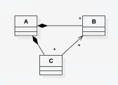

# Tipo Test Enero 2018

**1 [ V ]** Todo mapa puede convertirse en un set si a la clase de objetos que contiene se le dotan de los operadores de comparación necesarios

> **Explicación**: Un `std::set` guarda claves únicas ordenadas. Si una clase objeto incluye tanto la clave como los datos y define sus operadores de comparación (<), puede almacenarse en un `set` funcionando de forma equivalente a un `map`

**2. [ V ]** Los datos dentro de un nodo de un árbol B deben estar necesariamente ordenados

> **Explicación**: La estructura interna de las claves dentro de cada nodo de un árbol B exige que estén estrictamente ordenadas para poder realizar búsquedas binarias internas e iterar correctamente por sus subárboles

**3. [ F ]** Dada la siguiente definición de un multimapa: `multimap<Fecha, Reserva, greater<Fecha>> reservas`; la clase Fecha necesita la definición del `operator<`

> **Explicación**: Al haber explicitado el functor de ordenación `greater<Fecha>`, la clase `Fecha` necesita definir el operador mayor que (`operator>`), no el menor que (`operator<`)

**4. [ F ]** La operación de inserción en una lista simplemente enlazada en la posición anterior al nodo apuntado por el iterador `it` es una operación en tiempo constante:

```cpp
bool ListaEnlazada<T>::insertarAnt(const Iterator<T> &it, const T &dato);
```

> **Explicación**: Al ser una lista simplemente enlazada, no hay punteros hacia atrás (`anterior`). Para insertar antes de `it` se debe recorrer la lista desde el origen (cabecera) para buscar el nodo previo, lo que cuesta $\mathcal{O}(n)$

**5. [ V ] Es más eficiente un quadtree que una malla regular a nivel de consumo de memoria para almacenar todos los códigos postales de EEUU**

> **Explicación**: Los datos geográficos están desigualmente distribuidos (zonas urbanas densas vs. desiertos/montañas vacíos). Un quadtree subdivide el espacio solo donde hay datos (adaptativo), ahorrando memoria frente a una malla regular que reserva celdas fijas para zonas vacías

**6. [ F ]** El número de accesos a disco que se necesita para localizar un dato mediante un sistema de ficheros con un índice simple, depende o es directamente proporcional al tamaño de dicho índice

> **Explicación**: En un índice simple se realiza una búsqueda sobre la estructura en memoria/bloque de índice (por ejemplo en tiempo logarítmico), y una vez localizada la posición del registro en el fichero principal, se realiza un único acceso a disco ($\mathcal{O}(1)$)

**7. [ V ]** Mediante la siguiente definición: int **p; p puede ser una matriz bidimensional, un vector o nada de lo anterior

> **Explicación**: El puntero a puntero (int**) es una dirección de memoria flexible que puede apuntar a una matriz dinamica (int**), a un array de punteros a int, a un único puntero o ser nullptr

**8. [ F ]** Una cola con prioridad siempre tendrá un push() en $\mathcal{O}(1)$ independientemente de la implementación concreta (vectores, vector de listas o listas de listas)

> **Explicación**:  Depende de la estructura elegida; por ejemplo, usando un montículo (heap) el push() requiere reordenar en $\mathcal{O}(\log n)$, y usando un array/lista ordenada requiere inserción en $\mathcal{O}(n)$

**9. [ V ]** Averiguar las aristas de entrada a un nodo en un grafo dirigido implementado mediante listas invertidas es más costoso que implementado sobre una matriz de adyacencia

> **Explicación**: En una matriz de adyacencia basta con recorrer la columna del nodo en $\mathcal{O}(V)$. Con listas directas/invertidas de salida estándar hay que inspeccionar la lista completa de todos los demás nodos ($\mathcal{O}(V+E)$)

**10 [ V ]** Es peligroso usar un vector dinámico de objetos (no de punteros) si otra clase va a tener una asociación con estos objetos. Mirar el siguiente ejemplo, en el que la relación de composición entre A y B se implementa como: `vector<B>`



> **Explicación**: Si `A` almacena `vector<B>` y `C` guarda referencias o punteros directos a los objetos B, cualquier realojamiento interno de `vector<B>` (al crecer o insertar) cambiará la posición en memoria de los objetos `B`, dejando los punteros almacenados en `C` colgados (invalidación de referencias)

