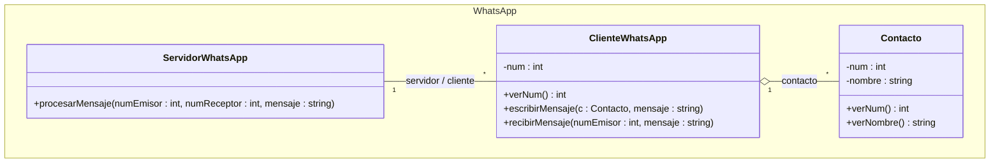

# UML Julio 2012

El siguiente diagrama representa la red WhatsApp para intercambio de mensajes entre móviles.

- **Cliente:** se instala en el móvil (`ClienteWhatsApp`).
- **Servidor:** (`ServidorWhatsApp`).

El cliente del móvil tiene acceso a la lista de contactos del usuario en el móvil, con los que el usuario puede establecer conversaciones.

### Funcionamiento

1. Cuando el usuario selecciona un contacto y escribe un mensaje se invoca a la operación `escribirMensaje()` del cliente, que muestra el mensaje en pantalla de la siguiente forma:

   `Yo: <mensaje>`

2. A continuación pasa toda la información al servidor central de WhatsApp (`procesarMensaje()`).

3. Si el servidor comprueba que el destinatario no está en la lista de clientes (ya sea por no haber instalado el software de WhatsApp o por no estar online), se lanza una excepción `ExcepcionDestinatarioInexistente()`.

4. En caso de que se localice el cliente, se llama a la operación `recibirMensaje()` del cliente WhatsApp del destinatario, que muestra el mensaje de esta manera:

   `<nombre emisor>: <mensaje>`

5. Si el emisor no estuviera en la lista de contactos, se mostraría su número de teléfono.

### Implementación

Implementar las tres clases del diagrama y las asociaciones utilizando las estructuras de datos más adecuadas.



### Elección de estructuras
1. `ServidorWhatsApp` $\leftrightarrow$ `ClienteWhatsApp` usará `std::map<int,ClienteWhatsApp*> donde la clave sea el `num` del cliente

2. `ClienteWhatsApp` $\rightarrow$ `Contacto` usará un `std::map<int,Contacto*> donde la clave es el `num` del contacto

```cpp
#include <iostream>
#include <string>
#include <map>

class ExcepcionDestinatarioInexistente {};

class ServidorWhatsApp;

class Contacto{
    private:
        int num;
        std::string nombre;
    public:
        Contacto(int num, std::string nombre): num(num),nombre(nombre){}
        int getNum(){
            return num;
        }
        std::string getNombre(){
            return nombre;
        }
};


class ClienteWhatsapp{
    private:
        int num;
        ServidorWhatsapp* servidor;
        std::map<int,Contacto*> contactos;

    public:
        ClienteWhatsApp(int num,ServidorWhatsapp* servidor): num(num), servidor(servidor){}

        ~ClienteWhatsApp(){
            std::map<int, Contacto*>::iterator it;
            for(it=contactos.begin();it!=contactos.end();++it){
                delete it->second;
            }
        }
        int getNum(){
            return num;
        }
        void anadirContacto(Contacto *c){
            contactos[c->verNum()]=c;
        }
        void escribirMensaje(Contacto c, std::string mensaje){
            std::cout << "Yo: " << mensaje << std::endl;
            servidor->procesarMensaje(this->num, c.verNum(), mensaje);
        }
        void recibirMensaje(int numEmisor, std::string mensaje){
            std::map<int, Contacto*>::iterator it = contactos.find(numEmisor);

        if (it != contactos.end()) {
            std::cout << it->second->verNombre() << ": " << mensaje << std::endl;
        } else {
            std::cout << numEmisor << ": " << mensaje << std::endl;
        }
    }
};

class ServidorWhatsApp {
private:
    std::map<int, ClienteWhatsApp*> clientes;

public:
    ServidorWhatsApp() {}

    void registrarCliente(ClienteWhatsApp* c) {
        clientes[c->verNum()] = c;
    }

    void procesarMensaje(int numEmisor, int numReceptor, std::string mensaje) {
        std::map<int, ClienteWhatsApp*>::iterator it = clientes.find (numReceptor); // con find si lo encuentra se queda con el iterador en la pos, si no pues se pone en end, por eso hay q realizar la siguiente comprobación

        if (it == clientes.end()) {
            throw ExcepcionDestinatarioInexistente();
        }

        it->second->recibirMensaje(numEmisor, mensaje);
    }
    void ClienteWhatsApp::escribirMensaje(Contacto c, std::string mensaje) {
    std::cout << "Yo: " << mensaje << std::endl;
    servidor->procesarMensaje(this->num, c.verNum(), mensaje);
    }
void ClienteWhatsApp::recibirMensaje(int numEmisor, std::string mensaje) {
    std::map<int, Contacto*>::iterator it = contactos.find(numEmisor);

    if (it != contactos.end()) {
        std::cout << it->second->verNombre() << ": " << mensaje << std::endl;
    } else {
        std::cout << numEmisor << ": " << mensaje << std::endl;
    }
}
};

```