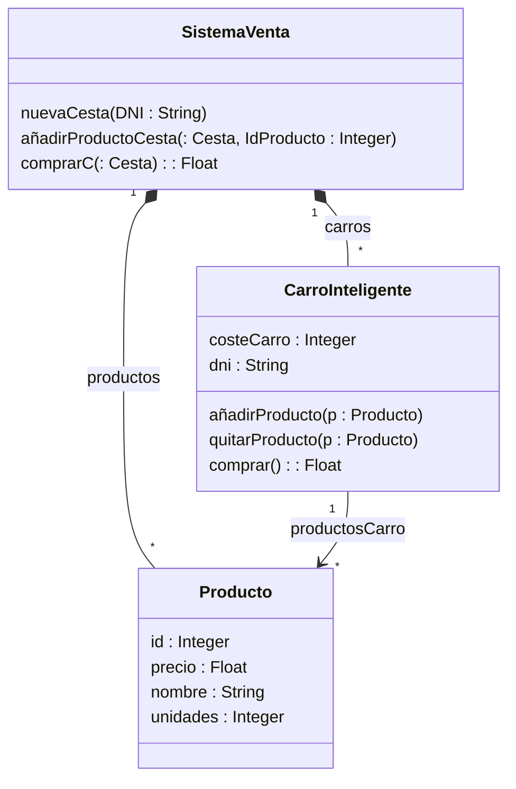

# Sistema de carro de supermercado inteligente

Una empresa está diseñando el carro de supermercado del futuro. Este carro inteligente permite calcular automáticamente el importe de la compra a medida que se introduce un producto en el carro, mediante la lectura automática de su código de barras.

El carro dispone de un visor que permite al cliente visualizar en todo momento el coste total de los productos que lleva. El pago se realiza simplemente pasando por el punto de salida, sin necesidad de pasar por una caja ni de ser atendido por un cajero.

Además, una serie de sensores detectan cuándo se retira un producto de una estantería para introducirlo en el carro. Esto permite controlar posibles hurtos, detectar el desabastecimiento de productos y conocer en tiempo real la efectividad de las ofertas.

## Implementación del sistema

Se pide implementar parte de la funcionalidad de este sistema siguiendo el diseño de clases propuesto.

### 1. Clase `Producto`

Cada producto se identifica de forma única mediante los siguientes atributos:

- `id`: identificador numérico único del producto.
- `nombre`: nombre del producto.
- `precio`: precio del producto.
- `unidades`: número de unidades disponibles en las estanterías.

### 2. Clase `CarroInteligente`

Cada carro que está funcionando en el supermercado está asociado a un cliente mediante su DNI (`DNI`) y dispone de un visor que muestra en todo momento el importe total de los productos que lleva.

Cuando un cliente introduce un nuevo producto en el carro, los sensores del carro y los de las estanterías se encargan conjuntamente de realizar la operación mediante la función:

- `añadirProducto()`

Esta función realiza las siguientes operaciones:

1. Descuenta una unidad del producto correspondiente en las estanterías.
2. Muestra en el visor el precio y el nombre del producto.
3. Muestra el subtotal de la compra hasta ese momento.

Para visualizar la información se utilizará `cout`.

Si el cliente decide sacar un producto del carro porque finalmente no quiere comprarlo, se seguirá el proceso contrario mediante la función:

- `quitarProducto()`

Esta función devuelve el producto a las estanterías y actualiza el importe total del carro.

Si se compran varias unidades de un mismo producto, se añadirán varias entradas del mismo producto en la relación `productosCarro`.

Por último, la función:

- `comprar()`

Únicamente devuelve el importe total de la compra. Otra parte del sistema será la encargada de realizar el cobro.

### 3. Clase `SistemaVenta`

Esta clase se encarga de controlar todas las ventas del supermercado.

Cuando llega un nuevo cliente y coge un carro, este debe facilitar su DNI electrónico mediante la operación:

- `nuevoCarro()`

La función:

- `añadirProductoCesto()`

Debe localizar internamente el producto correspondiente utilizando la relación `productos` y llamar a la función `CarroInteligente::añadirProducto()`, que será la encargada de descontar las unidades disponibles en las estanterías y actualizar el visor del carro.

Finalmente, cuando el cliente sale por la puerta del supermercado, se llama a la función:

- `comprar()`

Esta función libera el carro para que pueda ser utilizado por otro cliente.

Otra parte del sistema se encargará de realizar automáticamente el cobro del importe de la compra en la cuenta bancaria del cliente.



### Estructuras seleccionadas
1. **Relación** `SistemaVenta` -> `Producto`: `std::map<int, Producto*>`

2. **Relación** `SistemaVenta` $\rightarrow$ `CarroInteligente` : `std::map<std::string, CarroInteligente>`

3. **Relación** `CarroInteligente` $\rightarrow$ `Producto`: `std::list<Producto*>`

```cpp
#include <iostream>
#include <string>
#include <map>
#include <list>
#include <stdexcept>

class Producto{
    private:
        int id;
        float precio;
        string nombre;
        int unidades;
    public:
        Producto(int id, const std::string& nombre, float precio, int unidades)
        : id(id), nombre(nombre), precio(precio), unidades(unidades) {}

        int getId() const { return id; }
    float getPrecio() const { return precio; }
    std::string getNombre() const { return nombre; }
    int getUnidades() const { return unidades; }

    void decrementarUnidad() {
        if (unidades > 0) {
            unidades--;
        }
    }

    void incrementarUnidad() {
        unidades++;
    }
};


class CarroInteligente{
    private:
        float costeCarro;
        std::sring dni;
        std::list<Producto*> productosCarro;
    public:
        CarroInteligente(const std::string& dniCliente): costeCarro(0), dni(dniCLiente){}

        std::string getDni()const{
            return dni;
        }
        void anadirProducto(Porducto* p){
            if (p==nullptr || p->getUnidades() <=0){
                std::cout<<"Producto no disponible";
                return;
            }
            p->decrementarUnidad();
            productosCarro.push_back(p);
            costeCarro+=p->getPrecio();

            std::cout<<"Añadido:"<<p->getNomber()<<" | Precio:"<<p->getPrecio();
            std::cout<<"Subtotal actual: "<<costeCarro<<std::endl;
        }
    void quitarProducto(Producto *p){
        if (p==nullptr) return;

        for(std::list<Producto*> productosCarro::itetator it=productosCarro.beign(); it != productosCarro.end();++it{
            if (*it=p){
                productosCarro.erase(it);
                p->incrementarUnidad();
                costeCarro-=p->getPrecio();

                std::cout<<"Retirado:"<<p->getNombre()<<" Nuevo subtotal: "<<costeCarro<<std::endl;
                return;
            }
        }
    }
    float comprar() const{
        return costeCarro;
    }
};

class SistemaVenta{
    private:
        std::map<int, Producto*> productos; // clave: idProducto
        std::map<std::string, CarroInteligente*> carros; // clave: DNI cliente

    public:
        SistemaVenta() = default;

        ~SistemaVenta() {
        std::map<int, Producto*>::iterator itProd;
        for (itProd = productos.begin(); itProd != productos.end(); ++itProd) {
            delete itProd->second;
        }

        std::map<std::string, CarroInteligente*>::iterator itCarro;
        for (itCarro = carros.begin(); itCarro != carros.end(); ++itCarro) {
            delete itCarro->second;
        }
    }
    void registrarProducto(Producto* p) {
        if (p != nullptr) {
            productos[p->getId()] = p;
        }
    }
    CarroInteligente* nuevaCesta(const std::string& dni) {
        if (carros.find(dni) != carros.end()) {
            return carros[dni];
        }
        CarroInteligente* nuevo = new CarroInteligente(dni);
        carros[dni] = nuevo;
        return nuevo;
    }
    void anadirProductoCesta(CarroInteligente* c, int idProducto) {
        if (c == nullptr) return;

        std::map<int, Producto*>::iterator it = productos.find(idProducto);
        if (it != productos.end()) {
            c->anadirProducto(it->second);
        } else {
            std::cout << "Error: Producto con ID " << idProducto << " no encontrado.";
        }
    }
    float comprar(CarroInteligente* c) {
        if (c == NULL) return 0.0f;

        float total = c->comprar();

        carros.erase(c->getDni());
        delete c;
        return total;
    }
};
```