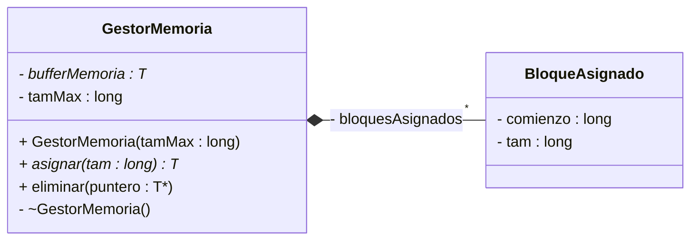
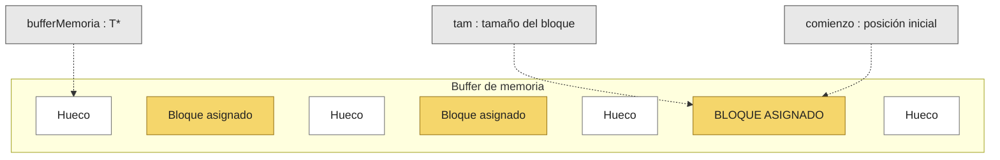

# UML 2014

Implementar un sencillo gestor de memoria, similar a los gestores de memoria dinámica de los sistemas operativos. La idea básica de este gestor es preasignar un búffer de objetos de tamaño grande para posteriormente ir concediendo bloques dentro de este buffer según las necesidades. La ventaja de este esquema es la velocidad: se hace una única petición de memoria al principio que es gestionada por nuestro gestor. Los constructores/operaciones son las siguientes:

* `GestorMemoria()`: Crea en memoria dinámica un buffer de objetos del tipo T, de tamaño igual al indicado como argumento. El tamaño del búffer permanece inalterable hasta que el gestor de memoria es destruido. El destructor correspondiente eliminará el espacio ocupado por el búffer

* `asignar()`: Devuelve un puntero a un nuevo bloque del búffer con el tamaño indicado. El gestor de memoria deberá mantener internamente una estructura de datos con todos los bloques de memoria asignados previamente dentro del búffer (posición de comienzo y tamaño). La operación usará esta estructura de datos para localizar un hueco libre dentro del búffer con el tamaño igual o mayor al solicitado, creará una nueva entrada en la estructura de datos (`BloqueAsignado`) y devolverá un puntero al comienzo del bloque en el búffer. La estrategia a usar será usar el hueco disponible más pequeño que tenga el tamaño suficiente. Si no es posible hacer la asignación de memoria, se lanzará una excepción estándar C++ `bad_alloc`

* `eliminar()`: Localiza el bloque asignado cuyo comienzo es apuntado por el puntero y lo elimina de la estructura de datos

Se pide la implementación del gestor de memoria descrito, eligiendo la estructura de datos y los algoritmos adecuados. Puede utilizarse STL si se considera oportuno.

----




> Resolución

### Explicación de las estructuras elegidas
Para gestionar los bloques ocupados se utiliza la estructura STL `std::list<BloqueAsignado>` ordenada por la posición de inicio (`comienzo`)

**¿Por qué `std::list`?**
1. **Recorrido fácil entre bloques adyacentes**: Al estar los bloques asignados ordenados secuencialmente según su posición en el búffer, el hueco libre entre dos bloques ocupados contiguos es simplemente: **comienzo_bloque_siguiente - (comienzo_bloque_actual + tam_bloque_actual)**


2. **Inserción y borrado eficiente** ($O(1)$): Cuando liberamos o añadimos un bloque con un iterador, `std::list` lo hace de forma instantánea sin desplazar elementos en memoria

> Consideración

Cuando hacemos el recorrido tenemos que ir analizando bloque por bloque el espacio disponible, si queremos guardar un bloque en un hueco, este debe ser en un espacio $>=$ que el tamaño del bloque, pero tenemos que elegir **el de menor tamaño** para optimizar los espacios mejor

> Implementación del UML

```cpp

#include <list>

template <typename T>

class GestorMemoria{
    private:

    class BloqueAsignado{
        public:
            long comienzo;
            long tam;
            BloqueAsignado(long c, long t);
    };
    T* bufferMemoria;
    long tamMax;
    std::list<BloqueAsignado> bloquesAsignados;

public:
    GestorMemoria(long tamMaximo): atmMax(tamMaximo){
        bufferMemoria= new T[tamMax];
    }
    ~GestorMemoria(){
        delete[] bufferMemoria;
    }
    T* asignar(long tam) {
        if (tam <= 0 || tam > tamMax) {
            throw std::bad_alloc();
        }

        long mejorInicio = -1;
        long tamMejorHueco = tamMax + 1;
        
        // Iterador para guardar la posición de inserción óptima
        std::list<BloqueAsignado>::iterator posInsercionMejor = bloquesAsignados.end();

        long inicioLibreActual = 0; // Marca el inicio del hueco disponible


        for (std::list<BloqueAsignado>::iterator it = bloquesAsignados.begin(); it != bloquesAsignados.end(); ++it) {
            long tamHueco = it->comienzo - inicioLibreActual;

            if (tamHueco >= tam && tamHueco < tamMejorHueco) {
                tamMejorHueco = tamHueco;
                mejorInicio = inicioLibreActual;
                posInsercionMejor = it;
            }

            inicioLibreActual = it->comienzo + it->tam;
        }

        long huecoFinal = tamMax - inicioLibreActual;
        if (huecoFinal >= tam && huecoFinal < tamMejorHueco) {
            tamMejorHueco = huecoFinal;
            mejorInicio = inicioLibreActual;
            posInsercionMejor = bloquesAsignados.end();
        }

        if (mejorInicio == -1) {
            throw std::bad_alloc();
        }

        bloquesAsignados.insert(posInsercionMejor, BloqueAsignado(mejorInicio, tam));

        return &bufferMemoria[mejorInicio];
    }
    void eliminar(T* puntero) {
        if (puntero == nullptr) return;

        // Restamos punteros para obtener el índice en el array (bufferMemoria)
        long indice = puntero - bufferMemoria;

        for (std::list<BloqueAsignado>::iterator it = bloquesAsignados.begin(); it != bloquesAsignados.end(); ++it) {
            if (it->comienzo == indice) {
                bloquesAsignados.erase(it); // Lo eliminamos de la estructura
                return;
            }
        }
    }
};

```