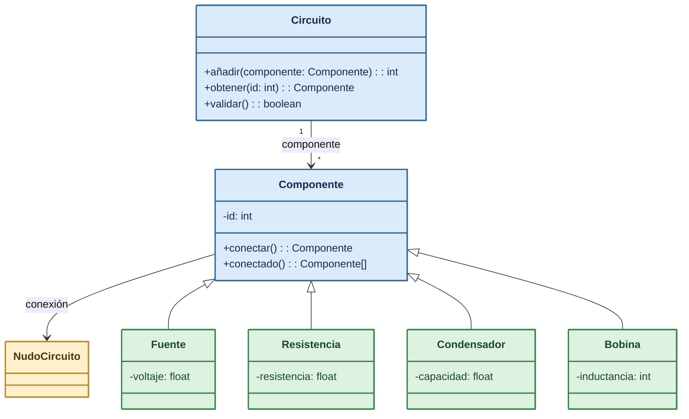

# Pregunta 4

Una aplicación de diseño de circuitos eléctricos necesita una estructura de datos para organizar los distintos componentes y la topología del circuito. El diagrama UML adjunto describe las clases de objetos necesarias.

## Descripción de las clases

- **Fuente, Resistencia, Condensador y Bobina** representan los componentes que admite la aplicación en su versión inicial. Cada uno de estos componentes viene definido por sus características eléctricas (voltaje, intensidad, resistencia, capacidad, inductancia). Estas clases heredan de `Componente`, que contiene un identificador único por componente y asociaciones a los otros componentes a los que está conectado.

  La operación `conectar()` permite conectar un componente con otro. Esta conexión debe ser siempre bidireccional: al conectar el componente A con B, automáticamente se conecta B con A.

  La operación `conectados()` devuelve la lista de componentes conectados.

  Existe un componente especial denominado `NodoCircuito` que sirve para ayudar a crear bifurcaciones (aunque no tenga ninguna propiedad eléctrica).

- **Circuito** es la clase principal que organiza los componentes del circuito. Dispone de una operación para añadir un componente al circuito mediante el método `anadir()`, devolviendo el ID del mismo (debe generar un identificador único para cada componente).

  De forma similar, para obtener un componente a partir de su ID usaremos `obtener()`.

  La operación más importante es `validar()`, que comprueba que el circuito está cerrado. Para ello deben verificarse las siguientes propiedades, en cuyo caso se devuelve `true`:

  1. Todos los componentes tienen 2 o más conexiones (para evitar circuitos abiertos).
  2. Empezando en un componente y siguiendo las conexiones se pueden alcanzar todos los demás componentes (para evitar que haya varios circuitos separados).


## Implementación

Implementar las clases `Circuito`, `Componente`, `NodoCircuito` y `Fuente` (considerar las otras tres clases implementadas), eligiendo las estructuras de datos adecuadas e implementando los algoritmos descritos.

El siguiente es un ejemplo de creación y validación del circuito mostrado en la figura (este código debería funcionar con la implementación que se pide).




### Elección de estructuras

**1. Relación** `Circuito` -> `Componente`: `std::map<int, Componente*>`

**2. Relación reflexiva** `Componente` $\rightarrow$ `Componente`: `std::set<Componente*>`

```cpp

class Componente {
private:
    int id;
    std::set<Componente*> conexiones; // Evita conexiones duplicadas entre dos mismos componentes

public:
    Componente() : id(-1) {}
    virtual ~Componente() {}

    int getId() const {
        return id;
    }

    void setId(int nuevoId) {
        id = nuevoId;
    }
    void conectar(Componente* c) {
        if (c == NULL || c == this) return;

        // Si c no estaba se añade por el final
        if (conexiones.find(c) == conexiones.end()) {
            conexiones.insert(c);
            c->conectar(this);
        }
    }
    std::vector<Componente*> conectados() {
        std::vector<Componente*> resultado;
        std::set<Componente*>::iterator it;
        for (it = conexiones.begin(); it != conexiones.end(); ++it) {
            resultado.push_back(*it);
        }
        return resultado;
    }
};

class NudoCircuito : public Componente {
public:
    NudoCircuito() : Componente() {}
};

class Fuente : public Componente {
private:
    float voltaje;

public:
    Fuente(float v) : Componente(), voltaje(v) {}

    float getVoltaje() {
        return voltaje;
    }
};

class Circuito {
private:
    std::map<int, Componente*> componentes;
    int siguienteId;

public:
    Circuito() : siguienteId(1) {}

    int anadir(Componente* c) {
        if (c == nullptr) return -1;

        int idAsignado = siguienteId++;
        c->setId(idAsignado);
        componentes[idAsignado] = c;

        return idAsignado;
    }
    Componente* obtener(int id) {
        std::map<int, Componente*>::iterator it = componentes.find(id);
        if (it != componentes.end()) {
            return it->second;
        }
        return nullptr;
    }

    bool validar() {
        if (componentes.empty()) {
            return false;
        }
    std::map<int, Componente*>::iterator it;
        for (it = componentes.begin(); it != componentes.end(); ++it) {
            if (it->second->conectados().size() < 2) {
                return false;
            }
        }
        std::set<Componente*> visitados;
        std::queue<Componente*> cola;

        Componente* inicial = componentes.begin()->second;
        cola.push(inicial);
        visitados.insert(inicial);

        while (!cola.empty()) {
            Componente* actual = cola.front();
            cola.pop();

            std::vector<Componente*> vecinos = actual->conectados();
            for (int i = 0; i < (int)vecinos.size(); i++) {
                Componente* vecino = vecinos[i];
                if (visitados.find(vecino) == visitados.end()) {
                    visitados.insert(vecino);
                    cola.push(vecino);
                }
            }
        }

        return visitados.size() == componentes.size();
    }
};
```