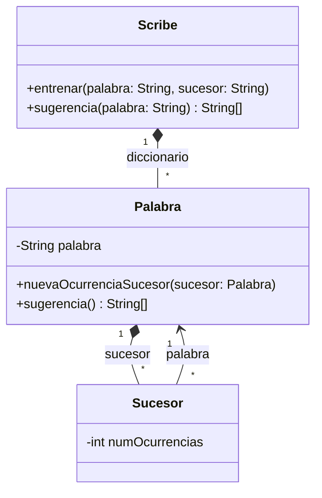

# UML 2016

Uno de los proyectos más interesantes de Google Labs fue Google Scribe (cancelado hace unos años), que consistía en un editor de textos que ofrecía sugerencias de la palabra a continuación conforme se escribía. La clave es diseñar una estructura de datos que guarde por cada palabra la lista de palabras que pueden aparecer a continuación con mayor probabilidad. Para que sea efectivo este sistema debe entrenarse con una gran cantidad de textos variados de forma que se construyan estas listas de sucesores.   

Vamos a implementar una versión muy sencilla de Google Scribe, ilustrado por el diagrama UML mostrado a continuación



La clase `Scribe`, que representa a nuestro generador de sugerencias, contiene una estructura de datos con la lista de palabras reconocidas (diccionario). Cada una de las palabras contiene a su vez las palabras sucesoras (sucesor), con el número total de ocurrencias de cada una encontrados durante el entrenamiento (e.g. of->wine (1024), water (732), champagne (239)...)

La operación `entrenar()` pasa una palabra y un sucesor de ésta al sistema. Ésta crea una entrada en el diccionario para la palabra y su sucesor si alguno de ellos no existe. A continuación llama a la operación `nuevaOcurrenciaSucesor()` de la palabra, que a su vez crea la entrada para el sucesor si no existe o incrementa su número de ocurrencias en caso contrario. La operación sugerencia() consulta la estructura de datos para devolver los 10 sucesores más probables (i.e. con mayor número de ocurrencias) para la palabra dada

Implementar las clases del diagrama y además realizar un pequeño programa `main()` que cree una instancia de `Scribe` y la entrene con el contenido de un fichero de texto "texto-largo.txt". Para ello deberá ir leyendo caracteres y construyendo palabras. Cada vez que tenga una palabra nueva pn llamará a `entrenar(pa, pn)` siendo pa la palabra anterior identificada en el texto. Además de caracteres alfanuméricos, en el texto pueden aparecer los caracteres de puntuación punto, coma, punto y coma, dos puntos, símbolos de interrogación y admiración. Una palabra termina al encontrar un espacio o un carácter de puntuación, pero nunca se considerará sucesora a una palabra que sigue a otra habiendo un carácter de puntuación enmedio. Por ejemplo, en el texto "Y de pronto pensé ¿Qué hago aquí?" "pensé" es sucesora de "pronto", pero "qué" no lo es de "pensé"

> Resolución

### 1. Selección de Estructura de Datos

* **Para el Diccionario (Scribe)**: `std::map<std::string, Palabra>` Por qué: Permite buscar, insertar y acceder a cualquier palabra del diccionario por su texto en tiempo $O(\log N)$

* **Para los Sucesores (Palabra):** `std::map<std::string, int>` (o `std::vector<Sucesor>`)

Por qué: Un `std::map<std::string, int>` nos permite asociar el texto del sucesor directamente con su contador de ocurrencias. Para obtener las sugerencias ordenadas, trasladamos los pares a un `std::vector` y lo ordenamos con `std::sort`

```cpp
#include <iostream>
#include <string>
#include <vector>
#include <map>

class Sucesor{
    private:
    Palabra* palabra;
    int numOcurrencias;

    public:
    Sucesor(const Palabra *p):
        palabra(p), numOcurrencias(1){}
    
    void incrementarNumOcurrencias(){
        numOcurrencias++;
    }
    int getNumOcurrencias() const{
        return numOcurrencias;
    }
    Palabra *getPalabra() const{
        return palabra;
    }
};

class Palabra{
    private:
        std::string palabra;
        std::vector<Sucesor*> sucesor;
    public:
        Palabra(): palabra(""){}

        Palabra(const std::string &p):
            palabra(p)

        ~Palabra(){
            for(size_t i=0;i<sucesor.size();++i){
                delete sucesor[i];
            }
            delete []sucesor;
        }

        std::string getPalabra() const{
            return palabra;
        }

        void nuevaOcurrenciaSucesor(Palabra &sucesor){
            for(size_t i=0;i<sucesor.size();++i){
                if(sucesor[i]->getPalabra==sucesor.getPalabra()){
                    sucesor[i]->incrementarOcurrencia();
                    return;
                }
            }
            // SI no está push back
            sucesor.push_back(new Sucesor(&sucesor));
        }
        std::vector<std::string> sugerencias() const {
            std::vector<Sucesor*> copia = sucesor;

           std::sort(copia.begin(), copia.end(), compararSucesores);

        std::vector<std::string> resultado;

        int limite = copia.size();
        if (limite > 10) {
            limite = 10;
        }

        for (int i = 0; i < limite; i++) {
            resultado.push_back(copia[i]->getPalabra()->getPalabra());
        }

        return resultado;
    }
};

class Scribe{
    private:
        std::map<std::string,Palabra*> diccionario;
    public:
        ~Scribe(){
            for(std::map<std::string,Palabra*>::iterator it=diccionario.begin(); it != diccionario.end();++i){
                delete it->second;
            }
        }

        void entrenar(const std::string &pa, const std::string &pn){
            if(diccionario.find(pa) == diccionario.end()) // NO LO HA ENCONTRADO
                diccionario[pa]= new Palabra(pa);
            if(diccionario.find(pn) == diccionario.end())
                diccionario[pn]= new Palabra(pn);

            diccionario[pa]->nuevaOcurrenciaSucesor(*diccionario[pn]);
        }

        std::vector<std::string> sugerencia(const std::string &p) const{
            std::map<std::string, Palabra*>::iterator it = diccionario.find(p);
            if(it!=diccionario.end())
                return it->second->sugerencias();
            return std::vector<std::string>();
        }

}
```