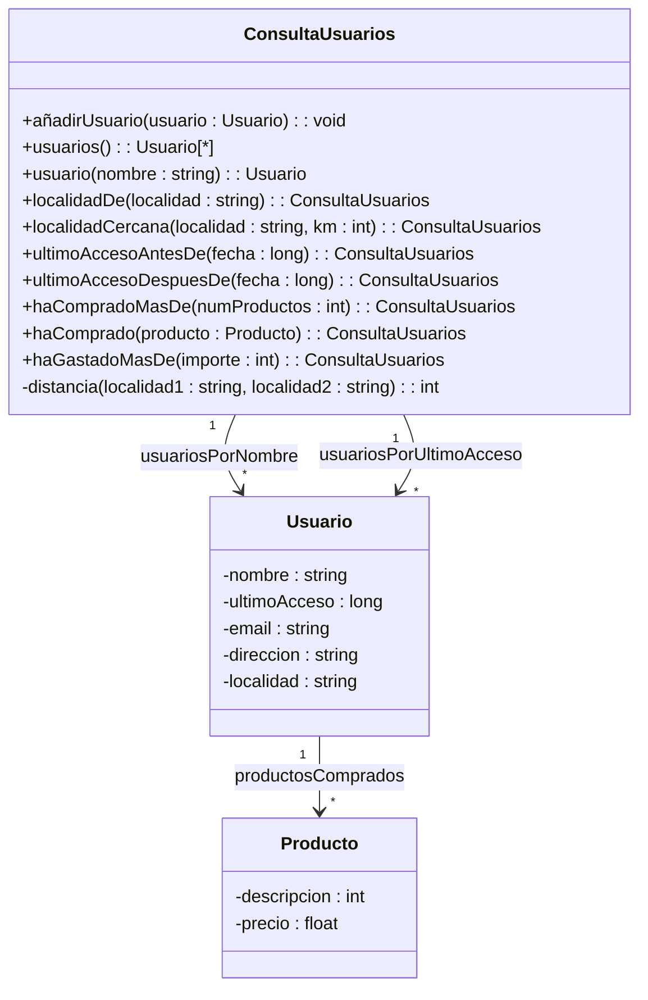

# Pregunta del UML Enero 2017

Los propietarios de la tienda Web descrita en la pregunta 2 han decidido rediseñar el sistema de una manera más ambiciosa para hacer estudios de mercado usando técnicas de BigData. Para ello han implementado un potente sistema de consultas representado por el diagrama UML adjunto.   

La clase **Usuario** se ha ampliado con información adicional (dirección, localidad), incluyendo una lista histórica de los productos que ha comprado el usuario

La clase **ConsultaUsuarios** contiene un conjunto de usuarios que pueden accederse de forma eficiente por dos criterios diferentes: nombre de usuario y fecha de último acceso. Esta clase contiene una serie de operaciones que permiten filtrar los usuarios por distintos criterios, devolviendo otro objeto de tipo `ConsultaUsuarios` con el resultado. Las operaciones son autoexplicativas así tan solo añadiremos un par de algunas aclaraciones adicionales:

* `usuarios()`: Devuelve una estructura de datos con todos los usuarios de la consulta

* `localidadCercana()`: Devuelve una consulta con todos los usuarios que viven a menos de una distancia dada (km) de otra localidad. Para implementar esta operación usaremos la operación estática privada `distancia()`, que daremos por implementada

Implementar las tres clases del diagrama. Implementar las consultas de `ConsultaUsuarios` de la manera más eficiente posible y con las mínimas redundancias. Una vez terminado el sistema, debe permitir consultas encadenadas como ésta:

// Obtener los usuarios de Jaén y 20 km. alrededor que hayan accedido este año al sistema
// y hayan gastado más de 1000 euros en total desde que se dieron de alta
// todos es de tipo ConsultaUsuarios y contiene todos los usuarios del sistema




> Resolución

### Paso 1: Elección de Estructura de Datos

* `Producto`: Clase sencilla para representar los artículos comprados con su descripción y precio

* `Usuario`: Almacena sus datos personales y una lista de compras mediante `std::vector<Producto>` para permitir accesos y recorridos dinámicos eficientes de su historial

* `ConsultaUsuarios:`

    * `std::map<string, Usuario*> (usuariosPorNombre)`: Permite búsquedas directas por nombre de usuario en tiempo logarítmico $\mathcal{O}(\log n)$

    * `std::multimap<long, Usuario*> (usuariosPorUltimoAcceso)`: Mantiene los usuarios ordenados por fecha/hora de último acceso. Permite hacer rangos y búsquedas eficientes por fecha en $\mathcal{O}(\log n)$, admitiendo múltiples usuarios con el mismo timestamp

### Paso 2: Código

```cpp
#include <iostream>
#include <string>
#include <vector>
#include <map>

class Producto{
    private:
        string descripcion;
        float precio;
    public:
        Producto(string desc = "", float p = 0.0) : descripcion(desc), precio(p) {}
    
        string getDescripcion() const { return descripcion; }
        float getPrecio() const { return precio; }

};

class Usuario{
    private:
        string nombre;
        long ultimoAcceso;
        string email;
        string direccion;
        string localidad;
        vector<Producto> productosComprados;

    public:
        Usuario(string nom = "", long acc = 0, string em = "", string dir = "", string loc = "") : nombre(nom), ultimoAcceso(acc), email(em), direccion(dir), localidad(loc){}

        string getNombre() const { return nombre; }
        long getUltimoAcceso() const { return ultimoAcceso; }
        string getLocalidad() const { return localidad; }
        const vector<Producto>& getProductos() const { return productosComprados; }

        void agregarProducto(const Producto &p){
            productosComprados.push_back(p);
        }

        float getTotalGastado() const{
            float total=0;
            for(int i=0;i<productosComprados.size();++i){
                total+=p[i].getPrecio();
            }
            return total;
        }
    };

class ConsultaUsuarios{
    private:
        map<string, Usuario*> usuariosPorNombre;
        multimap<long, Usuario*> usuariosPorUltimoAcceso;

        int distancia(string localidad1, string localidad2){
            if(localidad1==localidad2)
                return 0;
            return 10; // valor por defecto
        }
    public:
        ConsultarUsuarios(){}

        void añadirUsuario(Usuario* u) {
        if (u != nullptr) {
            usuariosPorNombre[u->getNombre()] = u;
            usuariosPorUltimoAcceso.insert(pair<long, Usuario*>(u->getUltimoAcceso(), u));
            }
        }
        vector<Usuario*> usuarios(){
            vector<Usuario*> lista;
            for(map<string,Usuario*>::iterator it=usuariosPorNombre.begin(); it != usuariosPorNombre.end(); ++it){
                lista.push_back(it->second);
            }
            return lista;
        }
        Usuario* usuario(string nombre){
            map<string,Usuario*>::iterator it= usuariosPorNombre.find(nombre);
            if(it!=usuariosPorNombre.end()){
                return it->second;
            }
            return nullptr;
        }

        ConsultaUsuarios localidadEs(string localidad){
            ConsultarUsuarios res;
            for(map<string,Usuario*>::iterator it=usuariosPorNombre.begin(); it != usuariosPorNombre.end();++it){
                if(it->second->getLocalidad()==localidad){
                    res.añadirUsuario(it->second):
                }
            }
            return res;
        }
        ConsultaUsuarios localidadCerca(string localidad, int km){
            ConsultaUsuarios res;
            for(map<string,Usuario*>::iterator it=usuariosPorNombre.begin();it<=usuariosPorNombre.end();++it){
                if(distancia(it->second->getLocalidad,localidad)<=km){
                    res.añadirUsuario(it->second);
                }
            }
            return res;
        }
        ConsultarUsuario ultimoAccesoAntesDe(long fecha){
            ConsultaUsuarios res;
            for(multimap<string,Usuario*>::iterator it=usuariosPorUltimoAcceso.begin();it<=usuariosPorUltimoAcceso.end();++it){
                if(it->first<fecha){
                    res.añadirUsuario(it->second);
                }
            }
            return res;
        }
        ConsultaUsuarios ultimoAccesoDespuesDe(long fecha) {
        ConsultaUsuarios res;
        for (multimap<long, Usuario*>::iterator it = usuariosPorUltimoAcceso.begin(); it != usuariosPorUltimoAcceso.end(); ++it) {
            if (it->first > fecha) {
                res.añadirUsuario(it->second);
            }
        }
        return res;
    }
        ConsultaUsuarios haCompradoMasDe(int numProductos) {
        ConsultaUsuarios res;
        for (map<string, Usuario*>::iterator it = usuariosPorNombre.begin(); it != usuariosPorNombre.end(); ++it) {
            if (it->second->getProductos().size() > (unsigned int)numProductos) {
                res.añadirUsuario(it->second);
            }
        }
        return res;
    }
        ConsultarUsuarios haComprado(Producto producto){
            ConsultaUsuarios res;
            for (map<string, Usuario*>::iterator it = usuariosPorNombre.begin(); it != usuariosPorNombre.end(); ++it) {
                vector<Producto> prods = it->second->getProductos();
                bool encontrado = false;

                for(size_t i=0;i<prods.size();++i){
                    if(prods[i].getDescripcion()==producto.getDescripcion()){
                        encontrado=true;
                    }
                }
                if(encontrado){
                    res.añadirUsuario(it->second);
                }
            }
            return res;
        }

        ConsultaUsuarios haGastadoMasDe(int importe) {
        ConsultaUsuarios res;
        for (map<string, Usuario*>::iterator it = usuariosPorNombre.begin(); it != usuariosPorNombre.end(); ++it) {
            if (it->second->getTotalGastado() > importe) {
                res.añadirUsuario(it->second);
            }
        }
        return res;
    }

}

```