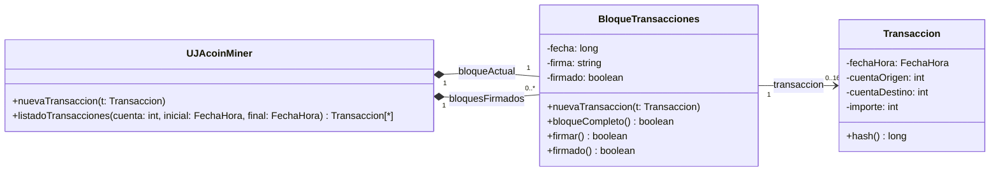

# UML Ordinaria 2018

La Universidad de Jaén ha decidido apuntarse también a la moda de las criptomonedas inventando la suya propia, el ujacoin, que podrá utilizarse para pagos dentro del campus. Para garantizar la seguridad en las transacciones (básicamente transferencias de una cuenta a otra) existe un servidor que guarda los bloques de transacciones y las firma mediante un sistema de minado similar al utilizado por bitcoin. Las clases involucradas son las siguientes:

**Transaccion** representa una transferencia de dinero entre dos cuentas ujacoin. Dispone de un constructor donde se indican los datos de la transferencia (la fecha y hora es tomada automáticamente del reloj del sistema). La operación `hash()` devuelve un hash calculado como $H_T = djb2(fechaHora.convertirALong(), cuentaOrigen, cuentaDestino, importe)$. La función `djb2()` es descrita más abajo.

**BloqueTransacciones** representa un bloque de 16 transacciones. La operación `nuevaTransaccion()` permite añadir nuevas transacciones (lanza una excepción si el bloque está completo, es decir si tiene ya 16 transacciones). La operación `firmar()` es la que firma el bloque una vez está completo (lanza una excepción en caso de que no lo esté). El algoritmo de firmado se describe más abajo. Además se anota la fecha y hora de firmado.

**UJACoinMiner** representa el servidor de minado. Tiene una operación para añadir transacciones al bloque actual. Cuando el bloque actual está completo se firma y se pasa a la lista de bloques firmados, creando un nuevo bloque vacío. Además incluye una operación para listar transacciones (solo las firmadas) a partir de dos fechas dadas donde la cuenta indicada sea origen o destino de la transferencia.

Para generar el hash de un conjunto de números usaremos una versión de la función `djb2()` que estudiamos en el tema de dispersión, pero tomando un vector de long como entrada en lugar de un vector de caracteres: `long djb2(vector<long> datos)` (no implementar). Tampoco implementar la clase *FechaHora*. Supondremos que tiene un constructor por defecto que toma la fecha y hora del sistema, la operación `convertirALong()` y los operadores de comparación correspondientes.

La firma de un bloque se realizará de la siguiente manera. En primer lugar calculando el hash del bloque como: $H_{Bloque} = djb2(F_{UltimoBloque}, HT0, HT1...HT15)$, donde $F_{UltimoBloque}$ es la firma del último bloque de la lista de bloques firmados. Entonces la firma del bloque será un long $F_{Bloque} = x$ que verifique: $0 < djb2(H_{Bloque}, x) < 11117$. Este valor hay que buscarlo a base de ensayo y error (pero se garantiza que existe).




> Resolución

### Paso 1: Escogemos estructuras de datos

* **En BloqueTransacciones:**

`std::vector<Transaccion*>` transacciones (o std::vector<Transaccion>):

Por qué: Permite almacenar de 0 a 16 transacciones de forma limpia y consultar su tamaño fácil con `.size()`

* **En UJACoinMiner**

`BloqueTransacciones* bloqueActual`: Puntero al bloque en construcción.

`std::vector<BloqueTransacciones*> bloquesFirmados`: Contenedor para la lista de bloques que ya han sido minados/firmados

```cpp
#include <iostream>
#include <vector>

class FechaHora{
    public:
        FechaHora(){}
        long convertirALong() const{ return 0; }
        bool operator>=(const FechaHora& f) const { return true; }
        bool operator<=(const FechaHora& f) const { return true; }
};


class Transaccion{
    private:
        FechaHora fechaHora;
        int cuentaOrigen;
        int cuentaDestino;
        int importe;
    public:
        Transaccion(int origen, int destino, int imp):
            cuentaOrigen(origen), cuentaDestino(destino), importe(imp){}
        long hash() const {
            std::vector<long> v;
            v.push_back(fechaHora.convertirALong());
            v.push_back(cuentaOrigen);
            v.push_back(cuentaDestino);
            v.push_back(importe);
            return djb2(v);
    }
};

class BloqueTransacciones{
    private:
        long firma;
        FechaHora fechaFirma;
        bool esFirmado;
        std::vector<Transaccion*> transacciones;
    public:
        BloqueTransacciones(){
            firma=0;
            esFirmado=false;
        }

        ~BloqueTransacciones(){
            for (size_t i = 0; i < transacciones.size(); ++i) {
            delete transacciones[i];
            }
        }

        bool bloqueCompleto() const{
            return transacciones.size() == 16;
        }

        bool firmado() const {
        return esFirmado;
        }

        long getFirma() const {
        return firma;
        }

        const std::vector<Transaccion*>& getTransacciones() const {
            return transacciones;
        }

        void nuevaTransaccion(Transaccion* t) {
            if (bloqueCompleto()) {
                throw std::runtime_error("El bloque ya tiene 16 transacciones.");
            }
            transacciones.push_back(t);
        }


        void firmar(long firmaUltimoBloque) {
            if (!bloqueCompleto()) {
                throw std::runtime_error("No se puede firmar un bloque incompleto.");
        }

        std::vector<long> datosHash;
        datosHash.push_back(firmaUltimoBloque);
        for (size_t i = 0; i < transacciones.size(); ++i) {
            datosHash.push_back(transacciones[i]->hash());
        }
        
        long hBloque = djb2(datosHash);

        long x = 0;
        bool encontrado = false;
        while (!encontrado) {
            std::vector<long> prueba;
            prueba.push_back(hBloque);
            prueba.push_back(x);

            long resultado = djb2(prueba);
            if (resultado > 0 && resultado < 11117) {
                firma = x;
                encontrado = true;
            } else {
                x++;
            }
        }

        esFirmado = true;
        fechaFirma = FechaHora();

        }
};


lass UJACoinMiner {
private:
    BloqueTransacciones* bloqueActual;
    std::vector<BloqueTransacciones*> bloquesFirmados;

public:
    UJACoinMiner() {
        bloqueActual = new BloqueTransacciones();
    }

    ~UJACoinMiner() {
        delete bloqueActual;
        for (size_t i = 0; i < bloquesFirmados.size(); ++i) {
            delete bloquesFirmados[i];
        }
    }

    void nuevaTransaccion(Transaccion* t) {
        bloqueActual->nuevaTransaccion(t);
        if (bloqueActual->bloqueCompleto()) {
            long firmaAnterior = 0;
            if (!bloquesFirmados.empty()) {
                firmaAnterior = bloquesFirmados.back()->getFirma();
            }

            bloqueActual->firmar(firmaAnterior);
            bloquesFirmados.push_back(bloqueActual);
            bloqueActual = new BloqueTransacciones();
        }
    }
std::vector<Transaccion*> listadoTransacciones(int cuenta, const FechaHora& fInicial, const FechaHora& fFinal) const {
        std::vector<Transaccion*> resultado;
        for (size_t i = 0; i < bloquesFirmados.size(); ++i) {
            const std::vector<Transaccion*>& txs = bloquesFirmados[i]->getTransacciones();
            for (size_t j = 0; j < txs.size(); ++j) {
                Transaccion* t = txs[j];
                FechaHora fh = t->getFechaHora();

                if (fh >= fInicial && fh <= fFinal) {
                    if (t->getCuentaOrigen() == cuenta || t->getCuentaDestino() == cuenta) {
                        resultado.push_back(t);
                    }
                }
            }
        }
        return resultado;
    }
};

```