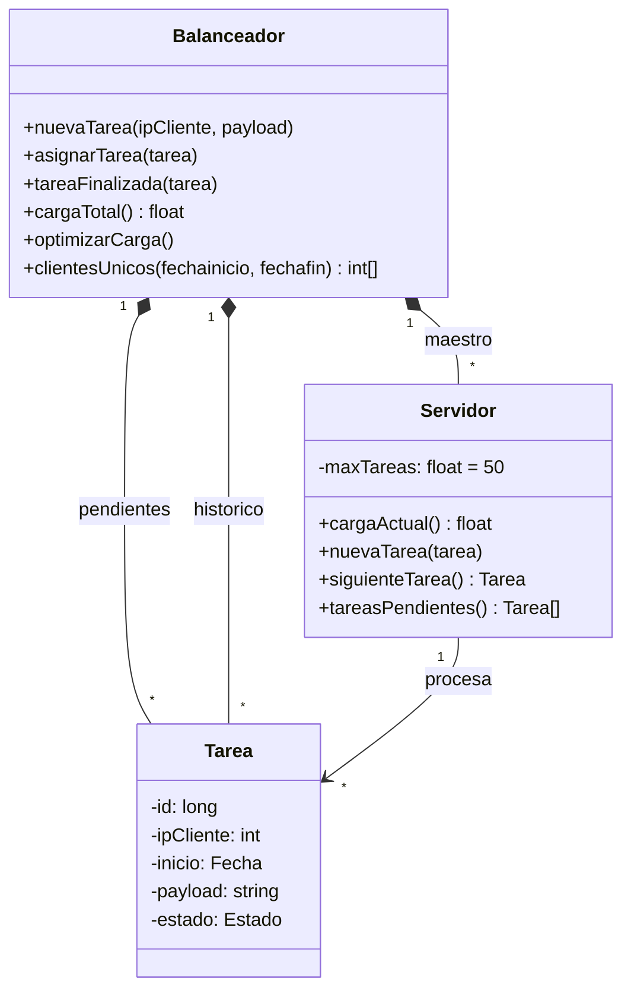

# UML enero 2023

### Descripción de Clases y Métodos




**Tarea:** contiene la información que debe ser procesada (*payload*) y el estado en el que se encuentra en el sistema: pendiente de procesarse o ya finalizada. Por cuestiones administrativas debe almacenar la fecha en que se solicitó y la IP del cliente que lo hizo. Cada una se debe identificar internamente, y de forma unívoca, por un código numérico.

**Servidor:** gestiona las tareas de cálculo que una determinada máquina virtual asociada tendrá que procesar. Por defecto hay un tope de 50 tareas máximas por servidor pero en el futuro podría variar según las características de la máquina virtual utilizada.

* `nuevaTarea`: añade una nueva tarea al servidor de forma que se procesen en primer lugar las tareas con mayor tamaño de datos a procesar (*payload*). Al finalizar el método el servidor comenzará a procesar su tarea con más prioridad.
* `siguienteTarea`: este método es llamado por el propio servidor cuando ha finalizado el procesamiento de su tarea más prioritaria. Esta será eliminada de sus tareas por procesar y se notificará al Balanceador mediante su método `tareaFinalizada`. Se descartarán a continuación aquellas tareas más prioritarias que ya hubieran sido finalizadas (por otro servidor). Devuelve la tarea con más prioridad con la que el servidor comenzará a trabajar cuando finalice el método.
* `cargaActual`: valor entre 0 y 1 obtenido como el número de tareas que debe procesar el servidor entre el máximo establecido para dicho servidor (atributo `maxTareas`).
* `tareasPendientes`: elimina y devuelve las tareas por procesar del servidor. Utilizado por el método `optimizarCarga` del balanceador antes de que elimine al servidor.

**Balanceador:** encargado de crear y repartir entre los servidores las nuevas tareas que se reciban. También se encarga de crear o destruir los servidores para garantizar un uso óptimo de los recursos de computación gestionados.

* `nuevaTarea`: crea una nueva tarea pendiente en el sistema, identificándola con un id único generado automáticamente, con la fecha actual y asignándola (método `asignarTarea`) a dos servidores para su procesamiento, garantizando así una alta disponibilidad en caso de que uno de ellos se pudiera bloquear. Los objetos *Fecha* inicializados por defecto tienen la fecha actual del sistema.
* `asignarTarea`: asigna una tarea a un servidor utilizando el esquema *round-robin*, es decir, al siguiente de forma consecutiva entre todos los servidores disponibles y siempre que su carga actual no sea superior a 1. Si no es posible asignar la tarea a ningún servidor, crear uno nuevo y asignársela a él.
* `tareaFinalizada`: método llamado desde un Servidor para notificar que una tarea ha sido finalizada. Esta será marcada como finalizada y transferida permanentemente de las tareas pendientes del balanceador al histórico. Si la tarea ya se hubiera finalizado anteriormente por otro servidor será ignorada. Si la carga total del sistema (método `cargaTotal`) es inferior a 0.5 se llamará al método `optimizarCarga`.
* `cargaTotal`: devuelve la carga total del sistema (valor entre 0 y 1) obtenida como la media aritmética de las cargas de los servidores existentes (suma total de las cargas de los servidores dividida por el número de servidores).
* `optimizarCarga`: método utilizado para evitar que los servidores estén infrautilizados. Elimina uno de ellos pero, antes de hacerlo, obtiene sus tareas pendientes (`Servidor::tareasPendientes`) y las reparte entre el resto, aumentando por consiguiente la carga total del sistema.
* `clientesUnicos`: consulta de forma eficiente las tareas finalizadas entre dos fechas determinadas y devuelve las direcciones IP, sin repetir, de los clientes que las hayan realizado.


> Resolución:


### 1. Planteamos las Estructuras

En **Servidor** (`procesa * Tarea`)
Por qué: Guardar las tareas asignadas. Al insertar una nueva tarea con nuevaTarea, recorremos la lista e insertamos ordenado por tamaño de payload de mayor a menor

En **Balanceador** (`* Servidor`, `pendientes * Tarea`, `historico * Tarea`)

* `std::vector<Servidor*> servidores`: Para guardar las máquinas virtuales (`* Servidor`)

* `std::list<Tarea*> pendientes`: Para el atributo pendientes del UML

* `std::vector<Tarea*> historico`: Para el atributo historico del UML

* `std::set<int>`: Usado solo localmente dentro del método clientesUnicos para filtrar las IPs sin duplicados fácilmente


```cpp
#include <iostream>
#include <string>
#include <vector>
#include <list>
#include <set>

class Fecha{
    public:
        Fecha(){}
        bool operator>=(const fecha& f) const{
            return true;
        }
        bool operator<=(const Fecha& f) const { return true; }
};

enum EstadoTarea{
    PENDIENTE, 
    FINALIZADA
}

class Tarea{
    private:
        long contadorId;
        long id;
        int ipCliente
        Fecha inicio;
        std::string payload;
        EstadoTarea estado;

    public:
        Tarea(int ip, const std::string& p){
            id=contadorId++;
            ipCliente=ip;
            payload=p;
            estado=PENDIENTE;
        }
        long getId() const{
            return id;
        }
        int getIpCliente() const{
            return ipCliente;
        }
        std::string getPayload() const{
            return payload;
        }
        Fecha getInicio() const{
            return inicio;
        }
        EstadoTarea getEstado() const{
            return estado;
        }
        void setEstado(EstadoTarea e){
            estado=e;
        }
};

class Servidor{
    private:
        float maxTareas;
        std::list<Tarea*> procesa;
        Balnceador *maestro;
    public:
        Servidor(Balanceador *b){
            maxTareas=50;
            maestro=b;
        }
        float cargaActual() const{
            return (float)procesa.size() / maxTareas;
        }
        void nuevaTarea(Tarea *t){
            std::list<Tarea*>::iterator it;
            for(it=procesa.begin(); it!=procesa.end();++it){
                if(t->getPayload().length()>(*it)->getPayload().length()){
                    procesa.insert(it,t);
                    return;
                }
            }
            procesa.push_back(t); // si es pequeña al final
        }
    std::vector<Tarea*> tareasPendientes(){
        std::vector<Tarea*> resultado;
        for(std::list<Tarea*>::iterator it= procesa.begin(); it!=procesa.end();++it){
            resultado.push_back(*it);
        }
        procesa.clear();
        return resultado;
    }
    Tarea* siguienteTarea();
};


class Balanceador{
    private:
        std::vector<Servidor*> servidores;
        std::list<Tarea*> pendientes:
        std::vector<Tarea*> historico;
        int indiceRoundRobin;

    public:
    Balanceador() {
        indiceRoundRobin = 0;
    }

    ~Balanceador() {
        for (size_t i = 0; i < servidores.size(); ++i) {
            delete servidores[i];
        }
        for (std::list<Tarea*>::iterator it = pendientes.begin(); it != pendientes.end(); ++it) {
            delete *it;
        }
        for (size_t i = 0; i < historico.size(); ++i) {
            delete historico[i];
        }
    }
    float cargaTotal() const {
        if (servidores.empty()) return 0;
        float suma = 0;
        for (size_t i = 0; i < servidores.size(); ++i) {
            suma += servidores[i]->cargaActual();
        }
        return suma / (float)servidores.size();
    }
    void asignarTarea(Tarea* t) {
        if (servidores.empty()) {
            servidores.push_back(new Servidor(this));
        }

        int totalServidores = (int)servidores.size();
        for (int i = 0; i < totalServidores; ++i) {
            int pos = (indiceRoundRobin + i) % totalServidores;
            if (servidores[pos]->cargaActual() < 1) {
                servidores[pos]->nuevaTarea(t);
                indiceRoundRobin = (pos + 1) % totalServidores;
                return;
            }
        }

        Servidor* nuevo = new Servidor(this);
        nuevo->nuevaTarea(t);
        servidores.push_back(nuevo);
    }
    void nuevaTarea(int ipCliente, const std::string& payload) {
        Tarea* t = new Tarea(ipCliente, payload);
        pendientes.push_back(t);
        asignarTarea(t);
        asignarTarea(t);
    }
    void optimizarCarga() {
        if (servidores.size() <= 1) return;
        Servidor* victima = servidores.back();
        servidores.pop_back();
        std::vector<Tarea*> aRepartir = victima->tareasPendientes();
        delete victima;
        for (size_t i = 0; i < aRepartir.size(); ++i) {
            if (aRepartir[i]->getEstado() == PENDIENTE) {
                asignarTarea(aRepartir[i]);
            }
        }
    }
    void tareaFinalizada(Tarea* t) {
    if (t->getEstado() == FINALIZADA) return;

    t->setEstado(FINALIZADA);
    std::list<Tarea*>::iterator it = pendientes.begin();
    bool encontrado = false;
    while (it != pendientes.end() && !encontrado) {
        if ((*it)->getId() == t->getId()) {
            it = pendientes.erase(it);
            encontrado = true;
        } else {
            ++it;
        }
    }
    historico.push_back(t);

    if (cargaTotal() < 0.5) {
        optimizarCarga();
    }
}
    std::vector<int> clientesUnicos(const Fecha& fechainicio, const Fecha& fechafin) const {
        std::set<int> ipsUnicas;
        for (size_t i = 0; i < historico.size(); ++i) {
            Fecha inicio = historico[i]->getInicio();
            if (inicio >= fechainicio && inicio <= fechafin) {
                ipsUnicas.insert(historico[i]->getIpCliente());
            }
        }
        std::vector<int> resultado;
        for (std::set<int>::iterator it = ipsUnicas.begin(); it != ipsUnicas.end(); ++it) {
            resultado.push_back(*it);
        }
        return resultado;
    }
};


```