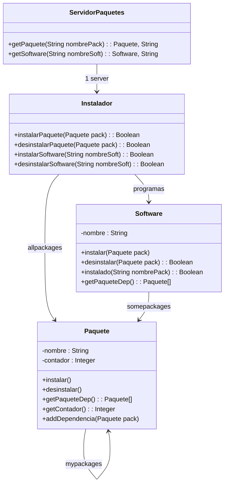

# UML ordinaria 2024

El gestor de paquetes en sistemas operativos tipo Linux es una herramienta que facilita la instalación, actualización, configuración y eliminación de software. Una aplicación software que siga esta filosofía se instala conjuntamente con una serie de paquetes que a su vez pueden necesitar otros paquetes en una jerarquía de dependencias con diferentes niveles. Se distinguen dos tipos de paquetes, los paquete software (Software) que son programas de usuario y los paquetes del sistema que se necesitan por otros paquetes software o del sistema (Paquete). Diferenciamos por tanto, el software a instalar (VCL, GIMP, etc.) que ocupa el primer nivel de la jerarquía o raíz, y el conjunto de paquetes que son necesarios para su instalación que estarán en los niveles sucesivos. Implementad las siguientes clases del UML (menos *ServidorPaquetes*). **NOTA: No es necesario añadir los #include en el código:**

**Instalador:** Esta clase es la que controla todos los paquetes del sistema para su instalación y desinstalación, y además se comunica con el servidor de paquetes para obtener nuevos paquetes (*ServidorPaquetes*). La funcionalidad es la siguiente: *InstalarSoftware()* es una acción dirigida por el usuario, que sólo necesita conocer el nombre de la aplicación software (p.e. GIMP) y no de las dependencias. La función de instalación comprueba que dicho software no está ya instalado (en este caso devuelve false) y busca dicho paquete en el servidor con *ServidorPaquetes::getSoftware()*, que devuelve tanto el Software a instalar como un listado de dependencias del siguiente nivel de dependencias (se devuelven los nombres de esos paquetes dependientes). Esta función deberá llamar a *InstalarPaquete()* tantas veces como dependientes tenga en su nivel de la jerarquía. Los paquetes se obtienen del servidor con *ServidorPaquetes::getPaquete()* con la lista de dependencia del siguiente nivel. Si ocurre que esa lista no está vacía, entonces hay que realizar la misma operación con el siguiente nivel de dependencia hasta instalar todos los paquetes de la jerarquía. La función *desinstalarSoftware()* debe hacer lo contrario, es decir, eliminar el Software instalado y llamar a *desinstalarPaquete()* para todos los paquetes dependientes del sistema. La función *instalarPaquete()* añade el paquete al sistema en *Instalador::allpackages* si no estaba ya instalado. Y del mismo modo *desinstalarPaquete()* lo elimina si ningún otro paquete lo está ya usando.

**ServidorPaquetes:** Esta clase **no se implementa**. Funciona a modo de servicio externo proporcionando el paquete solicitado (Software o Paquete) y una lista de dependencias devuelta como un std::vector<String>. Ese listado de dependencias indica el nombre de los otros paquetes del siguiente nivel de la jerarquía que necesita el sistema para instalar el paquete. El orden de instalación no va a ser importante. El paquete que se devuelve cuando se llama a *Instalador::instalarSoftware()* es un paquete de tipo Software (nivel 1 de la jerarquía), y los de *Instalador::instalarPaquete()* son de tipo Paquete (resto de niveles). Sólo hay un paquete tipo software para cada instalación (raíz de la jerarquía), mientras que el número de paquetes del sistema pueden ser muchos y a distintos niveles.

**Software:** Se considera software al programa principal o aplicación, por ejemplo GIMP. Tiene un nombre por que el que es conocido por el usuario. Normalmente dicho programa necesitará otros paquetes para su correcta instalación que no serán conocidos, como pueden ser librerías del sistema. Al instalar cada paquete software se deben añadir sus paquetes dependientes a través de la relación: *Software::somepackages* con la función *Software::instalar()*. La instalación de un paquete depende de si ya está o no instalado en el sistema. Si no está instalado se añade en *Instalador::allpackages*; si ya está instalado, basta con incrementar el contador de uso. Desinstalar un paquete sigue el proceso contrario, decrementando el contador y devolviendo false si no estuviera dicho paquete. La función *Software::instalado()* indica si el paquete que se da por parámetro está instalado y *Software::getPaqueteDepend()* devuelve todos los paquetes instalados de los que depende el software de forma recursiva, es decir, considerando las dependencias anidadas de los paquetes asociados.

**Paquete:** Representa a todos aquellos paquetes instalados en el sistema y que no son programas de usuario. Un paquete, cuando se instala por primera vez, se añade al sistema; además debe añadirse su dependencia del programa principal que lo instaló si es una dependencia de primer nivel a través de *Software::somepackages*. En caso contrario, si no es de primer nivel y tiene otras dependencias, entonces se deben añadir a través de *Paquete::mypackages* con la función *addDependencia()*. La función *instalar()* siempre es llamada y sólo se encarga de incrementar el contador, al contrario de lo que hace *desinstalar()*. Para eliminar totalmente el paquete, el contador debe ser igual a 0. La función *getPaqueteDepend()* devuelve todos los paquetes de los que depende dicho paquete en toda la jerarquía. En el ejemplo que aparece abajo, el paquete **babl** devolvería: **[buster, trixie, equivs]**.



### Ejemplo de instalación de GIMP: en corchetes aparecen las dependencia del paquete:

```text
getSoftware (GIMP) : <Gimp.sh, GEGL] [babl,> -> instalarSoftware ("Gimp")
    getPaquete (babl): <babl, [buster, trixie]> -> instalarPaquete(babl)
    getPaquete (buster): <buster, [equivs]>
    getPaquete(equivs): <equivs> -> instalarPaquete (equivs)
    getPaquete(trixie): <trixie> -> instalarPaquete (trixie)
    getPaquete(GEGL): <GEGL, [libc6]> -> instalarPaquete(GEGL)
    getPaquete(libc6): <libc6> -> instalarPaquete(libc6)
```

```
        [ Gimp ]
        /        \
    [ babl ]     [ GEGL ]
    /      \        |
[ buster ] [ trixie ] [ libc6 ]
    |
[ equivs ]
```


```cpp
class ServidorPaquetes {
public:
    std::pair<Software*, std::vector<std::string> > getSoftware(std::string nombre);
    std::pair<Paquete*, std::vector<std::string> > getPaquete(std::string nombre);
};

class Paquete {
private:
    std::string nombre;
    int contador;
    std::vector<Paquete*> mypackages;
public:
    Paquete(std::string nom) {
        nombre = nom;
        contador = 0;
    }
    std::string getNombre() const { return nombre; }
    int getContador() const { return contador; }

    void instalar() {
        contador++;
    }

    void desinstalar() {
        if (contador > 0) {
            contador--;
        }
    }
    void addDependencia(Paquete* pack) {
        mypackages.push_back(pack);
    }
    std::vector<Paquete*> getPaqueDepend() {
        std::vector<Paquete*> resultado;
        for (size_t i = 0; i < mypackages.size(); ++i) {
            resultado.push_back(mypackages[i]);
            std::vector<Paquete*> subDeps = mypackages[i]->getPaqueDepend();
            for (size_t j = 0; j < subDeps.size(); ++j) {
                resultado.push_back(subDeps[j]);
            }
        }
        return resultado;
    }
};


class Software {
private:
    std::string nombre;
    std::vector<Paquete*> somepackages;

public:
    Software(std::string nom) {
        nombre = nom;
    }

    std::string getNombre() const { return nombre; }

    void instalar(Paquete* pack) {
        somepackages.push_back(pack);
    }

    bool desinstalar(Paquete* pack) {
        for (std::vector<Paquete*>::iterator it = somepackages.begin(); it != somepackages.end(); ++it) {
            if (*it == pack) {
                somepackages.erase(it);
                return true;
            }
        }
        return false;
    }
    bool instalado(std::string nombrePaq) const {
        for (size_t i = 0; i < somepackages.size(); ++i) {
            if (somepackages[i]->getNombre() == nombrePaq) {
                return true;
            }
        }
        return false;
    }
    std::vector<Paquete*> getPaqueDepend() {
        std::vector<Paquete*> resultado;
        for (size_t i = 0; i < somepackages.size(); ++i) {
            resultado.push_back(somepackages[i]);

            std::vector<Paquete*> subDeps = somepackages[i]->getPaqueDepend();
            for (size_t j = 0; j < subDeps.size(); ++j) {
                resultado.push_back(subDeps[j]);
            }
        }
        return resultado;
    }
};

class Instalador {
private:
    ServidorPaquetes* server;
    std::vector<Software*> programs;
    std::vector<Paquete*> allpackages;
    Paquete* buscarPaquete(std::string nombre) {
        for (size_t i = 0; i < allpackages.size(); ++i) {
            if (allpackages[i]->getNombre() == nombre) {
                return allpackages[i];
            }
        }
        return nullptr;
    }
    Software* buscarSoftware(std::string nombre) {
        for (size_t i = 0; i < programs.size(); ++i) {
            if (programs[i]->getNombre() == nombre) {
                return programs[i];
            }
        }
        return nullptr;
    }
public:
    Instalador(ServidorPaquetes* s) {
        server = s;
    }

    bool instalarPaquete(Paquete* pack) {
        Paquete* existente = buscarPaquete(pack->getNombre());
        if (existente == nullptr) {
            pack->instalar();
            allpackages.push_back(pack);
            return true;
        } else {
            existente->instalar();
            return false;
        }
    }
    bool desinstalarPaquete(Paquete* pack) {
        Paquete* existente = buscarPaquete(pack->getNombre());
        if (existente == nullptr) {
            return false;
        }

        existente->desinstalar();

    bool instalarSoftware(std::string nombresoft) {
        if (buscarSoftware(nombresoft) != nullptr) {
            return false;
        }
        std::pair<Software*, std::vector<std::string> > respSoft = server->getSoftware(nombresoft);
        Software* soft = respSoft.first;
        std::vector<std::string> depsNombres = respSoft.second;
        for (size_t i = 0; i < depsNombres.size(); ++i) {
            instalarPaqueteRecursivo(depsNombres[i], soft, NULL);
        }

        programs.push_back(soft);
        return true;
    }

    Paquete* existente = buscarPaquete(pack->getNombre());
        if (existente == NULL) {
            return false;
        }

        existente->desinstalar();

        std::vector<Software*>::iterator it = programs.begin();
        bool eliminado = false;
        while (it != programs.end() && !eliminado) {
            if (*it == soft) {
                it = programs.erase(it);
                delete soft;
                eliminado = true;
            } else {
                ++it;
            }
        }
        return true;
    }

    void instalarPaqueteRecursivo(std::string nombrePaq, Software* softPadre, Paquete* paqPadre) {
        Paquete* p = buscarPaquete(nombrePaq);
        std::vector<std::string> subDepsNombres;

        if (p == nullptr) {
            std::pair<Paquete*, std::vector<std::string> > resp = server->getPaquete(nombrePaq);
            p = resp.first;
            subDepsNombres = resp.second;
        }
        instalarPaquete(p);
        if (softPadre != nullptr) {
            softPadre->instalar(p);
        } else if (paqPadre != nullptr) {
            paqPadre->addDependencia(p);
        }
    bool instalarSoftware(std::string nombresoft) {
        if (buscarSoftware(nombresoft) != nullptr) {
            return false;
        }
        std::pair<Software*, std::vector<std::string> > respSoft = server->getSoftware(nombresoft);
        Software* soft = respSoft.first;
        std::vector<std::string> depsNombres = respSoft.second;
        
        for (size_t i = 0; i < depsNombres.size(); ++i) {
            instalarPaqueteRecursivo(depsNombres[i], soft, nullptr);
        }
        programs.push_back(soft);
        return true;
    }
    void instalarPaqueteRecursivo(std::string nombrePaq, Software* softPadre, Paquete* paqPadre) {
        Paquete* p = buscarPaquete(nombrePaq);
        std::vector<std::string> subDepsNombres;

        if (p == nullptr) {
            std::pair<Paquete*, std::vector<std::string> > resp = server->getPaquete(nombrePaq);
            p = resp.first;
            subDepsNombres = resp.second;
        }

        instalarPaquete(p);
        if (softPadre != nullptr) {
            softPadre->instalar(p);
        } else if (paqPadre != nullptr) {
            paqPadre->addDependencia(p);
        }
        çfor (size_t j = 0; j < subDepsNombres.size(); ++j) {
            instalarPaqueteRecursivo(subDepsNombres[j], nullptr, p);
        }
    }
    bool desinstalarSoftware(std::string nombresoft) {
        Software* soft = buscarSoftware(nombresoft);
        if (soft == nullptr) {
            return false;
        }
        std::vector<Paquete*> dependencias = soft->getPaqueDepend();
        for (size_t i = 0; i < dependencias.size(); ++i) {
            desinstalarPaquete(dependencias[i]);
        }
        if (existente->getContador() == 0) {
            std::vector<Paquete*>::iterator it = allpackages.begin();
            bool borrado = false;
            while (it != allpackages.end() && !borrado) {
                if (*it == existente) {
                    it = allpackages.erase(it);
                    delete existente;
                    borrado = true;
                } else {
                    ++it;
                }
            }
        }
        return true;
    }
```