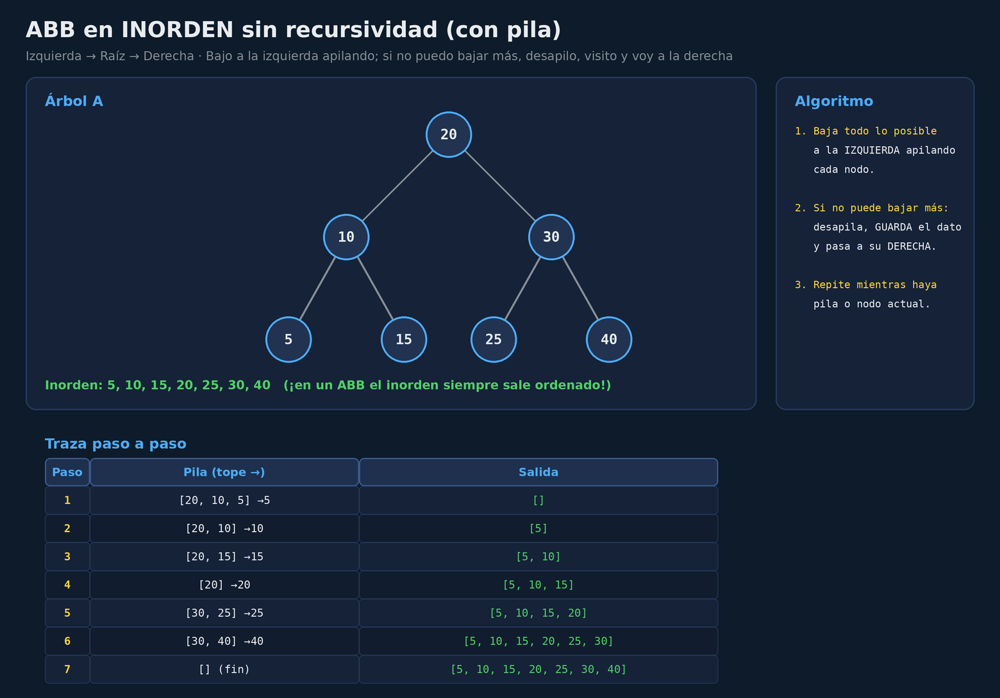
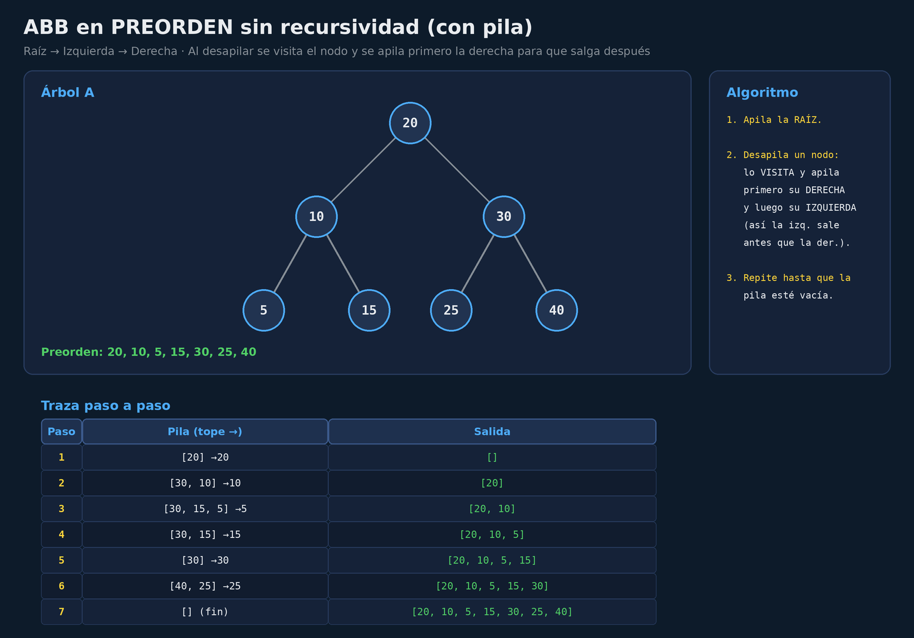
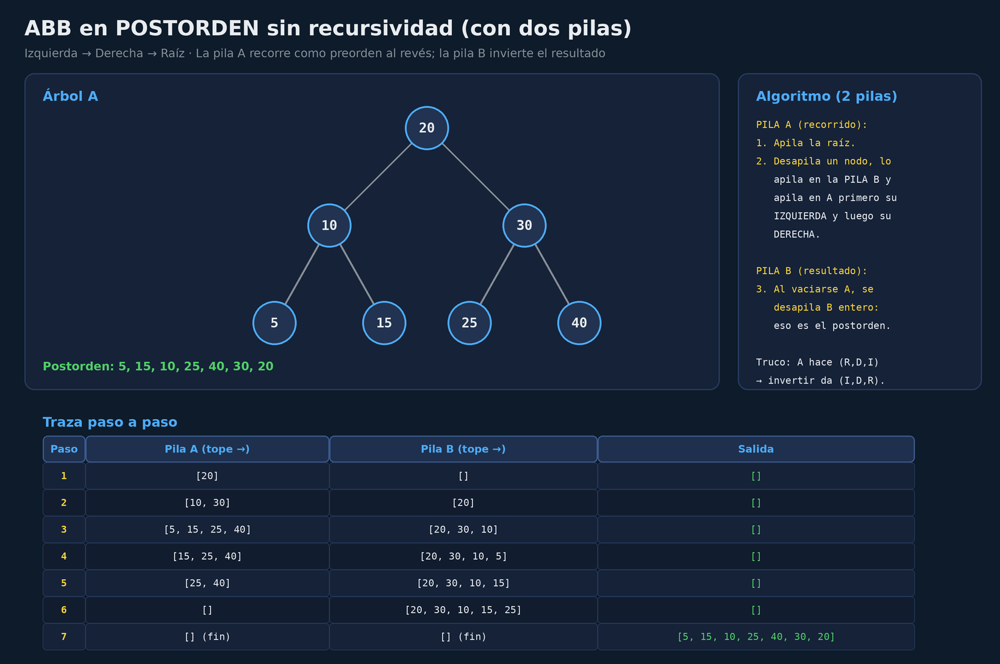
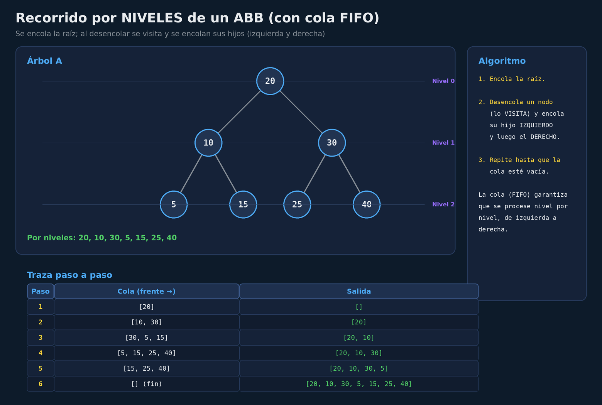
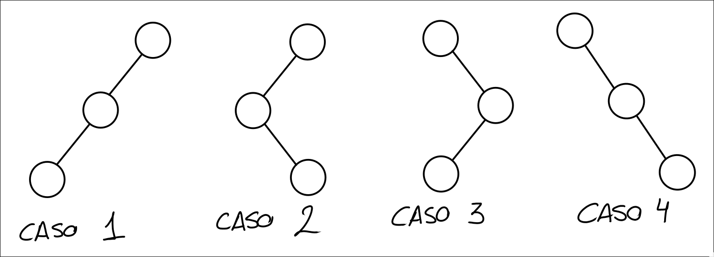
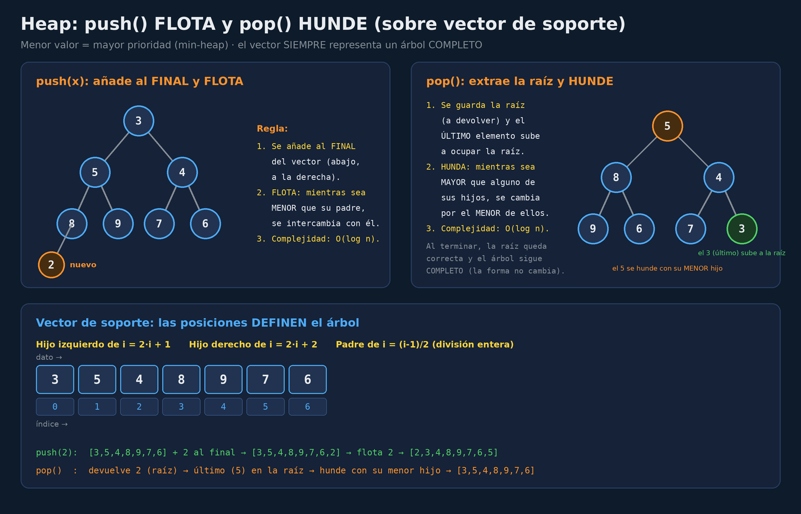
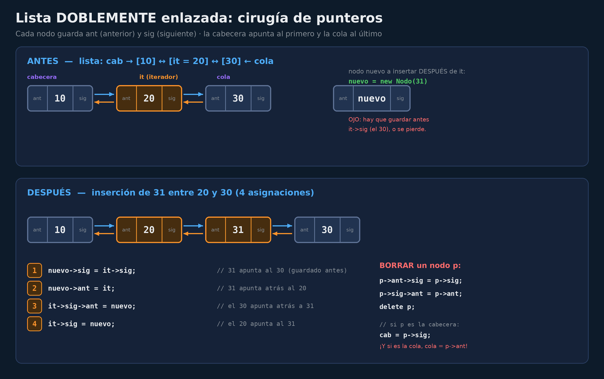
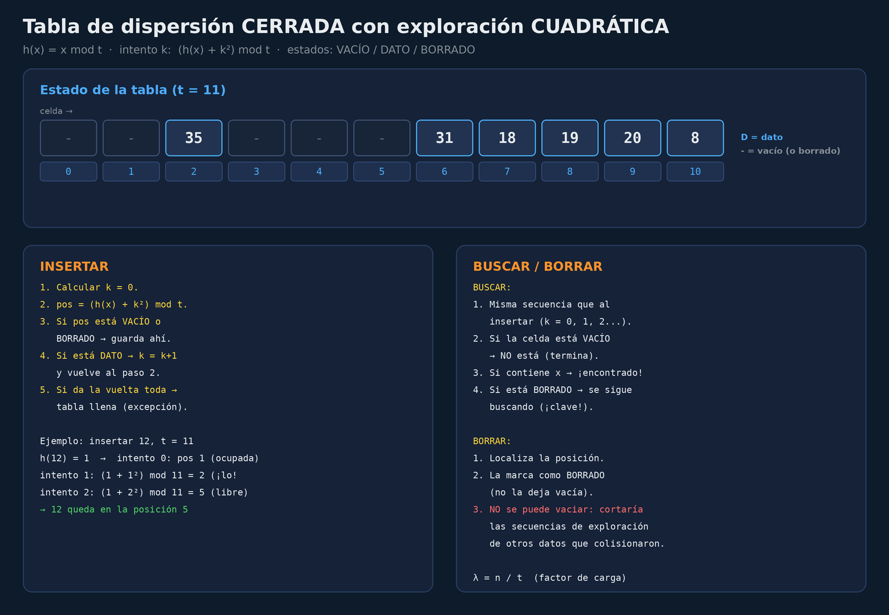
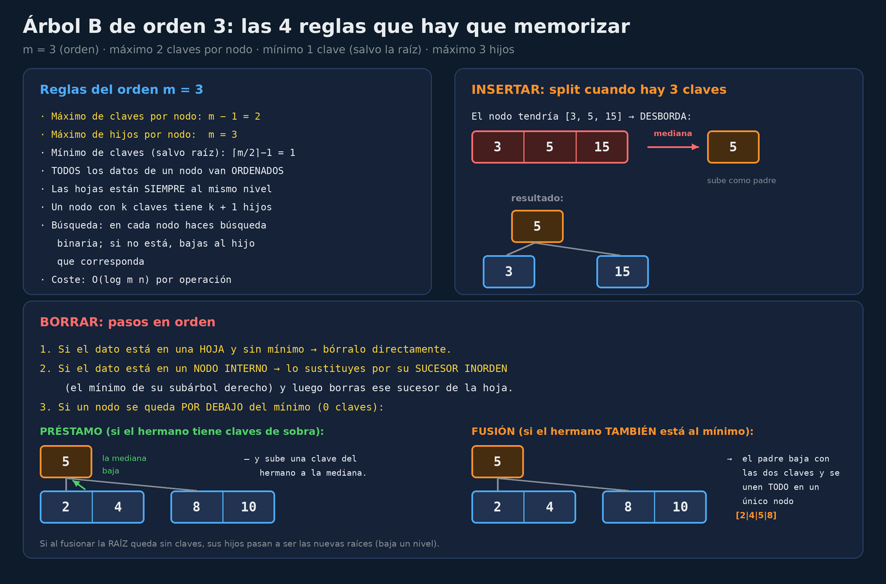

# Guía para el examen de EEDD


> No resuelve ningún ejercicio concreto: contiene **código genérico aplicable** a cualquier
> enunciado que te pongan, más los patrones y preguntas que más se repiten.

## Índice

1. [Estructura del examen](#1-estructura-del-examen)
2. [Qué cae y qué no: análisis de frecuencias](#2-qué-cae-y-qué-no-análisis-de-frecuencias)
3. [Las preguntas que más caen (tipo test)](#3-las-preguntas-que-más-caen-tipo-test)
4. [Recorridos de árboles con pila y cola (sin recursividad)](#4-recorridos-de-árboles-con-pila-y-cola-sin-recursividad)
5. [Código genérico de árboles (ABB y AVL)](#5-código-genérico-de-árboles-abb-y-avl)
6. [Heaps: push y pop sobre vector](#6-heaps-push-y-pop-sobre-vector)
7. [Listas enlazadas: la cirugía de punteros](#7-listas-enlazadas-la-cirugía-de-punteros)
8. [Tablas de dispersión (hash)](#8-tablas-de-dispersión-hash)
9. [Árbol B: reglas de inserción y borrado](#9-árbol-b-reglas-de-inserción-y-borrado)
10. [STL: los que salen siempre](#10-stl-los-que-salen-siempre)
11. [UML: patrones de implementación recurrentes](#11-uml-patrones-de-implementación-recurrentes)
12. [Trampas y condiciones típicas de los enunciados](#12-trampas-y-condiciones-típicas-de-los-enunciados)
13. [Checklist de repaso la noche anterior](#13-checklist-de-repaso-la-noche-anterior)

---

## 1. Estructura del examen


| Pregunta | Puntos | Contenido | Carpeta en las notas |
| -- | -- | -- | -- |
| **P1** | **2** | 10 afirmaciones **V/F**, **sin explicación** | [`Examenes/TipoTest/`](Examenes/TipoTest/) |
| **P2** | **1,5–2** | 1 ejercicio de **trazado/dibujo** | [`Examenes/Primitivas/`](Examenes/Primitivas/) |
| **P3** | **3** | 1 o 2 apartados de **código C++** con la firma dada | [`Examenes/Primitivas/`](Examenes/Primitivas/) |
| **P4** | **3–3,5** | Diagrama UML → **implementar las clases en C++** | [`Examenes/UML/`](Examenes/UML/) |

Los puntos exactos de P2 y P4 alternan según el año (1,5 + 3,5 o bien 2 + 3),
pero el total siempre son **10**.

### 1.1 Pregunta 1: Tipo Test (V/F) — 2 ptos

- **10 afirmaciones de V/F**. En todos los años el formato es `[V]` o `[F]`.
- **No hace falta justificar**: solo hay que marcar. La letra literal del enunciado es
  *"Contestar V/F las siguientes cuestiones, teniendo en cuenta que una respuesta incorrecta
  invalida una correcta"* → **penalización**: cada fallo anula un acierto.
- Los enunciados son trampa: suelen ser afirmaciones *casi* ciertas con un matiz invertido
  (por ejemplo, cambiar $\mathcal{O}(1)$ por $\mathcal{O}(n)$, o "izquierda" por "derecha").

### 1.2 Pregunta 2: Trazado (1,5–2 ptos)

- **Un ejercicio de trazado** (dibujar estados, no código). Por frecuencia, el enunciado puede ser:
  - Tabla de dispersión (cerrada con exploración cuadrática o doble dispersión) con `I/B` y búsquedas.
  - Árbol B de orden 3 con una secuencia de `I(...)` y `B(...)`.
  - Heap sobre vector de soporte con `push(...)` y `pop()`.
  - AVL o ABB con inserciones/borrados (y rotaciones si es AVL): AVL salió en 2015 y en los dos exámenes de 2017 (enero y julio); ABB, solo en junio 2012.
  - Conjuntos disjuntos sobre una matriz.

### 1.3 Pregunta 3: Código (3 ptos)

- **Uno o dos apartados de código** con la **firma ya dada** en el enunciado. Suele pedirse:
  - Funciones de ABB/AVL (recorridos, construir, consultar propiedades).
  - Operaciones sobre listas enlazadas (insertar, borrar, invertir, concatenar).
  - Funciones sobre tablas hash o matrices dinámicas.

Condiciones que **casi siempre** aparecen en la letra del enunciado:

- Plantillas (`template <typename T>`) y clases ya definidas con sus nodos.
- **Sin recursividad** → hay que usar pila (o cola si es por niveles).
- **Sin iteradores** de STL → punteros manuales (`nodo->sig`).
- Devolver un valor concreto (`bool`, un vector, la longitud...) o lanzar una excepción.
- Respetar la firma exacta: si pone `vector<T> inorden() const`, no la cambies.

### 1.4 Pregunta 4: UML (3–3,5 ptos)

- Un caso de uso largo con **diagrama de clases**
- Hay que implementar **todo en C++**: constructores, destructores, métodos públicos.
- Elementos recurrentes: vectores de punteros (`vector<T*>`), punteros a objetos de otras clases,`pair` devueltos por métodos externos, recursión sobre estructuras jerárquicas, excepciones.
- No hacen falta los `#include` (lo dice el enunciado).
- **No** se puede ni debe usar `auto`

---

## 2. Qué cae y qué no: análisis de frecuencias

### 2.1 Primitivas: qué ejercicios de trazado salen

Contando los **15 exámenes** que tenemos (2012×2, 2014, 2015, 2016, 2017 enero y julio, 2018,
2019×3, 2022×2, 2023 y 2024):

| Ejercicio de trazado | Veces que ha salido | Años |
| -- | -- | -- |
| **Tabla de dispersión** (cuadrática, doble, abierta) | **4** | 2014 (abierta + cuadrática), 2019 enero (cuadrática), 2022 Extra, 2023 |
| **Árbol B de orden 3** (I/B) | **3** | 2019 Extra2, 2022, 2024 (+ reglas del árbol B en autoevaluaciones) |
| **Heap** (push/pop sobre vector) | **3** | 2012 septiembre, 2016, 2019 Extra |
| **AVL** (inserciones con rotaciones) | **3** | 2015, 2017 enero, 2017 julio |
| **Conjuntos disjuntos** | **1** | 2018 |
| **ABB** (I/B sobre ABB) | **1** | 2012 junio |


### 2.2 Primitivas: qué código se pide

| Tipo de código | Veces | Años |
| -- | -- | -- |
| **Funciones sobre ABB** (recorridos, construir equilibrado, comprobar propiedades) | **10** | 2012 septiembre, 2014, 2015, 2016, 2017 enero, 2017 julio, 2018, 2019 Extra, 2022, 2023 |
| **Listas enlazadas** (insertar/concatenar/invertir, borrar ocurrencias...) | **8** | 2014, 2015, 2017, 2019 Extra, 2019 enero, 2022 Extra, 2023, 2024 |
| **Funciones sobre tabla hash** (insertar/buscar con la secuencia de exploración) | **4** | 2012 junio, 2016, 2018, 2022 Extra |
| **AVL** (insertar con rotaciones, datoMax, compatibleAVL...) | **3** | 2017, 2022 Extra, 2024 |
| **Matrices dinámicas** (añadir fila/columna, `operator+`) | **2** | 2012 septiembre, 2019 Extra2 |
| **Heap** (consulta `menorPrioridad` sobre `Heap<T>`) | **1** | 2019 enero |
| **Árbol genérico** (contar descendientes) | **1** | 2019 Extra2 |
| **Recorrido en anchura / BFS** (`rellenarColor` sin recursión) | **1** | 2017 julio |

**Conclusión**: sigue mandando el **ABB con recursividad y sin ella** (10 veces), y segundo
**listas** (8): entre los dos son 18 de los 30 apartados de código de toda la historia. Si
solo puedes preparar dos temas de código, esos.

### 2.3 Tipo Test: frecuencia de temas

Contando en cuántos de los **15 archivos** de TipoTest aparece cada tema (ya incluidos 2015,
enero 2019, julio 2017 y septiembre 2012):

| Tema | Archivos | Notas |
| -- | -- | -- |
| **Punteros y memoria** (pila/heap, `new/delete`, fugas) | **15/15** | En todos |
| **STL** (`map`, `set`, `list`, comparadores, `erase`) | **13/15** | Casi garantizado |
| **Vector dinámico** (redimensión, direcciones de memoria) | **14/15** | Muy habitual |
| **Árbol B** (propiedades, orden, alturas) | **14/15** | Muy habitual |
| **Listas enlazadas** (simple, doble, circular) | **14/15** | Muy habitual |
| **Hash** (agrupamientos, cubetas, factores de carga) | **13/15** | Muy habitual |
| **AVL** (rotaciones, casos, sensibilidad al orden) | **11/15** | Habitual |
| **Heap** (equilibrio, prioridades, menor/mayor) | **10/15** | Habitual |
| **Mapas/contenedores asociativos** | **7/15** | Habitual |
| **Grafos** (definiciones, recorridos) | **10/15** | Habitual |
| **Quadtrees / Kd-trees** (codificación Z, búsqueda del más cercano, por rango) | **8/15** | Aparece bastante (el Kd-tree, solo en septiembre 2012) |
| **Recorridos de árboles** (preorden/inorden/postorden) | **5/15** | Frecuente |
| **ABB** (propiedades del inorden) | **6/15** | Aparece |

> **Nota**: ya están las **15 fichas**, incluido septiembre 2012 (sus respuestas V/F estaban
> rotuladas en rojo en la propia página del examen: el texto que extrae el PDF no las recogía).
> Ojo con dos preguntas discutibles que se dejan tal cual vienen marcadas y con su aviso en la
> ficha: la 2 de septiembre 2012 (direcciones de un dato en una lista dinámica) y la 3 de julio
> 2017 (fusionar dos listas ordenadas en $O(n)$). Por cierto, la pregunta de **ficheros con
> registros de longitud variable** solo aparece en 2015.

### 2.4 Autoevaluaciones de Platea


Las carpetas:
 [`arboles.md`](Examenes/AutoEvaluación/arboles.md),
[`heaps.md`](Examenes/AutoEvaluación/heaps.md),
[`MemoriaIII.md`](Examenes/AutoEvaluación/MemoriaIII.md) y
[`stl.md`](Examenes/AutoEvaluación/stl.md) son **banco de preguntas directo**: échales un vistazo


---

## 3. Las preguntas que más caen (tipo test)

Estas son las afirmaciones que, con distintas palabras, se repiten año tras año, agrupadas por
tema. Fíjate en el **matiz exacto** de cada una: ahí está la trampa.

### 3.1 Listas y vectores

- El borrado del **último elemento de una lista simple es $\mathcal{O}(n)$ aunque tengas un puntero
  al mismo** → **V**. Necesitas el penúltimo para poner su `sig = nullptr`, y para eso hay que
  recorrer desde el principio.
- **Insertar antes de un iterador en una lista simple no es $\mathcal{O}(1)$** → **F** si lo afirma;
  en realidad *sí* que es $\mathcal{O}(n)$ en lista simple (hay que llegar al anterior) pero
  en **lista doble** sí es $\mathcal{O}(1)$ porque tienes `ant`. La trampa está en la estructura
  que nombra.
- Una **lista circular no tiene puntero a cabecera** (le basta con el puntero al último, ya que
  desde él llegas al primero) → **V**.
- Los datos de un **vector dinámico pueden cambiar su dirección de memoria aunque nunca se borren**
  (por la redimensión) → **V**.
- La redimensión **no reduce a la mitad** el tamaño físico cuando el lógico cae por debajo de la mitad (en la implementación de la asignatura es a **un tercio**) → **F**.
- `int **p` puede servir para matriz, vector u otro uso → **V**.
- Es **peligroso** guardar `vector<B>` (objetos, no punteros) si otra clase mantiene asociación con esos objetos → **V** (la redimensión invalidaría todos los punteros externos).
- "**El puntero cola de una lista simple permite que la inserción y el borrado por el final sean
  $\mathcal{O}(1)$**" → **F**: la inserción sí lo es, pero el borrado no (necesitas el penúltimo).
  Como la frase mezcla las dos operaciones, la afirmación entera es falsa.

### 3.2 Árboles: ABB, AVL y recorridos

- El **inorden de un ABB devuelve los datos ordenados** de menor a mayor → **V** (propiedad que más cae de todas).
- En un ABB **y** en un AVL, el orden de inserción afecta a la estructura y a la eficiencia → **V**.
- Insertando datos **ascendentes** en un AVL siempre se produce el **caso 4** (rotación simple a la izquierda) → **V**; si fueran descendentes, siempre **caso 1** (simple a la derecha).
- **"Tras una inserción en un AVL, el proceso de ajuste requiere a lo sumo una rotación
  simple o doble"** → **F** (así salió en el examen de enero 2015). La trampa es la palabra
  *requiere*: muchas inserciones **no requieren ninguna rotación** (el árbol sigue
  equilibrado tras subir el dato). Cuando sí hace falta rotar, como máximo es UNA rotación
  simple **o** una doble (nunca dos seguidas en la inserción). Ojo: eso es en la
  **inserción**; en el **borrado** el reajuste sí puede encadenarse por varios niveles
  mientras subes recalculando alturas.
- **Partir de un vector ordenado y coger el centro como raíz recursivamente** produce un árbol
  **compatible con AVL** → **V**.
- Un **heap es un árbol binario equilibrado en altura** → **V** (es completo, y completo implica
  equilibrado en altura).
- Datos **ordenados de forma ascendente** introducidos en un ABB lo **degeneran en lista**
  ($\mathcal{O}(n)$), mientras que en un AVL se mantiene $\mathcal{O}(\log n)$ → **V**.
- "**Un heap puede no estar equilibrado si los valores se insertan en orden contrario al que se
  desea recuperar**" → **F**: la forma de un heap depende solo del número de inserciones (siempre
  queda completo y equilibrado en altura); los valores no la alteran.
- El orden de un **ABB** y el de un **heap** "es el mismo" y solo cambia que uno va en vector →
  **F**: el ABB separa menores (izquierda) y mayores (derecha) en cada nodo; el heap ordena por
  **prioridad** entre padre e hijos (la raíz es la extrema) y no hay orden entre hermanos.
- "**La hoja con mayor profundidad de un ABB no se puede calcular de forma iterativa**" → **F**:
  cualquier recorrido de árbol, incluido éste, se hace con una pila explícita en lugar de la pila
  de llamadas.

### 3.3 Árbol B

- Los datos **dentro de un nodo** de un árbol B están **ordenados** → **V**.
- **Todas las hojas están al mismo nivel/profundidad** → **V**.
- Es **imposible** que un árbol B de orden 20 tenga **menos altura** que uno de orden 22 con los mismos datos → **F** (es perfectamente posible: con orden mayor el árbol es más "ancho" y puede requerir menos niveles... el enunciado lo plantea al revés, repásalo: con más orden la altura no puede ser *mayor*).
- En la **inserción** se puede **repartir carga con nodos hermanos** si el dato no cabe → **V** (préstamo).
- La **profundidad de todas las hojas es la misma** → **V**.
- "**Cualquier borrado en un árbol B implica acceder siempre a una hoja**" → **F**: el préstamo y
  la fusión que siguen al borrado tocan hermanos y padres que no son hojas; el "siempre" de la
  frase es la trampa.
- El **árbol B usa rotaciones** para mantener el equilibrio → **F**: se equilibra con reparto y
  fusión (split al insertar; préstamo con el hermano o fusión al borrar), no con rotaciones como
  el ABB o el AVL.
- "**La búsqueda de un registro con un índice simple es más eficiente que con un árbol B**" →
  **F**: el índice lineal es $\mathcal{O}(n)$, mientras que el árbol B descarta niveles enteros
  en cada paso y se resuelve en $\mathcal{O}(\log n)$ con muy pocos accesos a disco.

### 3.4 Hash y dispersión

- **Agrupamiento primario**: acumulación de claves en la posición base; **secundario**: acumulación alrededor de posiciones ocupadas por otras claves que colisionaron distinto.
- Evitar **ambos** agrupamientos: es preferible la **doble dispersión** sobre la cuadrática → la cuadrática elimina el primario pero crea secundario; la doble elimina ambos (depende del enunciado, lee bien cuál afirma cada cosa).
- Las **cubetas** minimizan el número de elementos reasignados → **V**.
- Un dato en dispersión **abierta (encadenamiento) no queda en su posición de hash**, va en la lista de esa posición → el enunciado típico dice que "queda en la celda que le corresponde" → **F**.
- **Factor de carga** $\lambda = n / t$: si dos tablas tienen los mismos datos y $\lambda_1 = 0.8$,
  $\lambda_2 = 0.7$, entonces $t_1 < t_2$ (no al revés) → la afirmación "T1 es mayor" es **F**.
- En **dispersión abierta no se produce agrupamiento secundario, pero sí el primario** → **V**:
  no hay sondeo, cada clave cae siempre en su posición base, donde se acumulan todas las que
  comparten hash (eso es primario); ninguna se acumula alrededor de posiciones ajenas.
- En **cubetas**, si al buscar se llega a un **hueco** la búsqueda **sí se detiene siempre** → la
  frase "no siempre se detiene" es **F** (hueco = clave ausente). Ojo con la trampa contraria: en
  una celda **BORRADO** hay que seguir buscando.
- "**Las operaciones de borrado e inserción posteriores deterioran la tabla de dispersión
  abierta**" → **F**: es al revés; en la **cerrada** los BORRADOS dejan celdas que hay que ir
  saltando en cada sondeo, y en la encadenada borrar solo toca la lista de su posición.

### 3.5 STL y contenedores asociativos

- `map::insert` con un `pair` explícito es **totalmente válido** (un F clásico).
- La **clave de un `map` es constante**: `(*it).first = ...` no compila → **V**.
- `std::list` **no tiene `operator[]`** (no hay acceso aleatorio) → **V**.
- Para un `set`/`map` con `greater<T>` hace falta `operator>` definido → **V**.
- Tras hacer `erase`, **hay que recoger el iterador devuelto** (`it = cont.erase(it)`) si sigues
  iterando → **V**.
- `map<Fecha, list<Reserva>>` y `multimap<Fecha, Reserva>` son válidas para reservas de hotel → **V**.
- Una cola con `std::vector` tiene `pop_front` en $\mathcal{O}(n)$ mientras que con `std::list`
  o `deque` es $\mathcal{O}(1)$ → la afirmación "es igual eficiencia" es **F**.
- "**El deque permite inserciones eficientes en cualquier posición**" → **F**: solo es
  $\mathcal{O}(1)$ en los dos extremos (inicio y final); en una posición intermedia hay que
  desplazar los elementos.
- "**Las colas y colas con prioridad se implementan igual de eficientes con vector que con lista;
  la única diferencia es si conocemos el tamaño máximo**" → **F**: depende de la operación
  (`pop_front` en vector $\mathcal{O}(n)$; `push`/`pop` sobre heap-vector $\mathcal{O}(\log n)$;
  en lista doble, $\mathcal{O}(1)$).

### 3.6 Grafos, quadtrees y memoria

- Un **grafo camino** es una sucesión de aristas donde cada una comparte vértice con la siguiente → **V**.
- Un **árbol binario es un grafo dirigido, conexo y acíclico** con grado de salida $\le 2$ → **V**.
- **DFS = pila, BFS = cola** (recorrido por niveles) → **V**.
- El punto más cercano en un quadtree **no tiene por qué estar en un hermano** del nodo → **F** si afirma que "debe" estar ahí.
- No liberar memoria provoca **memory leak**, no **stackoverflow** (eso es desbordamiento de pila, típico de recursión infinita) → **F**.
- Los dos conceptos **no son lo mismo**: fuga de memoria vs. desbordamiento de pila.
- Un **grafo poco denso** conviene más implementarlo con **listas de adyacencia** que con matriz
  → **V**: $\mathcal{O}(V+E)$ de espacio frente a $\mathcal{O}(V^2)$ casi todo ceros.
- "**La búsqueda de un punto es siempre más eficiente en una malla regular que en un quadtree**"
  → **F**: con los puntos concentrados en una zona, el quadtree poda regiones enteras vacías y
  examina muchas menos celdas que la malla.
- Rejilla regular de **500 m**: localizar lo que hay a **100 m** de $(x,y)$ se reduce a filtrar
  la celda que contiene $(x,y)$ → **V** (el radio es mucho menor que la celda).
- Un **bitset** para el rango 100–100000 ocupa **1238 bytes** → **F**: son 99901 bits ≈ 12488
  bytes.
- En un fichero con **registros de longitud variable**, el hueco de un registro borrado **no
  siempre** se puede reutilizar → **V**: los huecos quedan fragmentados y hay que medirlos antes
  de darlos por buenos.

---

## 4. Recorridos de árboles con pila y cola (sin recursividad)

> Este es EL contenido que más pide la asignatura en "cómo se recorre X sin recursividad".
> Cada recorrido lleva su diagrama con la traza paso a paso.

### 4.1 Inorden con pila (Izquierda → Raíz → Derecha)

La idea: **baja todo lo que pueda a la izquierda apilando cada nodo**. Cuando ya no puedas bajar,**desapila, guarda el dato y ve a su derecha**. Repite mientras haya pila o nodo actual.



```cpp
// Recorrido inorden ITERATIVO. Devuelve el vector de datos en orden.
template <typename T>
vector<T> ABB<T>::inordenIterativo() const {
    vector<T> salida;
    Pila<Nodo *> p;
    Nodo *act = raiz;

    // La pila "recuerda" de dónde vengo (sustituye a la recursión)
    while (act != nullptr || !p.vacia()) {
        while (act != nullptr) {      // 1) bajo por la izquierda apilando
            p.apilar(act);
            act = act->izq;
        }
        act = p.desapilar();          // 2) ya no puedo bajar más
        salida.push_back(act->dato);  // 3) visito
        act = act->der;               // 4) paso a la derecha (¿o null?)
    }
    return salida;
}
```

**Claves del examen:**

- El bucle es `while (act != nullptr || !p.vacia())`: **condición con `||`**.
- Si te piden **inorden inverso** (Derecha → Raíz → Izquierda), basta con cambiar `act->izq` por `act->der` en ambos sitios (o al revés según el orden que quieras).
- En un ABB, este recorrido **siempre devuelve los datos ordenados**.

### 4.2 Preorden con pila (Raíz → Izquierda → Derecha)

Aquí la pila se usa distinto: **se apila la raíz y al desapilar se visitan**. El truco es apilar
**primero la derecha y después la izquierda**, para que la izquierda salga antes.



```cpp
template <typename T>
vector<T> ABB<T>::preordenIterativo() const {
    vector<T> salida;
    Pila<Nodo *> p;
    if (raiz != nullptr) p.apilar(raiz);

    while (!p.vacia()) {
        Nodo *act = p.desapilar();
        salida.push_back(act->dato);   // visito al SACAR de la pila
        if (act->der != nullptr) p.apilar(act->der);  // derecha primero...
        if (act->izq != nullptr) p.apilar(act->izq);  // ...izquierda después
    }
    return salida;
}
```

**Claves del examen:** apilar der **antes** que izq (la pila invierte el orden). Si apilaras la
izquierda primero, saldría la derecha primero y sería un recorrido espejo.

### 4.3 Postorden con pila (Izquierda → Derecha → Raíz)

El más enrevesado: se resuelve con **dos pilas**. La pila A recorre como un preorden "al revés"
(raíz, der, izq) apilando en la pila B; al vaciar A, se vuelca B y eso es exactamente el postorden.



```cpp
template <typename T>
vector<T> ABB<T>::postordenIterativo() const {
    vector<T> salida;
    Pila<Nodo *> A, B;
    if (raiz != nullptr) A.apilar(raiz);

    while (!A.vacia()) {
        Nodo *act = A.desapilar();
        B.apilar(act);                              // acumula al revés
        if (act->izq != nullptr) A.apilar(act->izq); // izq primero...
        if (act->der != nullptr) A.apilar(act->der); // ...der después
    }
    while (!B.vacia())
        salida.push_back(B.desapilar()->dato);      // al invertir da I-D-R
    return salida;
}
```

**Truco para recordarlo:** A hace el recorrido (R, D, I). Al invertirlo con B queda (I, D, R),
que es el postorden. También se puede hacer con **una sola pila** usando un puntero al "último
visitado", pero con dos pilas el código es mucho más corto y el examen lo valora igual.

### 4.4 Por niveles con cola (BFS)

Único recorrido que usa **cola FIFO** y no pila: encolas la raíz, desencolas (visitas) y encolas
sus hijos. La cola garantiza que se procese **nivel por nivel, de izquierda a derecha**.



```cpp
template <typename T>
vector<T> ABB<T>::porNiveles() const {
    vector<T> salida;
    Cola<Nodo *> c;
    if (raiz != nullptr) c.encolar(raiz);

    while (!c.vacia()) {
        Nodo *act = c.desencolar();
        salida.push_back(act->dato);
        if (act->izq != nullptr) c.encolar(act->izq);  // izq primero
        if (act->der != nullptr) c.encolar(act->der);  // der después
    }
    return salida;
}
```

**Para el tipo test:** pila → profundidad (DFS) / cola → anchura (BFS, niveles). Esa oposición
es una de las preguntas que más caen.

---

## 5. Código genérico de árboles (ABB y AVL)

### 5.1 Insertar en un ABB (recursivo)

```cpp
template <typename T>
void ABB<T>::insertar(const T &dato) {
    raiz = insertar(raiz, dato);
}

template <typename T>
Nodo *ABB<T>::insertar(Nodo *n, const T &dato) {
    if (n == nullptr) return new Nodo(dato);   // sitio encontrado
    if (dato < n->dato)
        n->izq = insertar(n->izq, dato);       // va por la izquierda
    else if (dato > n->dato)
        n->der = insertar(n->der, dato);       // va por la derecha
    // si dato == n->dato: no se permiten duplicados, no hacemos nada
    return n;                                  // reconstruye los enlaces al volver
}
```

**Patrón de examen**: la recursividad devuelve el nodo para reengancharlo en la vuelta atrás.
Si el enunciado pide **sin recursividad**, se recorre con un puntero `act` comparando hasta
llegar a `nullptr` y se guarda el puntero del padre.

### 5.2 Buscar en un ABB

```cpp
template <typename T>
bool ABB<T>::buscar(const T &dato) const {
    Nodo *act = raiz;
    while (act != nullptr) {
        if (dato == act->dato) return true;    // encontrado
        act = (dato < act->dato) ? act->izq : act->der;
    }
    return false;                              // llegué a null: no está
}
```

**Coste $\mathcal{O}(\log n)$ en el mejor caso, $\mathcal{O}(n)$ si está degenerado.** Si el
enunciado pide "sin recursividad", este es el código que hay que escribir (iterativo natural).

### 5.3 Borrar en un ABB (los 3 casos)

```cpp
template <typename T>
void ABB<T>::borrar(const T &dato) { raiz = borrar(raiz, dato); }

template <typename T>
Nodo *ABB<T>::borrar(Nodo *n, const T &dato) {
    if (n == nullptr) return nullptr;

    if (dato < n->dato)          n->izq = borrar(n->izq, dato);
    else if (dato > n->dato)     n->der = borrar(n->der, dato);
    else {                                        // ¡nodo encontrado!
        // CASO 1: hoja (sin hijos)
        if (n->izq == nullptr && n->der == nullptr) {
            delete n;
            return nullptr;
        }
        // CASO 2: un solo hijo → el hijo "sustituye" al padre
        if (n->izq == nullptr) { Nodo *h = n->der; delete n; return h; }
        if (n->der == nullptr) { Nodo *h = n->izq; delete n; return h; }
        // CASO 3: dos hijos → se sustituye por su SUCESOR INORDEN
        Nodo *suc = minimo(n->der);       // el más pequeño del subárbol derecho
        n->dato = suc->dato;              // copiamos el dato (¡no el nodo!)
        n->der = borrar(n->der, suc->dato); // y borramos el sucesor de su sitio
    }
    return n;
}

// auxiliar: el mínimo de un subárbol = bajar siempre por la izquierda
template <typename T>
Nodo *ABB<T>::minimo(Nodo *n) const {
    while (n->izq != nullptr) n = n->izq;
    return n;
}
```

**Los tres casos son pregunta de examen clásica**: hoja → se elimina; un hijo → el hijo sube;
dos hijos → **sustitución por sucesor inorden** (el mínimo del subárbol derecho, *no* la raíz
del subárbol derecho).

### 5.4 Construir un ABB equilibrado desde un vector ordenado

Sale muchísimo (2019 y 2023). Truco: **coger siempre el elemento CENTRO** como raíz y repetir con
los subvectores izquierdo y derecho. El resultado es un árbol equilibrado en altura (compatible AVL).

```cpp
template <typename T>
Nodo *ABB<T>::construirEquilibrado(const vector<T> &v, int ini, int fin) {
    if (ini > fin) return nullptr;
    int mid = ini + (fin - ini) / 2;          // centro (evita overflow)
    Nodo *n = new Nodo(v[mid]);
    n->izq = construirEquilibrado(v, ini, mid - 1);
    n->der = construirEquilibrado(v, mid + 1, fin);
    return n;
}
// llamada: raiz = construirEquilibrado(v, 0, v.size() - 1);
```

### 5.5 Propiedades clásicas sobre ABB (recursivas de retorno)

```cpp
// ¿Altura del árbol?  (mayor camino raíz-hoja)
template <typename T>
int ABB<T>::altura(Nodo *n) const {
    if (n == nullptr) return 0;
    return 1 + max(altura(n->izq), altura(n->der));
}

// ¿Está completo? (todos los nodos exactamente llenos excepto el último nivel,
// que se llena por la izquierda)
template <typename T>
bool ABB<T>::esCompleto(Nodo *n) const {
    if (n == nullptr) return true;
    if (n->izq == nullptr && n->der == nullptr) return true;   // hoja OK
    if (n->izq == nullptr || n->der == nullptr) return false;  // uno solo: mal
    return esCompleto(n->izq) && esCompleto(n->der);
}

// ¿Es un ABB válido? (rango de valores permitidos en cada rama)
template <typename T>
bool ABB<T>::esABB(Nodo *n, const T *min, const T *max) const {
    if (n == nullptr) return true;
    if (min != nullptr && !(n->dato > *min)) return false;
    if (max != nullptr && !(n->dato < *max)) return false;
    return esABB(n->izq, min, &n->dato) && esABB(n->der, &n->dato, max);
}
```

### 5.6 AVL: insertar con rotaciones

El AVL es un ABB con una **altura** almacenada en cada nodo y un **factor de equilibrio**
$FE = altura(izq) - altura(der) \in \{-1, 0, 1\}$.

Las **4 rotaciones** (casos según el subárbol donde nace el desequilibrio):

| Caso | Situación | Solución |
| -- | -- | -- |
| **1** | Pesado por la **izquierda**, hijo izq. cargado a la izq. | **Rotación simple derecha** (RSD) |
| **2** | Pesado por la izquierda, hijo izq. cargado a la **derecha** | **Rotación doble izq-der** (RDI... se resuelve con RS a la izq. del hijo y luego RS a la der.) |
| **3** | Pesado por la **derecha**, hijo der. cargado a la izq. | **Rotación doble der-izq** (RDD) |
| **4** | Pesado por la derecha, hijo der. cargado a la derecha | **Rotación simple izquierda** (RSI) |




```cpp
// --- Rotación simple a la DERECHA (caso 1) ---
//        y              x
//       / \            / \
//      x   C   →      A   y
//     / \                / \
//    A   B              B   C
template <typename T>
NodoAVL<T> *AVL<T>::rotarDerecha(NodoAVL<T> *y) {
    NodoAVL<T> *x = y->izq;
    NodoAVL<T> *B = x->der;
    x->der = y;
    y->izq = B;
    y->altura = 1 + max(altura(y->izq), altura(y->der));
    x->altura = 1 + max(altura(x->izq), altura(x->der));
    return x;                             // la nueva raíz del subárbol
}

// --- Rotación simple a la IZQUIERDA (caso 4) ---
template <typename T>
NodoAVL<T> *AVL<T>::rotarIzquierda(NodoAVL<T> *x) {
    NodoAVL<T> *y = x->der;
    NodoAVL<T> *B = y->izq;
    y->izq = x;
    x->der = B;
    x->altura = 1 + max(altura(x->izq), altura(x->der));
    y->altura = 1 + max(altura(y->izq), altura(y->der));
    return y;
}
```

Insertar en AVL = insertar como en el ABB + **recalcular alturas + balancear** en la vuelta atrás:

```cpp
template <typename T>
NodoAVL<T> *AVL<T>::insertar(NodoAVL<T> *n, const T &dato) {
    if (n == nullptr) return new NodoAVL(dato);
    if (dato < n->dato)      n->izq = insertar(n->izq, dato);
    else if (dato > n->dato) n->der = insertar(n->der, dato);
    else return n;                                  // sin duplicados

    n->altura = 1 + max(altura(n->izq), altura(n->der));
    int fe = altura(n->izq) - altura(n->der);       // factor de equilibrio

    // FE > 1 → cargado por la IZQUIERDA (casos 1 y 2)
    if (fe > 1 && dato < n->izq->dato)
        return rotarDerecha(n);                     // caso 1: RSD
    if (fe > 1 && dato > n->izq->dato) {            // caso 2: RDI
        n->izq = rotarIzquierda(n->izq);
        return rotarDerecha(n);
    }
    // FE < -1 → cargado por la DERECHA (casos 3 y 4)
    if (fe < -1 && dato > n->der->dato)
        return rotarIzquierda(n);                   // caso 4: RSI
    if (fe < -1 && dato < n->der->dato) {           // caso 3: RDD
        n->der = rotarDerecha(n->der);
        return rotarIzquierda(n);
    }
    return n;                                       // estaba equilibrado
}
```

**Truco de examen**: en la recursividad, la decisión de qué rotación hacer se toma comparando
`dato` con el nieto correspondiente. Si el enunciado te da la secuencia y te pide "dibuja las
rotaciones", aplica los casos 1–4 del cuadro de arriba: la secuencia ascendente da siempre caso 4
y la descendente siempre caso 1 (eso también es pregunta de tipo test).

**DatoMax en un AVL/ABB ($\mathcal{O}(\log n)$)**: si el dato máximo siempre está por la derecha,
basta con bajar por `der` hasta que no haya hijo:

```cpp
template <typename T>
T ABB<T>::datoMax() const {
    Nodo *act = raiz;
    while (act->der != nullptr) act = act->der;   // nunca hace falta volver atrás
    return act->dato;
}
```

---

## 6. Heaps: push y pop sobre vector

El heap se representa **en un vector plano**: el hijo de `i` es `2i+1` y `2i+2`, el padre es
`(i-1)/2`. Siempre es un **árbol completo** (no se puede alterar su forma, solo el orden).



```cpp
// --- FLOTAR (subir): usado por push() ---
template <typename T>
void Heap<T>::flotar(int i) {
    while (i > 0) {
        int padre = (i - 1) / 2;
        if (datos[i] >= datos[padre]) break;   // ya cumple el orden: paramos
        swap(datos[i], datos[padre]);          // intercambia y sigue subiendo
        i = padre;
    }
}

// --- HUNDIR (bajar): usado por pop() ---
template <typename T>
void Heap<T>::hundir(int i) {
    int n = datos.size();
    while (true) {
        int izq = 2 * i + 1;
        int der = 2 * i + 2;
        int menor = i;
        if (izq < n && datos[izq] < datos[menor]) menor = izq;
        if (der < n && datos[der] < datos[menor]) menor = der;
        if (menor == i) break;                 // ya está donde debe
        swap(datos[i], datos[menor]);          // baja con el MENOR hijo
        i = menor;
    }
}

// push: añadir al final y flotar
template <typename T>
void Heap<T>::push(const T &x) {
    datos.push_back(x);
    flotar(datos.size() - 1);
}

// pop: devolver raíz, mover la última a la raíz y hundir
template <typename T>
T Heap<T>::pop() {
    T raiz = datos.front();
    datos[0] = datos.back();
    datos.pop_back();
    if (!datos.empty()) hundir(0);
    return raiz;
}
```

**Condiciones del enunciado típicas:**

- "Menor valor numérico implica **mayor prioridad**" → es un **min-heap**: el mínimo está en la
  raíz (índice 0) y el `pop` se queda con él. Si dice al revés, todos los comparadores se invierten.
- Te piden **solo el vector de soporte**: no dibujes el árbol, solo la tabla de valores tras cada
  operación (lo que verás en el ejercicio de trazado).
- El `pop` **nunca** cambia la forma del árbol: por eso basta con hundir desde la raíz.

---

## 7. Listas enlazadas: la cirugía de punteros

Lo único que hay que tener claro: **cada asignación de puntero, en orden y sin perder referencias**.
Siempre guarda el puntero que vas a pisar *antes* de pisarlo.



### 7.1 Insertar al principio (lista simple)

```cpp
template <typename T>
void Lista<T>::insertarInicio(const T &dato) {
    Nodo *n = new Nodo(dato);
    n->sig = cabecera;   // 1) el nuevo apunta al que era el primero
    cabecera = n;        // 2) la cabecera apunta al nuevo
    tam++;
}
```

### 7.2 Insertar al final

```cpp
template <typename T>
void Lista<T>::insertarFinal(const T &dato) {
    Nodo *n = new Nodo(dato);
    if (cabecera == nullptr) { cabecera = n; return; }
    Nodo *act = cabecera;
    while (act->sig != nullptr) act = act->sig;   // llego al último
    act->sig = n;                                 // y le cuelgo el nuevo
    tam++;
}
```

### 7.3 Insertar tras un nodo (el patrón que sale en todos los exámenes)

```cpp
// Inserta la lista 'otra' DESPUÉS del nodo apuntado por 'destino'
void Lista<T>::insertarTras(Nodo *destino, Lista<T> &otra) {
    if (otra.cabecera == nullptr) return;    // nada que insertar

    Nodo *siguiente = destino->sig;   // 1) GUARDO el siguiente (o se pierde)
    destino->sig = otra.cabecera;     // 2) destino ahora apunta al inicio de 'otra'

    Nodo *ult = otra.cabecera;        // 3) busco el último de 'otra'
    while (ult->sig != nullptr) ult = ult->sig;
    ult->sig = siguiente;             // 4) el último de 'otra' apunta al resto

    otra.cabecera = otra.cola = nullptr;  // 5) 'otra' queda vacía (si pide mover)
    otra.tam = 0;
}
```

### 7.4 Borrar un nodo dado su puntero (lista doble)

```cpp
void ListaDoble<T>::borrar(Nodo *p) {
    if (p == nullptr) return;
    if (p->ant != nullptr) p->ant->sig = p->sig;
    else                   cabecera = p->sig;      // era el primero
    if (p->sig != nullptr) p->sig->ant = p->ant;
    else                   cola = p->ant;          // era el último
    delete p;
    tam--;
}
```

### 7.5 Lista doble circular desde un vector (clásico 2019)

```cpp
// Constructor: crea una lista doble CIRCULAR a partir de un vector.
// En circular NO hay cabecera: basta un puntero al ÚLTIMO (desde él se llega al primero).
template <typename T>
ListaCircular<T>::ListaCircular(const vector<T> &v) {
    ultimo = nullptr;
    for (int i = 0; i < (int)v.size(); i++) {
        Nodo *n = new Nodo(v[i]);
        if (ultimo == nullptr) {
            n->sig = n->ant = n;      // único nodo: se apunta a sí mismo
            ultimo = n;
        } else {
            Nodo *primero = ultimo->sig;   // GUARDO primero antes de reenganchar
            n->ant = ultimo;
            n->sig = primero;
            ultimo->sig = n;
            primero->ant = n;
            ultimo = n;                    // el nuevo pasa a ser el último
        }
    }
}
```

### 7.6 Concatenar dos listas (operador `+`, típico 2023)

```cpp
template <typename T>
Lista<T> Lista<T>::operator+(const Lista<T> &otra) const {
    Lista<T> res;
    res.cabecera = copiar(cabecera);        // copio mi lista
    if (res.cabecera == nullptr) {
        res.cabecera = copiar(otra.cabecera);
    } else {
        Nodo *ult = res.cabecera;           // llego al final de la copia
        while (ult->sig != nullptr) ult = ult->sig;
        ult->sig = copiar(otra.cabecera);   // y le cuelgo la copia de 'otra'
    }
    // recalcular cola y tamaño...
    return res;
}
```

---

## 8. Tablas de dispersión (hash)



### 8.1 Fórmulas según el tipo de resolución de colisiones

| Tipo | Secuencia de exploración (intento $k = 0, 1, 2, \dots$) |
| -- | -- |
| **Exploración lineal** | $(h(x) + k) \bmod t$ |
| **Exploración cuadrática** | $(h(x) + k^2) \bmod t$ |
| **Doble dispersión** | $(h_1(x) + k \cdot h_2(x)) \bmod t$ con $h_2(x) = 1 + (x \bmod (t-1))$ (o la que dé el enunciado) |

Siempre con $h(x) = x \bmod t$ (dispersión por división) salvo que el enunciado diga otra cosa.

### 8.2 Insertar con exploración cuadrática (con estados)

```cpp
enum Estado { VACIO, DATO, BORRADO };       // 3 estados: clave del ejercicio

template <typename T>
void THash<T>::insertar(const T &dato) {
    unsigned h = hash(dato);                 // h(x) = x % tamaTabla
    for (unsigned k = 0; k < tamaTabla; k++) {
        unsigned pos = (h + k * k) % tamaTabla;   // secuencia cuadrática
        if (tabla[pos].est != DATO) {              // VACÍO o BORRADO: me sirve
            tabla[pos].dato = dato;
            tabla[pos].est = DATO;
            numElem++;
            return;
        }
        if (tabla[pos].dato == dato) return;       // ya existía: no duplicar
    }
    throw std::overflow_error("Tabla llena");      // dio toda la vuelta
}
```

### 8.3 Buscar (ojo con los BORRADOS)

```cpp
template <typename T>
bool THash<T>::buscar(const T &dato, T &res) const {
    unsigned h = hash(dato);
    for (unsigned k = 0; k < tamaTabla; k++) {
        unsigned pos = (h + k * k) % tamaTabla;
        if (tabla[pos].est == VACIO)  return false;  // fin de la búsqueda: NO está
        if (tabla[pos].est == DATO && tabla[pos].dato == dato) {
            res = tabla[pos].dato;
            return true;
        }
        // si esté BORRADO: ¡SE SIGUE BUSCANDO! (error clásico de examen)
    }
    return false;
}
```

### 8.4 Borrar (marca BORRADO, jamás VACÍO)

```cpp
template <typename T>
void THash<T>::borrar(const T &dato) {
    unsigned h = hash(dato);
    for (unsigned k = 0; k < tamaTabla; k++) {
        unsigned pos = (h + k * k) % tamaTabla;
        if (tabla[pos].est == VACIO) return;         // no está
        if (tabla[pos].est == DATO && tabla[pos].dato == dato) {
            tabla[pos].est = BORRADO;                // NO se pone VACÍO:
            numElem--;                               // cortaría la secuencia
            return;                                  // de exploración de otros
        }
    }
}
```

**Preguntas de examen sobre hash:**

- ¿Por qué no se puede poner la celda en VACÍO al borrar? → Porque la búsqueda de otros datos
  que colisionaron **se detiene en el primer VACÍO**: si lo vacías, no encontrarías esos datos.
- **Factor de carga** $\lambda = n / t$ (número de datos / tamaño de la tabla).
- **Agrupamiento primario** = claves acumuladas en la celda base; **secundario** = acumulación
  alrededor de posiciones que ya chocaron. La **cuadrática** mata el primario pero crea secundario;
  la **doble** elimina ambos.
- En dispersión **abierta (encadenamiento)**, cada celda es la cabecera de una lista: insertar puede
  añadir **dos nodos** (el de la lista y... cuidado: en matrices dispersas son dos, en hash encadenado
  solo uno).

---

## 9. Árbol B: reglas de inserción y borrado



### 9.1 Las reglas (orden $m$; en el examen casi siempre $m = 3$)

- Máximo de **claves** por nodo: $m - 1$ (para $m=3$: **2 claves**).
- Máximo de **hijos** por nodo: $m$ (para $m=3$: **3 hijos**).
- Mínimo de claves por nodo (salvo la raíz): $\lceil m/2 \rceil - 1$ (para $m=3$: **1 clave**).
- Un nodo con $k$ claves tiene $k+1$ hijos y sus claves están **ordenadas**.
- **Todas las hojas al mismo nivel** (propiedad que más cae en tipo test).

### 9.2 Inserción (algoritmo mental para el trazado)

1. Baja desde la raíz hasta una **hoja** comparando: si la clave cabe en el nodo interno, no pasa
   nada más (la insertas ahí), si no, baja al hijo correspondiente.
2. Inserta la clave en la hoja **manteniéndolas ordenadas**.
3. Si el nodo queda con **3 claves (desborda)** → **SPLIT**: la clave **mediana sube al padre**
   (o crea raíz nueva si era la raíz) y el nodo se parte en dos.
4. Si al subir la mediana el padre desborda → se repite el split **hasta arriba**.
5. Si hay "hueco" en un nodo interno, también se puede **repartir con los hermanos** (préstamo).

### 9.3 Borrado (algoritmo mental para el trazado)

1. Si el dato está en una **hoja** y no queda por debajo del mínimo → **bórralo directamente**.
2. Si está en un **nodo interno** → sustitúyelo por su **sucesor inorden** (mínimo del subárbol
   derecho) y borra ese sucesor de la hoja.
3. Si un nodo se queda **sin claves** (underflow):
   - **PRÉSTAMO**: si un hermano tiene claves de sobra, la mediana del padre baja al nodo vacío
     y una clave del hermano sube a la mediana (rotación con el hermano).
   - **FUSIÓN**: si el hermano también está al mínimo, el padre **baja con sus dos claves** y se
     unen todo en un solo nodo con el hermano.
4. Si al fusionar la **raíz** se queda sin claves, **sus hijos pasan a ser la nueva raíz** (el
   árbol baja un nivel).

---

## 10. STL: los que salen siempre

Referencia completa en [stl.md](stl.md). Aquí van los que aparecen en los exámenes.

### 10.1 Recorrer un `map` y no perder iteradores al borrar

```cpp
// Recorrer un map<T1,T2>: (*it).first = clave, (*it).second = valor
for (auto it = m.begin(); it != m.end(); ) {
    if (condicion(it->first)) {
        it = m.erase(it);      // OJO: hay que recoger el iterador devuelto
    } else {
        ++it;                  // solo se incrementa si NO se borra
    }
}
// La clave de map/set es CONSTANTE: (*it).first = x;  NO compila (pregunta clásica)
```

### 10.2 `vector`: inserción/borrado con remove-erase

```cpp
#include <algorithm>
// Borrar TODAS las apariciones de un valor en un vector (patrón remove-erase)
v.erase(std::remove(v.begin(), v.end(), valor), v.end());
// remove mueve los que quedan al principio y devuelve iterator al "nuevo final"
// erase recorta realmente el tamaño
```

### 10.3 `lower_bound` / `upper_bound` (búsqueda binaria sobre ordenados)

```cpp
// lower_bound: primer elemento >= valor   (devuelve end() si no hay)
// upper_bound: primer elemento  > valor
auto it = v.lower_bound(v.begin(), v.end(), valor);
if (it != v.end() && *it == valor) { /* encontrado */ }
// Coste O(log n) — SOLO funciona si el rango está ORDENADO
```

### 10.4 `list` y `deque` para colas y pilas eficientes

```cpp
#include <list>
std::list<int> cola;
cola.push_back(1);          // encolar al final
cola.front();               // ver primero (peek)
cola.pop_front();           // desencolar: O(1)

// En std::vector pop_front es O(n) (hay que desplazar) → FALSO si dicen "es igual"
// En std::list/deque es O(1) → así está la pregunta en los exámenes
```

### 10.5 `pair` con `map::insert` y `find`

```cpp
#include <map>
// Insertar un par: los 3 formas válidas (pregunta de examen: dicen que la 1 es falsa...)
m.insert(std::pair<char,int>('a', 100));     // 1) válida
m.insert({"a", 100});                        // 2) válida
m['a'] = 100;                                // 3) válida (pero crea si no existe)

// find NO inserta, devuelve end() si no está
auto it = m.find(clave);
if (it != m.end()) { T valor = it->second; }

// Para recorrer solo los de un rango (multi-map o map por fechas):
for (auto it = m.lower_bound(fechaIni); it != m.end() && it->first < fechaFin; ++it)
    procesar(it->second);
```

### 10.6 Comparadores: `greater` necesita `operator>`

```cpp
// set/map ordenados de mayor a menor
std::set<T, std::greater<T>> s;   // exige que T tenga operator> definido
// Si el enunciado solo define operator<, greater NO compila → pregunta típica
```

### 10.7 `vector<vector<T>>` (matriz dinámica)

```cpp
// Declarar e inicializar una matriz 3D (aparece en tipo test 2016 y 2023)
std::vector<std::vector<std::vector<Jugador>>> jugadores(
    jornadas, std::vector<std::vector<Jugador>>(partidos));

// Recorrer:
for (auto &j : jugadores)
    for (auto &p : j)
        for (auto &juga : p)
            procesar(juga);
```

---

## 11. UML: patrones de implementación recurrentes

Estos son los patrones que se repiten:

### 11.1 Búsqueda lineal en un vector de punteros

```cpp
// Método que busca por un campo y devuelve puntero (nullptr si no está)
Paquete *Instalador::buscarPaquete(const string &nombre) {
    for (int i = 0; i < (int)paquetes.size(); i++)
        if (paquetes[i]->getNombre() == nombre)
            return paquetes[i];
    return nullptr;
}
```

### 11.2 Recursión sobre jerarquía de dependencias (2024)

```cpp
// Devuelve true si 'nombre' está entre las dependencias directas o indirectas
bool Paquete::tieneDependencia(const string &nombre) const {
    if (this->nombre == nombre) return true;           // caso base
    for (Paquete *dep : dependencias)                  // recorro hijos
        if (dep->tieneDependencia(nombre)) return true; // recursión
    return false;                                       // caso base
}
```

### 11.3 Recuento con contadores de uso (instalar/desinstalar)

```cpp
// Patrón de "referencia counting" que aparece en 2024 con Instalador
void Instalador::instalar(Paquete *p) {
    if (p == nullptr || p->estaInstalado()) return;
    for (Paquete *dep : p->getDependencias())
        instalar(dep);              // primero las dependencias (recursivo)
    p->incrementarUsos();           // contador ++
    instalados.push_back(p);
}

void Instalador::desinstalar(Paquete *p) {
    p->decrementarUsos();
    if (p->getUsos() > 0) return;   // aún lo usan otros: NO se borra
    // quitarlo del vector y delete
}
```

### 11.4 `pair` devuelto por servicio externo (2024: ServidorPaquetes)

```cpp
// El enunciado te dice que el servicio devuelve pair<Paquete*, vector<string>>
pair<Paquete *, vector<string>> ServidorPaquetes::obtener(const string &nombre) {
    // ... lógica del servidor (no la piden implementar, solo USARLA)
}

// En TU clase que lo usa:
auto resultado = servidor->obtener(nombre);
Paquete *nuevo = resultado.first;
vector<string> nombres = resultado.second;
```

### 11.5 Iterador con `erase` dentro de un bucle (2018)

```cpp
// Al recorrer un vector/lista y borrar dentro del bucle:
auto it = vect.begin();
while (it != vect.end()) {
    if (condicion(*it))
        it = vect.erase(it);    // erase devuelve el SIGUIENTE
    else
        ++it;
}
// Si haces ++it después de erase te saltas un elemento (error clásico)
```

### 11.6 Constructor copia profundo y destructor

```cpp
// Si la clase tiene vector<T*> o punteros a nodos, OBLIGATORIO:
// - Constructor copia (deep copy): copia los objetos apuntados, no solo el puntero
// - Operador de asignación
// - Destructor con delete de cada puntero
// Si no los defines y la clase gestiona memoria dinámica → FALSO (pregunta 2016)
```

### 11.7 Recorrido con recuperación de datos de un `map` ordenado por fechas

```cpp
// "clientes únicos entre fechaIni y fechaFin" (2023) o "reservas de hotel" (2016)
vector<Cli*> Instalador::clientesEnRango(long ini, long fin) const {
    vector<Cli*> res;
    for (auto it = datos.lower_bound(ini); it != datos.end() && it->first < fin; ++it)
        res.push_back(it->second);
    return res;
}
```

---

## 12. Trampas y condiciones típicas de los enunciados

Lista de "letra pequeña" que aparece repetidamente y que hay que cumplir **AL PIÉ DE LA LETRA**:

| Condición del enunciado | Cómo cumplirla |
| -- | -- |
| "**Sin recursividad**" | Pila para recorridos de profundidad (§4.1–4.3); cola solo si pide por niveles |
| "**Sin iteradores STL**" | Punteros manuales: `Nodo *act = cab; while (act)...` |
| "**Con plantillas**" (`template<typename T>`) | Todas las funciones y clases con `<typename T>`; nada de `int` fijo |
| "**Respetar la firma**" | Copia la firma EXACTA del enunciado, incluido el `const` final |
| "**No permitir duplicados**" | En insertar ABB/hash: si `dato == n->dato` → no hacer nada |
| "**Devolver el vector**" | Acumular en un `vector<T> local` y devolverlo (nada de imprimir) |
| "**Lanzar excepción**" | `throw std::overflow_error(...)` / `throw NON_SORTED_LIST()` — el nombre lo da el enunciado |
| "**Agrupar pasos cuando sea posible**" | En trazados: si insertas sin colisión, puedes mostrar el estado de 2–3 operaciones juntas |
| "**Mostrar solo el vector de soporte**" (heap) | No dibujes el árbol, solo la tabla |
| "**Tiempo $\mathcal{O}(\log n)$**" | Solo bajar por un camino (datoMax, buscar en ABB/AVL/hash sin recorrer) |
| "**$\mathcal{O}(1)$**" | Acceso directo: puntero guardado, `vector[i]`, raíz del heap |

### 12.1 Los errores que más se ven en los exámenes

1. **Pisar un puntero antes de guardarlo** (el `siguiente = act->sig` de la lista).
2. **Parar la búsqueda de hash en una celda BORRADO** (hay que seguir).
3. **Poner VACÍO al borrar de hash** (hay que poner BORRADO).
4. **Intercambiar los hijos al apilar en preorden** (¡primero derecha, luego izquierda!).
5. **Olvidar el `return n`** en las funciones recursivas de ABB (el nodo se desconecta).
6. **Confundir sucesor con el hijo derecho** al borrar con dos hijos.
7. **No recalcular la altura** antes de calcular el FE en AVL.
8. **Hacer `++it` después de `erase`** (se salta un elemento).

---

### Enlaces a los apuntes completos

- [Árboles y recorridos](03_Estructuras%20no%20Lineales/07-arboles.md)
- [Árboles AVL](03_Estructuras%20no%20Lineales/08-arboles-avl.md)
- [Heaps y conjuntos disjuntos](03_Estructuras%20no%20Lineales/09-Heaps-Conjuntos.md)
- [Mapas, sets y STL](03_Estructuras%20no%20Lineales/10-Conjuntos-mapas-STL.md)
- [Dispersión abierta](03_Estructuras%20no%20Lineales/11-dispersion-abierta.md)
- [Dispersión cerrada](03_Estructuras%20no%20Lineales/12-dispersion-cerrada.md)
- [Grafos](03_Estructuras%20no%20Lineales/13-grafos.md)
- [Quadtrees](03_Estructuras%20no%20Lineales/14-quadtrees.md)
- [Árboles B](04_Archivos%20y%20Persistencia/17-arbolesB.md)
- [Comparación de complejidades (Resumen)](Resumen.md)
- [Referencia STL completa](stl.md)

---

## 13. Checklist de repaso la noche anterior

Repaso corto y ordenado. No hace falta inventar nada nuevo: solo refrescar lo que ya sabes.

1. **Lee otra vez §1 y respira**: 4 preguntas (2 / 1,5–2 / 3 / 3–3,5). En las V/F **no hace
   falta justificar**, y cada respuesta incorrecta invalida una correcta: si una no te convence,
   mejor no la marques.
2. **Fíjate en las tablas de §2.1 y §2.2**: los trazados que más salen (hash, árbol B y AVL
   encabezan) y el dato clave de la historia: el código es ABB + listas en más de la mitad de
   los apartados. A eso dedica el rato largo.
3. **Repasa los esqueletos de código que más se repiten** (los tienes aquí mismo): inorden con
   pila (§4.1), por niveles con cola (§4.4), insertar y borrar en ABB (§5.1 y §5.3), rotaciones
   del AVL (§5.6), push/pop del heap (§6), insertar y borrar en hash con estados (§8.2–§8.4) y
   la cirugía de punteros de las listas (§7.1–§7.4).
4. **De STL, solo los cuatro de siempre**: iterar un `map` sin perder iteradores con `erase`
   (§10.1), remove-erase en `vector` (§10.2), `lower_bound`/`upper_bound` (§10.3) y
   comparadores (§10.6).
5. **De UML (§11)**, recuerda los patrones: vector de punteros con búsqueda lineal, recursión
   sobre jerarquía de dependencias, contadores de uso, `pair` devuelto por servicio externo y
   destructor que libera en profundidad.
6. **Pasa el dedo por las trampas de §12.1** (BORRADO nunca VACÍO, no pisar punteros antes de
   guardarlos, preorden derecha primero...) y por las preguntas V/F de §3, fijándote en el
   matiz exacto de cada una.
7. **Relee tus fichas de TipoTest** de los temas con más presencia (punteros, STL, vector,
   árbol B, listas y hash): solo releer y asentar, sin resolver nada nuevo.
8. **Duerme.** El examen se aprueba con calma y con la lista de arriba, no con prisas ni con
   un temario nuevo a medianoche.