# Tema 5: Modelado del Ciclo de Vida de los Objetos

* En la fase de **análisis** modelamos el **problema**, no la solución. Nos interesa qué **entidades del dominio** existen y cómo se comportan

* Un **objeto** es una **instancia** concreta de un concepto del dominio. Posee
    * Una **identidad** propia, que lo distingue de los demás
    * Unos **atributos** cuyos valores describen su situación en un momento dado
    * Un **comportamiento**: Las operaciones que puede realizar o que se le pueden solicitar

* Una **clase** describe lo que tienen en común sus objetos

## Ciclo de vida de un objeto
Los objetos **no son estáticos**: son creados, **evolucionan** a lo largo del tiempo y en ocasiones son destruidos

El **ciclo de vida** de un objeto es la sucesión de **situaciones** (estados) por las que pasa entre su **creación** y su **destrucción** junto con los **hechos** (eventos) que provocan cada cambio

El **estado actual** de un objeto se determina por el **valor actual** de sus **atributos** y los **vínculos** que mantiene con otros objetos

> No todos los objetos tienen un ciclo de vida relevante

## Modelado del ciclo de Vida
Identificar para cada clase con ciclos de vida relevante, sus **estados**, los **eventos** que provocan los cambios, las **condiciones** que deben cumplirse y las **actividades** que se ejecutan y representarlos mediante UML

* **Utilidad en el análisis**
    * **Precisar las reglas del dominio**, de modo que el cliente pueda validarlas
    * **Detectar requisitos omitidos**: estados o transiciones no contemplados
    * Servir de **base para el diseño** y **para las pruebas**
    * Facilitar una **comunicación unívoca** entre analistas , clientes y desarrolladores

### Diagramas de UML para el modelado
* **Diagrama de máquina de estados**
    * Describe los **estados** por los que pasa un objeto y las **transiciones** entre ellos provocadas por los **eventos**
* **Diagrama de actividades**
    * Describe el **flujo de acciones** de un proceso, un caso de uso o una operación con sus alterantivas, su concurrencia y sus responsables

### Diferencias
* **Foco**: La máquina de estados se centra en el **objeto** y sus estados; el diagrama de actividades , en el **proceso** y sus acciones

* **Qué hace avanzar el modelo**: En la máquina de estados, un **evento** recibido por el objeto; en el diagrama de actividades la **finalización** de la acción anterior

* **Aspecto similar, significado distinto**: Ambos usan rectángulos de esquinas redondeadas, pero en uno representan **estados** y en otro **acciones**

* **Relación en UML 2.5.1**: Son dos diagramas de comportamiento **independientes**; el de actividades **no** es un tipo de máquina de estados aunque se complementan

## Diagrama de Estados
Los **estados** del ciclo de vida de un objeto contienen:
    * Un **estado inicial**: corresponde al estado del objeto just odespués de su creación
    * Uno o varios **estados finales**: Corresponden a la fase de destrucción del objeto
    * **Puede no existir estado final**, ya que es posible que el objeto no llegue a ser destruido nunca

**Evento**: Es un hecho que activa el cambio de estado
    * Condicionado a que el objeto reciba una señal
    * UML 2.5.1: Distingue también los eventos temporales y los de cambio

### Elaboración del diagrama
El **diagrama de máquina de estados** representa el **ciclo de vdia** de las **instancias** de una clase

**Describe** los **estados**, las **transiciones** que los vinculan y los **eventos** que provocan que se recorran las transiciones

Este diagrama se aplica a aquellos **objetos** que tienen un **ciclo de vida**

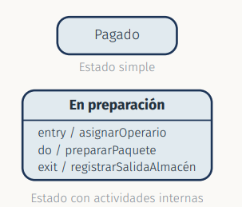

Carece de sentido su uso para otros objetos, simplemente portan la información

* Un **estado** es una situación en la que se cumple una **condición invariante**

* Se representa con un **rectángulo de esquinas redondeadas** y su **nombre**

* Un segundo compartimento puede recoger sus **actividades internas**: entry , do y exit

Un estado no es necesariamente una sitaución estática: mientras el objeto permanece en él puede **ejecutar comportamientos**

* UML 2.5.1 permite asociar a un estado tres comportamientos:
    * **entry**: Se ejecuta **al entrar** en el estado 
    * **do**: Comienza tras `entry` y se ejecuta **mientras el objeto permanece** en el estado. Termina cuando **se completa** o se **aborta** si el objeto sale del estado antes
    * **exit**: se ejecuta **al salir** del estado

* Se anotan en el comportamiento de comportamientos internos con el formato `etiqueta` / `expresión`

### Estados de actividades
| | Actividad de estado (`do`) | Diagrama de actividades | 
| -- | -- | -- |
| **Qué es** | Un comportamiento **asociado a un estado** | Un **diagrama** propio con nodos y flujos | 
| **Qué describe** | Una tarea ue el objeto realiza **mientras está en el estado** | Un **proceso** como flujo de acciones | 
| **Duración** | Acotada por el estado: se **aborta** si se abandona | Hasta que el flujo alcanza su nodo final | 

* **Estado Inicial**: Es el primer estado en que se encuentra el objeto justo después de su creación ( se representa con un punto negro )

* **Estado final**: Corresponde a una etapa en la que el objeto ya no resulta necesario en el sistema y se destruye
    * No todos los objetos tienen estado final
    * Se representa con un punto negro rodeado de una circunferencia

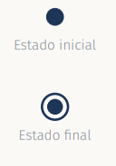
### Transición

* **Transición** entre dos estados: Línea continua con una flecha en un extremo que une ambos estados

* Si es **condiciuonal**, se **etqiueta** con el evento que determina su ejecución; si es **automática**, no necesita etiqueta

* **Transición reflexiva**: Aquella cuyo estado origen y destino **coinciden**

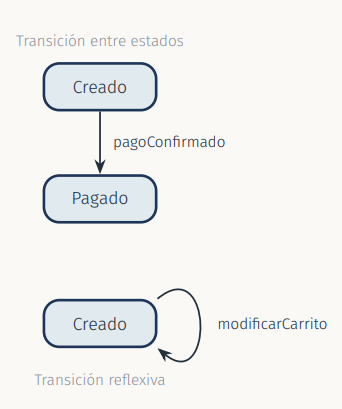

### Condiciones de Control
* Se utilizan para asociar **condiciones de ejecución a una transición**

* **Para recorrer la transición**, además de recibir el evento asociado si existe es preciso que la **condición se cumpla**

* Las condiciones de control se escriben **entre corchetes**

* Si aparece el nombre del **evento**, se escriben **a la derecha** de este

* Sintaxis completa de una transición: **evento [guarda] / efecto**

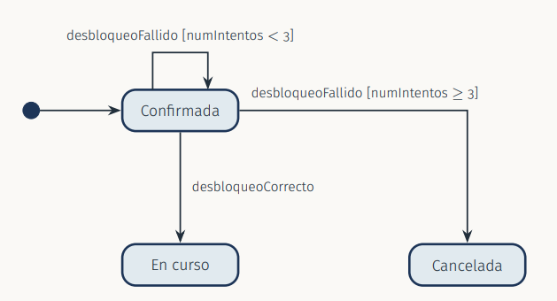

### Estados compuestos
* En UML 2.5.1 un estado puede ser:
    * **Simple**: no contiene vértices ni transiciones internos
    * **Compuesto**: Contiene al menos una **región** y cada región tiene sus propios estados y transiciones; es una **máquina de estados anidada**

* Los estados que contiene una región se denomian **subestados** del estado compuesto

* Con una sola región, la **descomposición** es secuencial; con varias regiones (estado **ortogonal**) hay un subestado activo **en cada región** a la vez

* **Utilidad**: Refinar un estado sin saturar el diagrama y **agrupar** las transiciones comunes a varios subestados

* Se representa como un estado con un **comportamiento de descomposición** que contiene el diagrama anidado, con sus subestados, su estado inicial y sus transiciones

* **entrada por defecto**: Una transición que termina en el **borde** del estado compuesto ejecuta su `entry` y continua desde el **estado inicial** de la región

* **Entrada explícita**: Si la transición termina directamente en un subestado, ese subestado pasa a estar activo

* Mientras el estado compuesto está activo, **también lo está uno de sus subestados**: la **configuración de estados activa** incluye ambos

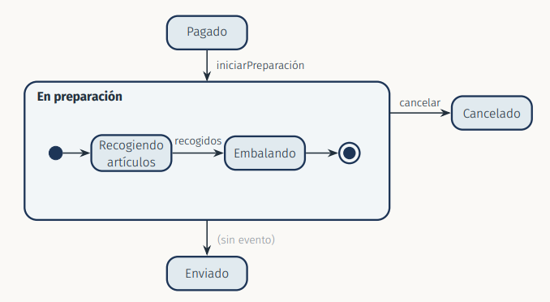

* **Transición de grupo**: Una transición cuyo orien es el **borde** del estado compuesto se aplica a **todos sus subestados**. Al dispararse, se **abandonan todos los subestados** y se ejecutan los `exit` desde el subestado más interno hacia fuera

* **Transición de finalización** (sin evento): sólo se dispara cuando la región **alcanza su estado final** y se complementan las actividades internas del estado compuesto

> El estado final interno es opcional

### Regiones Ortogonales
Algunos objetos tienen **varias dimensiones de estado independientes**. 

     Un vehículo en uso se desplaza y a la vez tiene un nivel de batería 

* Cada dimensión evoluciona **por su cuenta**.

* UML recoge esta situación con las **regiones ortogonales**

    * **Región**: Parte de un estado compuesto que contiene sus **propios subestados y transiciones** con su propio estado inicial y final

    * **Regiones ortogonales**: Dos o más regiones de **un mismo estado compuesto** . Se activan **a la vez** cuando se entrea en él

    * En cada instante hay **un subestado activo en cada región**; la configuración activa del objeto es la **combinación** de todos ellos

    * **Ortogonal** significa **independiente**. Un estado con varias regiones se denomina **estado ortogonal**

    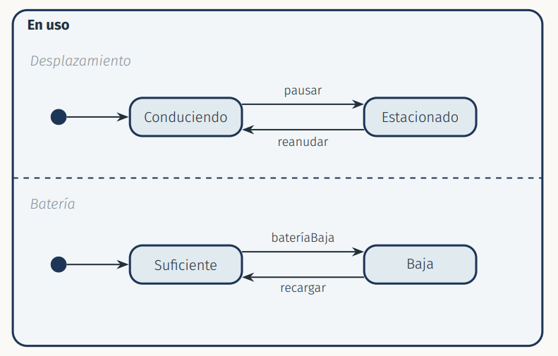
    
    `pausar` solo afecta a la región *Desplazamiento*

    `batería baja` solo afecta a la región Batería

    Al dispararse `finalizarTrayecto` desde el borde de **En uso**, se abandonan **las dos regiones** y después se ejecuta el `exit`

* **Sin regiones**: habría que dibujar un estado por **cada combinación** de subestados , con las transiciones **duplicadas**

* **Con regiones**: Se dibujan los subestados de cada dimensión por separado: `n+m` estados en lugar de `n x m`

* **Cuándo**: Solo si las dimensiones son **realmente independientes**. Es mejor un único estado o **clases distintas**

* Las regiones pertenecen al **mismo objeto**: no son objetos diferentes

* **Entrada por defecto**: Si la transición termina en el **Borde** del estado,**todas** las regiones empiezan por su estado inicial

* **Entrada explícita**: Si termina en un subestado de una región esa región entra por ahí y las demás por defecto salvo que se entren también explicitamente

* **Salida**: Se abandonan **todas** las regiones y después se ejecuta el `exit`

* **Finalización**: La transición sin evento solo se dispara cuando **todas** las regions han alcanzado su estado final

### Seudoestados
Un **estado** tiene duración: el objeto **permanece** en él esperando eventos

Un **seudoestado** (Pseudostate) es un vértice **transitorio**: El objeto **no se detiene** en él. Sirve para **encadenar transiciones** en una **transición compuesta**

* Se utilizan para dos fines: **decidir** entre caminos alternativos y **controlar la concurrencia** entre regiones ortogonales

* El estado inicial ya visto es un seudoestado. El **estado final no**: es un estado (FinalState) que indica que la región ha terminado

| Seudoestado | Símbolo | Para qué sirve | 
| -- | -- | -- | 
| `choice` | Rombo | Decisión: elige un camino evaluando las guardas **al llegar** | 
| `junction` | Círculo pequeño relleno | Unir varias transiciones en una, o dividir una en varias con guardas |
| `fork` | Barra gruesa, 1 entrada y >= 2 salidas | Activdar a la vez subestados de **varias regiones** | 
| `join` | Barra gruesa , >= 2 entradas y 1 salida | Esperar a que **todas las regiones** lleguen | 

### Decisión

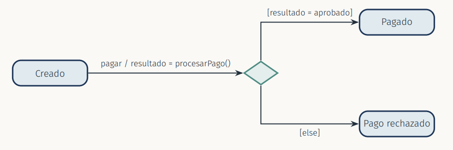

* Es **una única transición compuesta**

* Las guardas se evalúan **al llegar al rombo, después** de ejecutar procesarPago()

* Convierte una salida `[else]`: sin ella , el modelo puede quedar mal formado

* El **junction une** las dos transiciones `cancelar` en un tramo común donde se escribe **una sola vez** el efecto reponerStock()

* También puede **dividir** una transición en varias guardas distintas. A diferencia de `choice`, las guardas se evalúan **antes** de iniciar la transición compuesta

### Concurrencia
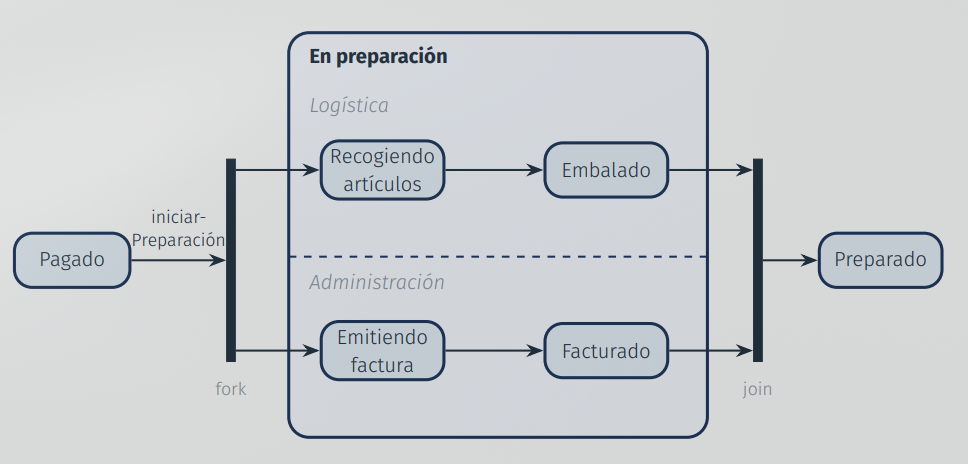

* **fork()**: Una transición iniciarPreparación se **divide** y la lleva al pedido , **a la vez** a un subestado de cada región

* Cada región avanza **a su ritmo**

* **join**: el pedido sólo pasa a **Preparado** cuando **las dos regiones** han llegado a embalado y a Facturado; La primera en llegar **espera** a la otra

* Las transiciones que salen de un `fork` y las que entran en un `join` **no llevan evento ni guarda**

* Otra opción: un estado final en cada región y una transición **sin evento** desde el borde

### La máquina de estados y el sistema completo

* En UML, una máquina de estados es un **comportamiento** cuyo **contexto** es un **clasificador** y describe cómo cambian de estados sus instancias

* Por tanto, **es posible** modelar los estados del **sistema completo** siempre que se trate como un clasificador

* Pero que sea posible **no implica que sea pertinente**
    > ¿ Tiene el sistema, como un todo estados con duración que cambien su respuesta ante los mismos eventos?

    Si la respuesta es sí > máquina de estados. no > objetos

* Sustenas **reactivos, embebidos o de control, y protocolos**: Su comportamiento global depende del **modo de operación**

### Errores típicos en máquinas de estados

* **Nombrar estados con acciones**. Un estado es una **situación con duración** la acción va en la transición o en do

* **Modelar el proceso** de un caso de uso en lugar del **ciclo de vida** de un objeto

* **Mezclar varios objetos** en un mismo diagrama -> Diagrama por clase

* **Un estado por cada valor de un atributo**: Provoca explosión de estados. Solo son estados los valores que **cambian el comportamiento**. 

* **Regiones para dimensiones dependientes**: Las regiones ortogonales son para dimensiones **independientes**

* **Transición sin evento** donde si hacia falta -> se interpreta como finalización

* **Guardas solapadas o incompletas** para u nmismo evento en un choice (forzar salida con `[else]`)

* **Estados inalcanzables o sin salida; sin estado inicial** o con varios

* **Transición de grupo mal dibujada**: si parte de un subestado afecta solo a el ; debe partir del borde

* **fork / join con evento o guarda** con un numero de lineas incorrectos

* Confundir las **actividades internas** con las acciones del diagrama de actividades

## Diagrama de Actividades
### Propiedades

* Es un **diagrama decomportamiento** con **metamodelo propio** (Activity), **independiente** del de las máquinas de estado

* Su semántica se basa en el **flujo de tokens** sobre una red de **nodos** (ActivityNode) y **aristas** (ActivityEdge)

* Una **actividad** está formada por una **serie de acciones**

* Una **acción** consiste en:
    * Asignar un valor a un atributo
    * Crear o destruir un objeto
    * Invocar una operación
    * Enviar o recibir una señal

* Las transiciones entre acciones se denomian **encadenamientos**; en UML 2.5.1 son **flujos de control** (ControlFlow)

* Permite reflejar **alternativas** a través de las **condiciones de control** (guardas) de los nodos de decisión

 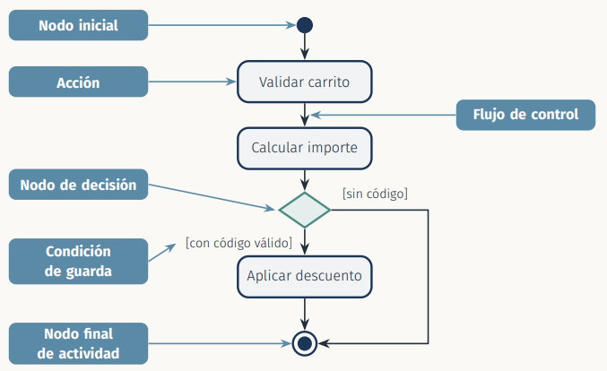

* Se **utiliza** para:
    * **Modelar una tarea**
    * **Describir** una funcion del sistema representada por **un caso de uso**
    * **Describir** la **lógica** de una **operación**
    * **Modelar** las **actividades** que componen el ciclo de vida en el **Proceso Unificado**

### Encadenamiento de acciones
* Un encadenamiento es un **vínculo orientado entre dos nodos** dse la actividad; en UML 2.5.1 es un **flujo de control**

* Para recorrerse cuando concluye el nodo origen, lo que conduce a la activación del nodo destino

* Los **nodos de control** gobiernan el avance del flujo: **nodo inicial, nodo final de actividad, decisión, fusión, horquilla** (bifurcación) y **sincronización** (unión)

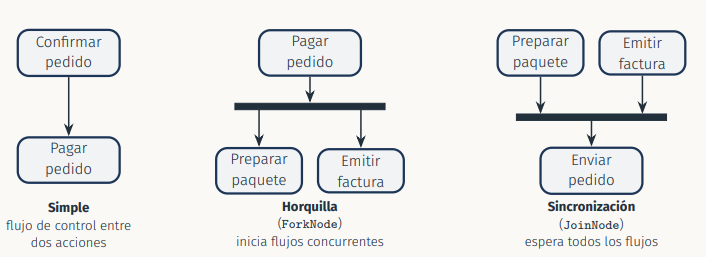

### Terminología

| Término Didáctico | UML 2.5.1 | 
| -- | -- | 
| Actividad Inicial | InitialNode | 
| Acción | Action | 
| Encadenamiento | ControlFlow (arista) | 
| Nodo de decisión / fusión | DecisionNode / MergeNode |
| Horquilla / sincronización | ForkNode / JoinNode | 
| Actividad final | ActivityFinalNode | 
| Condición de control | Guarda (guard) | 
| Calle o carril (swimlane) | ActivityPartition | 

### Particiones de Actividad
* También conocidas como **swimlanes** (ActivityPartition en UML 2.5.1)

* Puede representar las **acciones** realizadas por **varios objetos** con sus encadenamientos

* El diagrama se divide en **calles o carriles**

* A **cada calle** lle corresponde el **objeto responsable** de realizar todas las **acciones contenidas** en ella

* Un **encadenamiento** puede cortar la línea de serparación de dos calles para **mostrar un cambio de responsable** entre la acción inicial y la final

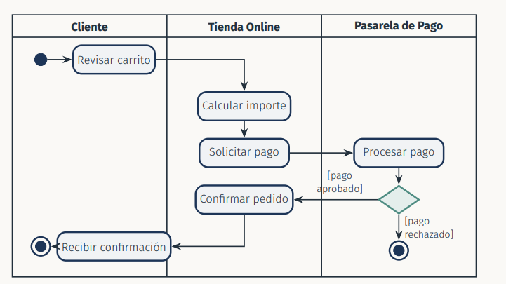

## Guia para dibujar diagramas de actividades

### Paso 1
* Identificar el **caso de uso** u operación a representar 

* Comenzar identificando las principales **acciones asociadas**

* Representar las acciones de forma ordenada mediante los **flujos de control**

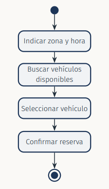

### Paso 2
* Identificar los **flujos alternativos y las condiciones** en ellos:
    * A veces no hay vehiculos disponibles , otras si
    * A veces el usuario contrata un seguro, otras no

* Añadir **nodos de decisión, flujos y condiciones de control**; Si los caminos vuelven a juntarse, hacerlo con un **nodo de fusión**

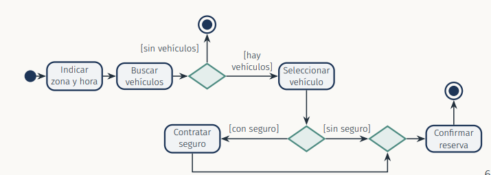

### Paso 3
* ¿ Son todas las acciones llevadas a cabo por la misma persona, organización o sistema?

* Si no es así -> **calles o carriles** (swimlanes)

* Decidir el nombre de cada calle

* Mostrar cada acción en la calle apropiada

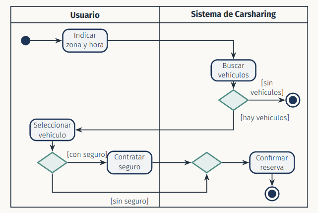

### Errores típicos en diagramas de Actividades
* **Estados en lugar de acciones** ("Reservado"), hay que usar **verbos** -> ("Reservar artículos")

* **Modelar el ciclo de vida** de un objeto con este diagrama

* **Mezclar niveles de abstracción**: "Pulsar botón" junto "Gestionar pedido"

* **Tratarlo como un diagrama de flujo secuencial** ignorando la concurrencia

* **Calles sin responsable real** o acciones que no pertenecen a ninguna calle

* Esperar un **evento externo** dentro de una acción

* **Confundir decisión y fusión**: la decisión **elige** un camino; la fusión **reune** caminos alternativos

* **Fusión donde hacía falta una unión**: La acción posterior se ejecuta **una vez por cada rama**. **Unión donde hacía falta una fusión**

* **Un final de actividad por cada rama** de un `fork`: el **primero** que se alcanza **termina toda la actividad**. Para acabar sólo una rama, se usa el **final de flujo**

* **Guardas solapadas o incompletas** en una decisión, falta guarda `[else]`

* **Sin nodo inicial**, acciones sin salida o **bulces** que no se cierran con una fusión

### Máquina de estados frente a diagrama de actividades
|  |  Máquina de estados | Diagrama de actividades | 
| -- | -- | -- |
| **Perspectiva** | Ciclo de vida de **los obhjetos de una clase** | Flujo de un **proceso, caso de uso u operación** | 
| **Elemento central** | Estado | Acción | 
| **Qué hace avanzar** | Un **evento** recibido por el objeto | La **finalización** de la acción anterior | 
| **Concurrencia** | Regiones ortogonales | Horquilla y sincronización | 
| **Responsables** | El propio objeto | Particiones (calles) | 
| **Metamodelo** | StateMachine | Activity | 
