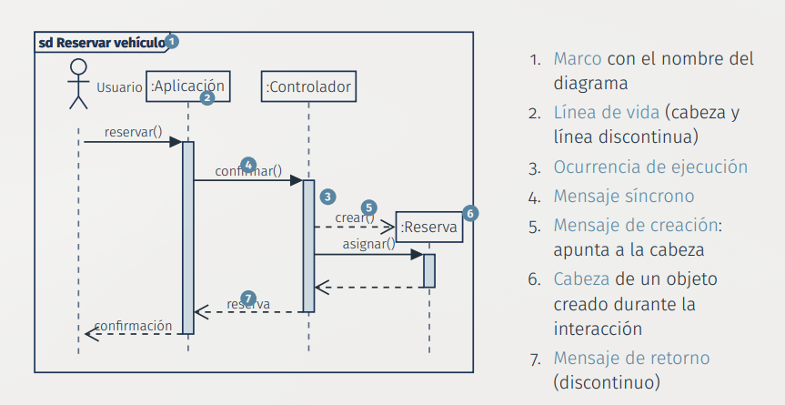
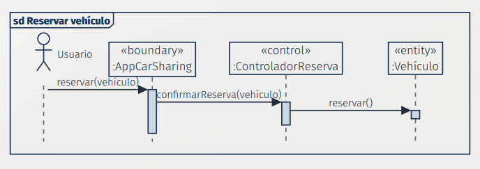
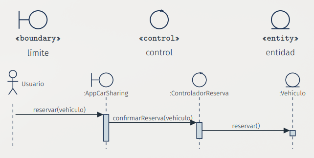
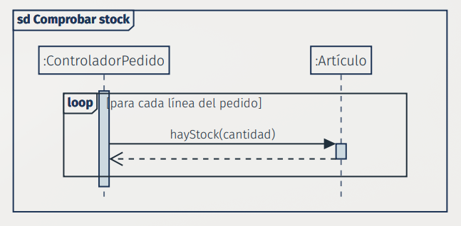
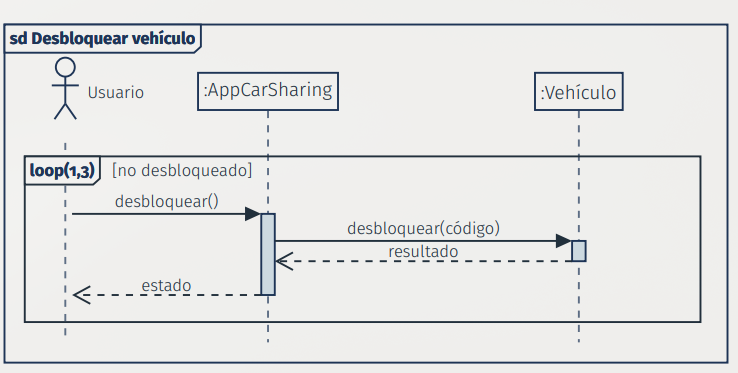
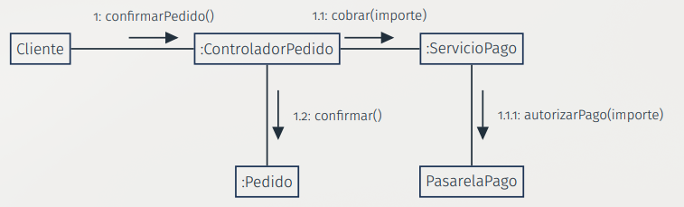
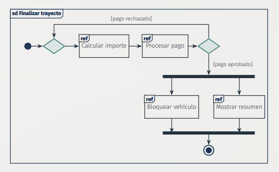
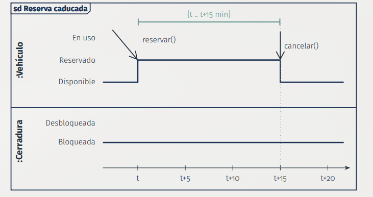
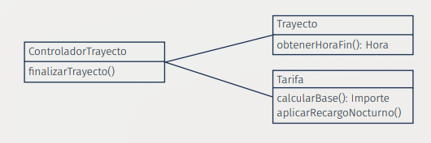

# Tema 6. Modelado de la Dinámica

## 1. Introducción y Conceptos Fundamentales
Los diagramas de interacción sirven para representar **cómo colaboran varios objetos para llevar a cabo un caso de uso** (indicando quién envía qué mensaje a quién y en qué orden)

* **Colaboración**: Grupo de objetos o clases que trabajan conjuntamente para proporcionar una funcionalidad o comportamiento

* **Interacción**: Paso de mensajes entre líneas de vida (objetos o actores) en el contexto de una colaboración para lograr un comportamiento específico

* **Objetivo de modelar la interacción**: Permite asignar operaciones a las clases (cada mensaje recibido equivale a una operación del receptor), detectar objetos o mensajes omitidos y asegurar la consistencia con el diagrama de clases

**Existen cuatro variantes de diagramas de interacción en UML 2.5.1:**

| Diagrama | Se centra en | 
| -- | -- | 
| **De secuencia** | El **orden temporal** de los mensajes entre líneas de vida | 
| **De comunicación** | Los **vínculos** entre los objetos; el orden se indica con números | 
| **General de interacción** | El **flujo de control** entre interacciones (visión de conjunto) | 
| **De tiempos** | Los **cambios de estado** a lo largo de un eje de tiempo lineal y las restricciones temporales | 

## 2. Diagramas de Secuencia
Es el diagrama más utilizado debido a su capacidad para describir protocolos entre componentes de forma intuitiva (el tiempo avanza hacia abajo)

### Elementos Básicos y Representación
* **Dimensión vertical**: Representa el avance del tiempo (hacia abajo)

* **Línea de vida**: Formada por una cabeza (rectángulo con la identificación `nombre [selector] : Tipo`) y una línea vertical discontinua

* **Ocurrencia de ejecución (activación)**: Rectángulo estrecho sobre la línea de vida que indica el periodo en el que se ejecuta una operación

* **Marco (`sd`)**: Contenedor global etiquetado con `sd NombreDelDiagrama`




### Tipos de Mensajes

* **Síncrono (flecha con punta rellena $\rightarrow$)**: El emisor se bloquea y espera a que el receptor termine la ejecución

* **Asíncrono (flecha con punta abierta $\rightarrow$)**: El emisor continúa trabajando en paralelo sin esperar

* **De retorno (línea discontinua $-\!-\!>$)**: Devuelve el control y/o un valor al originador 

* **De creación (línea discontinua $-\!-\!>$ hacia la cabeza del objeto)**: Crea e instancia una nueva línea de vida

* **De destrucción (cruz $\mathbf{X}$ al final de la línea)**: Destruye el objeto y finaliza su línea de vida

* **Reflexivo**: Un objeto se envía un mensaje a sí mismo, dibujando una activación anidada

### Convención de Análisis (Jacobson / RUP)
Asigna roles a las clases representadas mediante estereotipos o iconos:

* `«boundary»` (**Límite**): Interfaz o punto de contacto entre el actor y el sistema

* `«control»` (**Control**): Coordinador de la lógica del caso de uso

* `«entity»` (**Entidad**): Información o datos persistentes del dominio




### Fragmentos Combinados
Permiten estructurar la lógica compleja envolviendo líneas de vida en cajas etiquetadas:   

* **Operadores de Elección y Repetición:**

| Operador | Significado | Ejemplo | 
| -- | -- | -- | 
| `alt` | **Alternativas**: se elige como mucho un operando, con guarda verdadera. [else] niega las demás | Pago aprobado o rechazado | 
| `opt` | **Opcional**: el operando ocurre o no ocurre nada. Equivale a un alt con un operando vacío | Tarifa nocturna | 
| `break` | **Escape**: si la guarda es verdadera, se ejecuta el operando en lugar del resto del fragmento envolvente | Vehículo no disponible: error y fin | 
| `loop` | **Repetición**: el operando se repite entre mín y máx veces mientras la guarda lo permita | Comprobar el stock de cada línea | 


* **Operadores de Orden**: 

| Operador | Significado | Ejemplo |
|---|---|---|
| `par` | Paralelo: las ocurrencias de los operandos se intercalan de cualquier modo, respetando el orden de cada operando. | Enviar el recibo y actualizar la disponibilidad. |
| `seq` | Secuenciación débil: se mantiene el orden dentro de cada línea de vida; entre líneas de vida distintas no se impone orden. | Combinación por defecto de operandos. |
| `strict` | Secuenciación estricta: los operandos se ejecutan en el orden vertical en que aparecen. | Pasos de un protocolo de desbloqueo. |
| `critical` | Región crítica: el fragmento es atómico; ninguna otra ocurrencia se intercala en él. | Actualizar la disponibilidad al reservar. |


* **Operadores de Validez y Filtrado**: 

| Operador | Significado | Ejemplo |
|---|---|---|
| `neg` | Negativo: el operando describe trazas inválidas; los demás fragmentos describen trazas válidas. | Desbloquear con la reserva caducada. |
| `assert` | Aserción: las secuencias del operando son las únicas continuaciones válidas; cualquier otra es inválida. | Tras un código correcto, `abrir()`. |
| `ignore` | Ignorar: los mensajes indicados se consideran irrelevantes y pueden aparecer en cualquier punto. | `ignore {consultarEstado}` |
| `consider` | Considerar: solo los mensajes indicados son significativos; equivale a ignorar todos los demás. | `consider {desbloquear, abrir}` |

El operando se **repite**; la guarda es la condición de continuidad y el
pentágono puede incluir los límites de iteraciones.



| Sintaxis | Iteraciones | 
| -- | -- | 
| `loop` | Mínimo 0, **sin cota superior** | 
| `loop(4)` | Exactamente 4 (mínimo = máximo = 4)
| `loop(1,3)` | Al menos 1 y como máximo 3 | 
| `loop(1,*)` | Al menos 1, sin cota superior (* = ilimitado) | 


* Tras ejecutar el **mínimo**, el bucle termina cuando la guarda es falsa o
se alcanza el máximo

* Si hay una condición de control explícita, el bucle **sólo continúa**
mientras sea verdadera, incluso antes del mínimo

### Guía para elaborar diagramas de secuencia
**1.** Decidir a qué nivel se modela la interacción (análisis o diseño)
**2.** Identificar los principales elementos implicados: actor, objetos límite,
de control y de dominio
**3.** Considerar los escenarios alternativos que puedan ser necesarios
**4.** Identificar las interacciones ya modeladas, o que lo vayan a ser, para
incluirlas con ref
**5.** Dibujar el esquema de la estructura del diagrama
**6.** Añadir la interacción detallada
**7.** Comprobar la consistencia con los diagramas de secuencia vinculados
y modificarlos si es necesario
**8.** Comprobar la consistencia con otros diagramas o modelos UML (casos
de uso, máquinas de estados, clases)

## 3. Diagramas de Comunicación
* Muestran los **vínculos** entre los objetos que participan en la colaboración y los mensajes que se envian entre ellos

* **No ienen dimensión de tiempo**: La secuencia se indica con **númneros de secuencia** anidados para reflejar el anidamiento del control

* Equivalen a **diagramas de secuencia sencillos**, sin mecanismos de estructuración como los gragmentos combinados o las referencias

| Expresión | Significado | 
| -- | -- | 
| **1:, 2:** | Orden de los mensajes en el **mismo nivel** | 
| **1.1:, 1.1.1:** | Mensajes **anidados**: 1.1 ocurre dentro de la activación 1 | 
| **1a:, 1b:** | Mensajes **concurrentes** dentro de la misma activación | 
| **[i := 1..n]:** | **Iteración:** el mensaje se repite | 
| **[guarda]:** | **Ramificación**: el mensaje sólo se envía si la guarda es verdadera | 

Cada mensaje se acompaña de una **pequeña flecha** que indica su
dirección a lo largo del vínculo



### Diagramas de secuencia frente a diagramas de comunicación

| | **Secuencia (DS)** |  **Comunicación (DC)** | 
| -- | -- | -- |
| **Orden** | Posición **vertical**, con el tiempo explícito | **Números** de secuencia | 
| **Se ve mejor** | La **duración** de cada activación | Los **vínculos** entre objetos | 
| **Complejidad** | Admite fragmentos y referencias: sirve para interacciones **complejas** | No admite estas estructuras | 
| **Lectura** | Clara aunque haya muchos mensajes entre dos objetos | Se complica con muchos mensajes entre dos objetos | 
| **Uso típico** | **Diseño** detallado | **Análisis**, cuando los mensajes aún no están especificados | 


## 4. Diagramas Generales de Interacción

Ofrecen una **visión de conjunto del flujo de control** que orquesta y conecta múltiples unidades de interacción

**Comparten notación con los diagramas de actividades**

| | General de interacción | De actividades | 
| -- | -- | -- |
| **Nodos** | **Interacciones** o referencias a interacciones | **Acciones**, objetos y otros nodos | 
| **Describe** | Cómo se **encadenan** interacciones | El flujo de un **proceso** | 
| **Ramificación** | Debe estar **anidada** | Puede ser más libre | 




## 5. Diagramas de Tiempos
Se aplican cuando la prioridad del modelado es **analizar el comportamiento dependiente del tiempo lineal**, restricciones de duración o plazos de caducidad

### Propiedades Principales

* **Eje temporal explícito**: Las líneas de vida se disponen verticalmente con sus posibles estados, y el tiempo avanza horizontalmente de izquierda a derecha.

* **Restricciones de tiempo:** Permite acotar explícitamente duraciones máximas o mínimas (por ejemplo: {t .. t+15 min})

* **Soporte en UML**: Es una variante menos extendida y su implementación no es obligatoria para herramientas que afirman ser conformes a UML 2.5.1



## 6. Consistencia del Modelo
Asegura la **coherencia técnica entre el modelado dinámico (interacciones) y el modelado estático y funcional** (diagramas de clases y de estados)



### 1. Interacciones vs. Diagrama de Clases

* **Firma de operaciones**: Cada mensaje que un objeto recibe en una interacción debe **estar implementado como una operación explícita** dentro de su clase en el diagrama de clases

* **Vínculos y visibilidad**: Para que un objeto remitente pueda enviar un mensaje a un destinatario, debe existir un mecanismo de visibilidad entre ellos:  
    * Que exista una asociación directa entre sus clases
    * Que exista una ruta de asociaciones a través de otros objetos intermedios
    * Que la referencia del receptor sea recibida como argumento/parámetro en un mensaje previo
    * Que el objeto emisor haya creado explícitamente al receptor durante esa interacción

> Inconsistencia: Si en un diagrama de secuencia se envía un mensaje entre dos objetos que no poseen un vínculo de visibilidad ni una operación definida en el diagrama de clases, existe un error de modelado que debe ser corregido.

### 2. Tríada de Consistencia (Interacción, Clase y Estado)
Existe una equivalencia directa entre estos tres modelos de UML:   

1. El **Diagrama de Interacción** especifica quién envía el mensaje y cuándo ocurre

2. El **Diagrama de Clases** declara la operación disponible en el receptor

3. La **Máquina de Estados** del receptor define el evento detonante y el cambio de estado resultante en la vida de ese objeto   

## 7. Documentación como Código
Consiste en **definir los diagramas en formato de texto plano** que luego es procesado por motores de renderizado

### Comparativa de Notación Textual: PlantUML vs. Mermaid
Ambas herramientas permiten versionar el diseño dinámico en los mismos repositorios de código:   

```java
' ===== EJEMPLO EN PLANTUML =====
@startuml
actor Cliente
participant ControladorPedido as C
participant ServicioPago as S

Cliente -> C: confirmarPedido()
activate C
C -> S: cobrar(importe)
alt pago aprobado
    C --> Cliente: pedido confirmado
else pago rechazado
    C --> Cliente: pago rechazado
end
deactivate C
@enduml
```


```java
%% ===== EJEMPLO EN MERMAID =====
sequenceDiagram
    actor Cliente
    participant C as ControladorPedido
    participant S as ServicioPago

    Cliente->>C: confirmarPedido()
    C->>S: cobrar(importe)
    alt pago aprobado
        C-->>Cliente: pedido confirmado
    else pago rechazado
        C-->>Cliente: pago rechazado
    end
```

### Ventajas y Precauciones
* **Ventajas del enfoque Docs-as-Code:**

    * **Versionado**: Los diagramas se almacenan en Git junto al código fuente y se revisan mediante Pull Requests

    * **Automatización:** Se pueden incluir en canalizaciones de integración continua (CI/CD) para regenerar la documentación de las APIs automáticamente

    * **Mantenibilidad**: Reduce drásticamente el desfase entre el código y la documentación técnica

* **Precaución técnica:** Herramientas como PlantUML o Mermaid utilizan sintaxis muy cercanas a UML pero **no siempre respetan la notación estricta del estándar OMG UML 2.5.1**


## 8. Cuadro de Síntesis: Criterios de Selección del Diagrama
| Diagrama de Interacción | Criterio de Selección | Ejemplo de Caso de Uso | 
| -- | -- | -- | 
| **Secuencia (DS)** | Cuando el **orden temporal** de los mensajes y el detalle lógico (fragmentos, bucles, excepciones) son prioritarios | *Reservar vehículo, Confirmar pedido, Procesar pago.* | 
| **Comunicación (DC)** | Cuando se requiere enfatizar la **estructura de red y los vínculos fijos** entre clases colaboradoras | Análisis de colaboraciones preliminares en fase de análisis. | 
| **General de Interacción** | Cuando se necesita una **visión global y de alto nivel** del flujo entre múltiples sub-interacciones | Orquestación completa del proceso *Finalizar trayecto* | 
| **Tiempos** | Cuando el análisis depende de **plazos de caducidad, restricciones de tiempo o transiciones explícitas** | Límite de 15 minutos en la caducidad de una reserva no desbloqueada | 

