# Tema 7. Modelado de los Objetos

## 1. Introducción: de la dinámica de los objetos a su estructura
Continuamos con los sistemas de **Car Sharing** y **Tienda Online**:

* **Tema 5**: ¿cómo cambia de estado un Vehículo, una Reserva o un Pedido?
* **Tema 6**: ¿quién envía qué mensaje a quién? Cada mensaje recibido es un método de la clase receptora
* **Tema 7**: ¿qué clases hay, qué atributos y métodos tiene cada una y cómo se relacionan? Es la **visión estructural**

| Sistema | Clases que aparecerán en este tema |
| -- | -- |
| **Car Sharing** | Usuario, Vehículo (eléctrico o de combustión), Reserva, Trayecto, Zona |
| **Tienda Online** | Cliente, Pedido, LíneaPedido, Producto, Carrito, Categoría |

**Objetivos del tema:**

* Conocer los conceptos de **objeto, abstracción, clase de objetos y encapsulación**
* Conocer y diferenciar **herencia** (especialización y generalización), **polimorfismo** y **relaciones todo-parte**
* Saber diferenciar entre **agregación y composición**
* Diferenciar **clase abstracta** y **clase concreta**
* Conocer el **estereotipo** y cómo se extiende UML mediante **perfiles**
* Conocer los distintos **tipos de asociaciones** entre clases
* Conocer las peculiaridades de UML 2 para representar **objetos, clases y sus relaciones**

## 2. Representación del objeto

### El objeto
* Un objeto es una **entidad identificable del mundo real**. Puede tener una **existencia física** (un vehículo, un producto) o **no** (una reserva, un pedido). *Identificable* significa que el objeto **se puede designar**

* En UML todo objeto posee **atributos** (estructura) y **métodos** (comportamiento). Un **método** es lo que el objeto **sabe hacer**: se **declara en la clase** y se **implementa en el código**

* Incluso los objetos estáticos son percibidos en UML como **dinámicos**. Así, un producto del catálogo, aparentemente pasivo, es un objeto capaz de descontar existencias (`reducirStock()`)

* Todo sistema en UML está compuesto por **objetos que interactúan entre sí** (Tema 6)

### La abstracción
* La **abstracción** es un principio muy importante en modelado: consiste en tener en cuenta **únicamente las propiedades pertinentes** de un objeto **para un problema concreto**

* Los objetos utilizados en UML son **abstracciones del mundo real**

> **Ejemplo (Car Sharing):** De un vehículo real interesan muchas cosas: color, peso, número de bastidor, estado de la batería... Para gestionar reservas, el modelo se queda con la **matrícula**, el **modelo** y si está **disponible**. En un taller mecánico, el mismo vehículo se abstraería con otras propiedades (el historial de averías, por ejemplo)

### Clases de objetos
Se define como un **conjunto de objetos similares**, con la **misma estructura y comportamiento**, y constituidos por los **mismos atributos y métodos**

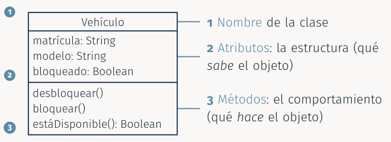

* **1. Nombre** de la clase
* **2. Atributos**: la estructura (qué *sabe* el objeto)
* **3. Métodos**: el comportamiento (qué *hace* el objeto)

### Instancia de clase
Cada objeto de una clase se denomina **instancia de clase** y se distingue por tener una **identidad propia** y un comportamiento **específico** a través de sus atributos

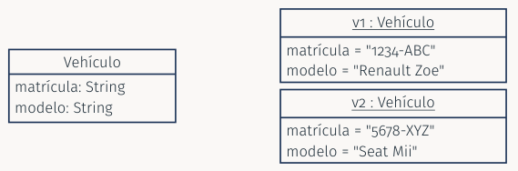

* La **clase** (izquierda) define **qué atributos existen**
* Cada **objeto** (derecha, nombre **subrayado**) guarda sus **propios valores**

### Encapsulación
* La **encapsulación** consiste en **ocultar los atributos y métodos** del objeto a otros objetos

* Algunos atributos y métodos tienen como único objeto **tratamientos internos** del objeto y **no deben estar expuestos** a otros objetos. Una vez encapsulados, pasan a denominarse atributos y métodos **privados** del objeto

* La encapsulación es una **abstracción**, ya que simplifica la representación del objeto con respecto al resto de objetos. Esa representación simplificada está formada por los **atributos y métodos públicos** del objeto

#### Visibilidad en UML
En notación UML los atributos y métodos van precedidos por un signo según su **visibilidad**:

| Visibilidad | Signo | Descripción |
| -- | -- | -- |
| **público** | `+` | Elemento no encapsulado, **visible para todos** |
| **protegido** | `#` | Elemento encapsulado, visible en la **clase y sus subclases** |
| **privado** | `−` | Elemento encapsulado, visible **sólo en la clase** |
| **paquete** (empaquetado) | `~` | Elemento encapsulado, visible **sólo en las clases del mismo paquete** |

> OMG, UML 2.5.1: §9.5.4 (p. 113); §7.4 (VisibilityKind). El signo de paquete es la tilde (`~`)

#### Ejemplo: la clase Vehículo

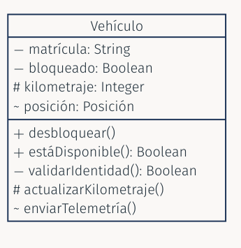

* Los atributos suelen ser **privados**: nadie fuera de la clase modifica `bloqueado` directamente
* Otra clase, como el `ControladorReserva` del Tema 6, sólo **ve** lo **público**: `desbloquear()` y `estáDisponible()`
* `validarIdentidad()` es un **detalle interno**: puede cambiar sin afectar a los demás
* `enviarTelemetría()` sólo la ven las clases de su **paquete** (por ejemplo, las de gestión de flota)

## 3. Relaciones con otros objetos

### Especialización y generalización
* Las clases pueden especificarse como **subconjuntos de otras clases** siempre que éstos constituyan conjuntos de objetos **similares**

* La **generalización** es la relación **inversa** a la especialización. Si una clase es una especialización de otra clase, ésta última es una generalización de la primera

* La clase especializada es una **subclase** de la generalizada, la cual a su vez es una **superclase** de la especializada

* **Prueba práctica**: la relación se lee **"es un"**. Un *VehículoEléctrico* es un Vehículo; en cambio, una Reserva **no** es un Vehículo, así que no hay generalización

> OMG, UML 2.5.1: §9.2.3.2 (p. 100)

**Ejemplo: la flota de Car Sharing**

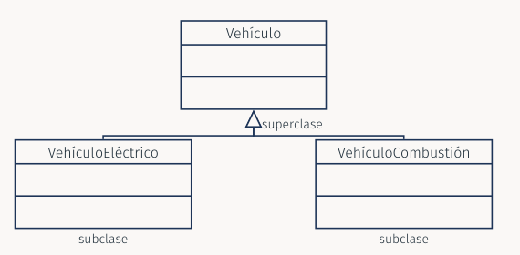

La **flecha con triángulo hueco** apunta de la **subclase** a la **superclase**

### Herencia
* La **herencia** es la propiedad que hace que una subclase se **beneficie de la estructura y comportamiento** de su superclase

* Las instancias de una subclase son también **instancias de la superclase**, por lo que también se benefician de la estructura y comportamiento definidos por la superclase

**Ejemplo: atributos y métodos heredados**

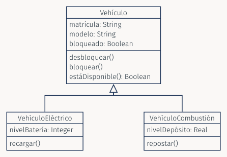

Un `VehículoEléctrico` **tiene**:

* **heredados**: `matrícula`, `modelo`, `bloqueado`
* **propio**: `nivelBatería`

Y **sabe**:

* **heredadas**: `desbloquear()`, `bloquear()`, `estáDisponible()`
* **propia**: `recargar()`

> Recuerda el Tema 5: el estado *Batería baja* sólo tiene sentido en los vehículos eléctricos

### Clases abstractas y concretas
| | Definición |
| -- | -- |
| **Clase abstracta** | Tiene subclases asociadas, y por tanto **no posee directamente instancias**, al pertenecer éstas a las subclases declaradas |
| **Clase concreta** | Sí permite **instancias** de esa clase y **no posee subclases** asociadas |

**Ejemplo: Vehículo es abstracta**

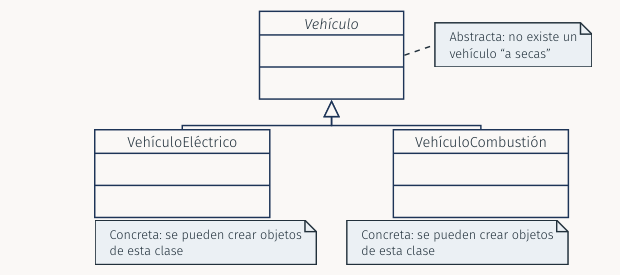

Cada vehículo real de la flota es un `VehículoEléctrico` o un `VehículoCombustión`: la clase `Vehículo` (**nombre en cursiva**) sólo recoge lo que tienen en común

### Polimorfismo
El **polimorfismo** significa que una clase (generalmente abstracta) representa un conjunto formado por **objetos diferentes**, ya que éstos son instancias de **subclases diferentes**. Cuando se llama a un método del mismo nombre, esto se traduce en **comportamientos diferentes**

> **Ejemplo (Car Sharing):** Al reservar, el `ControladorReserva` (Tema 6) quiere mostrar la autonomía de cada vehículo. Envía el **mismo mensaje**, `calcularAutonomía()`, y cada vehículo **responde a su manera**: el eléctrico según su batería y el de combustión según su depósito. El controlador **no necesita saber** de qué subclase es cada vehículo

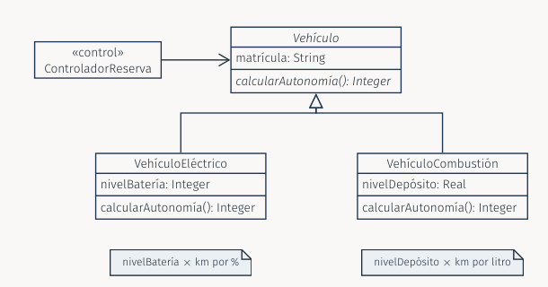

### Relaciones todo-parte: agregación y composición
Un objeto puede estar **formado por otros**. UML distingue dos relaciones todo-parte, cada una con **nombre y notación propios**. Se definen entre **clases**, pero los vínculos se establecen entre **instancias**:

| | **Agregación** | **Composición** |
| -- | -- | -- |
| **Símbolo** | Rombo **hueco** ◇ | Rombo **relleno** ◆ |
| **Vida de la parte** | **Independiente**: sobrevive si desaparece el todo | **Dependiente**: desaparece con el todo |
| **¿Compartida?** | Puede **compartirse** entre varios todos | **Exclusiva**: sólo un todo a la vez |

> OMG, UML 2.5.1: §9.5.3 (pp. 111–112); notación en §11.5.4 (p. 202)

#### Terminología
* En apuntes y manuales antiguos se habla de **composición débil** (la agregación) y **composición fuerte** (la composición), o se usa "composición" como término genérico

* En este curso usamos los dos términos coordinados del estándar y de las herramientas: **agregación** (*shared aggregation*) y **composición** (*composite aggregation*)

* El estándar describe la composición como una forma **fuerte** de agregación y deja **abierta** la semántica de la agregación ("varía según el área de aplicación y el modelador")

* **Regla de uso**: si la parte **no tiene sentido sin el todo** → composición; si tiene **vida propia** → agregación; y si dudas, una **asociación simple** basta

#### Ejemplo: Tienda Online

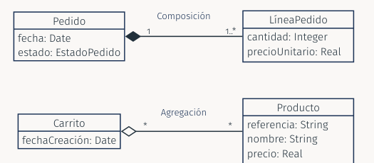

* **Composición**: una `LíneaPedido` pertenece a un **único** `Pedido`; si se elimina el pedido, **desaparecen** sus líneas
* **Agregación**: el `Producto` puede estar en **muchos** `Carrito`s y **no desaparece** al vaciar el carrito

#### Ejemplo: Car Sharing y cómo decidir

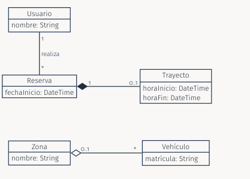

**Pregunta clave**: ¿qué ocurre con la **parte** si desaparece el **todo**?

* Sin `Reserva` no hay `Trayecto` → **composición**
* Si se cierra una `Zona`, los `Vehículo`s **siguen existiendo** y se reubican → **agregación**
* `Usuario`–`Reserva` (línea simple) **no es todo-parte**: **asociación simple**; un usuario puede hacer varias reservas

### La noción de estereotipo en UML
* El concepto de clase abstracta es un concepto **especializado** de clase. Un **estereotipo** es una **marca** (`«Nombre»`) que se añade a un elemento del modelo para darle un **significado más específico**

* En UML 2.5.1, que una clase sea abstracta es una **propiedad** de la clase (`isAbstract`), indicada de dos formas, ambas **estándar**:
    * **Implícita**: el nombre de la clase en **cursiva**
    * **Explícita**: la anotación **`{abstract}`** junto al nombre

* Muchos libros y herramientas usan además el estereotipo `«abstract»`. Es una notación muy extendida, pero **no está definida en UML 2.5.1**

> OMG, UML 2.5.1: §9.2.4.1 (p. 101)

**Tres formas de indicar una clase abstracta**

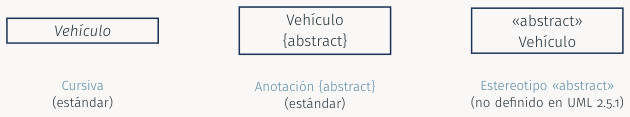

Los tres diagramas dicen lo mismo. En los trabajos de la asignatura, usad la **cursiva** o **`{abstract}`**. ¿Y si queremos definir estereotipos propios? Para eso existen los **perfiles**

### Perfiles de UML
**Estereotipos propios para cada dominio**

* UML es un lenguaje **general**, pero cada dominio o plataforma tiene su **propio vocabulario**: entidad persistente, servicio web, tarea de tiempo real...

* UML permite adaptarse a ese vocabulario **sin cambiar el lenguaje**, mediante los **perfiles** (*profiles*). Un perfil sirve para:
    * **usar la terminología** de una plataforma o dominio
    * **añadir información** (por ejemplo, el nombre de una tabla) y **restricciones**
    * **guiar la transformación** del modelo en código

* Un perfil **no crea un lenguaje nuevo** ni elimina reglas de UML: **sólo lo adapta**

> OMG, UML 2.5.1: §12.3.1 (p. 252)

#### Vocabulario

| Término | Qué es | Ejemplo |
| -- | -- | -- |
| **Metaclase** (*Metaclass*) | Elemento del metamodelo de UML que representa una **construcción del lenguaje** | `Class` representa a Vehículo, Reserva... |
| **Estereotipo** (*Stereotype*) | **Nuevo tipo de elemento**, definido a partir de una metaclase, con significado y propiedades propios | `«Persistente»` |
| **Propiedad del estereotipo** | Dato que lleva el elemento estereotipado (antes, *tagged value*) | `tabla = "reservas"` |
| **Extensión** (*Extension*) | **Vínculo** entre un estereotipo y la metaclase a la que se puede aplicar | `«Persistente» → Class` |
| **Perfil** (*Profile*) | **Paquete** que agrupa los estereotipos de un dominio y se aplica a un modelo | Perfil Persistencia |

> OMG, UML 2.5.1: §12.3.3 (pp. 253–262)

#### Una analogía con Java
Si ya conoces las **anotaciones de Java** (`@Override`, `@Entity`...), los perfiles te resultarán familiares:

| UML | Java |
| -- | -- |
| Perfil **Persistencia** | Biblioteca de anotaciones |
| Estereotipo **`«Persistente»`** | Anotación **`@Entity`** |
| Propiedad **`tabla`** | `@Table(name = "reservas")` |
| **Aplicarlo** a la clase `Reserva` | **Anotar** la clase `Reserva` |

En ambos casos, la marca **no cambia el lenguaje**: añade significado que una herramienta puede interpretar

#### Paso 1: definir el perfil Persistencia (Car Sharing)

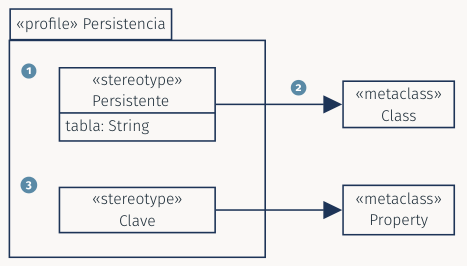

1. `«Persistente»` guarda en `tabla` el **nombre de la tabla** de la base de datos
2. La **flecha con triángulo relleno** es la **extensión**: el estereotipo se puede aplicar a cualquier `Class`
3. `«Clave»` extiende `Property`: marca el **atributo** que identifica a cada objeto

> OMG, UML 2.5.1: §12.3.4 (p. 262)

#### Paso 2: aplicar el perfil al modelo (Car Sharing)

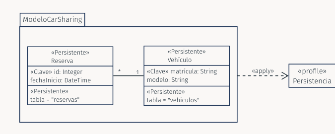

La flecha **`«apply»`** indica que el modelo **usa** el perfil. `Reserva` y `Vehículo` llevan los estereotipos y sus **valores** (`tabla`) en un **compartimento propio**

> OMG, UML 2.5.1: §12.3.4 (pp. 262–263)

#### ¿Para qué sirven en la práctica?
* Las herramientas de modelado permiten **definir y aplicar** perfiles, y pueden usarlos para **validar** el modelo o **generar** código o esquemas de base de datos

* Hay perfiles muy conocidos: **SysML** (ingeniería de sistemas) y **MARTE** (tiempo real) son perfiles de UML. El estándar menciona también perfiles para plataformas como **EJB** o **.NET**

* Ya hemos usado estereotipos: `«boundary»`, `«control»` y `«entity»` (Tema 6) son una **convención de análisis** muy extendida, **no** elementos básicos de UML

* **Cuidado**: un estereotipo debe **aportar significado**, no decoración. Si lo defines, **documéntalo**

> OMG, UML 2.5.1: cap. 22 (Standard Profiles), Tabla 22.1

## 4. UML: representación de asociaciones entre clases

### Asociación binaria entre clases
* El **nombre** de la asociación se indica **encima de la línea**. Para indicar el **sentido de lectura** del nombre puede añadirse un **triángulo relleno** (▶) junto al nombre

* Los extremos de la asociación también pueden recibir un **nombre representativo de la función** (el **rol**) que desempeñan en la asociación las instancias de la clase correspondiente

* Dicha función se representaría como un **atributo** de la clase situada al **otro extremo** de la asociación, y cuyo **tipo** sería la clase situada en el mismo extremo donde aparece la función

> OMG, UML 2.5.1: §11.5.4 (pp. 201–203)

**Notación**

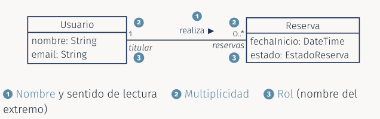

1. **Nombre** y **sentido** de lectura
2. **Multiplicidad**
3. **Rol** (nombre del extremo)

Se lee: *"un Usuario realiza cero o varias Reservas"*. El rol `reservas` equivale a un atributo de `Usuario` de tipo `Reserva`; el rol `titular`, a un atributo de `Reserva` de tipo `Usuario`

**Ejemplos de Car Sharing**

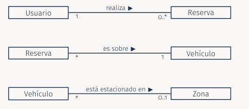

* Un usuario realiza **cero o varias** reservas, y cada reserva es de un **único** usuario
* Cada reserva es sobre un **único** vehículo, y un vehículo puede tener **muchas** reservas a lo largo del tiempo
* Un vehículo está estacionado en **una** zona o, si está en ruta, en **ninguna**

### Asociación n-aria entre clases
La representación gráfica de una asociación **ternaria y superiores** consiste en un **rombo** que une las diferentes clases. El **nombre** de la asociación se escribe **junto al rombo**

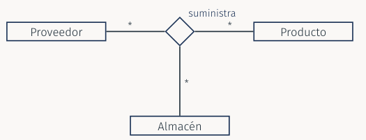

**Ejemplo: Tienda Online**

Cada **vínculo** (instancia de la asociación) une **tres objetos a la vez**: un proveedor suministra un producto a un almacén

| Proveedor | Producto | Almacén |
| -- | -- | -- |
| Logística Sur | Teclado USB | Almacén de Jaén |
| Logística Sur | Ratón | Almacén de Granada |
| TecnoMayor | Teclado USB | Almacén de Jaén |

Con una asociación **binaria** no podríamos saber **quién** suministra **qué** a **qué almacén**: haría falta la combinación de los tres

### Cardinalidad de las asociaciones
* La **cardinalidad** en un extremo indica **a cuántas instancias** de la clase de **ese mismo extremo** está vinculada **una instancia del extremo opuesto**

* Si no hay especificación explícita se suele considerar **1**

| Especificación | Cardinalidad | Ejemplo |
| -- | -- | -- |
| `0..1` | **cero o una vez** | un vehículo está en una zona o en ninguna |
| `1` | **únicamente una vez** | una reserva es de un único usuario |
| `*` | de **cero a varias** veces | un usuario puede tener ninguna o muchas reservas |
| `1..*` | de **una a varias** veces | un pedido tiene al menos una línea |
| `M..N` | **entre M y N** veces | un usuario tiene entre 0 y 3 reservas activas (`0..3`) |
| `N` | **N veces** | un vehículo tiene exactamente 4 ruedas (`4`) |

> OMG, UML 2.5.1: §11.5.4 (p. 202)

**Ejemplo: lectura en los dos sentidos**

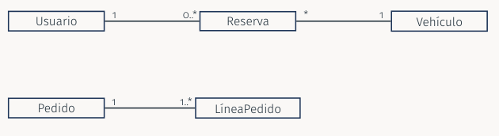

* Un `Usuario` tiene `0..*` `Reserva`s; una `Reserva` es de **exactamente 1** `Usuario`
* Una `Reserva` es sobre **exactamente 1** `Vehículo`; un `Vehículo` puede tener **muchas** `Reserva`s
* Un `Pedido` tiene `1..*` `Línea`s; una `Línea` pertenece a **exactamente 1** `Pedido`

### Navegación
* Por **convención** (el estándar admite otras opciones de presentación), las asociaciones dibujadas **sin flechas** se interpretan con navegación **bidireccional**; es decir, es posible determinar los vínculos de la asociación desde una instancia de **cada una** de las clases implicadas

* La navegación **bidireccional** suele ser **más compleja** de realizar para los desarrolladores, por lo que conviene **evitarla** en la medida de lo posible

* Para especificar un **único sentido** de navegación se dibuja la asociación con una **flecha abierta** en el extremo navegable. Una pequeña **x** indica que el extremo **no es navegable**

> OMG, UML 2.5.1: §11.5.4 (pp. 202–203)

**Ejemplo de navegación (Car Sharing)**

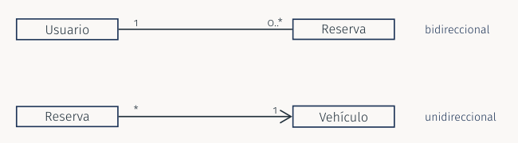

Desde una `Reserva` se necesita llegar a su `Vehículo` (para desbloquearlo, Tema 6), pero el `Vehículo` **no necesita** conocer sus reservas: la asociación es navegable **sólo de Reserva a Vehículo**. Esto coincide con la regla del Tema 6: **el remitente debe conocer la referencia del destinatario**

### Asociación reflexiva
* Se trata de asociaciones en las cuales encontramos en los **dos extremos** de una relación a **una misma clase**

* Resulta **recomendable** asignar un **nombre** a la función desempeñada por la clase en **cada extremo** de la asociación

* Sirven para describir, dentro del conjunto de instancias de una clase:
    * **Grupos de instancias**: relación de **equivalencia**
    * **Jerarquía** dentro de las instancias: relación de **orden**

**Ejemplo: jerarquía y grupos**

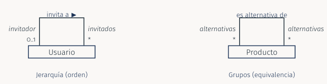

* **Jerarquía**: un usuario puede ser invitado por otro (`invitador`, a lo sumo uno) y haber invitado a varios
* **Grupos**: los productos alternativos entre sí (por ejemplo, distintos modelos de teclado) forman un **conjunto**

### Clases-asociaciones
* Un vínculo entre instancias de clases puede llevar **información específica** a dicho vínculo

* En estos casos, la asociación que describe el vínculo se comporta como una **clase** y sus instancias son elementos de la asociación

* Recibe el nombre de **clase-asociación** y se comporta como cualquier otra clase

* Se dibuja como una clase unida con una **línea discontinua** a la línea de la asociación

> OMG, UML 2.5.1: §11.5.3.2 (p. 200); notación en §11.5.4 (p. 202)

**Ejemplo: Tienda Online**

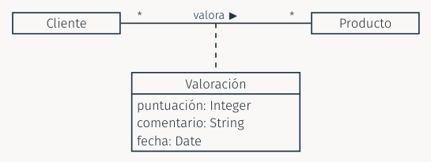

La `puntuación` y el `comentario` **no pertenecen** ni al `Cliente` ni al `Producto`: pertenecen al **vínculo** entre ambos. Cada instancia de `Valoración` es la valoración de **un cliente** sobre **un producto**

### La calificación de una asociación
* En caso de **cardinalidad máxima no finita** en un extremo de la asociación, si las instancias situadas en dicho extremo son **calificables**, la **calificación** permite **acotar superiormente** la cardinalidad asociada

* La **calificación** de una instancia es un **valor o conjunto de valores** que permiten **encontrar** dicha instancia

* Suelen ser **índices** para encontrar un elemento en una tabla, o **claves** para, por ejemplo, localizar un valor en un diccionario

* Se dibuja como un pequeño **rectángulo pegado a la clase**, con el **atributo calificador** dentro

> OMG, UML 2.5.1: §11.5.4 (p. 203)

**Ejemplo: Car Sharing**

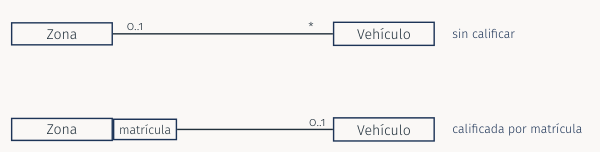

Sin calificar, una zona tiene **muchos** vehículos. Dada una zona **y** una matrícula, se obtiene como **mucho un** vehículo: la cardinalidad máxima pasa de `*` a `0..1`

### Restricción de exclusión {xor}
En ocasiones, determinadas asociaciones **no pueden darse a la vez**, por lo que UML permite establecer dicha restricción enlazando las asociaciones implicadas mediante **líneas discontinuas** e indicando mediante una **nota** la restricción existente: `{xor}`

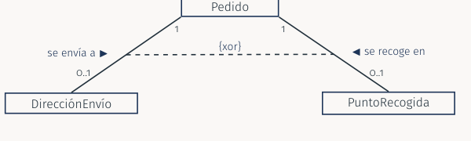

Un pedido se envía a una **dirección** **o** se recoge en un **punto de recogida**, pero **no ambas cosas a la vez**

### Restricción de orden {ordered}
En ocasiones, las posibles instancias de la clase de uno de los extremos de la asociación tienen que mantener un **orden** en su relación con las instancias de la clase del otro extremo. UML indica dicha restricción mediante el término **`{ordered}`** en el lado de la asociación donde hay que mantener dicho orden

```
Cliente  1 ——— realiza ▶ ——*  Pedido
                      pedidos {ordered}
```

El **historial** de pedidos de un cliente se mantiene **ordenado** (por ejemplo, del más reciente al más antiguo)

### Restricción de inclusión {subsets}
Pueden presentarse **dos o más asociaciones entre dos clases**, de manera que las instancias de uno de los extremos de una asociación estén **incluidas** dentro de las instancias de **ese mismo extremo** de otra asociación. En UML 2.5.1 se indica en el extremo de la asociación **incluida** con la restricción **`{subsets nombre}`**

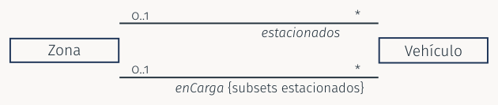

Los vehículos **en carga** de una zona son siempre un **subconjunto** de los **estacionados** en ella. Los manuales clásicos dibujan una **flecha discontinua** etiquetada `{subset}` entre las dos asociaciones, con el mismo significado

## 5. Síntesis: relaciones entre clases

| Relación | Símbolo | Se lee | Ejemplo |
| -- | -- | -- | -- |
| **Asociación** | `————` | "conoce a" | Usuario–Reserva |
| **Asociación navegable** | `———▶` | "conoce a" (en **un** sentido) | Reserva → Vehículo |
| **Agregación** | `———◇` | "tiene" (**parte independiente**) | Carrito–Producto |
| **Composición** | `———◆` | "se compone de" (**parte dependiente**) | Pedido–LíneaPedido |
| **Generalización** | `———▷` | "**es un**" | VehículoEléctrico → Vehículo |
