# Tema 8. De los Requisitos a las Clases

## 1. Introducción: de la estructura a los requisitos
Continuamos con **Car Sharing** y **Tienda Online**:

* **Tema 4**: ¿qué debe hacer el sistema? Son los **casos de uso**, en lenguaje natural
* **Temas 5 y 6**: ¿cómo **evolucionan** los objetos y cómo se les **envían mensajes**?
* **Tema 7**: ¿cómo se **relacionan** las clases? Es la visión estructural
* **Tema 8**: ¿de dónde **salen** las clases? Es el **puente entre requisitos y diagrama de clases**

> **El problema**: los casos de uso **no están estructurados** como software, que está formado por **clases**. Hay que **transformar los requisitos en clases**

### Un caso de uso de partida
**Reservar vehículo (Car Sharing)**

**Flujo básico:**
1. El usuario indica la **zona** y la **hora** de inicio
2. El sistema **consulta** los vehículos de la zona y **muestra** los disponibles
3. El usuario **elige** un vehículo
4. El sistema **crea** la reserva y **confirma** al usuario

* Veremos paso a paso cómo obtener las clases que lo realizan
* Una **pista**: los **sustantivos** suelen indicar **clases o atributos** (usuario, zona, hora, vehículo, reserva) y los **verbos**, **métodos** (consultar, mostrar, crear)

## 2. Estereotipos de clase de análisis

### Papel que interpreta cada objeto
Los estereotipos de clase **diferencian el papel** de los objetos en el sistema:

| Estereotipo | Papel | Ejemplo |
| -- | -- | -- |
| **Límite** (`«boundary»`) | **Interacción** entre el sistema y los actores (y otros sistemas) | `AppCarSharing` |
| **Control** (`«control»`) | **Coordina y controla** a otros objetos: encapsula la conducta de un caso de uso | `ControladorReserva` |
| **Entidad** (`«entity»`) | **Información y conducta** del dominio de la aplicación | `Vehículo`, `Reserva` |

> Convención de análisis (Jacobson, RUP), **no definida en UML 2.5.1** (ya vista en el Tema 6)

### Estereotipo de clase límite «boundary»
Las clases límite representan la **interacción con el usuario y con otros sistemas**. Cada actor habla con el sistema **a través de ellas**

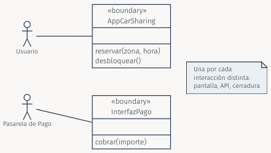

**Una por cada interacción distinta**: pantalla, API, cerradura...

### Estereotipo de clase entidad «entity»
Las clases entidad modelan la **información y el comportamiento** de algo de la vida real, **concreto** (un vehículo) o **abstracto** (una reserva)

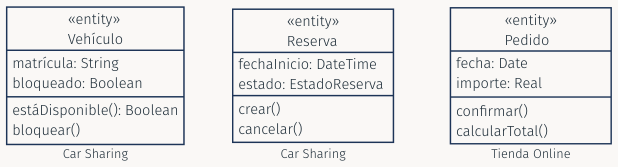

Son los objetos que **perduran** durante el funcionamiento del sistema; los demás se crean **sólo mientras se ejecuta** una interacción

### Estereotipo de clase control «control»
Las clases control encapsulan la **conducta propia de un caso de uso**: reciben la petición de la interfaz y **coordinan a las entidades**

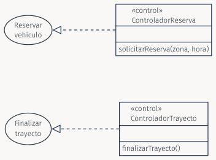

Se recomienda **una clase control por cada caso de uso**. La **flecha discontinua** indica qué caso de uso realiza cada clase

### Reglas del análisis de robustez: ¿quién puede comunicarse con quién?

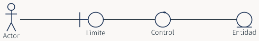

* El **actor** sólo habla con objetos **límite**
* El **límite** se comunica con el **control**, **no** directamente con las entidades
* El **control** coordina a las **entidades** y puede pedir ayuda a **otros controles**
* Las **entidades** **no inician** la conversación con el límite

### Una idea con muchos nombres
**Límite, control y entidad en la arquitectura de software actual**

El análisis de robustez (Jacobson, años 90) es el **antecedente** de patrones que se usan en los proyectos actuales:

| Análisis | MVC / MVVM | Clean Architecture | Car Sharing |
| -- | -- | -- | -- |
| **Límite** | **Vista**: interfaz de usuario, pantalla de la aplicación | Capa de presentación y adaptadores de entrada | `AppCarSharing` |
| **Control** | **Controlador**; servicio de aplicación | Caso de uso (*interactor*) | `ControladorReserva` |
| **Entidad** | **Modelo** del dominio | Entidades | `Vehículo`, `Reserva` |

#### Matices y continuidad
* Es una correspondencia **aproximada**, **no** una equivalencia exacta: cada patrón reparte las responsabilidades con sus **propias reglas**

* El **punto de entrada** de una API (*endpoint* que recibe la petición) cumple un papel de **límite**; la lógica que **coordina** la petición, de **control**

* En **Clean Architecture** cada caso de uso es un objeto propio: es la idea de **una clase control por caso de uso**

* Lo importante es el **razonamiento**: **separar** lo que **interactúa**, lo que **coordina** y lo que **representa el dominio**

* La **arquitectura hexagonal** y otros estilos se estudian en el **Tema 10**; aquí sólo sembramos la idea

## 3. Realización de un caso de uso

### Definición y objetivos
**Realización**: consiste en desarrollar un **modelo o elemento abstracto** para pasar a otro **más cercano a su ejecución**. Aquí veremos las primeras etapas de la actividad que realiza un caso de uso

**Objetivos de una realización:**
* El **diagrama de clases de análisis** es un producto **provisional**
* Se **transformará** en un diagrama de clases de **diseño**
* El resultado final es la **implementación software** del caso de uso

### Los cinco pasos (visión general)
Para **cada caso de uso**:

1. **Identificar la colaboración**: qué clases intervienen
2. **Identificar los objetos** y los **vínculos** entre ellos
3. **Detallar la interacción** en un diagrama de **comunicación**
4. **Obtener el diagrama de clases** del caso de uso

Y, al **terminar todos** los casos de uso:

5. **Unificar** los diagramas de clases en **uno único** de análisis

### Paso 1: identificación de una colaboración
* Realizar un caso de uso exige identificar un posible **conjunto de clases** y saber cómo podrían **interactuar** para ofrecer la funcionalidad

* Ese conjunto de clases es una **colaboración**

* Se dibuja con una **elipse discontinua**; una **flecha discontinua con triángulo hueco** la une al caso de uso que realiza

> OMG, UML 2.5.1: §11.7.4 (p. 217) y §18.1 (el caso de uso puede describirse mediante una colaboración)

**Ejemplo: la colaboración de Reservar vehículo**

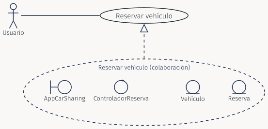

### Paso 2: identificación de los objetos de la colaboración
* Se obtiene una **visión básica** de la colaboración:
    1. Se identifican los **objetos implicados**, a partir del análisis del caso de uso
    2. Se identifican los **vínculos** entre ellos

* Esta visión aún **no indica cómo interactúan** los objetos, ni cómo se relacionan con el resto del modelo

* Es un **diagrama de objetos**: sus elementos son **instancias**, **no** clases (Tema 7)

**Ejemplo: la colaboración con sus objetos y vínculos**

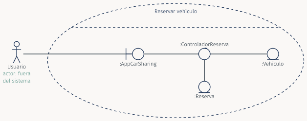

**Elipse discontinua**: la colaboración. **Iconos**: objetos. **Líneas**: vínculos entre objetos. El **actor queda fuera**: es externo al sistema y habla con el objeto límite

**La misma colaboración con la notación clásica**

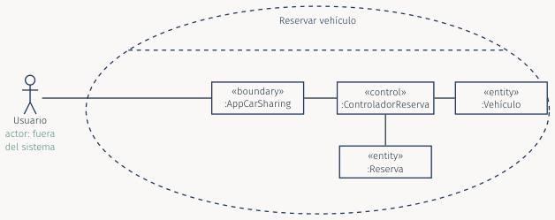

Es la **notación clásica**: cada objeto es un **rectángulo** con su estereotipo entre comillas angulares, por ejemplo `«boundary»`. El actor sigue **fuera** de la colaboración

### Paso 3: funcionamiento interno de una colaboración
* Se obtiene una visión **detallada**. El diagrama de **comunicación** muestra **explícitamente** la interacción entre objetos

* El diagrama de **secuencia** oculta parte de la estructura, pero muestra con más claridad la **secuencia de mensajes**

* El diagrama de comunicación está más **orientado al análisis** de requisitos y a la **obtención de clases**; el de secuencia, al **diseño**, la **prueba** y la **implementación**

**Ejemplo: diagrama de comunicación de Reservar vehículo**

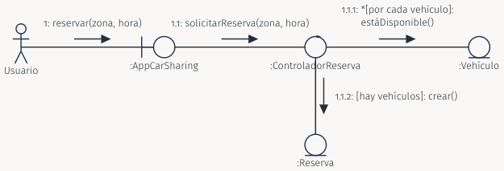

### Paso 4: de diagrama de comunicación a diagrama de clases
* Se **genera** el diagrama de clases correspondiente a cada diagrama de comunicación

* Si el diagrama de comunicación se hizo con cuidado, la transición **no es difícil**:
    * Cada **objeto** da lugar a una **clase**
    * Cada **vínculo** da lugar a una **asociación**
    * Cada **mensaje recibido** da lugar a un **método** de la clase **receptora**

* Hay **similitudes obvias** entre los dos diagramas, pero también **diferencias importantes**

**Ejemplo: diagrama de clases de Reservar vehículo**

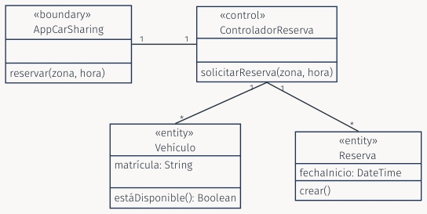

### Paso 5: unificación de los diagramas de clases
* Por último **unificamos** los diagramas obtenidos para **cada caso de uso**

* Las **clases compartidas** (por ejemplo `Vehículo`) aparecen una **sola vez**; las **asociaciones se ensamblan**

* El resultado es **un único diagrama de clases de análisis**

> Para cada caso de uso: identificar las clases probables (la colaboración); diseñar su diagrama de comunicación; obtener su diagrama de clases. Después, **ensamblar**

**Ejemplo: unificación de Reservar vehículo y Finalizar trayecto**

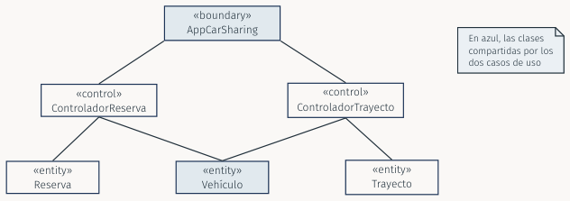

*En azul, las clases compartidas por los dos casos de uso*

### Diagrama de comunicación frente a diagrama de clases

**Similitudes:**
* Ambos muestran símbolos de **objetos o de clases** unidos por **líneas de conexión**
* El diagrama de clases suele tener **más o menos la misma estructura** que el diagrama de comunicación
* Ambos muestran clases u objetos de los **mismos tipos**
* Los tres estereotipos de análisis (**límite, control y entidad**) pueden usarse en **cualquiera** de los dos

**Diferencias (1/2):**
* El diagrama de comunicación muestra con frecuencia un **actor**; el de clases, **rara vez** (representa una **interacción particular** y el actor es parte importante de ella)
* El de comunicación contiene **objetos**; el de clases, **clases**
* Las conexiones son **vínculos** en el de comunicación y **asociaciones** en el de clases
* El de comunicación muestra la interacción **dinámica**: todos los vínculos necesarios para los **mensajes**; en el de clases las asociaciones suelen llevar **nombre** y los **mensajes no se muestran**

**Diferencias (2/2):**
* Los objetos **límite y de control** existen **sólo mientras se ejecuta** el software; los objetos **entidad** y sus vínculos **perduran** más allá de una ejecución
* Aun así, las clases **límite y de control** son **importantes para los requisitos**: se incluyen en el diagrama de clases
* El diagrama de clases es un modelo de **estructura estática**: sus vínculos temporales **no se modelan** en el diagrama de clases de análisis

**Mismo caso, dos vistas**

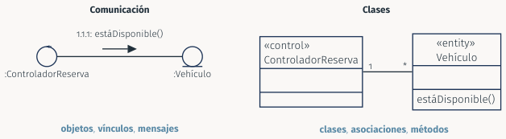

| Comunicación | Clases |
| -- | -- |
| objetos, vínculos, **mensajes** | clases, asociaciones, **métodos** |

### Análisis de clases candidatas
**Cuestiones para comprobar que una clase es razonable:**

| Pregunta | Ejemplo (Car Sharing) |
| -- | -- |
| ¿Excede el **ámbito** del sistema? | *Compañía petrolera*: no forma parte del sistema |
| ¿Se refiere al **sistema como un todo**? | `SistemaCarSharing`: es el sistema, no una clase de él |
| ¿**Duplica** a otra clase? | *Coche* y `Vehículo`: se queda una |
| ¿Es demasiado **imprecisa**? | *Gestor*: ¿gestiona qué? |
| ¿Es demasiado **específica**? | `VehículoBlancoDe5Puertas` |
| ¿Está ligada a **entradas y salidas** concretas? | `BotónReservar`: es un detalle de la interfaz |
| ¿Podría ser un **atributo**? | *Matrícula*: atributo de `Vehículo` |
| ¿Podría ser un **método**? | *Desbloquear*: método de `Vehículo` |
| ¿Podría ser una **asociación**? | *Conduce*: asociación entre `Usuario` y `Vehículo` |

**Cómo aplicarlas:**
* Si la respuesta a alguna cuestión es **sí**, tal vez la clase candidata **no lo sea** y haya que modelarla de **otra forma**
* Es una herramienta de **razonamiento**: sirve igual en un diseño de clase y en una **revisión de código**
* Volvamos al caso de uso: de **usuario, zona, hora, vehículo y reserva**, ¿cuáles son clases y cuáles atributos?
    * **hora** es un **atributo** de `Reserva` (`fechaInicio`)
    * **usuario, zona, vehículo y reserva** son **clases**

### De la realización al sprint: el mismo razonamiento en un equipo ágil
* Los cinco pasos son el **flujo de trabajo** de un equipo cuando pasa de una **historia de usuario aceptada** a un **diseño técnico**, antes de implementarla
* No hace falta documentar cada paso con tanta formalidad: basta una **pizarra** y **diagramas ligeros**
* Lo que sí se conserva es el **razonamiento**:
    * ¿Qué **clases** intervienen?
    * ¿Qué **mensajes** intercambian para cumplir la historia?
    * ¿Qué **estructura** resulta?
* Por eso aprendemos los pasos con detalle: aunque luego se simplifiquen, **saber hacerlo despacio permite hacerlo rápido**

## 4. Tarjetas CRC (Clase-Responsabilidad-Colaboración)

### Descripción: otra metodología para obtener las clases de una colaboración
* Es más fácil pensar una clase en términos de **responsabilidades globales** que de sus **métodos individuales**

* Una **responsabilidad** es una descripción de **alto nivel** de algo que una clase puede hacer:
    * Refleja la **información** que tiene la clase: en sus **atributos** o solicitada a otras clases (**colaboración**)
    * Refleja los **servicios** que ofrece a otros objetos
    * Puede corresponder a **uno o varios métodos**

* Una **tarjeta CRC** recoge, por clase: su **nombre**, sus **responsabilidades** y sus **colaboradores**

### Ejemplo de tarjetas CRC: Reservar vehículo (Car Sharing)

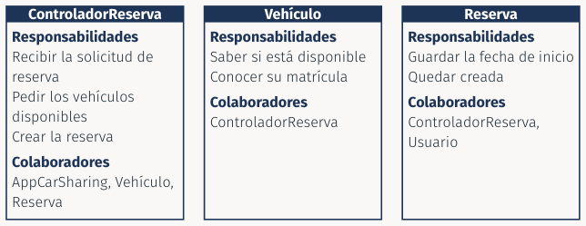

### Otro ejemplo: Confirmar pedido (Tienda Online)

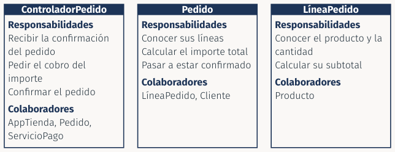

### De las tarjetas al diagrama de clases
Cada elemento de la tarjeta tiene su **equivalente**:

| Tarjeta CRC | Diagrama de clases | Ejemplo |
| -- | -- | -- |
| **Nombre** de la tarjeta | **Clase** | `Vehículo` |
| Responsabilidad de **información** | **Atributo** | `matrícula: String` |
| Responsabilidad de **servicio** | **Método** | `estáDisponible()` |
| **Colaborador** | **Asociación** | `ControladorReserva 1 — * Vehículo` |

### Cómo rellenar las tarjetas: el proceso, en equipo
1. Hacer una **sesión de intercambio de ideas** para identificar los objetos implicados en el caso de uso
2. **Adjudicar cada objeto** a un miembro del equipo, que **representa** a ese objeto
3. **Representar el caso de uso**: los miembros **negocian** entre los objetos las responsabilidades y las colaboraciones
4. **Identificar y registrar** los objetos **redundantes** o **perdidos**

### Estrategias para repartir responsabilidades
* **Objetos perezosos**: cada objeto **rechaza** responsabilidades adicionales salvo que sus compañeros le convenzan de aceptarlas
* **Objetos proclives**: todos los objetos están dispuestos a aceptar una **misma** responsabilidad; la decisión final se **negocia**
* **Ejemplo en Car Sharing**: ¿quién sabe si un vehículo está libre, el `ControladorReserva` o el propio `Vehículo`?
    * El `Vehículo` **tiene la información** (`bloqueado`): es responsabilidad **suya**
    * El controlador **sólo coordina**: pregunta y decide

### Vigencia actual de las tarjetas CRC
**De las tarjetas de papel a las pizarras digitales**

* La técnica **no es sólo de aula**: sigue vigente como **diseño colaborativo**
* Hoy se usa con **tarjetas virtuales** en pizarras online (**Miro, Mural, FigJam**): el equipo, aunque sea remoto, comparte la sesión
* En **Domain-Driven Design (DDD)**, el **Event Storming** persigue un objetivo muy parecido: identificar **entidades, responsabilidades y colaboraciones** de un dominio **entre todo el equipo**
* **CRC** y **Event Storming** comparten la idea de fondo: **pensar en equipo antes de programar**

> Evans (2003) para DDD; Beck y Cunningham (1989) para las tarjetas CRC

## 5. Síntesis: de los requisitos a las clases

| Paso | Pregunta | Producto (Car Sharing) |
| -- | -- | -- |
| **1** | ¿Qué **clases** intervienen? | Colaboración de Reservar vehículo |
| **2** | ¿Qué **objetos** hay y cómo se **vinculan**? | Diagrama de objetos |
| **3** | ¿Qué **mensajes** se intercambian? | Diagrama de comunicación |
| **4** | ¿Qué **clases y asociaciones** resultan? | Diagrama de clases del caso de uso |
| **5** | ¿Cómo se **reúne** todo? | Diagrama de clases de análisis único |

Las **tarjetas CRC** son una **vía alternativa** al paso 1 y a los pasos 2–4
