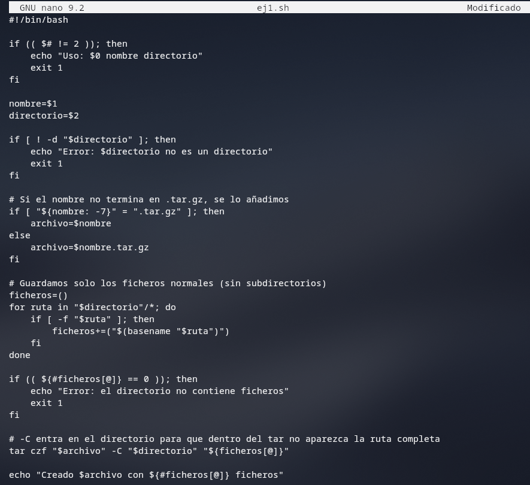
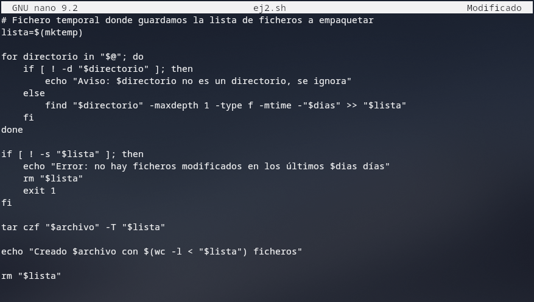
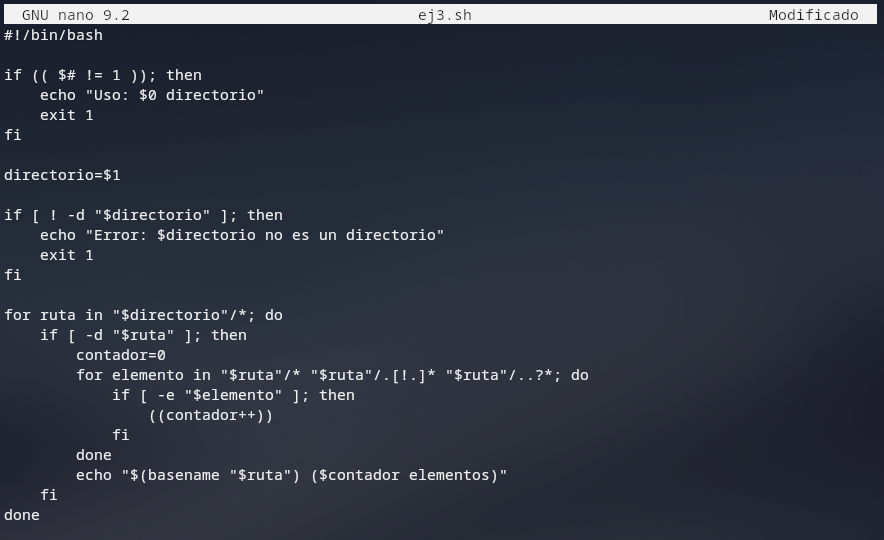

# Ejercicios de repaso de shell script

**1) La orden tar permite empaquetar varios archivos en uno solo y si se quiere, el resultado se puede comprimir. Por ejemplo: tar czf copia.tar.gz fichero1 fichero2, crea un archivo llamado copia.tar.gz que contiene los archivos: fichero1 y fichero2 empaquetados y comprimidos en formato zip**

**Escribe un shell script que reciba como argumentos un nombre y un directorio y que cree un archivo comprimido con los archivos del directorio (sin subdirectorios) y que se llame: [nombre].tar.gz, donde [nombre] es el nombre que se da como argumento. Si el nombre que se da como argumento ya termina en tar.gz entonces no hay que añadirle esa extensión, si no, hay que añadírsela.**


**2) La orden find con la opción -mtime busca archivos que se hayan modificado después de una fecha dada. Por ejemplo: find / -type f -mtime -4 busca todos los archivos del sistema que hayan sido modificados en los últimos cuatro días.**

**Basándote en el ejercicio anterior, escribe un shell script que reciba como argumentos un nombre, un número de días y varios directorios, y que cree un archivo comprimido con todos los archivos de los directorios que hayan sido modificados en los últimos n días (donde n es el parámetro que se pasa al script). El nombre del archivo debe ser [nombre]- [fecha].tar.gz donde [nombre] es el nombre que se pasa como argumento, [fecha] es la fecha de hoy, y hay que tener en cuenta las mismas consideraciones para la extensión que en el ejercicio anterior.**

> La orden date permite obtener la fecha actual. Repasa su sintaxis y úsala en tu script




**3) Escribir un shell script llamado lsdir que liste los directorios que haya dentro del directorio que se pasa como argumento, pero diciendo a continuación de su nombre, cuántos elementos tiene dentro. Por ejemplo:**
```bash
fconde@fconde-VirtualBox:~$ lsdir .
bin (17 elementos)
Descargas (0 elementos)
Documentos (4 elementos)
```



