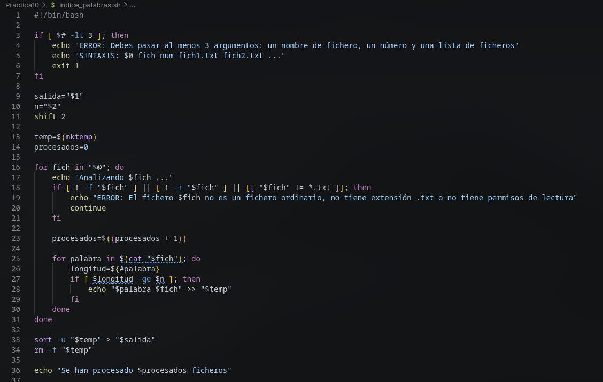
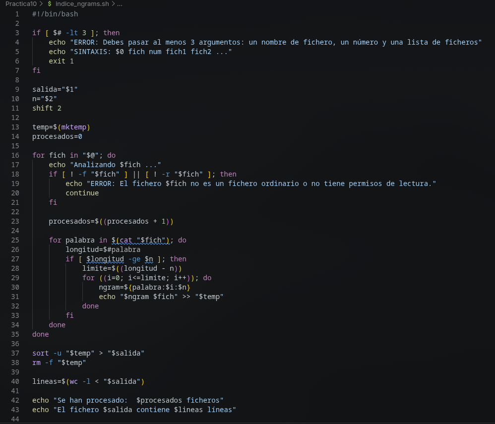

# Índice invertido de palabras
Escribe un shell script llamado indice_palabras.sh que recibe varios argumentos: un
nombre de fichero, un número y una lista de ficheros ordinarios. El script deberá generar un
fichero, con el nombre introducido como primer parámetro, que contenga un listado de
palabras junto con el fichero donde aparecen. Dicho listado tendrá una línea por cada
palabra y nombre de fichero (ejemplo: “palabra fichero1”), y las líneas no podrán repetirse.
Asegúrate de realizar las siguientes acciones y comprobaciones:
● Si el programa no recibe 3 o más argumentos debe escribir cual es la sintaxis
correcta de la orden y finalizar.
● Sólo procesa los ficheros ordinarios que tienen permiso de lectura y extensión
“.txt”.
● Para cada fichero procesado, leerá el fichero palabra a palabra y añadirá al fichero
índice una línea con la palabra y el nombre del fichero analizado.
● Sólo se añadirán las palabras que tengan una longitud igual o mayor al número dado
como segundo argumento.
● Asegúrate de que el fichero final se llama como el primer parámetro y que no tiene
ninguna pareja (palabra fichero) repetida.
● Escribe el número total de ficheros procesados.
NOTAS:
● La orden mktemp crea un fichero temporal vacío y devuelve el nombre de dicho
fichero.
● Se pueden quitar líneas repetidas de un fichero con la siguiente orden:
sort -u ficherotemp > ficheroindice

**Ejemplos de llamadas:**
```cpp
$ ./indice_palabras.sh
ERROR: Debes pasar al menos 3 argumentos: un nombre de fichero, un número
y una lista de ficheros
SINTAXIS: ./indice_palabras.sh fich num fich1.txt fich2.txt ...
$ ./indice_palabras.sh indice.csv 4 *.txt
Analizando fich1.txt ...
Analizando fich2.txt ...
Analizando fich3.txt ...
ERROR: El fichero fich3.txt no es un fichero ordinario o no tiene permisos
de lectura.
Se han procesado 2 ficheros.
```




# Índice invertido de n-grams
Escribe un shell script llamado indice_ngrams.sh que recibe varios argumentos: un
nombre de fichero, un número y una lista de ficheros ordinarios. El script deberá generar un
fichero, con el nombre introducido como primer parámetro, que contenga un listado de
n-grams junto con el fichero donde aparecen. Dicho listado tendrá una línea por cada n-gram
y nombre de fichero (ejemplo: “ngram fichero1”), y las líneas no podrán repetirse.
Los n-grams se calculan a partir de una palabra y el número dado como segundo argumento,
por ejemplo, para la palabra “botijo” y el número 4 se generan los siguientes 4-grams:
“boti”, “otij” y “tijo”.
Asegúrate de realizar las siguientes acciones y comprobaciones:
    ● Si el programa no recibe 3 o más argumentos debe escribir cual es la sintaxis
        correcta de la orden y finalizar.
    ● Sólo procesa los ficheros ordinarios que tienen permiso de lectura.
    ● Para cada fichero procesado, leerá el fichero palabra a palabra y añadirá al fichero  
        índice una línea por cada n-gram generado de cada palabra junto con el nombre del
        fichero analizado.
    ● Los n-grams serán del tamaño indicado como segundo argumento. Si la palabra no
        tiene tamaño suficiente para generar un n-gram, dicha palabra se desestima.
    ● Asegúrate de que el fichero final se llama como el primer parámetro y que no tiene
        ninguna pareja (ngram fichero) repetida.
    ● Escribe el número total de ficheros procesados y el número total de líneas del fichero
        generado.

NOTAS:
    ● La orden mktemp crea un fichero temporal vacío y devuelve el nombre de dicho
        fichero.
    ● Se pueden quitar líneas repetidas de un fichero con la siguiente orden:
        sort -u ficherotemp > ficheroindice

**Ejemplos de llamadas:**
```bash
$ ./indice_ngrams.sh
ERROR: Debes pasar al menos 3 argumentos: un nombre de fichero, un número
y una lista de ficheros
SINTAXIS: ./indice_ngrams.sh fich num fich1 fich2 ...
$ ./indice_ngrams.sh indice.csv 4 *.txt
Analizando fich1.txt ...
Analizando fich2.txt ...
Analizando fich3.txt ...
ERROR: El fichero fich3.txt no es un fichero ordinario o no tiene permisos
de lectura.
Se han procesado 2 ficheros.
El fichero indice.csv contiene 305 líneas.
```


# Clasificación de ficheros por extensión
Escribe un shell script llamado clasificar_ficheros.sh que recibe como argumentos dos
nombres de directorios: un directorio de origen (dir_origen) y un directorio de destino
(dir_destino). El script deberá escanear todos los ficheros ordinarios presentes en
dir_origen y moverlos a subdirectorios dentro de dir_destino, nombrando cada
subdirectorio según la extensión del fichero original en minúsculas (por ejemplo, el fichero
informe.pdf se movería a dir_destino/pdf/informe.pdf).
Asegúrate de realizar las siguientes acciones y comprobaciones:
    ● Si el programa no recibe 2 argumentos debe escribir cuál es la sintaxis correcta de la
        orden y finalizar.
    ● Comprueba que dir_origen es un directorio y tiene permitido el acceso a él
        (permisos de lectura y ejecución).
    ● Si el directorio dir_destino no existe, debe crearlo automáticamente. Si existe, el
        script debe asegurarse de que tiene permisos de escritura.
    ● Solo procesa los ficheros ordinarios que tienen permiso de lectura en dir_origen
    ● Si se encuentra un directorio o un archivo sin permiso, debe descartarlo y generar un
        mensaje de advertencia.
    ● Por cada fichero procesado, crea el subdirectorio correspondiente a su extensión
        dentro de dir_destino (si no existe) y mueve el fichero a dicho subdirectorio.
    ● Si un fichero no tiene extensión (es decir, el punto . no existe en el nombre), se debe
        clasificar en un subdirectorio llamado sin_extension.
    ● Antes de finalizar, el script debe indicar el número total de ficheros clasificados y el
        número de ficheros descartados, así como un listado de las extensiones únicas
        procesadas.

**Ejemplos de llamadas:**
```bash
$ ./clasificar_ficheros.sh
ERROR: Debes pasar como argumento 2 nombres de directorios (origen y
destino)
SINTAXIS: ./clasificar_ficheros.sh dir_origen dir_destino
$ ./clasificar_ficheros.sh temp/source temp/target
Analizando ficheros en temp/source ...
Creando directorio de destino temp/target (si es necesario)...
Clasificando archivo1.txt -> temp/target/txt/archivo1.txt
Clasificando foto.jpg -> temp/target/jpg/foto.jpg
AVISO: Descartando temp/source/temporal (no es fichero ordinario).
…
Se han clasificado 25 ficheros en total.
Se han descartado 3 archivos o directorios.
Extensiones únicas procesadas: txt, jpg, pdf, sin_extension
```

```bash
#!/bin/bash

if [ $# -ne 2 ]; then
    echo "Le debes pasar dos parámetros"
    echo "SINTAXIS: $0 dir_origen dir_destino"
    exit 1
fi

if [ ! -d "$1" ]; then
    echo "NO existe el directorio origen"
    exit 2
fi

if [ ! -x "$1" ] || [ ! -r "$1" ]; then
    echo "El directorio: $1 no tiene permisos de lectura o ejecución"
    exit 3
fi

if [ ! -d "$2" ]; then
    echo "NO existe el directorio destino"
    echo "Creando directorio destino con nombre: $2 ..."
    mkdir -p "$2"
fi

if [ ! -w "$2" ]; then
    echo "El directorio : $2 no tiene permisos de escritura"
    exit 4
fi

clasificados=0
descartados=0
lista_ext=""

for i in "$1"/*; do
    if [ ! -e "$i" ]; then
        continue
    fi

    if [ ! -f "$i" ] || [ ! -r "$i" ]; then
        echo "AVISO: Descartando $i"
        descartados=$((descartados + 1))
        continue
    fi
    
    nombre=$(basename "$i")

    if [[ "$nombre" == *.* ]]; then
        extension="${nombre##*.}"
        extension="${extension,,}"
    else
        extension="sin_extension"
    fi

    mkdir -p "$2/$extension"
    mv "$i" "$2/$extension/$nombre"
    echo "Clasificando $nombre -> $2/$extension/$nombre"

    clasificados=$((clasificados + 1))

    if [[ "$lista_ext" != *"$extension"* ]]; then
        lista_ext="$lista_ext $extension"
    fi
done

echo "Se han clasificado $clasificados ficheros en total."
echo "Se han descartado $descartados archivos o directorios."
echo "Extensiones únicas procesadas:$lista_ext"
```