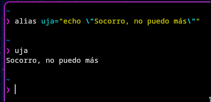

## Resumen Shell y programación en bash.

Aquí se añadirá el resumen de los libros para programación bash para complementar la información de los guiones.

Se añadirán los resumenes divididos por el contenido de sus guiones correspondientes.

---

### Resumen - Introducción

**Bash** está basado en el shell **sh** y puede verse como un **superconjunto** de suyo. Muchas órdenes se comportan igual que en **sh**.
¿Qué añade respecto a sh?

- Historial de órdenes, para recuperar las anteriores.
- Edición de la línea de comandos.
- Control de trabajos: conmutar entre procesos y controlar su avance.
- Sustitución de variables más flexible.
- Operadores adicionales, con sintaxis parecida a la de C.
- Alias para órdenes de uso frecuente, sin tener que escribir guiones.

| Característica              | sh  | csh | tcsh | ksh | bash |
| --------------------------- | --- | --- | ---- | --- | ---- |
| Histórico de órdenes        | No  | Sí  | Sí   | Sí  | Sí   |
| Alias                       | No  | Sí  | Sí   | Sí  | Sí   |
| Shell scripts               | Sí  | Sí  | Sí   | Sí  | Sí   |
| Autocompletado de archivos  | No  | Sí  | Sí   | Sí  | Sí   |
| Edición de línea de órdenes | No  | No  | No   | Sí  | Sí   |
| Control de trabajos         | No  | Sí  | Sí   | Sí  | Sí   |

Es importante saber que podemos interrumpir la ejecución de un script. Podemos hacerlo mediante:

- Teclando `exit`
- Pulsando `Ctrl + D`. Este método puede no funcionar si se ha asignado `IGNOREEOF`, la cual es una variable de entorno. Entonces `export IGNOREEOF=42` tendrá que pulsar `Ctrl + D` 42 veces antes de realmente salir a la shell.

---

### Sintaxis de entrada

- Es importante saber que Bash leer las instrucciones separando las palabras mediante espacios o tabuladores. Si queremos seguir escribiendo un comando en la siguiente linea podemos usar `\`

- Bash presenta un simbolo de solicitud cuando está esperando una nueva orden. La solicitud por omisión es: `\u@\h:\w\$`. Se puede personalizar asignando un valor a la variable de entorno `PS1`. (Ej: PS1="paco>"), sin dejar espacios alrededor del `=`.

- **Comillas y metacaracteres**: Simbolos como `;`,`&`, `|`, `<`, `>`, `(` , `)` actúan como separadores y tienen funciones especiales. Para que bash trate una frase como espacios (o separadores) como una sola palabra o texto ordinario, debe encerrarse entre comillas `"` o apóstrofos `'`

- **Comentarios**: Comienzan con `#`. Todo lo que escribamos detrás es ignorado por la shell.

- **Operadores para combinar comandos**:
  Aparte de los vistos en sesiones anteriores de órdenes de linux (`||`, `&&`, `;`...) tenemos otros operadores como:
  - `|&`: Pasa tanto la salída estándar como los errores del primer comando al segundo.
  - `&`: Ejecuta el comando en segundo plano, permitiendo seguir usando el términal de inmediato.
  - `(...)`: Agrupa comandos para tratarlos como una unidad y ejecutarlos en una subshell.

La prioridad de los comandos de mayor a menor precedencia son: `|` > `||` y `&&` > `;` > `&`. El `||` y `&&` se evaluan de izquierda a derechaa.

---

### Ejecución de ordenes

- **Bash** al igual que **sh**, tiene 3 métodos de ejecutar órdenes: ejecución directa, ejecución directa en un _subshell_, y ejecución indirecta en un _subshell_:
  - **Ejecución directa**: El comando se ejecuta en el propio shell actual. Cualquier cambio (como modificar una variable) afecta al entorno de forma permanente hasta que se cierra la sesión. Se usa para comandos internos (intrínsecos) y archivos cargados con `source`.

  - **Ejecución directa en una subshell**: Se crea un entorno hijo que hereda todas las variables del padre. Lo que pasa en el subshell se queda en el subshell (no afecta al shell principal). Se usa para comandos entre paréntesis `(...)` y procesos en segundo plano `&`.

  - **Ejecución indirecta en una subshell**: Crea un entorno hijo pero usando la llamada de sistema `exec`. Solo hereda las variables de entorno (ignora las locales). Tampoco afecta al shell padre. Es el método que se usa para comandos externos, como programas instalados y scripts ordinarios.

- **Busqueda de comandos externos**:
  - Si el comando no es interno, Bash lo busca en los directorios definidos en la variable de entorno `PATH` (rutas separadas por `:`).
  - Se puede incluir el directorio actual de trabajo en la búsqueda utilizando el símbolo del punto (`.`).

- **La tabla hash**:
  - Para no tener que buscar en el `PATH` cada vez, Bash memoriza las ubicaciones de los comandos ejecutados en una tabla de dispersión (hash), acelerando el sistema.

  - Precaución: Si creas o instalas un archivo ejecutable nuevo, Bash podría no encontrarlo inmediatamente porque su caché está desactualizada. Según el texto, esto se soluciona usando el comando `rehash` para reconstruir la tabla (Nota: en versiones estándar de Bash, el comando equivalente actual es `hash -r`).

---

### Redireccionamiento.

- **Decriptores de archivos** UNIX trata los flujos de entrada, salida y errores como si fueran archivos, asignandoles un número (descriptor):
  - **0 (stdin)**: Entrada estándar.
  - **1 (stdout)**: Salida estándar.
  - **2 (stderr)**: Salida de errores.

- Redirección de entrada:
  - `< fichero`: El comando lee los datos desde el archivo especificado en logar de pedirlos por teclado

  - `<< palabra` (Here-Document): El comando toma como entrada todo el texto que se escriba a continuación, hasta encontrar una línea que contenga exactamente la palabra delimitadora. Bash interpretará variables dentro de ese texto, a menos que la palabra contenga comillas o caracteres de escape.

- Redirección de Salida (Sobrescribir):
  - `> fichero`: Envía la salida estándar al archivo. Si el archivo ya existe, su contenido se borra (se trunca a cero); si no existe, se crea.

  - **Protección noclobber**: Si esta variable del shell está activada, Bash lanza un error para evitar que sobrescribas un archivo existente por accidente.

  - `>| fichero`: Fuerza la sobrescritura del archivo, ignorando la protección de noclobber.

- Redirección de Salida (Añadir):
  - `>> fichero`: Envía la salida al archivo, pero añadiendo el contenido al final del mismo, sin borrar lo que ya estaba escrito.

- Redirección por Descriptores Específicos:
  - Se puede elegir qué flujo redirigir colocando su número antes del operador (si no se pone nada, se asume el 1, salida estándar).

  - Uso habitual de errores: 2> fichero captura solo los mensajes de error y los guarda en un archivo.

  - Separar salidas: Una estructura como `(orden > fichero_salida) 2> fichero_errores` permite enviar los resultados correctos a un documento y los mensajes de fallo a otro distinto.

---

### COmpleción de Órdenes y Archivos

Bash permite completar automáticamente nombres de archivos y comandos al presionar cietas teclas:

- **Teclas `[Tab]` o `[Esc]`:**

- **Coincidencia única**: Si existe un solo archivo que coincida con lo escrito, Bash completa el nombre automáticamente

- **Sin coincidencia única**: Completa hasta donde puede. SI hay múltiples opciones, al presionar de neuvo lista de los candidatos. SI el número de opciones es muy alot, Bash pregunta si deseas mostrarlas antes de listarlas

- **Carácter `EOf` (`Ctrl+D`):** Muestra de inmediato la lista de todas las coincidencias posibles y devuelve el control al indicador para termianr de escribir

- **Variable `FIGNORE`:** Contiene una lista de extensiones / sufijos separados por comas (ej: `.tmp`, `.o`) Los archivos con estos sufijos **se ignoran** en las sugerencais de autocompletado a menos que no exista ninguna otra opción posible

---

### Control de Trabajos (Jobs)

Un **trabajo** es un grupo de procesos asociados en el shell. Pueden estar en **primer plano** (máximo uno a la vez, el único que recibe entrada del teclado), en **segundo plano** (se ejecutan sin bloquear el terminal) o **detenidos** (pausados)

#### Estados e Identificación

- **Lanzar en segundo plano**: Se añade `&` al final del comando. Bash devuelve su identificador de trabajo y su PID
  - _Ejemplo_ `[2] 470` -> Trabajo num 2, PID 470

- **Avisos de cambio de estado**: Bash notifica cuando un trabajo termina o cambia de estado justo nates de mostrar el siguiente indicador (_promt_). Si la variable `notify` está activa, los avisos se muestran al instante

#### Lista de trabajos (`jobs`)

Al ejecutar el comando `jobs`, los procesos se representan con la siguiente sintaxis:

- `+`: Indica el **trabajo actual** (el último en iniciarse o detenerse)

- `-`: Indica el **trabajo anterior**

- **Estados posibles**:
  - Running (en ejecución)
  - Done (terminado)
  - Stopped (detenido explicitamente o a la espera de entrada por termina `tty input`)
  - Opción `-l`: Muestra además los identificadores de proceso (PID)

#### Sintaxis para Referenciar Trabajos

| Formato          | Trabajo al que hace referencia             |
| ---------------- | ------------------------------------------ |
| `%n`             | Al trabajo número n.                       |
| `%cadena`        | Al trabajo cuyo nombre empieza por cadena. |
| `%?cadena`       | Al trabajo cuyo nombre contiene cadena.    |
| `%+`, `%%` o `%` | Al trabajo actual (el marcado con +).      |
| `%-`             | Al trabajo anterior (el marcado con -).    |

#### Cambio de Estado y Comandos

- **Detener un trabajo (`Ctrl + Z`)**: Envía la señal `STOP` al trabajo en primer palno, pausándolo y moviendolo al segundo plano (Stopped)

- **Pasar a primer plano (`fg`)**:
  - Uso: `fg %trabajo` (o escribir simplemente `%trabajo`)

  - Concede al trabajo el control de termianl

- **Reanudar en segundo plano (`bg`)**
  - Uso `bg %trabajo`
  - Si el trabajo reanudado requiere entrada del teclado, volverá a quedar detenido

- **Finalizar un trabajo (`kill`):**
  - Uso normal: `kill %trabajo`
  - Forzado: `kill -9 %trabajo` (envía la señal `SIGKILL`, la cual no puede ser bloqueada ni ignorada, matando el proceso de forma incondicional)

---

### Expansión de Nombres de Fichero (Globalización)

Es el mecanismo mediante el cual Bash expande caracteres especiales (comodines) para convertirlos en rutas o nombres de archivo

- **Uso de virgulilla (`~`):**
  - `~` solo: Representa el directorio personal (home) del usuario actual

  - `~usuario`: Representa el directorio personal del usuario especificado (ej. `~maria`)

- **Expansión con llaves (`{ }`):**
  - La estructura `a{x1,x2,...,xn}b` se expande a una lista separada por espacios: `ax1b ax2b ... axnb`

  - _Ejemplo_: `cp ~noe/fauna/{gaviotas,cebras}` se expande a: `cp ~noe/fauna/gaviotas ~noe/fauna/cebras`

  - **Excepción literal**: Si `{`, `}` o `{}` están rodeados por espacios en blanco, Bash los interpreta literalmente como caracteres y no los expande

---

### Sustituciones Históricas

Una **sustitución histórica** permite reutilizar comandos (o partes de comandos) ejecutados previamente. **Bash interpreta estas sustituciones antes de procesar las comillas o ejecutar cualquier orden**

#### Estructura General

- Tiene la forma: `![suceso][:]selector[:modificador]`

- **Escape**: Para usar el carácter `!` de forma literal se antepone una diagonal invertida (`\!`). No hace falta escaparlo si va seguido de un espacio en blanco, `=` o `(`

- **Personalización**: Se puede cambiar el carácter `!` modificando la variable `histchars`

#### Sucesos (`suceso`)

Define a qué orden pasada de la lista de historial hacemos referencia:

| Sintaxis    | Descripción                                             |
| ----------- | ------------------------------------------------------- |
| `!!`        | La orden inmediatamente anterior (equivalente a `!-1`). |
| `!n`        | La orden número n del historial.                        |
| `!-n`       | La n-ésima orden anterior a la actual.                  |
| `!cadena`   | La última orden que comience por cadena.                |
| `!?cadena?` | La última orden que contenga la cadena.                 |

#### Selectores (`selector`)

Permiten extraer palabras específicas del suceso seleccionado. Si el selector no empieza por un dígito, se puede omitir el signo `:` inicial

| Selector      | Palabra(s) seleccionada(s)                                   |
| ------------- | ------------------------------------------------------------ |
| `0`           | El nombre del comando (palabra 0).                           |
| `^` / `:^`    | El primer argumento (palabra 1).                             |
| `$` / `:$`    | El último argumento.                                         |
| `:n`          | El n-ésimo argumento (`$n \ge 1$`).                          |
| `:n1-n2`      | Rango de palabras desde n1 hasta n2.                         |
| `*` / `:x*`   | Desde la palabra 1 (o la palabra x) hasta el final (`$`).    |
| `:x*` / `:X*` | Rango desde x hasta el final o el penúltimo argumento.       |
| `:-x`         | Rango desde el comando (0) hasta el argumento x.             |
| `%` / `:%`    | La palabra que coincidió con la última búsqueda `!?cadena?`. |

#### Modificadores (`modificador`)

Van precedidos por `:` y alteran las palabras extraídas por los selectores:

#### A. Manipulación de Rutas / Archivos

(Aplican sobre la primera palabra seleccionada):

- `:r` $\rightarrow$ Elimina la extensión del archivo (quita a partir del último .)

- `:h` $\rightarrow$ Elimina el nombre del archivo, dejando solo la ruta (head / directorio)

- `:t` $\rightarrow$ Elimina la ruta, dejando solo el nombre del archivo (tail / archivo)

- **Ejemplo:**

```bash
$ ls -l /usr/elsa/juguetes.texto

$ echo !!^:r  !!^:h  !!^:t  !!^:t:r

Resultado: /usr/elsa/juguetes  /usr/elsa/  juguetes.texto  juguetes
```

#### B. Sustitución y Reemplazo

`:[g]s/l/r` $\rightarrow$ Sustituye la cadena `l` por `r`. Si incluye `g`, se aplica globalmente a todas las palabras del suceso; si no, solo a la primera

`:[g]&` $\rightarrow$ Repite la última sustitución realizada

#### C. Control de Comillas y Ejecución

- `:q` $\rightarrow$ Entrecomilla las palabras seleccionadas para evitar sustituciones posteriores

- `:x` $\rightarrow$ Entrecomilla dividiendo además por espacios en blanco

- `:p` $\rightarrow$ Muestra el comando resultante en pantalla pero no lo ejecuta

#### Convencionalismos Especiales (Abreviaturas)

**Reemplazo rápido con `^`:**

Escribir `^error^correccion` al principio de la línea es una abreviatura de `!:s^error^correccion`. Sirve para corregir rápido una errata de la línea anterior:

```bash
$ cat /etc/lasswd
$ ^l^p
# Se ejecuta: cat /etc/passwd
```

- **Aislamiento con llaves `{}`:**

Permite pegar texto a una sustitución histórica sin que Bash se confunda

- `!{cp}s` expande el comando cp anterior y le concatena la letra `s` al final

---

### Alias

Un **alias** es una abreviatura o atajo de teclado asignado a una orden de uso frecuente. Se gestionan con las órdenes `alias` y `unalias`

#### Funcionamiento de la Sustitución

Cuando escribes una línea de comandos, Bash comprueba si la primera palabra es un alias:

- **Sin sustitución histórica**: Reemplaza el texto del alias directamente

- **Con sustitución histórica**: Procesa las variables/argumentos pasados al alias usando la sintaxis de historial (ej. `\!^`)

- **Prevención de bucles**: Si el alias reemplaza un comando por sí mismo (ej. `alias who='who;date'`), Bash realiza el cambio una sola vez y detiene el procesamiento para no caer en un ciclo infinito

- **Anular un alias en ejecución**: Si antepones una barra invertida `\` al comando (ej. `\ls`), Bash ignorará el alias y ejecutará el comando original del sistema

**Ejemplos**

**1. Alias simples:**

```bash
alias h=history
alias ll='ls -l'
alias ls='ls -CF'
```

**2. Importancia de las comillas:**

```bash
# CORRECTO (las comillas evitan que ';' corte la orden):
$ alias who='who;date'

# INCORRECTO (crea el alias 'who=who' y ejecuta inmediatamente 'date'):
$ alias who=who;date
```

**3. Uso de argumentos en alias:**

```bash
$ alias buscar='who | fgrep \!^'
```

Al ejecutar buscar `igor`, se expande como `who | fgrep igor`, filtrando los terminales conectados por el usuario especificado

Ejemplo de `alias`:



Asignamos a una palabra una órden para que el sistema lo reconozca como tal.

---

### Variables de shell

- Debemos saber que bash maneja variables (predefinidas o creadas por el usuario) que almacenan información. La diferencia principal entre ellas radica en el alcance que tienen, funcionando de manera similar a las variables locales y globales en programación:
  - **Variables de shell (Locales)**: Solo existen y son accesibles dentro del propio shell que las creó.
  - **Variables de entorno (Globales)**: Son atributos del sistema operativo. Una vez definidas, cualquier proceso, script o programa hijo que se lance desde ese shell podrá acceder a ellas.

- **Prioridad (Precedencia)**: Si coinciden en nombre una variable de shell y una variable de entorno, la variable de shell tiene prioridad al momento de realizar sustituciones o leer su valor.

- **Comandos para la gestión de variables**: Bash hace una distinción clara entre ambos tipos de variables utilizando las siguientes herramientas:
  - `=`: El operador de asignación estándar se usa para definir variables de shell (ej. mivar="hola").

  - `export`: Se utiliza para convertir una variable local en global (asignar) y para mostrar las variables de entorno.

  - `env`: Muestra en pantalla el listado de todas las variables de entorno actuales.

  - `unset`: Elimina una variable, ya sea de shell o de entorno.
  - `unsetenv`: Comando específico para eliminar variables de entorno (nota: es más propio de shells tipo csh, pero se menciona explícitamente en tu texto).

---

### Sustitución de variables

La sustitución de variables es el proceso mediante el cual Bash toma la referencia a una variable (o parámetro) y la reemplaza por su valor de texto real en la línea de comandos antes de ejecutar la orden.

- **El símbolo del dólar** (`$`): Toda sustitución de variable debe comenzar con este símbolo.
  - Si necesitas escribir el símbolo del dólar como texto normal (sin que Bash intente sustituir una variable), debemos escaparlo usando una barra invertida (\$).

  - Sin embargo, si el `$` va seguido de un espacio en blanco, Bash lo interpretará como texto literal automáticamente sin necesidad de escaparlo.

- Uso de llaves (`{}`): Se pueden usar llaves alrededor del nombre de la variable (por ejemplo, `${variable}`) para evitar confusiones con el texto que le sigue. Si no hay riesgo de ambigüedad, las llaves se pueden omitir (por ejemplo, `$variable`).

- **Modificadores**: El texto resultante de una sustitución (que puede ser una secuencia de palabras) puede ser modificado y alterado mediante operadores adicionales (mencionados en el texto como "Modificadores para la sustitución de variables").

* Variables con nombre:
  - **Obtener su valor**: Se utiliza `$nombre` o `${nombre}` para extraer el texto que contiene.

  - **Uso de llaves** (evitar ambigüedades): Las llaves son imprescindibles cuando la variable va unida a otro texto. Por ejemplo, si la variable x vale 3, escribir `${x}p` devolverá 3p. Si escribieras $xp, Bash buscaría una variable inexistente llamada "xp".

  - **Longitud de la variable**: El modificador `${#nombre}` devuelve el número total de caracteres que contiene el valor de esa variable.

* **Variables especiales** (o parámetros posicionales y de estado): Bash dispone de variables automáticas muy útiles, especialmente al programar scripts:
  - Argumentos del script:
    - `$0`: El nombre del script o shell que se está ejecutando.

    - `$1` al `$9`: Almacenan desde el primer hasta el noveno parámetro con los que se invocó el script.

    - `$#`: La cantidad total de parámetros que recibió el script.

    - `$\*`: Engloba todos los parámetros recibidos en una sola línea (separados habitualmente por un espacio, según indique la variable IFS).
  * Estado y Procesos (PIDs):
    - `$?`: El código de salida (exit status) del último programa ejecutado. Por convención, 0 significa éxito y cualquier otro número es un error.

    - `$$`: El PID (Identificador de Proceso) del intérprete de comandos (shell) actual.

    - `$!`: El PID del último comando que se mandó a ejecutar en segundo plano (background).

    - `$-`: Muestra las opciones y flags que se han pasado al script o shell durante su ejecución.

---

### Entrecomillado

El **entrecomillado** sirve para evitar que los metacaracteres, incluido el espacio en blanco, tengan su interpretación normal. Bash reconoce tres formas:

- **`\c` (barra invertida)**: Entrecomilla el carácter `c`. Es la **única forma** que sirve para entrecomillar el carácter de sustitución histórica (`!`).

- **`"texto"` (comillas dobles)**: Entrecomilla el texto, pero **siguen siendo metacaracteres** `$`, `` ` `` y `!`. Por tanto, se respetan las sustituciones de variables, de órdenes y las históricas.
  - Una `\` antes de un `!` o de un salto de línea entrecomilla ese símbolo. En cualquier otro contexto es un carácter normal.
  - Los espacios se interpretan literalmente, así que **todo el texto entrecomillado actúa como una sola palabra**.
  - Excepción: un salto de línea producido por una sustitución de órdenes actúa como separador entre palabras.

- **`'texto'` (comillas simples)**: Igual que las comillas dobles, pero **solo se reconoce como metacarácter el `!`**. Como en las dobles, los saltos de línea y el `!` son lo único que se puede entrecomillar con `\`.

**Ejemplo**

```bash
$ perro=pluto
$ echo \! "[$perro; `echo v`;]"\
'[\$terrier; `echo vera`;]'
! [pluto; v;][\$terrier; `echo vera`;]
```

- `\!`: la barra entrecomilla el `!`, que se imprime tal cual.
- `"[$perro; `echo v`;]"`: se sustituyen la variable y la orden (`pluto` y `v`). Los espacios y el `;` no separan palabras, así que todo el bloque entre corchetes es **una sola palabra**.
- `'[\$terrier; `echo vera`;]'`: dentro de comillas simples no se sustituye nada, sale literal.
- La `\` al final de la primera línea, seguida del salto de línea, continúa la orden en la línea siguiente.

#### Nota: lo que hace bash en la práctica

**Para recordar**

|                             | `\c`                      | `"texto"`     | `'texto'`                      |
| --------------------------- | ------------------------- | ------------- | ------------------------------ |
| `$variable` y `` `orden` `` | No se sustituyen          | Se sustituyen | No se sustituyen               |
| `!` (historial)             | Se entrecomilla           | Se interpreta | Se interpreta (según el texto) |
| Espacios                    | Solo el carácter escapado | Literales     | Literales                      |

---

### Sustitución de órdenes

La **sustitución de órdenes** sirve para ejecutar una orden y usar inmediatamente su salida como parte de otra.

- **Sintaxis**: `` `texto` `` (la comilla es la **inversa**, también llamada de ejecución).

- **Cómo funciona:**
  1. Ejecuta `texto` indirectamente como una orden en una **subshell**.
  2. Reemplaza `texto` en la línea de órdenes por la **salida estándar** de esa ejecución.
  3. Si el resultado termina en un salto de línea, éste **se descarta**.
  4. Los espacios en blanco de la salida **separan las palabras** de la línea resultante, aunque no haya ningún espacio implícito al inicio ni al final de la sustitución.

- **Dentro de comillas** (`"..."`): los espacios y tabuladores de la salida **no separan** palabras, pero los saltos de línea sí (según el texto).

**Ejemplo**

```bash
$ v1=(X`echo a b c`Y)
$ echo $v1
Xa b cY
```

- `echo a b c` produce `a b c`, que se divide en tres palabras por los espacios.
- `X` queda pegada a la primera palabra y `Y` a la última: `Xa`, `b`, `cY`.
- Los paréntesis `( )` guardan esas tres palabras como una lista en `v1`.

#### Nota: lo que hace bash en la práctica

Comprobado en bash 5.2:

| Caso                           | Según el texto   | En bash 5.2                                       |
| ------------------------------ | ---------------- | ------------------------------------------------- |
| `echo $v1`                     | `Xa b cY`        | Imprime solo `Xa` (el primer elemento)            |
| `echo ${v1[@]}`                | —                | Imprime `Xa b cY` (todos los elementos)           |
| `echo ${#v1[@]}`               | —                | `3` (número de elementos)                         |
| `v2=(X"`echo a b c`"Y)`        | —                | Un solo elemento: `Xa b cY`                       |
| Saltos de línea entre comillas | Separan palabras | **No** separan: quedan dentro de una sola palabra |

**Complemento: forma moderna `$(orden)`**

- Hace lo mismo que las comillas inversas, pero es más legible y se puede **anidar**: `$(echo $(date))`.
- Es la forma recomendada en bash.

---

---

### Expresiones

Varias órdenes internas de Bash permiten evaluar expresiones que tienen casi la misma forma que en el lenguaje C. Los operandos pueden ser números decimales, números octales (los que comienzan por `0`), cadenas de texto o comprobaciones de archivos. Todos los operandos se pueden obtener mediante sustituciones de variables.

| Categoría                    | Operador | Descripción                                            | Sintaxis habitual     |
| ---------------------------- | -------- | ------------------------------------------------------ | --------------------- |
| **Agrupamiento**             | `(...)`  | Agrupa expresiones y altera el orden de precedencia.   |                       |
| **Comparación de Enteros**   | `-eq`    | Igual (_equal_).                                       | `[ int1 -eq int2 ]`   |
|                              | `-ne`    | Distinto (_not equal_).                                | `[ int1 -ne int2 ]`   |
|                              | `-ge`    | Mayor o igual que (_greater than or equal_).           | `[ int1 -ge int2 ]`   |
|                              | `-gt`    | Mayor que (_greater than_).                            | `[ int1 -gt int2 ]`   |
|                              | `-le`    | Menor o igual que (_less than or equal_).              | `[ int1 -le int2 ]`   |
|                              | `-lt`    | Menor que (_less than_).                               | `[ int1 -lt int2 ]`   |
| **Evaluación de Cadenas**    | `=`      | Son idénticas.                                         | `[ cad1 = cad2 ]`     |
|                              | `!=`     | Son distintas.                                         | `[ cad1 != cad2 ]`    |
|                              | `-z`     | La longitud de la cadena es cero (vacía).              | `[ -z cad1 ]`         |
|                              | `-n`     | La longitud de la cadena es mayor que cero (no vacía). | `[ -n cad1 ]`         |
|                              | `<`      | Es menor que (alfabéticamente).                        | `[ cad1 < cad2 ]`     |
|                              | `>`      | Es mayor que (alfabéticamente).                        | `[ cad1 > cad2 ]`     |
| **Comprobación de Archivos** | `-nt`    | El primer archivo es más reciente (_newer than_).      | `[ arch1 -nt arch2 ]` |
|                              | `-ot`    | El primer archivo es más antiguo (_older than_).       | `[ arch1 -ot arch2 ]` |
|                              | `-e`     | El archivo existe.                                     | `[ -e arch1 ]`        |
|                              | `-s`     | El archivo existe y su tamaño es mayor que cero.       | `[ -s arch1 ]`        |
|                              | `-d`     | El archivo existe y es un directorio.                  | `[ -d arch1 ]`        |
|                              | `-h`     | El archivo existe y es un enlace simbólico.            | `[ -h arch1 ]`        |
|                              | `-x`     | El archivo existe y es ejecutable.                     | `[ -x arch1 ]`        |
| **Operadores Lógicos**       | `-a`     | AND lógico (ambas condiciones se cumplen).             | `[ cond1 -a cond2 ]`  |
|                              | `-o`     | OR lógico (al menos una condición se cumple).          | `[ cond1 -o cond2 ]`  |

---

### Variables predefinidas

Bash maneja una serie de variables que tienen un significado predefinido por el sistema (algunas de ellas comparten el mismo comportamiento que en el shell clásico `sh`).

El siguiente grupo de variables se encarga de indicar la ubicación de **directorios y ficheros** clave para el funcionamiento del sistema:

| Variable    | Descripción                                                                                                                                                                     |
| ----------- | ------------------------------------------------------------------------------------------------------------------------------------------------------------------------------- |
| **`HOME`**  | El directorio personal (base) del usuario que inició el shell. Su valor inicial se toma de la variable de entorno `HOME`.                                                       |
| **`PWD`**   | La ruta absoluta del directorio de trabajo actual. Bash actualiza esta variable automáticamente cada vez que cambias de directorio (el comando `pwd` muestra este mismo valor). |
| **`PATH`**  | La lista de directorios donde Bash busca los comandos a ejecutar. Su valor inicial se obtiene de la variable de entorno `PATH`.                                                 |
| **`SHELL`** | La ruta del archivo ejecutable donde reside el shell actual (por defecto, la ubicación de Bash).                                                                                |

**Nota sobre la persistencia y herencia:**
Los valores de `HOME` y `PATH` en el entorno se actualizan automáticamente para que cualquier programa hijo ejecutado desde Bash reciba siempre los valores más recientes. Sin embargo, cualquier cambio realizado sobre estas variables es temporal y **se pierde al terminar la sesión** de Bash.

---

### Órdenes intrínsecas simples

Las órdenes intrínsecas son comandos internos propios de Bash. A continuación se agrupan según su funcionalidad principal:

#### 1. Alias

Permiten crear o eliminar atajos (abreviaturas) para comandos.

| Comando              | Descripción                                                             |
| -------------------- | ----------------------------------------------------------------------- |
| `alias`              | Muestra todos los alias existentes.                                     |
| `alias nombre`       | Muestra el alias asociado a ese nombre.                                 |
| `alias nombre=texto` | Crea un atajo asignando las palabras de _texto_ a _nombre_.             |
| `unalias pat`        | Elimina los alias que coincidan con el patrón _pat_ (admite comodines). |

#### 2. Administración de Directorios

Bash cuenta con una **pila de directorios** (una lista donde la posición 0 es la cima) para facilitar la navegación entre rutas visitadas previamente.

| Comando                    | Descripción                                                                               |
| -------------------------- | ----------------------------------------------------------------------------------------- |
| `cd [dir]` / `chdir [dir]` | Cambia al directorio especificado (o al directorio base si no se indica nada).            |
| `dirs`                     | Muestra el contenido de la pila de directorios.                                           |
| `popd`                     | Saca el directorio de la cima de la pila y se mueve a él.                                 |
| `popd +n`                  | Elimina el n-ésimo elemento de la pila sin cambiar tu directorio actual.                  |
| `pushd`                    | Intercambia los dos directorios superiores de la pila y se mueve al que queda en la cima. |
| `pushd dir`                | Mete el directorio actual en la pila y luego te mueve al directorio _dir_.                |
| `pushd +n`                 | Mueve el n-ésimo elemento a la cima de la pila y cambia a ese directorio.                 |

#### 3. Salida

Comandos utilizados para abandonar la sesión o el shell.

| Comando         | Descripción                                                                                                                               |
| --------------- | ----------------------------------------------------------------------------------------------------------------------------------------- |
| `logout`        | Termina el shell (si es el shell de inicio de sesión del sistema).                                                                        |
| `login`         | Termina el shell actual (si es el de inicio) y solicita unas nuevas credenciales de entrada.                                              |
| `exit [(expr)]` | Sale del shell devolviendo _expr_ como código de estado. Si se ejecuta dentro de un subshell (entre paréntesis), solo cierra el subshell. |
| `exec orden`    | Ejecuta la _orden_ reemplazando por completo al shell actual (muy usado para cambiar de intérprete).                                      |

#### 4. Presentación e Información de estado

Comandos para mostrar texto, revisar el historial, monitorizar tareas o configurar permisos.

| Comando                 | Descripción                                                                                                                             |
| ----------------------- | --------------------------------------------------------------------------------------------------------------------------------------- |
| `echo [-n] [texto]`     | Muestra el texto en pantalla. La opción `-n` evita el salto de línea final.                                                             |
| `history [-r] [-h] [n]` | Muestra los últimos _n_ comandos. `-r` los invierte (más recientes primero) y `-h` oculta los números (ideal para guardar como script). |
| `jobs [-l]`             | Lista los trabajos activos. `-l` añade el Identificador de Proceso (PID).                                                               |
| `umask [n]`             | Muestra la máscara de creación de archivos, o la configura si se le pasa el valor _n_.                                                  |

#### 5. Control de trabajos y procesos

Órdenes destinadas a la gestión de tareas en segundo plano, prioridades y señales.

| Comando             | Descripción                                                                                                   |
| ------------------- | ------------------------------------------------------------------------------------------------------------- |
| `kill [-señal] id`  | Envía una señal (nombre o número) al proceso (PID) o trabajo (id). Si no se indica señal, manda `TERM` (15).  |
| `kill -l`           | Lista todos los nombres de las señales permitidas por el sistema.                                             |
| `nohup [orden]`     | Ejecuta la orden haciendo que ignore las desconexiones del terminal (sigue corriendo aunque cierres sesión).  |
| `nice [+n] [orden]` | Ejecuta la orden con una prioridad más baja (prioridad `n + 20`). Sirve para ceder recursos a otros usuarios. |
| `wait`              | Pausa la ejecución hasta que terminen todos los trabajos en segundo plano.                                    |
| `trap '' INT`       | Hace que el sistema ignore la señal de interrupción (`INT`).                                                  |
| `trap - INT`        | Restaura el comportamiento por defecto de la señal de interrupción.                                           |

#### 6. Órdenes diversas

Otras herramientas útiles de ejecución, temporización y manejo de rutas.

| Comando               | Descripción                                                                                                                                           |
| --------------------- | ----------------------------------------------------------------------------------------------------------------------------------------------------- |
| `hash`                | Añade un comando a la tabla caché de búsqueda (acelera su ejecución futura).                                                                          |
| `hash -r`             | Reinicia/borra la tabla de búsqueda de comandos.                                                                                                      |
| `source [-h] fichero` | Ejecuta los comandos del fichero en el shell actual (sin crear subshell), conservando variables locales. `-h` los añade al historial sin ejecutarlos. |
| `eval arg`            | Realiza sustituciones de variables en _arg_ y luego ejecuta el resultado como si fuera un comando escrito a mano.                                     |
| `time [orden]`        | Muestra cuánto tiempo tardó en ejecutarse la orden (o cuánto tiempo lleva en uso el shell si no se indica orden).                                     |
| `dirname ruta`        | Extrae y devuelve únicamente el directorio (path) de una ruta completa.                                                                               |
| `basename ruta`       | Extrae y devuelve únicamente el nombre del archivo final de una ruta completa.                                                                        |

---

### Órdenes compuestas (enunciados)

Las órdenes compuestas, también conocidas como enunciados, permiten crear estructuras de control estructuradas como condicionales, selección múltiple y bucles (ciclos).

Una lista de órdenes puede ocupar varias líneas. Si se escriben en la terminal interactiva, Bash irá solicitando las líneas de continuación necesarias. Como curiosidad, en el historial de comandos solo se guardará la primera línea del enunciado.

#### 1. Condicionales: `if`

Permite ejecutar un bloque de código si se cumple una condición matemática, lógica o de archivos. La expresión a evaluar debe ir entre corchetes `[ ]`.

**Sintaxis básica:**

```bash
if [ expr ]; then
    lista_de_ordenes
else
    lista_alternativa
fi

```

_(Se pueden anidar múltiples condiciones usando `elif`)._

Para evaluar la expresión `expr`, se utilizan los siguientes operadores (los mismos vistos en el apartado de Expresiones):

| Tipo de comprobación | Operador          | Condición verdadera (TRUE) si...                                       |
| -------------------- | ----------------- | ---------------------------------------------------------------------- |
| **Cadenas**          | `cad1 = cad2`     | Ambas cadenas son idénticas.                                           |
|                      | `cad1 != cad2`    | Las cadenas son diferentes.                                            |
|                      | `cad1 < cad2`     | `cad1` es menor que `cad2` (alfabéticamente).                          |
|                      | `cad1 > cad2`     | `cad1` es mayor que `cad2` (alfabéticamente).                          |
|                      | `-n cad1`         | La cadena no es nula (su longitud es > 0).                             |
|                      | `-z cad1`         | La cadena es nula (su longitud es 0).                                  |
| **Numéricas**        | `x -lt y`         | `x` es menor que `y`.                                                  |
|                      | `x -le y`         | `x` es menor o igual que `y`.                                          |
|                      | `x -eq y`         | `x` es igual a `y`.                                                    |
|                      | `x -ge y`         | `x` es mayor o igual que `y`.                                          |
|                      | `x -gt y`         | `x` es mayor que `y`.                                                  |
|                      | `x -ne y`         | `x` no es igual a `y`.                                                 |
| **Ficheros**         | `-d fich`         | El fichero existe y es un directorio.                                  |
|                      | `-e fich`         | El fichero existe.                                                     |
|                      | `-f fich`         | El fichero existe y es un archivo regular (no directorio ni especial). |
|                      | `-r fich`         | Tienes permiso de lectura sobre él.                                    |
|                      | `-s fich`         | El fichero existe y no está vacío.                                     |
|                      | `-w fich`         | Tienes permiso de escritura sobre él.                                  |
|                      | `-x fich`         | Tienes permiso de ejecución (o acceso si es directorio).               |
|                      | `-O fich`         | Eres el propietario del archivo.                                       |
|                      | `-G fich`         | El grupo del archivo coincide con tu grupo.                            |
|                      | `fich1 -nt fich2` | `fich1` es más reciente que `fich2` (_newer than_).                    |
|                      | `fich1 -ot fich2` | `fich1` es más antiguo que `fich2` (_older than_).                     |

#### 2. Selección múltiple: `case`

Compara una cadena contra múltiples patrones y ejecuta el bloque de código correspondiente al primer patrón que coincida (admite comodines).

**Sintaxis:**

```bash
case expr in
  patron1)
     lista_de_ordenes ;;
  patron2)
     lista_de_ordenes ;;
  *)
     lista_por_defecto ;;
esac

```

- Es fundamental terminar cada bloque de comandos con doble punto y coma `;;` para evitar que el código siga ejecutando los casos siguientes.
- El patrón `*)` funciona como un _default_ (por defecto) y se ejecuta si ningún otro patrón coincidió.

#### 3. Bucle: `for`

Itera sobre una secuencia de elementos y ejecuta un bloque de código por cada elemento, asignándolo a una variable en cada pasada.

**Sintaxis:**

```bash
for nombre in secuencia
do
    lista_de_ordenes
done

```

La `secuencia` puede ser una lista escrita a mano, una expansión con comodines o el resultado de un comando previo.
**Ejemplos:**

```bash
# Iterar sobre una lista estática
for i in 1 2 3 4 5; do
    echo "Hola $i veces"
done

# Iterar sobre el resultado de un comando (dos sintaxis válidas)
for i in $(ls); do
    echo "Item: $i"
done

```

#### 4. Bucles: `while` y `until`

Ejecutan un bloque de código basándose en el estado de una condición, la cual se evalúa _antes_ de cada repetición (incluyendo la primera).

**Sintaxis:**

```bash
while [ expr ]; do
    lista_de_ordenes
done

until [ expr ]; do
    lista_de_ordenes
done

```

- **`while`**: Ejecuta las órdenes **mientras** la condición sea verdadera (éxito). Se detiene cuando se vuelve falsa.
- **`until`**: Ejecuta las órdenes **hasta que** la condición sea verdadera (es decir, repite el bucle mientras la condición sea _falsa_).
