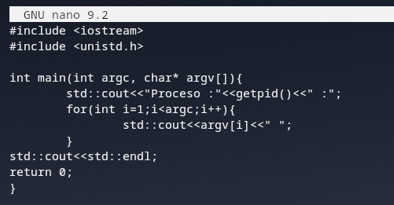
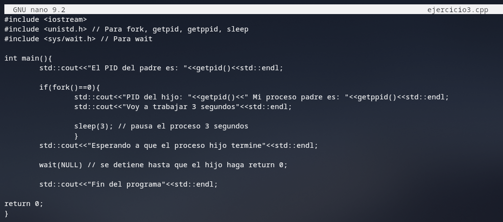
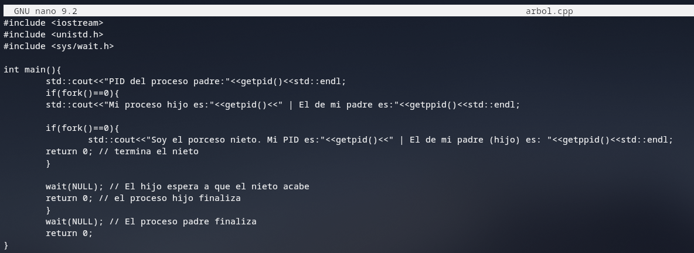
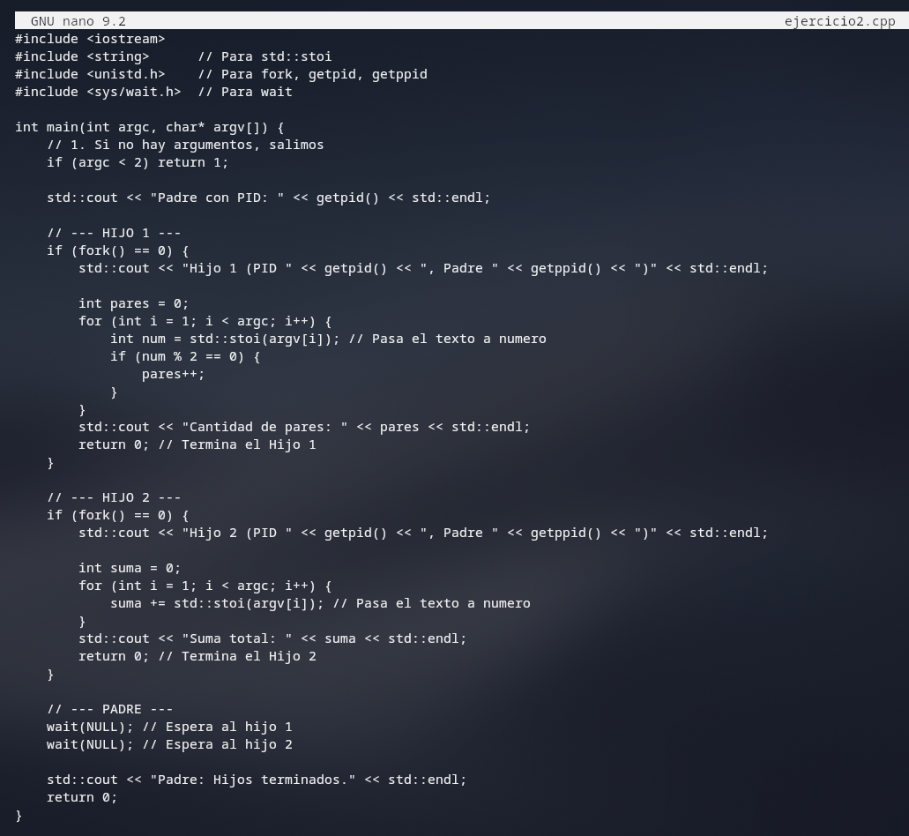

# Ejercicios para prácticar con Nano

> Recordatorio:

```
Pasos:
    1. touch ejercicio.cpp -> Para crear un archivo de tipo cpp
    2. nano ejercicio.cpp -> Para acceder al editor
    3. g++ ejercicio.cpp -o ejercicio -> para compilar el código
    4. ./ejercicio -> Para ejecutarlo
```

**1. Escribe un programa en C llamado `mi_echo.c` que reciba argumentos por línea de comandos y los imprima en pantalla separados por un espacio, seguidos de un salto de línea (igual que el comando `echo`). Además, antes de imprimir el texto, debe mostrar el PID del proceso actual.**

* Requisitos:
    * Usa `getpid()` para mostrar tu PID
    * Recorre el array argv desde el índice 1




> El vector se recorrde desde 1 ya que la posición 0 de argv es la propia instrucción

si lo probamos con una cadena como: ./ejercicio1 Hola Mundo

debería mostrar un resultado similar a:
    > [PID: 4321] Hola Mundo


**2. Objetivo: Ver claramente en la consola cómo el padre se frena (se bloquea) obligatoriamente hasta que el hijo termina de hacer una tarea que tarda unos segundos.**

* La idea:

    * El Padre hace un fork().

    * El Hijo duerme durante 3 segundos con sleep(3) simulando una tarea pesada y luego imprime un mensaje.

    * El Padre ejecuta wait(`NULL`), obligándolo a esperar. No mostrará su mensaje final hasta que el hijo termine.




> Comprobación de fork()==0 , es necesario ya qeu eso indica que el proceso padre se ha creado correctamente ya que este le debe pasar 0 a su hijo para indicar que todo ha ido con éxito, si no lo verificamos podría dar problema el programa


Debería mostrar un resultado similar a este:

```
El PID del padre es: 10789
Esperando a que el proceso hijo termine
PID del hijo: 10790 Mi proceso padre es: 10789
Voy a trabajar 3 segundos
Esperando a que el proceso hijo termine
Fin del programa
Fin del programa
```


**3. Repaso de árboles con Nano**

Objetivo:

* El Padre crea a un Hijo.

* El Hijo imprime sus datos y crea a un Nieto.

* El Nieto imprime sus datos y termina.

* Cada padre debe esperar a su respectivo hijo usando wait(NULL)



Debería mostrar un resutlado similar a este:
```
PID del proceso padre:10543
Mi proceso hijo es:10544 | El de mi padre es:10543
Soy el porceso nieto. Mi PID es:10545 | El de mi padre (hijo) es: 10544
```

**4. Objetivo: Crear un programa en C++ (analizador.cpp) que reciba varios números enteros como argumentos por línea de comandos, cree dos procesos hijos y reparta el trabajo entre ellos.**

* Requisitos del programa:
    *  Validación: El programa debe recibir al menos 2 números por consola.

* Proceso Padre:

    * Muestra su PID (getpid()).

    * Crea el Hijo 1 mediante fork().

    * Crea el Hijo 2 mediante otro fork().

    * Espera a que ambos hijos terminen usando wait(NULL) antes de imprimir un mensaje final y salir.

* Hijo 1 (Contador de Pares):

    * Muestra su PID y el PID de su padre (getppid()).

    * Recorre los argumentos recibidos y cuenta cuántos números son pares.

    * Imprime el resultado final y termina.

* Hijo 2 (Calculador de la Suma):

    * Muestra su PID y el PID de su padre (getppid()).

    * Recorre los argumentos y calcula la suma total de todos los números.

    * Imprime el resultado final y termina



Podemos comprobar que está correctamente con: 

```
g++ ejercicio2.cpp -o ejercicio2
./ejercicio2 4 7 2 9 10
```

Debería mostrar un resultado similar a este:

```
Padre con PID: 10865
Hijo 1 (PID 10866, Padre 10865)
Cantidad de pares: 3
Hijo 2 (PID 10867, Padre 10865)
Suma total: 32
Padre: Hijos terminados.
```

