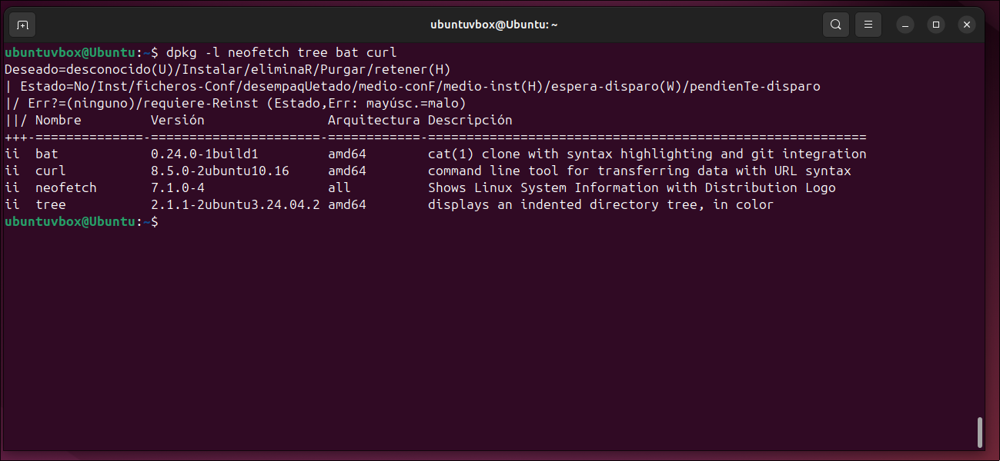
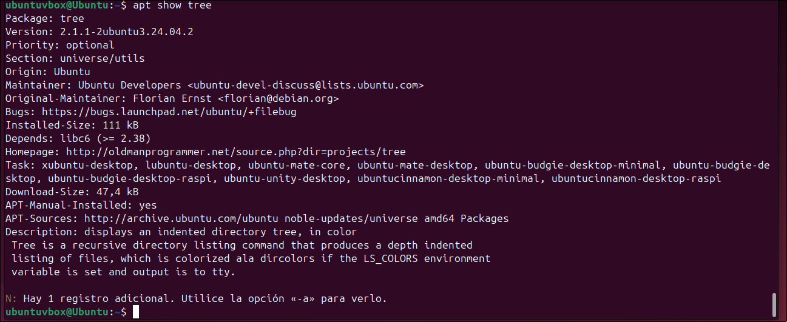
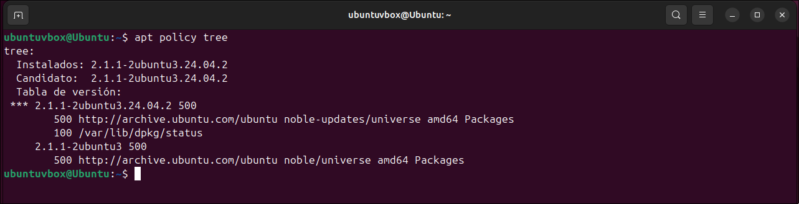
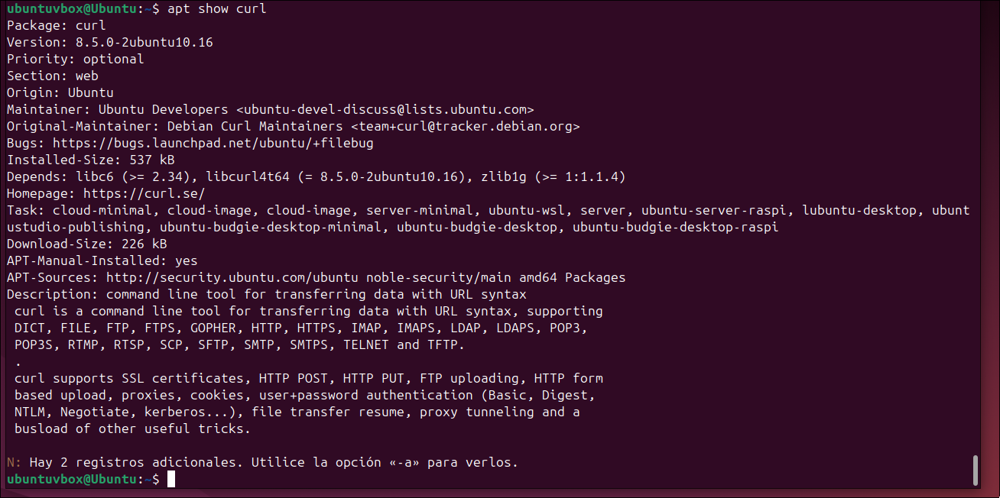
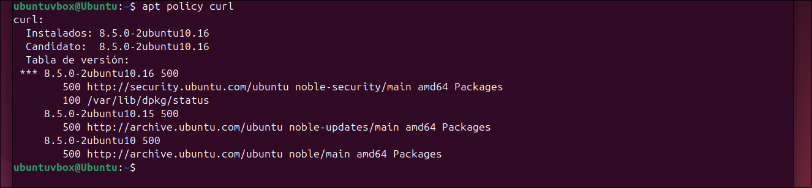
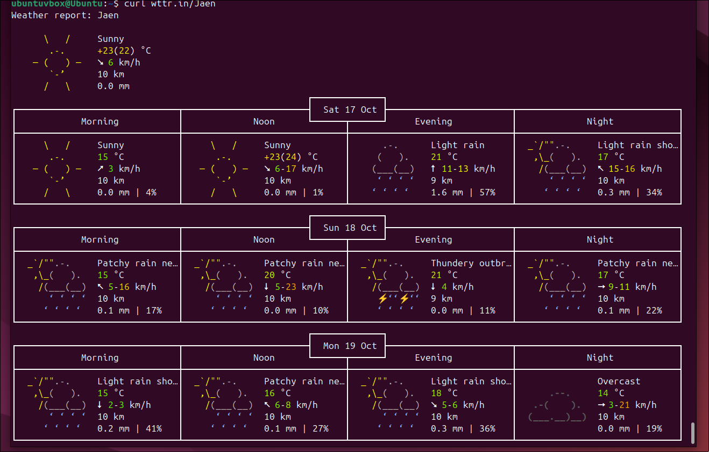
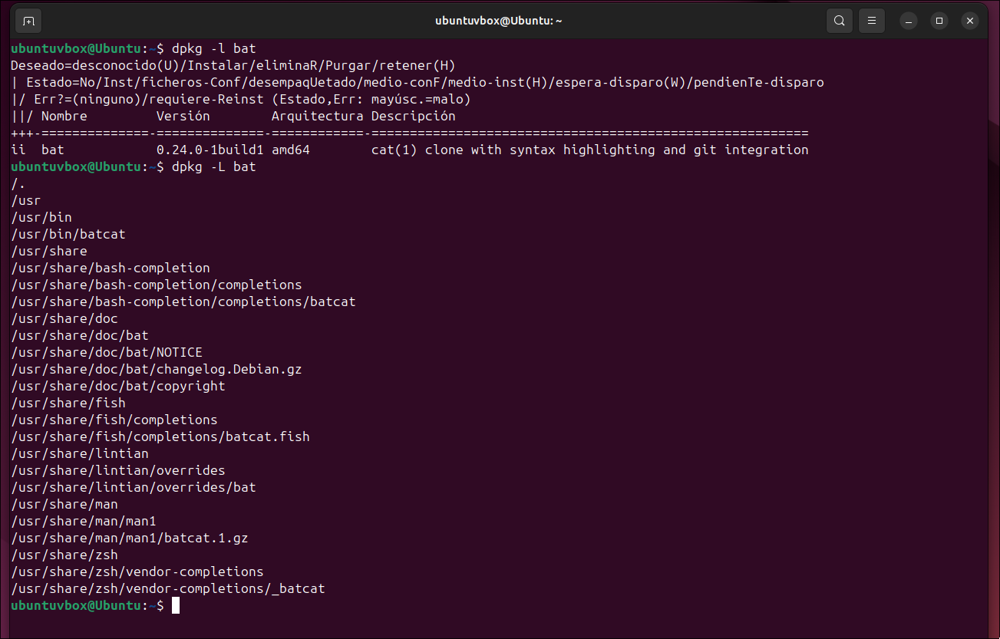
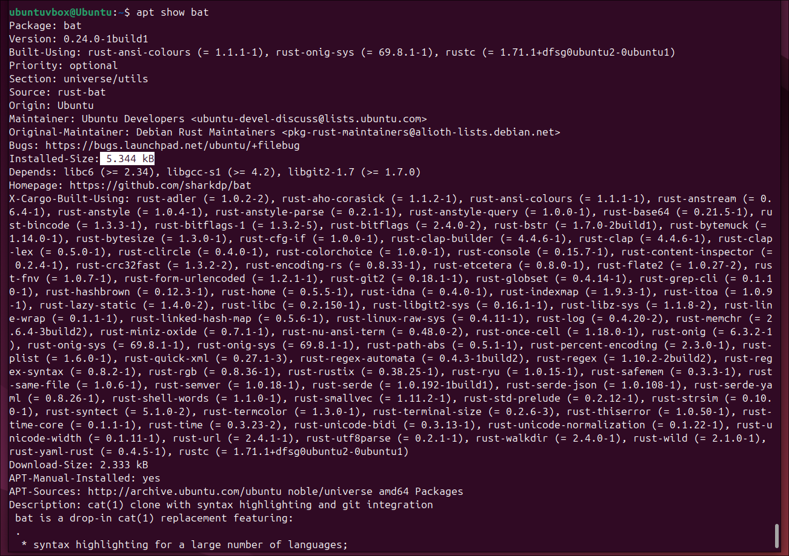
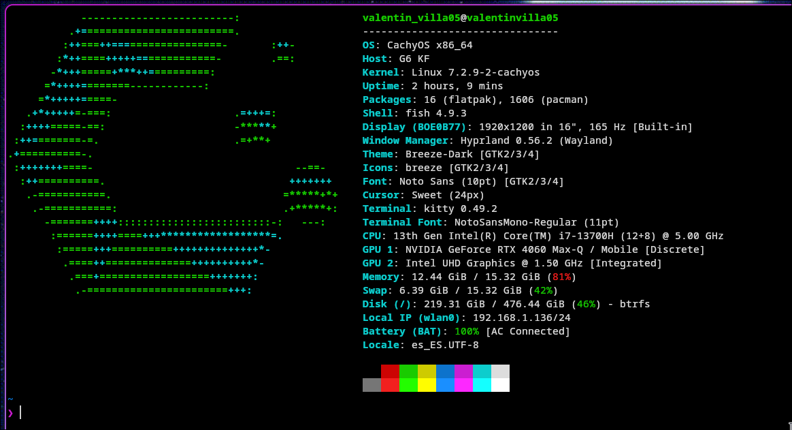

# Practica 5 : Administración de Software en Linux (LPI 1.102.4)

## 1. Conceptos Fundamentales

- **Paquete de Software**: Fichero comprimido que contiene los binarios precompilados, archivos de configuración, reglas y metadatos de un programa.

- **Dependencias**: Conjunto de bibliotecas o programas requeridos para que un software funcione. El «infierno de las dependencias» ocurre por incompatibilidades o ausencias de estas.

- **Base de Datos de Paquetes**: Registro local que rastrea qué archivos se han instalado, a qué paquete pertenecen y sus dependencias.

- **Checksums (Sumas de comprobación)**: Valores hash criptográficos para verificar la integridad del software y detectar archivos corruptos o modificados.
  - **Verificación**: dpkg --verify (o dpkg -V).

  - **Reinstalación**: sudo apt install --reinstall <paquete>.

- **Formatos Estándar (Incompatibles entre sí):**
  - **Debian (.deb)**: Usado por Debian, Ubuntu, Linux Mint, etc.

  - **RPM (.rpm)**: Usado por Red Hat, Fedora, Rocky Linux, openSUSE, etc.

  - No conviene mezclar RPM y dpkg en el mismo sistema, porque tienen bases de datos separadas y cada uno ignora lo que instaló el otro

- **Sistemas Modernos Autónomos (Snap, Flatpak, AppImage):** Incluyen sus propias dependencias y se ejecutan en entornos aislados (sandboxing). Evitan conflictos de dependencias a costa de consumir más disco y memoria

## 2. Depósitos o Repositorios de Software

Catálogos o servidores de confianza con paquetes e índices actualizados

### Categorías de Paquetes en Ubuntu

| Categoría      | Soporte canonical | Licencia | Descripción                                           |
| -------------- | ----------------- | -------- | ----------------------------------------------------- |
| **Main**       | Sí                | Libre    | Software principal y oficialmente soportado           |
| **Restricted** | Sí                | No libre | Controladores/drivers propietarios y software de pago |
| **Universe**   | No                | Libre    | Mantenido por la comunidad                            |
| **Multiverse** | No                | No libre | Restringido por derechos de autor o licencias         |

Por otro lado tenemos **backports** de `noble-backports` que contiene paquetes de otras cuatro categorias y APT no instalada **nada** de él salvo que se pida expresamente. Aquí hay versiones más recientes adaptadas de lanzamientos posteriores de Ubuntu.

### Configuración de Repositorios en Debian/Ubuntu

- **Ruta tradicional**: `/etc/apt/sources.list` (ficheros con formato .list)

- **Ruta moderna (deb822)**: `/etc/apt/sources.list.d/` (ficheros con extensión .sources)

- **Interpretación de campos principales:**
  - **Types (deb / deb-src)**: Paquetes binarios o código fuente

  - **URIs:** Dirección física o remota del repositorio

  - **Suites**: Nombre de la versión del sistema (ej: noble, resolute)

  - **Components:** Categorías (main, universe, etc.)

  - **Signed-By:** Clave GPG para comprobar la firma digital

## 3. Nomenclatura de Paquetes Debian (.deb)

**Formato:** `nombrePaquete_Numeroversion-Numerorevision_arquitectura.deb`

- Ejemplo: `zsh_5.9-6ubuntu2_amd64.deb`
  - **Programa**: `zsh`

  - **Versión del software:** `5.9`

  - **Revisión del paquete:** `6` (Debian) / `ubuntu2` (parche de Ubuntu)

  - **Arquitectura:** `amd64` (o all si no depende del hardware)

## 4. Comparativa: `APT` vs `dpkg`

| Característica              | `DPKG`                                                   | `APT` / `apt-get`                                  |
| --------------------------- | -------------------------------------------------------- | -------------------------------------------------- |
| **Nivel**                   | Herramienta de bajo nivel                                | Interfaz de alto nivel (usa `dpkg`) por debajo     |
| **Gestión de dependencias** | **No** resuelve dependencias automáticamente             | **Sí** descarga e instala dependencias requeridas  |
| **Repositorios remotos**    | Solo trabaja con archivos `.deb` locales                 | Busca, descarga e instala desde servidores remotos |
| **Uso principal**           | Consultas locales e instalación de ficheros individuales | Gestión completa del software del sistema          |

## 5. Consultas e Interpretación del Estado (dpkg -l)

El comando `dpkg -l` lista los paquetes y su estado mediante un código de 3 caracteres: [Deseado][Estado Actual][Error]

### Significado de los caracteres

- **1 Estado Deseado (Primer carácter):**
  - `i` (install): Debe ser instalado
  - `r` (remove): Debe eliminarse (manteniendo configuración)
  - `p` (purge): Debe eliminarse completamente (con configuración)
  - `h` (hold): Retenido/bloqueado contra modificaciones
  - `u` (unknown): Desconocido

- **2 Estado Actual (Segundo carácter):**
  - `i` (installed): Correctamente instalado
  - `c` (config-files): Solo quedan archivos de configuración
  - `U` (unpacked): Desempaquetado pero sin configurar
  - `F`/`H`: instalación o configuración incompleta/fallida
  - `n` (Not installed): No instalado
  - `W` o `t`: Triggers pendientes

- **3 Estado de Error (Tercer carácter):**
  - ` ` (espacio): Sin errores
  - `R` (Reinst-required): requiere reinstalación obligatoria

## 6. Comandos Clave de Referencia Rápida

- `whereis` Busca el binario, el código fuente y la página de manual de un programa en las rutas habituales (/usr/bin, /etc, /usr/share/man…) sin consultar el sistema de paquetes.

- **Gestión local con** `dpkg`:
  - `dpkg -l ['patrón']`: Listar paquetes (o filtrados)

  - `dpkg -L <paquete>:` Listar archivos instalados por un paquete

  - `dpkg --verify:` Verificar integridad de archivos instalados

  - `dpkg --contents <paquete>` Lee el archivo .deb y enumera las rutas que contiene, con sus permisos y propietarios.

- **Gestión remota y automática con** `apt`:
  - `apt list --installed`: Enumerar paquetes instalados.

  - `sudo apt install ./fichero.deb`: Instalar un `.deb` local resolviendo dependencias

  - `sudo apt install -f`: Corregir dependencias rotas

  - `apt install --reinstall <paquete>`: Vuelve a copiar los archivos del paquete tal como están en el depósito.

  - `sudo apt-mark hold <paquete>`: Bloquear la actualización de un paquete

  - `apt policy`: Muestra de dónde puede instalarse un paquete y con qué versión. Sin argumentos, lista los repositorios configurados con su prioridad.

  - `apt list --upgradable`: Lista los paquetes instalados para los que hay una versión más nueva en los repositorios.

  - `apt-mark unhold` / `showhold`: `hold` congela un paquete en su versión actual, de modo que upgrade y full-upgrade no lo tocan. Es útil cuando una versión nueva te rompería algo. En `dpkg -l` aparece con h en el primer carácter. `unhold` revierte el bloqueo y el paquete vuelve a actualizarse con normalidad.

  - `apt search <paquete>` Busca por nombre y descripción entre los paquetes que conoce APT.

## 7. Inspección y Consulta de Paquetes Instalados

Un paquete `.deb` no solo instala ejecutables binarios, sino también documentación, manuales, licencias y archivos de configuración

### A. Listar Archivos Instalados (`dpkg -L`)

Muestra todos los ficheros y directorios creados en el sistema por un paquete específico

- **Comando**: `dpkg -L <nombre_paquete>`

- **Tipos de archivos instalados:**
  - **Binarios:** `/usr/bin/` (ej: /usr/bin/zip)

  - **Páginas de manual:** `/usr/share/man/man1/` (ej: /usr/share/man/man1/zip.1.gz)

  - **Documentación y changelogs:** `/usr/share/doc/<paquete>/` (ej: WHATSNEW, changelog.Debian.gz)

### B. Mostrar Información Detallada del Paquete (`dpkg -s` / `apt show`)

Permite consultar metadatos técnicos, estado de instalación y relaciones de dependencias.

| Comando              | Cobertura                                                     | Uso Principal                                             |
| -------------------- | ------------------------------------------------------------- | --------------------------------------------------------- |
| `dpkg -s <paquete>`  | Solo paquetes **instalados**                                  | Consulta rápida de la base de datos locales de `dpkg`     |
| `apt show <paquete>` | Paquetes **instalados y no instalados** (de los repositorios) | Ver información, versión y dependencias antes de instalar |

- **Campos clave de la salida:**
- `Status`: Estado actual (install ok installed)

- `Depends`: Paquetes/librerías estrictamente necesarios

- `Recommends`: Paquetes recomendados para complementar la funcionalidad

- `Installed-Size`: Espacio total ocupado en disco

## 8 Instalación de Paquetes (`apt` / `apt-get install`)

Para instalar programas se requieren permisos de superusuario (`sudo`)

### **Sintaxis**

```bash
sudo apt install <nombre_paquete>
sudo apt-get install <nombre_paquete>
```

### **Diferencia de Comportamiento entre `apt` y `apt-get`**

- `apt-get`: Descarga los paquetes `.deb` a `/var/cache/apt/archives/` y los mantiene allí

- `apt`: Limpia y elimina automáticamente los archivos `.deb` descargados tras una instalación exitosa para ahorrar espacio

### **Las 4 Fases del Proceso de Instalación**

**1. Lectura y Verificación**: Se lee el índice local y la base de datos de `dpkg` para comprobar si el paquete existe y construir el árbol de dependencias

**2. Notificación y Confirmación**: Se informa al usuario de los paquetes adicionales (dependencias), paquetes sugeridos y el espacio total en disco que se utilizará. Se solicita confirmación (`[S/n]`).

**3. Descarga y Extracción**: Se descargan los ficheros .deb de los repositorios y se desempaquetan en el sistema

**4. Configuración Post-instalación**: Se ejecutan los scripts de post-instalación para dejar la aplicación lista para su uso (y se procesan disparadores o triggers)

### Opción de Solo Descarga (`-d` / `--download-only`)

- **Comando**: `sudo apt-get install -d <paquete>`

- **Utilidad**: Descarga el paquete y sus dependencias al directorio `/var/cache/apt/archives/` sin instalar ni configurar nada. Ideal para trasvasar paquetes a equipos sin conexión a red vía pendrive

## 9. Eliminación y Purga de Paquetes (`apt remove` / `apt purge`)

Existen dos niveles para desinstalar software del sistema:

### A. Desinstalación Estándar (remove)

- **Comando**: `sudo apt remove <paquete>` o `sudo apt-get remove <paquete>`

- **Efecto**: Elimina los ejecutables y archivos del paquete, pero conserva los archivos de configuración en `/etc/`

- **Estado en `dpkg -l`**: Pasa a ser rc (r = deseado eliminar, c = archivos de configuración presentes)

### B. Desinstalación Completa o Purga (purge)

- **Comandos equivalentes:**

```bash
sudo apt purge <paquete>
sudo apt remove --purge <paquete>
```

- **Efecto**: Elimina el paquete junto con todos sus archivos de configuración

### C. Limpieza de Dependencias Huérfanas (autoremove)

- Las dependencias instaladas automáticamente no se borran al eliminar el paquete principal

- Comando para eliminar dependencias obsoletas con su configuración:

```bash
sudo apt autoremove --purge
```

### D. Opciones Adicionales

- Opción `-y` / `--yes`: Responde automáticamente "sí" a todas las preguntas de confirmación (útil en scripts)

## 10 Actualización del Sistema Operativo

Se realiza ejecutando dos acciones en secuencia estricta:

```bash
sudo apt update
sudo apt upgrade
sudo apt full-upgrade    # O 'sudo apt-get dist-upgrade'
```

1. `sudo apt update`: Actualiza el índice local. Descarga la lista más reciente de paquetes y versiones disponibles desde los repositorios `/etc/apt/sources.list.d/ubuntu.sources`. No instala ni modifica software.

2. `sudo apt upgrade`: Actualiza los paquetes a versiones nuevas sin instalar paquetes adicionales ni eliminar ninguno

3. `sudo apt full-upgrade / dist-upgrade`: Actualización completa. Comprueba e instala actualizaciones resolviendo cambios complejos de dependencias (pudiendo instalar nuevos paquetes o eliminar los obsoletos si fuera necesario)

## 11. Caso Práctico Paso a Paso (Instalación y Borrado)

| Paso | Objetivo                              | Comando                       | Estado / Resultado esperable                                                |
| ---- | ------------------------------------- | ----------------------------- | --------------------------------------------------------------------------- |
| 1    | Actualizar índices locales            | `sudo apt update`             | Índice sincronizado con los servidores.                                     |
| 2    | Verificar si está instalado           | `dpkg -l zsh`                 | Salida: no se ha encontrado ningún paquete...                               |
| 3    | Instalar paquete                      | `sudo apt install zsh`        | Descarga, desempaqueta y configura el software.                             |
| 4    | Comprobar instalación                 | `dpkg -l zsh`                 | Estado: `ii` (instalación correcta).                                        |
| 5    | Ver binarios creados                  | `ls -al /bin/zsh*`            | Muestra `/usr/bin/zsh` y enlace/script de compatibilidad.                   |
| 6    | Desinstalar conservando configuración | `sudo apt remove zsh`         | Estado `rc` (los archivos de configuración de `/etc/zsh` siguen presentes). |
| 7    | Purgar el paquete                     | `sudo apt purge zsh`          | `zsh` deja de aparecer como `rc`; `zsh-common` sigue instalado              |
| 8    | Limpiar dependencias huérfanas        | `sudo apt autoremove --purge` | Retira y purga `zsh-common` junto con su configuración de `/etc/zsh`        |

## Ejercicios

**1.- Instala los siguientes paquetes: `neofetch`, `tree`, `bat`, `curl`. Recuerda que antes de instalar nada siempre se debe actualizar la lista de paquetes y es recomendable actualizar el sistema. En Ubuntu, la orden del paquete bat se llama batcat, porque el nombre bat lo usa otro paquete (lo explica la descripción de apt show bat). En Ubuntu 26.04, neofetch no existe: usa `fastfetch`.**

Antes de instalar cualquier programa, es obligatorio actualizar el índice local de repositorios (`update`) y altamente recomendable actualizar los paquetes existentes (`upgrade`)

```bash
sudo apt update
sudo apt upgrade -y
```

(apt update sincroniza la lista local con los servidores remotos y -y upgrade acepta la actualización automáticamente)

> En distribuciones como la de ubuntu 26.04 `neofetch` ha sido reemplazada por `fastfetch`

Instalamos los paquetes que queremos, podemos instalarlos todos de una sola orden así:

```bash
sudo apt install fastfetch tree bat curl -y
```

**2.- Para cada paquete consulta la siguiente información usando los comandos `apt` y `dpkg`**

- **Comprueba si se ha instalado correctamente**

```bash
dpkg -l tree
```

Resultado:

```bash
ii  tree  2.1.1-1  amd64  displays an image of a directory tree
```

`ii`: La primera `i` significa que se deseaba instalar y la segunda `i` (Installed) confirma que se había instalado

También podemos comprobarlos todos de una orden así:



- **Qué ficheros ha instalado cada uno**

```bash
dpkg -L tree
```

Resultado:
`/usr/bin/tree` $\rightarrow$ El ejecutable/programa principal

`/usr/share/man/man1/tree.1.gz` $\rightarrow$ La página de manual (documentación)

`/usr/share/doc/tree/...` $\rightarrow$ Licencias y notas de la versión

- **Para qué sirve**

```bash
apt show tree
```

buscamos en la línea de `Description`
Sirve para mostrar de forma visual y gráfica la estructura de directorios y archivos en forma de árbol jerárquico

- **Qué tamaño ocupa una vez instalado**

```bash
apt show tree
```



Buscamos en: `Installed-Size`
Valor típico: `111 kB`

- **¿Está mantenido directamente por la empresa Canonical? (ver la categoría a la que pertenece en el apartado Section de apt show: universe/utils indica la
  categoría universe; si no lleva prefijo, como «web», el paquete es de main)**

Miramos en `Section`

- Se dice solo `utils` -> Pertenece a Main -> Si está en canonical
- Nos dice: `universe/utils` -> Pertenece a Universe -> no lo mantiene Canonical

- **En qué sitio web puedes consultar más información sobre el proyecto ( apartado Homepage)**

Revisamos `Homepage`
Resultado:

```bash
Homepage: [http://oldmanprogrammer.net/source.php?dir=projects/tree](http://oldmanprogrammer.net/source.php?dir=projects/tree)
```

- **¿De qué repositorio de paquetes se ha descargado? (consulta apt policy
  nombrePaquete o el apartado APT-Sources de apt show)**

```bash
apt policy tree
```



Nos fijamos en la línea que tiene asterisco `***` o la selección de URLs de descarga

Resultado:

```bash
[http://archive.ubuntu.com/ubuntu](http://archive.ubuntu.com/ubuntu) noble-updates/universe amd64 Packages
```

- **Cómo se utiliza (utiliza man). Realiza pruebas simples de ejecución con cada uno para comprobar su funcionamiento**

1. Consultamos el manual

```bash
man tree
```

2. Probamos una ejecucion

```bash
tree -L 2 /etc
```

(Muestra los archivos y carpetas del directorio `/etc` limitando la profundidad a 2 niveles)

3. Probamos con `curl`
   Comprobamos si está bien instalado:

```bash
dpkg -l curl
```

( Nos fijamos en que las primeras letras sean ii )

Miramos que ficheros ha instalado

```bash
dpkg -L curl
```

Archivos:
`/usr/bin/curl` $\rightarrow$ Ejecutable
`/usr/share/man/man1/curl.1.gz` $\rightarrow$ Manual de usuario

Para que sirve

```bash
apt show curl
```

Linea: `Description`: es una herramienta de línea de comandos para transferir datos desde o hacia un servidor web/red mediante varios protocolos

Qué tamaño ocupa una vez instalado

```bash
apt show curl
```



Miramos: `Installed-Size`
Valor: `537 kB`

¿Está mantenido directamente por Canonical?
miramos la línea `Section` ejecutando `apt show curl`

Resultado:
Muestra: `Section: web`
Pertenece al main y está mantenido por canonical

Sitio web del proyecto
Miramos `Homepage`

Resultado:
[https://curl.se/](https://curl.se/)

¿De qué repositorio se ha descargado?

```bash
apt policy curl
```



Resultado: Muestra el servidor de Ubuntu y el componente `main` o `noble-security/main` si recibió alguna actualización

Cómo se utiliza (man) y prueba de ejecución

```bash
man curl
```

(Pulsa `q` para salir del manual)

Probamos una ejecución

```bash
curl wttr.in/Jaen
```

(`curl` hace una petición HTTP al servicio web `wttr.in` y muestra en la terminal la previsión del tiempo para Jaén en formato texto)



4. Repetimos el proceso con `bat` (comando `batcat`)

Comprobamos si está bien instalado:

```bash
dpkg -l bat
```

( Nos fijamos en que las primeras letras sean ii )

Miramos qué ficheros ha instalado

```bash
dpkg -L bat
```

Archivos:
`/usr/bin/batcat` $\rightarrow$ Ejecutable principal (en Ubuntu se llama `batcat`)
`/usr/share/man/man1/batcat.1.gz` $\rightarrow$ Página del manual



Para qué sirve

```bash
apt show bat
```



Línea: `Description`: sirve para mostrar el contenido de ficheros de texto (como el comando `cat`), pero añadiendo resaltado de sintaxis con colores y números de línea

Qué tamaño ocupa una vez instalado
Miramos: `Installed-Size`

Valor: ` 5.344 kB`

¿Está mantenido directamente por Canonical?
Miramos la línea `Section` ejecutando `apt show bat`

Resultado:
Muestra: `Section: universe/utils`
Lleva el prefijo `universe/` -> Pertenece a Universe -> NO lo mantiene Canonical directamente (lo mantiene la comunidad)

Sitio web del proyecto

Miramos `Homepage`

Resultado:
[https://github.com/sharkdp/bat](https://github.com/sharkdp/bat)

¿De qué repositorio se ha descargado?

```bash
apt policy bat
```

Resultado: Procede del repositorio oficial de Ubuntu, dentro del componente `universe`

Cómo se utiliza (man) y prueba de ejecución

```bash
man batcat
```

Probamos una ejecución

```bash
batcat /etc/hosts
```

(Lee el archivo `/etc/hosts` y lo muestra enmarcado, con números de línea y sintaxis coloreada)

5. Probamos con `fastfetch`

(Nota: en versiones modernas de Ubuntu se usa `fastfetch`; si usas una versión anterior, sustituye la palabra por `neofetch`)

Comprobamos si está bien instalado:

```bash
dpkg -l fastfetch
```

( Nos fijamos en que las primeras letras sean ii )

Miramos qué ficheros ha instalado

```bash
dpkg -L fastfetch
```

Archivos:
`/usr/bin/fastfetch` $\rightarrow$ Ejecutable
`/usr/share/man/man1/fastfetch.1.gz` $\rightarrow$ Página de manual

Para qué sirve

```bash
apt show fastfetch
```

Línea: `Description`: herramienta para mostrar información del sistema (versión de la distribución, kernel, escritorio, procesador, memoria RAM) en la terminal junto al logo de la distribución

Qué tamaño ocupa una vez instalado

```bash
apt show fastfetch
```

Miramos: `Installed-Size`
Valor: `3.8 MB`

¿Está mantenido directamente por Canonical?
Miramos la línea `Section` ejecutando `apt show fastfetch`

Resultado:
Muestra: `Section: universe/utils`
Lleva el prefijo `universe/` -> Pertenece a Universe -> NO lo mantiene Canonical

Sitio web del proyecto

```bash
apt show fastfetch
```

Miramos `Homepage`

Resultado:
[https://github.com/fastfetch-cli/fastfetch](https://github.com/fastfetch-cli/fastfetch)

¿De qué repositorio se ha descargado?

```bash
apt policy fastfetch
```

Resultado: Procede del repositorio oficial de Ubuntu, componente `universe`

Cómo se utiliza (man) y prueba de ejecución

```bash
man fastfetch
```

Probamos una ejecución

```bash
fastfetch
```

(Dibuja el logo de Ubuntu en ASCII junto a los datos técnicos del ordenador y del sistema operativo)
(Ejemplo de fastfetch en otra distribución a Ubuntu)



**3.- Elimina alguno de ellos y verifica que ya no está instalado o si ha dejado archivos de configuración. En ese caso, indica al gestor de paquetes que los elimine también.**

> Vamos a eliminar la herramienta `fastfetch`

```bash
sudo apt remove fastfetch
```

Verificamos el estado del paquete

```bash
dpkg -l fastfetch
```

Resultado de la salida

```bash
rc  fastfetch  2.8.0-1  amd64  fast system information tool
```

`r` (remove): el paquete fue marcado para ser eliminado y sus ejecutables fueron borrados

`c` (config-files): Aún permanecen en el sistema los archivos de configuración asociados

Eliminamos completamente sin que quede rastro

```bash
sudo apt purge fastfetch
```

y si el paquete instaló dependencias automáticamente y no nos hacen falta:

```bash
sudo apt autoremove --purge
```
