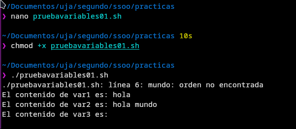
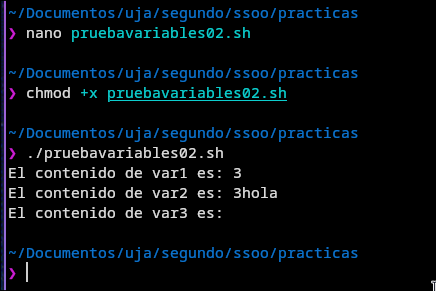
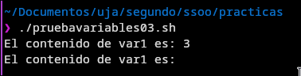
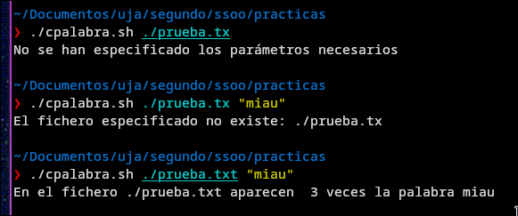
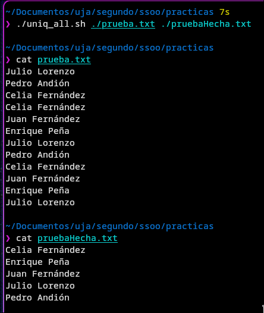
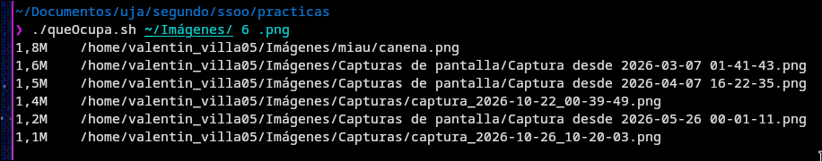
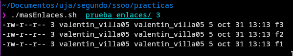
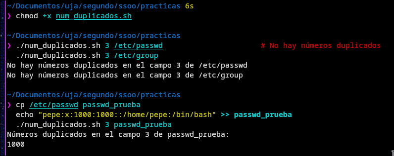

# Práctica 7 Programación en Shell. Primeros pasos.

Un **Shell Script** es un archivo de texto ejecutable que contiene una secuenia de órdenes que el intérprete (shell) procesa e interpreta ordenadamente

- **Utilidad**: Automatiza tareas administrativas repetitivas, evita errores humanos y simplifica comandos complejos

- **Naturaleza**: No requirer compilación, solo necesita permisos de ejecución

## Anatomía de un Shell Script

Un script estructurado consta de tres partes fundamentales:

```bash
#!/bin/bash
# Autor: Nombre del Autor
# Descripción: Breve explicación de lo que hace el script

echo "Ejecutando script..."
```

**1. Shebang (`#!`)**: Debe ubicarse en la primera línea y ser los dos primeros bites del archivo para que el sistema lod pueda reconocer. Indica la ruta absoluta del intérprete a usar: Ejemplo (`#!/bin/bash`)

> Para averiguar la ruta de Bash: **which bash**

**2. Comentarios (`#`)**: Todo texto tras el carácter # es ignorado por la Shell. Se usan para documentar el autor, fecha, versión y propósito del código. Estos solo se intepretan al inicio de una linea, si se escribe en mitad de una palabra no se interpreta como comentario

**3. Órdenes:** Comandos directos del sistema que se ejecutan secuencialmente

## Creación, Permisos y Ubicación

- **Convención de nombre:** Extensión `.sh` (opcional, pero recomendada)

- **Comprobar conflictos de nombre:** Usar type `-a <nombre>` para evitar sobrescribir comandos del sistema o del intérprete

- **Otorgar permiso de ejecución:**

```bash
chmod +x mi_script.sh
```

- **Ejecución básica (Ruta relativa/absoluta):**

```bash
./mi_script.sh
*(Es necesario indicar `./` porque el directorio actual no suele estar en la variable de entorno `$PATH`)
```

- **Ubicación recomendada (`~/bin`):**

Crear la carpeta `~/bin` y guardar allí los scripts para ejecutarlos directamente por su nombre desde cualquier directorio:

```bash
mkdir -p ~/bin
mv mi_script.sh ~/bin/
```

## Entrada y Salida de Datos

### Comando `echo` (Salida)

- `-n`: Imprime texto sin salto de línea final

- `-e`: Permite la interpretación de caracteres de escape como `\n` (nueva línea) o `\t` (tabulador)

- **Sustitución de comandos: `$()` ejecuta un comando y devuelve su salida.**

```bash
echo "Hoy es $(date)"
```

- **Comando `read` (Entrada)**

Lee el valor introducido por el usuario desde la entrada estándar y lo guarda en una variable

```bash
echo -e "\nEscribe la ruta:"
read la_ruta
ls "$la_ruta"
```

## Tipos de Parámetros

En Bash, los parámetros almacenan valores y se dividen en tres categorías principales:

### A. Variables (Definidas por el usuario)

- **Reglas:** Los nombres solo contienen letras, números y `_` (deben empezar por letra o `_`)
- **Regla de estilo:** **NUNCA usar Mayúsculas** para variables de usuario, ya que están reservadas para las variables de entorno del sistema (`$PATH`, `$HOME`, `$USER`
- **Asignación sin espacios:** `variable=valor` (Si hay espacios en la asignación, falla o se interpreta como comando)
- **Acceso:** `$variable` o `${variable}` (preferible para delimitar)
- **Eliminación:** `unset variable`
- **Tipado:** Todos los valores se almacenan e interpretan como **cadenas de texto** (Ejemplo: `var=1+2` guarda la cadena `"1+2"`, no realiza la suma)

### B. Parámetros Posicionales

Representan los argumentos pasados al script en la línea de comandos:

- `$1`, `$2`, `$3`: Argumento 1, 2, 3, etc
- `${10}`: Obligatorio usar llaves para posiciones mayores a 9

### C. Parámetros Especiales

- `$0`: Nombre o ruta con la que se invocó el script
- `$#`: Número total de parámetros posicionales pasados
- `$*`: Todos los argumentos. Si se usa entre comillas dobles (`"$*"`), se concatenan en **una sola cadena**
- `$@`: Todos los argumentos. Si se usa entre comillas dobles (`"$@"`), se tratan como **elementos o palabras individuales**
- `$$`: PID (ID de proceso) de la shell que ejecuta el script

## Uso de Comillas y Escapes

| Tipo                 | Sintaxis  | Comportamiento                                                                      |
| :------------------- | :-------- | :---------------------------------------------------------------------------------- |
| **Comillas Dobles**  | `"texto"` | Permite la expansión de variables (`$var`), ejecución de comandos (`$()`) y escapes |
| **Comillas Simples** | `'texto'` | Inhabilita la expansión. Todo se interpreta de forma **literal**                    |
| **Barra Invertida**  | `\$`      | Invalida el significado especial del carácter que le sigue (carácter de escape)     |

## Depuración de Scripts

Para solucionar errores sintácticos y lógicos se utilizan las siguientes opciones de ejecución

- `bash -x mi_script.sh`: Muestra cada orden que se ejecuta tras realizar la expansión de variables
- `bash -v mi_script.sh`: Muestra las líneas del guion en pantalla a medida que se van leyendo (modo _verbose_)
- `bash -n mi_script.sh`: Comprueba únicamente la sintaxis del script sin ejecutarlo
- **Herramientas recomendadas:** Uso del analizador estático `shellcheck` (`sudo apt install shellcheck`)

---

## Ejemplos

1. Escribe y ejecuta el siguiente shell script. Llámalo _pruebavariables01.sh_:

```bash
#!/bin/bash
# Autor: Francisco de Asís Conde Rodríguez
# Descripción: Pruebas de uso de variables

var1=hola
var2="hola mundo"
var3=hola mundo

echo El contenido de var1 es: ${var1}
echo El contenido de var2 es: ${var2}
echo El contenido de var3 es: ${var3}
```

¿Qué resultado se obtiene? ¿A qué crees que se debe? ¿Cómo crees que se resuelve?
Si se produce un error, puedes ejecutarlo con las opciones de depuración del
apartado anterior (por ejemplo, bash -x pruebavariables01.sh) para entender el
motivo

Al ejecutarlo podemos ver lo siguiente:


El primer y segundo `echo` se ejecutan correctamente porque los strings que queríamos imprimir estaban entre comillas o era solo una palabra junto al `=`, en el caso del tercero habiamos escrito el string formado por 2 palabras sin comillas por lo que el sistema interpreta la segunda palabra que no está junto al `=` como una orden la cual evidentemente no conoce.

2. Escribe y ejecuta el siguiente shell script. Llámalo _pruebavariables02.sh_:

```bash
#!/bin/bash
# Autor: Francisco de Asís Conde Rodríguez
# Descripción: Pruebas de uso de variables

var1=3
var2=${var1}hola
var3=$var1hola

echo El contenido de var1 es: ${var1}
echo El contenido de var2 es: ${var2}
echo El contenido de var3 es: ${var3}
```

¿Qué resultado se obtiene? ¿A qué crees que se debe? ¿Por qué no se produce un
error?

Ejecutamos y vemos lo siguiente:



En el primer `echo` imprime el valor de la primera variable declarada, un 3 en este caso. En el segundo `echo` imprime la primera variable haciendo uso de `${}` y despues escribe 'hola' junto a ello haciendo que se impriman ambas cosas juntas. El tercer `echo` no devuelve nada ya que al no hacer uso de `${}` está intentando imprimir una variable de nombre 'var1hola' la cual no existe.

3. Escribe y ejecuta el siguiente shell script. Llámalo _pruebavariables03.sh_:

```bash
#!/bin/bash
# Autor: Francisco de Asís Conde Rodríguez
# Descripción: Pruebas de uso de variables
var1=3
echo El contenido de var1 es: ${var1}
unset var1
echo El contenido de var1 es: ${var1}
```


¿Qué resultado se obtiene? ¿Por qué no se produce un error?

¿Qué resultado se obtiene? ¿Por qué no se produce un error?

Como vemos no se produce ningun error porque a pesar de borrar la variable con `unset` bash trata las variables que no existen como cadenas vacias y no como errores.

---

## Ejercicios

1. Escribe un script bash al que se le pasan 2 argumentos al que llamaremos
   cpalabra.sh: el nombre de un fichero de texto y una palabra o frase que debe pasarse entre comillas dobles. El programa cuenta el número de palabras o frases que hay en el fichero de texto que se pasa como argumento. Indicaciones: utiliza las órdenes grep (busca la opción que solo muestra las coincidencias, no la línea completa) y wc.

```bash
#!/bin/bash

# Autor: Valentin Villa
# Descripción: Cuenta el numero de veces que sale una palabra en un archivo, ambas pasadas por parámetro

if [ $# -ne 2 ]; then
	echo "No se han especificado los parámetros necesarios"
	exit 1
fi

if [ ! -f $1 ]; then
	echo "El fichero especificado no existe: $1 "
	exit 2
fi

numero=$(grep -io $2 $1 | wc -l)

echo "En el fichero $1 aparecen  ${numero} veces la palabra $2"
```



En el primer condicional comprobamos que el número de parámetros totales (`$#`) sea igual a 2, es decir, que se hayan pasado todos los parámetros necesarios, sino terminamos de ejecutar.

Pasando al segundo condicional, comprobamos que el fichero que se ha pasado exista con `! -f $1`, en caso de que no exista terminamos de ejecutar.

Por último, conseguimos todas las coincidencias de palabra en el archivo con `grep` usando las opciones `-i` para que tambien cuente las palabras aunque empiecen por mayúscula y `-o` para que nos de cada coincidencia en una linea para así solo tener que contar las líneas con el `wc -l`

2. La orden uniq sin argumentos elimina las líneas de texto que están duplicadas sólo si son adyacentes. Escribe una nueva orden que se llamará uniq_all.sh que recibe dos parámetros: 2 nombres de ficheros. Lo que hace es quitar las líneas repetidas de un fichero estén o no consecutivas y lo guarda en el otro fichero. A continuación tienes un ejemplo del contenido de un fichero con líneas repetidas.

```bash
#!/bin/bash

# Autor: Valentin Villa
# Descripcion: Elimina las lineas repetidas de un fichero esten o no consecutivas

if [ $# -ne 2 ]; then
	echo "No se han especificado los parámetros necesarios."
	exit 1
fi

if [ ! -f $1 ]; then
	echo "El archivo a leer no existe: $1"
	exit 2
fi

if [ $1 -ef $2 ]; then
	echo "El archivo de entrada y de salida no puede ser el mismo"
	exit 3
fi

if [ ! -f $2 ]; then
	touch $2
fi

sort $1 | uniq > $2
```



¿Que hemos hecho?

Primero hacemos las comprobaciones para que todo funcione, al igual que el ejercicio anterior comprobamos que se hayan pasado los parámetros necesarios, que el fichero que vamos a leer exista, si el archivo que vamos a escribir no existe entonces lo creamos y además comprobamos que no se pase el mismo archivo para entra y salida porque eso provocaria un error.

Luego, para hacer lo principal del ejercicio es simple, ordenamos el archivo con `sort` y de esa manera los nombre que sean iguales se pondrán seguidos y después usamos `uniq` para quitar los repetidos contiguos escribiendolo en el segundo fichero especificado. Todo eso con la linea: `sort $1 | uniq > $2`

3. El comando du sirve para verificar el uso de espacio en disco en un directorio. Escriba una orden llamada queocupa.sh al que se pasan 3 argumentos: un directorio, y una extensión (algo como .jpg, .png) y un número num y muestra los num ficheros que más ocupan con esa extensión. Indicaciones: Utiliza la opción de la orden du que muestra el espacio en Byte, Kilobyte, Megabyte, Gigabyte, Terabyte y Petabyte, usa las órdenes grep, sort (busca la opción que ordena los tamaños tal como los escribe du -h, con sus sufijos K, M, G…).

```bash
#!/bin/bash

#Autor: Valentin Villa
# Descripcion: Devuelve el numero de archivos que mas ocupan con la extension especificada

if [ $# -ne 3 ]; then
	echo "No se han especificado los parámetros necesarios."
	exit 1
fi

if [ ! -d $1 ]; then
	echo "El directorio a leer no existe: $1"
	exit 2
fi

du -ah $1 | sort -hr | grep $3 | head -$2
```

7

(En este ejercicio vamos a obviar la explicación de las comprobaciones del inicio pq son las mismas)

Para conseguir lo que nos pide el ejercicio vamos a usar las órdenes:
`du` con las opciones `-ah` que nos devuelve lo que ocupa cada archivo con su nomenclatura K, M... en un formato legible, la salida de eso la vamos a ordenar con `sort -hr` que ordena el resultado de `du` teniendo en cuenta el formato que nos da (por ejemplo: 67K) con `-h` y el `-r` para darle la vuelta y que lo ordene de mayor a menor. Una vez ordenados, nos quedamos solo con los archivos de la extensión especificada con `grep` y teniendolos ya filtrado nos quedamos solamente con los primeros X archivos que especificamos tambien en los parámetros con `head`

4. Escriba una orden llamada _masenlaces.sh_ a la que se pasan 2 argumentos: un
   directorio y un número. Esta orden muestra los n ficheros o directorios con más enlaces duros de ese directorio. Indicaciones: tail -n +2: Omite la primera línea de la salida, que suele ser el encabezado en el caso de ls -l (normalmente "total XX"). La opción -n especifica el número de líneas que quieres mostrar, pero el signo + cambia el comportamiento de tail. En lugar de mostrar las últimas n líneas, +2 indica que se deben mostrar todas las líneas comenzando desde la segunda línea.

```bash
#!/bin/bash

# Autor: Valentin Villa
# Descripcion: Muestra los ficheros o directorios con mas enlaces duros de un directorio

if [ $# -ne 2 ]; then
	echo "No se han especificado los parámetros necesarios."
	exit 1
fi

if [ ! -d "$1" ]; then
	echo "El directorio a leer no existe: $1"
	exit 2
fi

if [[ ! $2 =~ ^[0-9]+$ ]]; then
	echo "El segundo parámetro debe ser un número: $2"
	exit 3
fi

ls -l "$1" | tail -n +2 | sort -k2,2 -nr | head -n "$2"
```



Para lo principal del ejercicio usamos la salida de `ls -l`, donde la **segunda columna** es el número de enlaces duros de cada fichero o directorio:

- `ls -l "$1"` lista el contenido del directorio con todos sus detalles.
- `tail -n +2` elimina la primera línea, que es el `total XX` y no corresponde a ningún fichero.
- `sort -k2,2 -nr` ordena por la segunda columna (`-k2,2`), como número (`-n`) y de mayor a menor (`-r`).
- `head -n "$2"` se queda solo con las n primeras líneas, es decir, las que más enlaces tienen.

Los directorios suelen aparecer los primeros porque su número de enlaces es el de sus subdirectorios más 2 (`.` y la entrada en su padre). Para ver ficheros con enlaces duros "de verdad" tenemos que crearlos con `ln`.

5. Escriba una orden llamada num_duplicados.sh a la que se pasan 2 argumentos:
   un número y un fichero. Esta orden busca en un fichero de configuración (por ejemplo, /etc/passwd o /etc/group) si uno de sus campos numéricos tiene números duplicados. El argumento número hace referencia al campo que debe verificar. Por ejemplo, en el caso de /etc/passwd, en el campo 3 están los UIDs, en el caso de /etc/group, en el campo 3 están los GIDs. Formas de invocarla sería:

```bash
#!/bin/bash

# Autor: Valentin Villa
# Descripcion: Busca numeros duplicados en un campo de un fichero de configuracion

if [ $# -ne 2 ]; then
	echo "No se han especificado los parámetros necesarios."
	exit 1
fi

if [ ! -f "$2" ]; then
	echo "El fichero a leer no existe: $2"
	exit 2
fi

if [[ ! $1 =~ ^[1-9][0-9]*$ ]]; then
	echo "El campo debe ser un número mayor que 0: $1"
	exit 3
fi

duplicados=$(cut -s -d: -f"$1" "$2" | sort -n | uniq -d)

if [ -z "$duplicados" ]; then
	echo "No hay números duplicados en el campo $1 de $2"
else
	echo "Números duplicados en el campo $1 de $2:"
	echo "$duplicados"
fi
```



¿Que hemos hecho?

Primero las comprobaciones: que se pasen los dos parámetros, que el fichero exista y que el campo sea un número mayor que 0 (los campos se empiezan a contar desde 1).

Para lo principal del ejercicio usamos tres órdenes encadenadas:

- `cut -s -d: -f"$1" "$2"` extrae el campo que nos piden. Los ficheros de configuración separan los campos con `:`, por eso usamos `-d:`. La opción `-s` descarta las líneas que no tienen ningún `:` (líneas en blanco o comentarios), para que no cuenten como valores.
- `sort -n` ordena los números, de modo que los iguales quedan seguidos. Es el mismo truco del ejercicio 2, porque `uniq` solo compara líneas adyacentes.
- `uniq -d` muestra únicamente los valores que están repetidos (una vez cada uno).

Guardamos el resultado en la variable `duplicados`. Si está vacía (`-z`), no hay repetidos y lo indicamos; si no, mostramos cuáles son.
