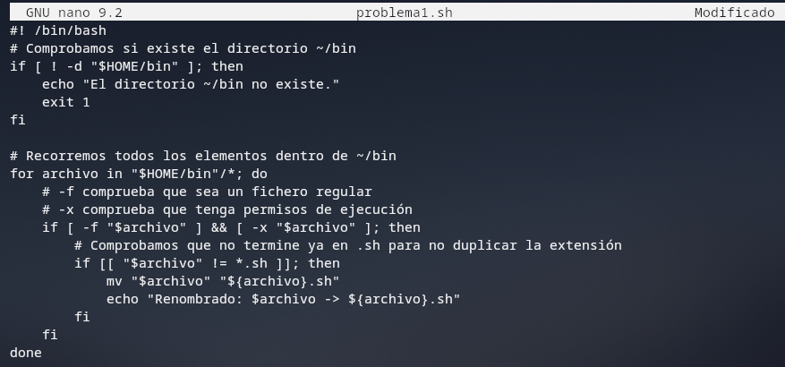
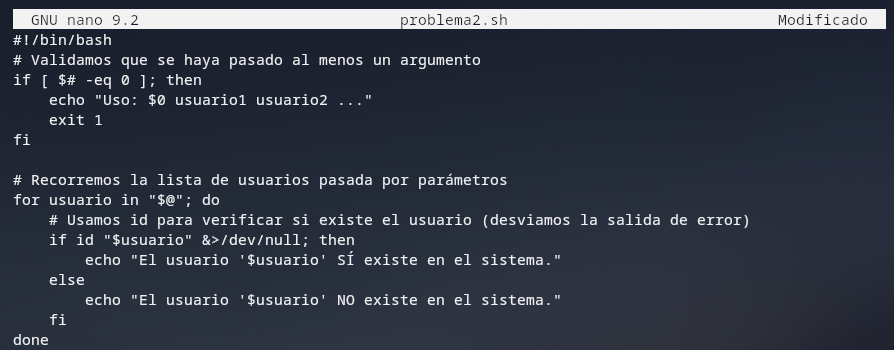
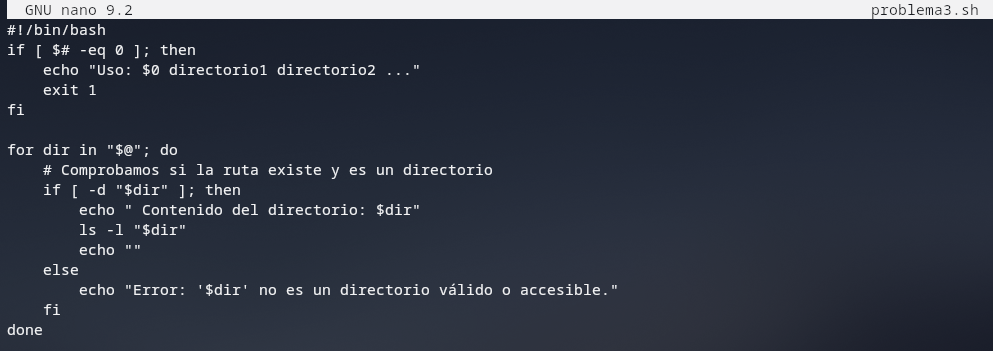
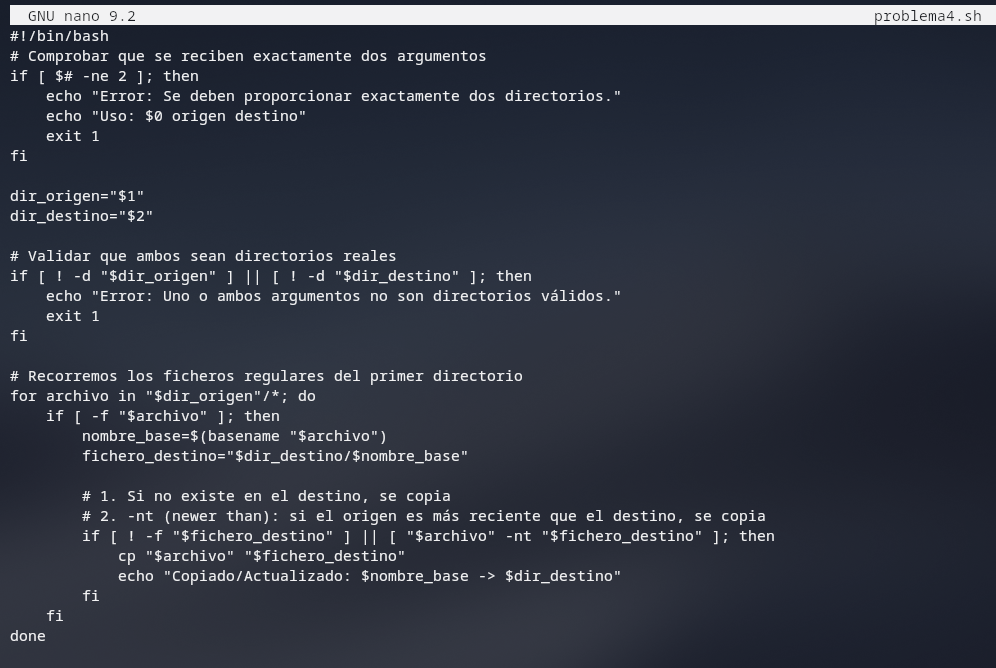
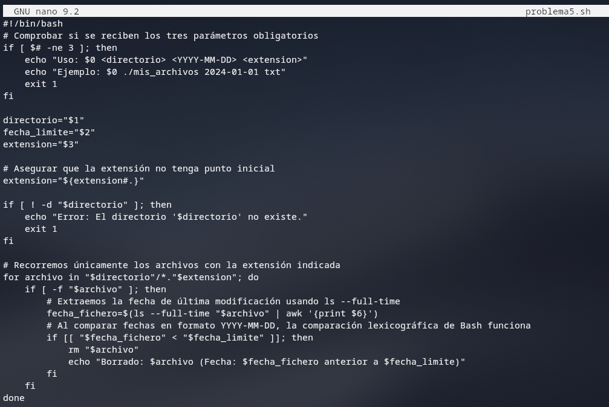

# 09-Programación en Shell. Listas y bucles.

## 1. Listas, vectores(Arrays) y Cadenas
> En Bash todo son variables, pero según cómo las guardes, la Shell las trata diferente

### A. Listas simples (Texto separado por espacios)
Una lista básica es solo texto normal guardado en una variable con comillas

```bash
frutas="manzana piña pera" # Creamos la lista
frutas="${frutas} naranja"  # Añadimos un elemento al final
```

### B. Vectores / Arrays (Listas con índice)
Son como cajones numerados (el primer cajón siempre es el `0`). Se crean entre **paréntesis**

```bash
animales=(gato perro loro) # Creación
```

#### Trucos

* **`{animales[1]}`** $\rightarrow$ Devuelve perro (el elemento del índice `1`)

* **`{animales[*]}`** o **`{animales[@]}`** $\rightarrow$ Muestra **TODOS** los animales

* **`{#animales[*]}`** $\rightarrow$ Muestra cuántos elementos hay en total (aquí devolvería `3`)

**Importante**: si no ponemos [*] nos muestra el número de letras de la primera palabra ("gato" = 4)

* **`{animales[*]:1:2}`** $\rightarrow$ Recorta: desde la casilla `1`, coge `2 elementos` (perro loro)


* **`{animales[*]: -3}`** $\rightarrow$ Muestra los últimos 3 elementos (**TENEMOS QUE DEJAR ESPACIO ANTES DEL `-`**)

---
#### Diferencia entre `*` y `@`

* `"${array[*]}"` junta todo en una **sola** palabra

* `"${array[@]}"` respeta los elementos separados como elementos individuales (**ideal para bucles**)


### C. Recortar Cadenas de Texto (Strings)
Usa **`{variable:inicio:longitud}`**:  

```bash
cadena="abcdefgh"
echo ${cadena:1:1} # Muestra "b" (empieza en pos 1, coge 1 letra)
echo ${#cadena}    # Muestra "8" (longitud total de la palabra)
```

## 2. Órdenes que devuelven listas (Sustitución)
Si ejecutas un comando de Linux y quieres guardar el resultado en un array o variable, TIENES que usar la sustitución **`$()`**

```bash
# BAD (Guarda la palabra literal "ls", no los archivos):
resultado='ls' 

# GOOD (Guarda el resultado de ejecutar ls):
resultado=$(ls) 

# TOP (Guarda los archivos directamente como un ARRAY):
resultado=($(ls))
```

## 3. Bucles **For**
El bucle for en Bash va cogiendo elemento a elemento

### 1. Bucle clásico sobre una lista de palabras

```bash
for f in manzana pera piña; do
    echo "Me gusta la $f"
done
```

### 2. Recorrer un Array
Pon **comillas dobles** y **`@`** para que si una fruta se llama "kiwi amarillo", no piense que son 2 frutas distintas

```bash
frutas=("manzana" "kiwi amarillo")
for f in "${frutas[@]}"; do
    echo "Fruta: $f"
done
```

### 3. Recorrer rangos de números
```bash
for i in {1..5}; do          # Cuenta de 1 a 5
for i in {1..10..2}; do      # Cuenta de 1 a 10 de 2 en 2 (1, 3, 5...)
```

### 4. Recorrer archivos del directorio
```bash
for archivo in *; do
    echo "Fichero encontrado: $archivo"
done
```

### 5. Contadores numéricos
```bash
for ((i=0; i<5; i++)); do
    echo "Número: $i"
done
```

## 4. PARÁMETROS DEL SCRIPT (`$*` vs `$@`)
Cuando llamas a un script así: `./script.sh 1 2 "3 4" 5`

| Expresión | Comportamiento | 
| -- | -- | 
| `$*` o `$@` | Rompe las comillas. Trata `"3 4"` como dos cosas separadas: `3` y `4` | 
| `"$*"` | Mete todo en una sola frase: `"1 2 3 4 5"` | 
| `"$@"` | Mantiene los espacios: `1`, `2`, `"3 4"` y `5` | 

## 5. LA VARIABLE `IFS` (Internal Field Separator)

### ¿Qué es?
`IFS` indica a Bash qué carácter usa para separar elementos. Por defecto son 3: **Espacio, Tabulador y Salto de línea**

### El problema típico:
Si tienes un archivo o un `find` con nombre con espacios (ej: `"Mi foto.jpg"`), el `for` lo romperá en dos iteraciones ("Mi" y "Foto.jpg")

### Solución:
Cambia temporalmente el `IFS` para qeu solo separe por **saltos de línea (`\n`)**

```bash
OLD_IFS="${IFS}"    # 1. Guardamos el IFS original
IFS=$'\n'           # 2. Le decimos que solo separe por líneas

for LINEA in $(ls); do
    echo "Línea completa: ${LINEA}"
done

IFS="${OLD_IFS}"    # 3. Restauramos el IFS original MUY MUY IMPORTANTE
```

# Ejercicios 

**1) Escribe un shell script que renombre todos los archivos ejecutables del directorio `~/bin`, de forma que le añada los caracteres `.sh`. Así si, por ejemplo, en `~/bin` existe un archivo ejecutable llamado programa, debería renombrarlo para que se llame `programa.sh`**



> Para que compile bien tenemos que hacer un chmod +x con el nombre del archivo

**2) Escribe un shell script que reciba como argumentos una lista de nombres de usuario, y que compruebe si existen, indicando por pantalla si el usuario existe o no.**



**3) Escribe un shell script que reciba como argumentos una lista de directorios accesibles desde el directorio de trabajo actual (es decir, que los nombres que se den como argumentos deben ser rutas válidas que permitan acceder a esos directorios desde el directorio de trabajo actual) y que liste el contenido de cada directorio.**




**4) Escribe un script que reciba como argumentos exactamente dos nombres de directorios accesibles desde el directorio de trabajo actual, y que copie los archivos del primer directorio en el segundo, siempre y cuando no existan ya en el segundo directorio, o bien, que el archivo que se copia sea más reciente que el que se sobreescribe.**



**5) Crea un script que reciba como argumentos la ruta a un directorio, una fecha y una extensión. El script deberá borrar todos los archivos de dicha extensión que existan en el directorio dado como parámetro y que sean anteriores a la fecha dada.**

> PISTA: La orden ls --full-time fichero devuelve toda la información de un fichero, incluyendo la fecha en formato año-mes-dia (YYYY-MM-DD).




